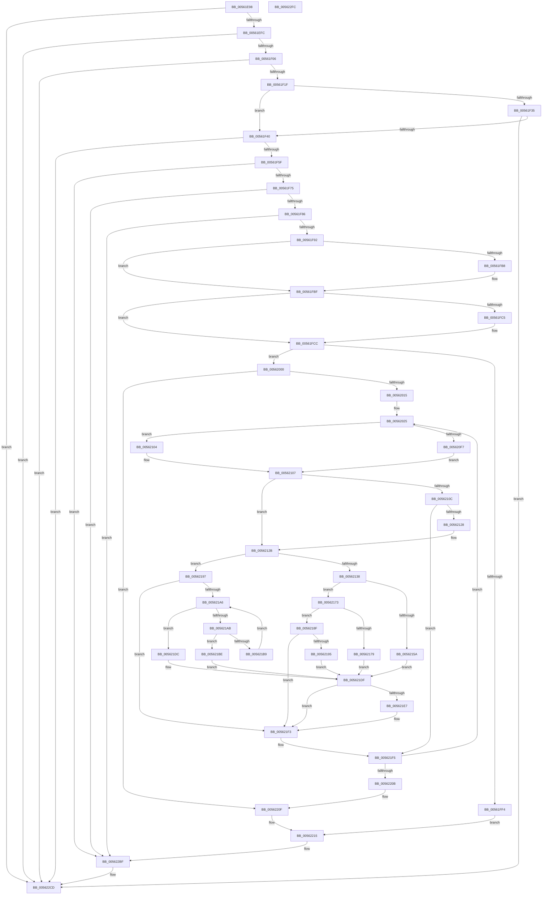

# HalpHpetDiscover

- RVA: `0x00561E98`–`0x005622FD` (길이 `1,125` bytes)
- VA: `0x0000000140561E98`
- 실행 섹션: `.text`
- PDB 이름 있음: `예`; PDB Function 태그: `아니요`
- unwind 정보 RVA: `0x000BC8F8`
- 디코드: `287`개 명령, `1,125/1,125` bytes 표시
- 미해석 바이트: `0` (있으면 어셈블리에 `.byte`로 보존)

> 이 문서는 커널 이미지의 기계어와 PDB 기호를 분석해 생성했습니다. 4번과 5번은 함수 원형과 자료형을 바이너리 사용 방식에서 추정한 C 해석이며 원본 소스 복구 결과는 아닙니다.

## 1. Dependencies

- 직접 호출 지점: **12**; 고유 호출 대상: **9**
- 직접 호출자로 확인된 함수: **1**
- RIP 상대 이미지 참조: **13**

### Outgoing calls
- `0x00561EEB` → [HalSocGetAcpiTable](HalSocGetAcpiTable_function_00561580.md) (function, `0x00561580`)
- `0x00561F12` → [HalSocRequestConfigurationData](HalSocRequestConfigurationData_function_00562ADC.md) (function, `0x00562ADC`)
- `0x00561F4A` → [HalMapIoSpace](../4F/HalMapIoSpace_function_004FCD40.md) (function, `0x004FCD40`)
- `0x00561F68` → [HalRegisterPermanentAddressUsage](HalRegisterPermanentAddressUsage_function_00561500.md) (function, `0x00561500`)
- `0x00561FAD` → [RtlCompareMemory](../6B/RtlCompareMemory_function_006BA670.md) (function, `0x006BA670`)
- `0x00562032` → [memset](../6C/memset_function_006C6C40.md) (function, `0x006C6C40`)
- `0x00562140` → [HalSocRequestConfigurationData](HalSocRequestConfigurationData_function_00562ADC.md) (function, `0x00562ADC`)
- `0x005621EE` → [HalpTimerRegister](HalpTimerRegister_function_005616BC.md) (function, `0x005616BC`)
- `0x00562222` → [memset](../6C/memset_function_006C6C40.md) (function, `0x006C6C40`)
- `0x005622BA` → [HalpTimerRegister](HalpTimerRegister_function_005616BC.md) (function, `0x005616BC`)
- `0x005622C8` → [HalpUnmapVirtualAddress](../3F/HalpUnmapVirtualAddress_function_003F8C30.md) (function, `0x003F8C30`)
- `0x005622D6` → [_security_check_cookie](../6A/_security_check_cookie_function_006AC640.md) (function, `0x006AC640`)

### Direct callers
- [HalpTimerRegisterBuiltinPluginsCommon](../54/HalpTimerRegisterBuiltinPluginsCommon_function_0054A014.md) at `0x0054A035`

### Static image references
- `0x00561EBB` → RVA `0x00E0A740` (`.data`; read)
- `0x00561F26` → RVA `0x00F8FBA8` (`.data`; write)
- `0x00561F5F` → RVA `0x00F8FBA8` (`.data`; read)
- `0x00561F96` → RVA `0x00F8FB9C` (`.data`; write)
- `0x00561FA6` → RVA `0x00025F14` (`.rdata`; read)
- `0x00561FC5` → RVA `0x00F8FBB8` (`.data`; write)
- `0x0056204A` → RVA `0x00562310` (`HalpHpetInitialize`; read)
- `0x00562060` → RVA `0x004B9760` (`HalpHpetAcknowledgeInterrupt`; read)
- `0x00562074` → RVA `0x004AC5C0` (`HalpHpetArmTimer`; read)
- `0x00562085` → RVA `0x005623A0` (`HalpHpetStop`; read)
- `0x00562130` → RVA `0x00F8FBB8` (`.data`; read)
- `0x005621C1` → RVA `0x00F8FBA0` (`.data`; read)
- `0x0056225F` → RVA `0x00379660` (`HalpHpetQueryCounter`; read)

## 2. Other-region calls and transfers

- 다른 실행 섹션으로 향하는 call: **0**
- 별도 외부 분기/꼬리 이동을 확인하지 못했습니다.

## 3. Assembly (complete function range)

```asm
00561E98  48 8B C4                        mov rax, rsp
00561E9B  48 89 58 08                     mov qword ptr [rax + 8], rbx
00561E9F  48 89 70 10                     mov qword ptr [rax + 0x10], rsi
00561EA3  48 89 78 18                     mov qword ptr [rax + 0x18], rdi
00561EA7  55                              push rbp
00561EA8  41 54                           push r12
00561EAA  41 55                           push r13
00561EAC  41 56                           push r14
00561EAE  41 57                           push r15
00561EB0  48 8D 68 C8                     lea rbp, [rax - 0x38]
00561EB4  48 81 EC 10 01 00 00            sub rsp, 0x110
00561EBB  48 8B 05 7E 88 8A 00            mov rax, qword ptr [rip + 0x8a887e]
00561EC2  48 33 C4                        xor rax, rsp
00561EC5  48 89 45 00                     mov qword ptr [rbp], rax
00561EC9  0F 57 C0                        xorps xmm0, xmm0
00561ECC  33 FF                           xor edi, edi
00561ECE  33 C0                           xor eax, eax
00561ED0  40 88 7C 24 20                  mov byte ptr [rsp + 0x20], dil
00561ED5  B9 48 50 45 54                  mov ecx, 0x54455048
00561EDA  40 88 7C 24 21                  mov byte ptr [rsp + 0x21], dil
00561EDF  0F 11 45 D8                     movups xmmword ptr [rbp - 0x28], xmm0
00561EE3  48 89 45 F8                     mov qword ptr [rbp - 8], rax
00561EE7  0F 11 45 E8                     movups xmmword ptr [rbp - 0x18], xmm0
00561EEB  E8 90 F6 FF FF                  call 0x140561580
00561EF0  4C 8B F0                        mov r14, rax
00561EF3  48 85 C0                        test rax, rax
00561EF6  0F 84 D1 03 00 00               je 0x1405622cd
00561EFC  40 38 78 28                     cmp byte ptr [rax + 0x28], dil
00561F00  0F 85 C7 03 00 00               jne 0x1405622cd
00561F06  44 8D 6F 01                     lea r13d, [rdi + 1]
00561F0A  41 8B CD                        mov ecx, r13d
00561F0D  4C 8D 44 24 21                  lea r8, [rsp + 0x21]
00561F12  E8 C5 0B 00 00                  call 0x140562adc
00561F17  85 C0                           test eax, eax
00561F19  0F 88 AE 03 00 00               js 0x1405622cd
00561F1F  49 8B 4E 2C                     mov rcx, qword ptr [r14 + 0x2c]
00561F23  48 8B C1                        mov rax, rcx
00561F26  48 89 0D 7B DC A2 00            mov qword ptr [rip + 0xa2dc7b], rcx
00561F2D  48 C1 E8 20                     shr rax, 0x20
00561F31  85 C0                           test eax, eax
00561F33  74 0B                           je 0x140561f40
00561F35  40 38 7C 24 21                  cmp byte ptr [rsp + 0x21], dil
00561F3A  0F 84 8D 03 00 00               je 0x1405622cd
00561F40  BB 00 04 00 00                  mov ebx, 0x400
00561F45  45 33 C0                        xor r8d, r8d
00561F48  8B D3                           mov edx, ebx
00561F4A  E8 F1 AD F9 FF                  call 0x1404fcd40
00561F4F  48 89 45 C8                     mov qword ptr [rbp - 0x38], rax
00561F53  4C 8B F8                        mov r15, rax
00561F56  48 85 C0                        test rax, rax
00561F59  0F 84 6E 03 00 00               je 0x1405622cd
00561F5F  48 8B 0D 42 DC A2 00            mov rcx, qword ptr [rip + 0xa2dc42]
00561F66  8B D3                           mov edx, ebx
00561F68  E8 93 F5 FF FF                  call 0x140561500
00561F6D  85 C0                           test eax, eax
00561F6F  0F 88 4A 03 00 00               js 0x1405622bf
00561F75  90                              nop
00561F76  41 8B 37                        mov esi, dword ptr [r15]
00561F79  8B DE                           mov ebx, esi
00561F7B  C1 EB 10                        shr ebx, 0x10
00561F7E  85 DB                           test ebx, ebx
00561F80  0F 84 39 03 00 00               je 0x1405622bf
00561F86  81 FB FF FF 00 00               cmp ebx, 0xffff
00561F8C  0F 84 2D 03 00 00               je 0x1405622bf
00561F92  49 8D 4E 0A                     lea rcx, [r14 + 0xa]
00561F96  C7 05 FC DB A2 00 02 00 00 00   mov dword ptr [rip + 0xa2dbfc], 2
00561FA0  41 B8 06 00 00 00               mov r8d, 6
00561FA6  48 8D 15 67 3F AC FF            lea rdx, [rip - 0x53c099]
00561FAD  E8 BE 86 15 00                  call 0x1406ba670
00561FB2  48 83 F8 06                     cmp rax, 6
00561FB6  75 07                           jne 0x140561fbf
00561FB8  44 89 2D DD DB A2 00            mov dword ptr [rip + 0xa2dbdd], r13d
00561FBF  0F BA E6 0F                     bt esi, 0xf
00561FC3  73 07                           jae 0x140561fcc
00561FC5  44 88 2D EC DB A2 00            mov byte ptr [rip + 0xa2dbec], r13b
00561FCC  48 BA 00 80 C6 A4 7E 8D 03 00   movabs rdx, 0x38d7ea4c68000
00561FD6  90                              nop
00561FD7  41 8B 47 04                     mov eax, dword ptr [r15 + 4]
00561FDB  8B C8                           mov ecx, eax
00561FDD  48 D1 E8                        shr rax, 1
00561FE0  48 03 C2                        add rax, rdx
00561FE3  33 D2                           xor edx, edx
00561FE5  48 F7 F1                        div rcx
00561FE8  48 89 45 D0                     mov qword ptr [rbp - 0x30], rax
00561FEC  81 FB DE 10 00 00               cmp ebx, 0x10de
00561FF2  75 0C                           jne 0x140562000
00561FF4  40 88 3D BD DB A2 00            mov byte ptr [rip + 0xa2dbbd], dil
00561FFB  E9 15 02 00 00                  jmp 0x140562215
00562000  C1 EE 08                        shr esi, 8
00562003  45 8B E5                        mov r12d, r13d
00562006  83 E6 1F                        and esi, 0x1f
00562009  41 03 F5                        add esi, r13d
0056200C  44 8B EF                        mov r13d, edi
0056200F  0F 84 FA 01 00 00               je 0x14056220f
00562015  8B D8                           mov ebx, eax
00562017  49 8D 87 00 01 00 00            lea rax, [r15 + 0x100]
0056201E  4C 8B F8                        mov r15, rax
00562021  48 89 5D C0                     mov qword ptr [rbp - 0x40], rbx
00562025  33 D2                           xor edx, edx
00562027  48 8D 4C 24 30                  lea rcx, [rsp + 0x30]
0056202C  41 B8 90 00 00 00               mov r8d, 0x90
00562032  E8 09 4C 16 00                  call 0x1406c6c40
00562037  89 7D EC                        mov dword ptr [rbp - 0x14], edi
0056203A  48 8D 45 D8                     lea rax, [rbp - 0x28]
0056203E  48 89 45 88                     mov qword ptr [rbp - 0x78], rax
00562042  41 8D 4D 01                     lea ecx, [r13 + 1]
00562046  48 89 7D F8                     mov qword ptr [rbp - 8], rdi
0056204A  48 8D 05 BF 02 00 00            lea rax, [rip + 0x2bf]
00562051  48 89 44 24 38                  mov qword ptr [rsp + 0x38], rax
00562056  41 BA 01 00 00 00               mov r10d, 1
0056205C  48 89 5D 98                     mov qword ptr [rbp - 0x68], rbx
00562060  48 8D 05 F9 76 F5 FF            lea rax, [rip - 0xa8907]
00562067  48 89 44 24 48                  mov qword ptr [rsp + 0x48], rax
0056206C  0F 57 C0                        xorps xmm0, xmm0
0056206F  F3 0F 7F 45 DC                  movdqu xmmword ptr [rbp - 0x24], xmm0
00562074  48 8D 05 45 A5 F4 FF            lea rax, [rip - 0xb5abb]
0056207B  44 89 54 24 30                  mov dword ptr [rsp + 0x30], r10d
00562080  48 89 44 24 50                  mov qword ptr [rsp + 0x50], rax
00562085  48 8D 05 14 03 00 00            lea rax, [rip + 0x314]
0056208C  48 89 44 24 58                  mov qword ptr [rsp + 0x58], rax
00562091  41 0F B6 46 34                  movzx eax, byte ptr [r14 + 0x34]
00562096  C1 E0 10                        shl eax, 0x10
00562099  0B C1                           or eax, ecx
0056209B  44 89 6D D8                     mov dword ptr [rbp - 0x28], r13d
0056209F  89 45 BC                        mov dword ptr [rbp - 0x44], eax
005620A2  48 8B 05 FF DA A2 00            mov rax, qword ptr [rip + 0xa2daff]
005620A9  48 89 45 F0                     mov qword ptr [rbp - 0x10], rax
005620AD  90                              nop
005620AE  41 8B 1F                        mov ebx, dword ptr [r15]
005620B1  81 E3 FB BF FF FF               and ebx, 0xffffbffb
005620B7  C7 44 24 34 90 00 00 00         mov dword ptr [rsp + 0x34], 0x90
005620BF  C7 45 94 1F 00 00 00            mov dword ptr [rbp - 0x6c], 0x1f
005620C6  C7 45 90 28 00 00 00            mov dword ptr [rbp - 0x70], 0x28
005620CD  44 89 55 B4                     mov dword ptr [rbp - 0x4c], r10d
005620D1  44 89 55 B0                     mov dword ptr [rbp - 0x50], r10d
005620D5  C7 45 B8 03 00 00 00            mov dword ptr [rbp - 0x48], 3
005620DC  44 89 55 A0                     mov dword ptr [rbp - 0x60], r10d
005620E0  C7 45 A4 30 00 00 00            mov dword ptr [rbp - 0x5c], 0x30
005620E7  41 89 1F                        mov dword ptr [r15], ebx
005620EA  89 4C 24 28                     mov dword ptr [rsp + 0x28], ecx
005620EE  F0 09 3C 24                     lock or dword ptr [rsp], edi
005620F2  F6 C3 10                        test bl, 0x10
005620F5  74 0D                           je 0x140562104
005620F7  41 8D 7A 6F                     lea edi, [r10 + 0x6f]
005620FB  44 88 55 E4                     mov byte ptr [rbp - 0x1c], r10b
005620FF  89 7D A4                        mov dword ptr [rbp - 0x5c], edi
00562102  EB 03                           jmp 0x140562107
00562104  8B 7D A4                        mov edi, dword ptr [rbp - 0x5c]
00562107  F6 C3 20                        test bl, 0x20
0056210A  74 1F                           je 0x14056212b
0056210C  B8 00 01 00 00                  mov eax, 0x100
00562111  0B D8                           or ebx, eax
00562113  41 89 1F                        mov dword ptr [r15], ebx
00562116  33 FF                           xor edi, edi
00562118  F0 09 3C 24                     lock or dword ptr [rsp], edi
0056211C  90                              nop
0056211D  41 8B 1F                        mov ebx, dword ptr [r15]
00562120  85 D8                           test eax, ebx
00562122  0F 84 CD 00 00 00               je 0x1405621f5
00562128  8B 7D A4                        mov edi, dword ptr [rbp - 0x5c]
0056212B  33 D2                           xor edx, edx
0056212D  89 5D F8                        mov dword ptr [rbp - 8], ebx
00562130  38 15 82 DA A2 00               cmp byte ptr [rip + 0xa2da82], dl
00562136  74 5F                           je 0x140562197
00562138  4C 8D 44 24 20                  lea r8, [rsp + 0x20]
0056213D  8D 4A 02                        lea ecx, [rdx + 2]
00562140  E8 97 09 00 00                  call 0x140562adc
00562145  0F B6 4C 24 20                  movzx ecx, byte ptr [rsp + 0x20]
0056214A  33 D2                           xor edx, edx
0056214C  85 C0                           test eax, eax
0056214E  0F 48 CA                        cmovs ecx, edx
00562151  88 4C 24 20                     mov byte ptr [rsp + 0x20], cl
00562155  45 85 ED                        test r13d, r13d
00562158  75 19                           jne 0x140562173
0056215A  0F BA EF 08                     bts edi, 8
0056215E  F6 D9                           neg cl
00562160  89 7D A4                        mov dword ptr [rbp - 0x5c], edi
00562163  1B C0                           sbb eax, eax
00562165  F7 D0                           not eax
00562167  83 E0 02                        and eax, 2
0056216A  89 45 A8                        mov dword ptr [rbp - 0x58], eax
0056216D  41 83 CC 04                     or r12d, 4
00562171  EB 6C                           jmp 0x1405621df
00562173  41 83 FD 01                     cmp r13d, 1
00562177  75 16                           jne 0x14056218f
00562179  B8 00 01 00 00                  mov eax, 0x100
0056217E  C7 45 A8 08 00 00 00            mov dword ptr [rbp - 0x58], 8
00562185  0B F8                           or edi, eax
00562187  89 7D A4                        mov dword ptr [rbp - 0x5c], edi
0056218A  44 0B E0                        or r12d, eax
0056218D  EB 50                           jmp 0x1405621df
0056218F  0F BA E3 0F                     bt ebx, 0xf
00562193  73 5E                           jae 0x1405621f3
00562195  EB 48                           jmp 0x1405621df
00562197  41 8B C4                        mov eax, r12d
0056219A  90                              nop
0056219B  45 8B 4F 04                     mov r9d, dword ptr [r15 + 4]
0056219F  F7 D0                           not eax
005621A1  44 23 C8                        and r9d, eax
005621A4  74 4D                           je 0x1405621f3
005621A6  80 FA 20                        cmp dl, 0x20
005621A9  73 31                           jae 0x1405621dc
005621AB  0F B6 CA                        movzx ecx, dl
005621AE  45 8B C2                        mov r8d, r10d
005621B1  41 D3 E0                        shl r8d, cl
005621B4  45 85 C1                        test r9d, r8d
005621B7  75 05                           jne 0x1405621be
005621B9  41 02 D2                        add dl, r10b
005621BC  EB E8                           jmp 0x1405621a6
005621BE  8B 7D A4                        mov edi, dword ptr [rbp - 0x5c]
005621C1  0F B7 05 D8 D9 A2 00            movzx eax, word ptr [rip + 0xa2d9d8]
005621C8  0F BA EF 09                     bts edi, 9
005621CC  03 C1                           add eax, ecx
005621CE  89 7D A4                        mov dword ptr [rbp - 0x5c], edi
005621D1  89 45 AC                        mov dword ptr [rbp - 0x54], eax
005621D4  45 0B E0                        or r12d, r8d
005621D7  88 55 DC                        mov byte ptr [rbp - 0x24], dl
005621DA  EB 03                           jmp 0x1405621df
005621DC  8B 7D A4                        mov edi, dword ptr [rbp - 0x5c]
005621DF  F7 C7 00 0F 00 00               test edi, 0xf00
005621E5  74 0C                           je 0x1405621f3
005621E7  33 D2                           xor edx, edx
005621E9  48 8D 4C 24 30                  lea rcx, [rsp + 0x30]
005621EE  E8 C9 F4 FF FF                  call 0x1405616bc
005621F3  33 FF                           xor edi, edi
005621F5  44 8B 6C 24 28                  mov r13d, dword ptr [rsp + 0x28]
005621FA  49 83 C7 20                     add r15, 0x20
005621FE  48 8B 5D C0                     mov rbx, qword ptr [rbp - 0x40]
00562202  44 3B EE                        cmp r13d, esi
00562205  0F 82 1A FE FF FF               jb 0x140562025
0056220B  4C 8B 7D C8                     mov r15, qword ptr [rbp - 0x38]
0056220F  41 BD 01 00 00 00               mov r13d, 1
00562215  33 D2                           xor edx, edx
00562217  48 8D 4C 24 30                  lea rcx, [rsp + 0x30]
0056221C  41 B8 90 00 00 00               mov r8d, 0x90
00562222  E8 19 4A 16 00                  call 0x1406c6c40
00562227  33 C0                           xor eax, eax
00562229  44 89 6C 24 30                  mov dword ptr [rsp + 0x30], r13d
0056222E  48 89 45 F8                     mov qword ptr [rbp - 8], rax
00562232  48 8D 4C 24 30                  lea rcx, [rsp + 0x30]
00562237  8B 45 D0                        mov eax, dword ptr [rbp - 0x30]
0056223A  0F 57 C0                        xorps xmm0, xmm0
0056223D  48 89 45 98                     mov qword ptr [rbp - 0x68], rax
00562241  33 D2                           xor edx, edx
00562243  0F 11 45 D8                     movups xmmword ptr [rbp - 0x28], xmm0
00562247  83 4D D8 FF                     or dword ptr [rbp - 0x28], 0xffffffff
0056224B  48 8D 45 D8                     lea rax, [rbp - 0x28]
0056224F  48 89 45 88                     mov qword ptr [rbp - 0x78], rax
00562253  48 8D 05 B6 00 00 00            lea rax, [rip + 0xb6]
0056225A  48 89 44 24 38                  mov qword ptr [rsp + 0x38], rax
0056225F  48 8D 05 FA 73 E1 FF            lea rax, [rip - 0x1e8c06]
00562266  48 89 44 24 40                  mov qword ptr [rsp + 0x40], rax
0056226B  48 8D 05 EE 74 F5 FF            lea rax, [rip - 0xa8b12]
00562272  48 89 44 24 48                  mov qword ptr [rsp + 0x48], rax
00562277  48 8D 05 42 A3 F4 FF            lea rax, [rip - 0xb5cbe]
0056227E  48 89 44 24 50                  mov qword ptr [rsp + 0x50], rax
00562283  0F 11 45 E8                     movups xmmword ptr [rbp - 0x18], xmm0
00562287  41 0F B6 46 34                  movzx eax, byte ptr [r14 + 0x34]
0056228C  C1 E0 10                        shl eax, 0x10
0056228F  89 45 BC                        mov dword ptr [rbp - 0x44], eax
00562292  C7 44 24 34 90 00 00 00         mov dword ptr [rsp + 0x34], 0x90
0056229A  C7 45 94 20 00 00 00            mov dword ptr [rbp - 0x6c], 0x20
005622A1  C7 45 90 28 00 00 00            mov dword ptr [rbp - 0x70], 0x28
005622A8  C7 45 B8 03 00 00 00            mov dword ptr [rbp - 0x48], 3
005622AF  44 89 6D A0                     mov dword ptr [rbp - 0x60], r13d
005622B3  C7 45 A4 02 00 00 00            mov dword ptr [rbp - 0x5c], 2
005622BA  E8 FD F3 FF FF                  call 0x1405616bc
005622BF  45 33 C0                        xor r8d, r8d
005622C2  41 8B D5                        mov edx, r13d
005622C5  49 8B CF                        mov rcx, r15
005622C8  E8 63 69 E9 FF                  call 0x1403f8c30
005622CD  33 C0                           xor eax, eax
005622CF  48 8B 4D 00                     mov rcx, qword ptr [rbp]
005622D3  48 33 CC                        xor rcx, rsp
005622D6  E8 65 A3 14 00                  call 0x1406ac640
005622DB  4C 8D 9C 24 10 01 00 00         lea r11, [rsp + 0x110]
005622E3  49 8B 5B 30                     mov rbx, qword ptr [r11 + 0x30]
005622E7  49 8B 73 38                     mov rsi, qword ptr [r11 + 0x38]
005622EB  49 8B 7B 40                     mov rdi, qword ptr [r11 + 0x40]
005622EF  49 8B E3                        mov rsp, r11
005622F2  41 5F                           pop r15
005622F4  41 5E                           pop r14
005622F6  41 5D                           pop r13
005622F8  41 5C                           pop r12
005622FA  5D                              pop rbp
005622FB  C3                              ret
005622FC  CC                              int3
```

## 4. C-style interpretation (structured pseudocode)

```c
__int64 __fastcall HalpHpetDiscover(void)
{
    __int64 result;
    __int64 v_r12;
    __int64 v_r15;
    __int64 v_rbx;
    __int64 v_rdi;
    __int64 v_rsi;
    __int64 v_rsp;
    unsigned __int64 v_stack_m100;
    unsigned int v_stack_m104;
    unsigned __int64 v_stack_m108;
    unsigned int v_stack_m110;
    unsigned __int8 v_stack_m117;
    unsigned __int8 v_stack_m118;
    unsigned int v_stack_m138;
    unsigned __int64 v_stack_m28;
    unsigned __int64 v_stack_mE0;
    unsigned __int64 v_stack_mE8;
    unsigned __int64 v_stack_mF0;
    unsigned __int64 v_stack_mF8;

    *(unsigned __int64 *)(v_rsp + 8) = v_rbx;
    *(unsigned __int64 *)(v_rsp + 16) = v_rsi;
    *(unsigned __int64 *)(v_rsp + 24) = v_rdi;
    v_rsp = (v_rsp) - (272);
    result = (*(unsigned __int64 *)(v_rip + 9078910)) ^ (v_rsp);
    *(unsigned __int64 *)(v_rsp - 56) = result;
    v_rdi = 0;
    result = 0;
    v_stack_m118 = 0;
    v_stack_m117 = 0;
    *(unsigned __int64 *)(v_rsp - 56 - 40) = v_xmm0;
    *(unsigned __int64 *)(v_rsp - 56 - 8) = 0;
    *(unsigned __int64 *)(v_rsp - 56 - 24) = v_xmm0;
    result = HalSocGetAcpiTable((unsigned int)(0x54455048ULL), a2, a3, a4);
    if (result == 0) goto loc_005622CD;
    if ((*(unsigned __int8 *)(result + 40)) != 0) goto loc_005622CD;
    result = HalSocRequestConfigurationData((unsigned int)((unsigned int)(v_rdi + 1)), a2, v_stack_m117, a4);
    if (sign_flag) goto loc_005622CD;
    *(unsigned __int64 *)(v_rip + 10673275) = *(unsigned __int64 *)(result + 44);
    result = (*(unsigned __int64 *)(result + 44)) >> (32);
    if ((unsigned int)(result) == 0) goto loc_00561F40;
    if (v_stack_m117 == 0) goto loc_005622CD;
loc_00561F40:
    a3 = 0;
    result = HalMapIoSpace(*(unsigned __int64 *)(result + 44), (unsigned int)((unsigned int)((unsigned int)(0x400ULL))), a3, a4);
    *(unsigned __int64 *)(v_rsp - 56 - 56) = result;
    if (result == 0) goto loc_005622CD;
    result = HalRegisterPermanentAddressUsage(*(unsigned __int64 *)(v_rip + 10673218), (unsigned int)((unsigned int)((unsigned int)(0x400ULL))), a3, a4);
    if (sign_flag) goto loc_005622BF;
    v_rbx = (unsigned int)(((unsigned int)((unsigned int)((unsigned int)(*(unsigned int *)(result))))) >> (16));
    if ((unsigned int)(v_rbx) == 0) goto loc_005622BF;
    if (((unsigned int)(v_rbx)) == 0xFFFFULL) goto loc_005622BF;
    *(unsigned int *)(v_rip + 10673148) = 2;
    result = RtlCompareMemory(result + 10, v_rip - 5488793, 6, a4);
    if (result == 6) {
        *(unsigned int *)(v_rip + 10673117) = (unsigned int)(v_rdi + 1);
    }
    if (result < 6) {
        *(unsigned __int8 *)(v_rip + 10673132) = (unsigned __int8)(v_rdi + 1);
    }
    result = ((unsigned int)(*(unsigned int *)(result + 4))) >> (1);
    result = (result) + (v_rip - 5488793);
    a2 = 0;
    *(unsigned __int64 *)(v_rsp - 56 - 48) = result;
    if (((unsigned int)(v_rbx)) != 0x10DEULL) goto loc_00562000;
    *(unsigned __int8 *)(v_rip + 10673085) = 0;
    goto loc_00562215;
loc_00562000:
    v_rsi = (unsigned int)(((unsigned int)(*(unsigned int *)(result))) >> (8));
    v_rsi = (unsigned int)((v_rsi) & (31));
    v_rsi = (unsigned int)((v_rsi) + ((unsigned int)(v_rdi + 1)));
    if (condition_is_equal) goto loc_0056220F;
    *(unsigned __int64 *)(v_rsp - 56 - 64) = (unsigned int)((unsigned int)(result));
loc_00562025:
    a2 = 0;
    result = memset(v_stack_m108, a2, 144, a4);
    *(unsigned int *)(v_rsp - 56 - 20) = 0;
    *(unsigned __int64 *)(v_rsp - 56 - 120) = v_rsp - 56 - 40;
    *(unsigned __int64 *)(v_rsp - 56 - 8) = 0;
    v_stack_m100 = v_rip + 703;
    *(unsigned __int64 *)(v_rsp - 56 - 104) = (unsigned int)((unsigned int)(result));
    v_stack_mF0 = v_rip - 690439;
    *(unsigned __int64 *)(v_rsp - 56 - 36) = v_xmm0;
    v_stack_m108 = 1;
    v_stack_mE8 = v_rip - 744123;
    v_stack_mE0 = v_rip + 788;
    result = (unsigned int)((*(unsigned __int8 *)(result + 52)) << (16));
    result = (unsigned int)((result) | ((unsigned int)(0 + 1)));
    *(unsigned int *)(v_rsp - 56 - 40) = 0;
    *(unsigned int *)(v_rsp - 56 - 68) = (unsigned int)(result);
    *(unsigned __int64 *)(v_rsp - 56 - 16) = *(unsigned __int64 *)(v_rip + 10672895);
    v_rbx = (unsigned int)(((unsigned int)(*(unsigned int *)(result + 256))) & (0xFFFFBFFBULL));
    v_stack_m104 = 144;
    *(unsigned int *)(v_rsp - 56 - 108) = 31;
    *(unsigned int *)(v_rsp - 56 - 112) = 40;
    *(unsigned int *)(v_rsp - 56 - 76) = 1;
    *(unsigned int *)(v_rsp - 56 - 80) = 1;
    *(unsigned int *)(v_rsp - 56 - 72) = 3;
    *(unsigned int *)(v_rsp - 56 - 96) = 1;
    *(unsigned int *)(v_rsp - 56 - 92) = 48;
    *(unsigned int *)(result + 256) = (unsigned int)(v_rbx);
    v_stack_m110 = (unsigned int)(0 + 1);
    if ((((unsigned __int8)(v_rbx)) & (16)) == 0) goto loc_00562104;
    *(unsigned __int8 *)(v_rsp - 56 - 28) = 1;
    *(unsigned int *)(v_rsp - 56 - 92) = (unsigned int)(1 + 111);
    goto loc_00562107;
loc_00562104:
loc_00562107:
    if ((((unsigned __int8)(v_rbx)) & (32)) == 0) goto loc_0056212B;
    v_rbx = (unsigned int)((v_rbx) | (256));
    *(unsigned int *)(result + 256) = (unsigned int)(v_rbx);
    v_rdi = 0;
    if (((256) & ((unsigned int)((unsigned int)(*(unsigned int *)(result + 256))))) == 0) goto loc_005621F5;
loc_0056212B:
    a2 = 0;
    *(unsigned int *)(v_rsp - 56 - 8) = (unsigned int)((unsigned int)(*(unsigned int *)(result + 256)));
    if ((*(unsigned __int8 *)(v_rip + 10672770)) == 0) goto loc_00562197;
    result = HalSocRequestConfigurationData(a2 + 2, a2, v_stack_m118, a4);
    a2 = 0;
    a1 = v_stack_m118;
    if (sign_flag) { a1 = 0; }
    v_stack_m118 = (unsigned __int8)(a1);
    if (0 != 0) goto loc_00562173;
    a1 = (unsigned __int8)(-(a1));
    *(unsigned int *)(v_rsp - 56 - 92) = (unsigned int)((unsigned int)(*(unsigned int *)(v_rsp - 56 - 92)));
    result = (unsigned int)(~(result));
    result = (unsigned int)((result) & (2));
    *(unsigned int *)(v_rsp - 56 - 88) = (unsigned int)(result);
    v_r12 = (unsigned int)(((unsigned int)((unsigned int)(v_rdi + 1))) | (4));
    goto loc_005621DF;
loc_00562173:
    if (0 != 1) goto loc_0056218F;
    *(unsigned int *)(v_rsp - 56 - 88) = 8;
    v_rdi = (unsigned int)(((unsigned int)(*(unsigned int *)(v_rsp - 56 - 92))) | (256));
    *(unsigned int *)(v_rsp - 56 - 92) = (unsigned int)(v_rdi);
    v_r12 = (unsigned int)((v_r12) | (256));
    goto loc_005621DF;
loc_0056218F:
    if (condition_is_above_or_equal) goto loc_005621F3;
    goto loc_005621DF;
loc_00562197:
    result = (unsigned int)(~((unsigned int)((unsigned int)(v_r12))));
    a4 = (unsigned int)(((unsigned int)(*(unsigned int *)(result + 256 + 4))) & ((unsigned int)(result)));
    if (condition_is_equal) goto loc_005621F3;
loc_005621A6:
    if (0 >= 32) goto loc_005621DC;
    a3 = (unsigned int)((1) << (0));
    if ((((unsigned int)(a4)) & ((unsigned int)(a3))) != 0) goto loc_005621BE;
    a2 = (unsigned __int8)((a2) + (1));
    goto loc_005621A6;
loc_005621BE:
    result = (unsigned int)((*(unsigned __int16 *)(v_rip + 10672600)) + (0));
    *(unsigned int *)(v_rsp - 56 - 92) = (unsigned int)((unsigned int)(*(unsigned int *)(v_rsp - 56 - 92)));
    *(unsigned int *)(v_rsp - 56 - 84) = (unsigned int)(result);
    v_r12 = (unsigned int)((v_r12) | ((unsigned int)(a3)));
    *(unsigned __int8 *)(v_rsp - 56 - 36) = (unsigned __int8)(a2);
    goto loc_005621DF;
loc_005621DC:
loc_005621DF:
    if ((((unsigned int)((unsigned int)(*(unsigned int *)(v_rsp - 56 - 92)))) & (0xF00ULL)) != 0) {
        a2 = 0;
        a1 = v_stack_m108;
        result = HalpTimerRegister(a1, a2, a3, a4);
    }
    v_rdi = 0;
loc_005621F5:
    v_r15 = (result + 256) + (32);
    if (((unsigned int)((unsigned int)(v_stack_m110))) < ((unsigned int)(v_rsi))) goto loc_00562025;
loc_0056220F:
loc_00562215:
    a2 = 0;
    result = memset(v_stack_m108, a2, 144, a4);
    result = 0;
    v_stack_m108 = 1;
    *(unsigned __int64 *)(v_rsp - 56 - 8) = 0;
    *(unsigned __int64 *)(v_rsp - 56 - 104) = (unsigned int)(*(unsigned int *)(v_rsp - 56 - 48));
    a2 = 0;
    *(unsigned __int64 *)(v_rsp - 56 - 40) = v_xmm0;
    *(unsigned __int64 *)(v_rsp - 56 - 120) = v_rsp - 56 - 40;
    v_stack_m100 = v_rip + 182;
    v_stack_mF8 = v_rip - 2001926;
    v_stack_mF0 = v_rip - 690962;
    v_stack_mE8 = v_rip - 744638;
    *(unsigned __int64 *)(v_rsp - 56 - 24) = v_xmm0;
    result = (unsigned int)((*(unsigned __int8 *)(result + 52)) << (16));
    *(unsigned int *)(v_rsp - 56 - 68) = (unsigned int)(result);
    v_stack_m104 = 144;
    *(unsigned int *)(v_rsp - 56 - 108) = 32;
    *(unsigned int *)(v_rsp - 56 - 112) = 40;
    *(unsigned int *)(v_rsp - 56 - 72) = 3;
    *(unsigned int *)(v_rsp - 56 - 96) = 1;
    *(unsigned int *)(v_rsp - 56 - 92) = 2;
    result = HalpTimerRegister(v_stack_m108, a2, 144, a4);
loc_005622BF:
    a3 = 0;
    result = HalpUnmapVirtualAddress(*(unsigned __int64 *)(v_rsp - 56 - 56), 1, a3, a4);
loc_005622CD:
    result = 0;
    a1 = (*(unsigned __int64 *)(v_rsp - 56)) ^ (v_rsp);
    result = _security_check_cookie(a1, 1, a3, a4);
    return result;
}
```

## 5. (Beta) C Style

```c
void HalpHpetDiscover(void)
{
    int64_t result;
    int64_t local_r12;
    int64_t local_r15;
    int64_t local_rbx;
    int64_t local_rdi;
    int64_t local_rsi;
    int64_t local_rsp;
    uint64_t v_stack_m100;
    uint32_t v_stack_m104;
    uint64_t v_stack_m108;
    uint32_t v_stack_m110;
    uint8_t v_stack_m117;
    uint8_t v_stack_m118;
    uint32_t v_stack_m138;
    uint64_t v_stack_m28;
    uint64_t v_stack_mE0;
    uint64_t v_stack_mE8;
    uint64_t v_stack_mF0;
    uint64_t v_stack_mF8;

    *(uint64_t *)(local_rsp + 0x8) = local_rbx;
    *(uint64_t *)(local_rsp + 0x10) = local_rsi;
    *(uint64_t *)(local_rsp + 0x18) = local_rdi;
    local_rsp = (local_rsp) - (272);
    result = (*(uint64_t *)(v_rip + 0x8A887E)) ^ (local_rsp);
    *(uint64_t *)(local_rsp - 0x38) = result;
    local_rdi = 0;
    result = 0;
    v_stack_m118 = 0;
    v_stack_m117 = 0;
    *(uint64_t *)(local_rsp - 0x38 - 0x28) = v_xmm0;
    *(uint64_t *)(local_rsp - 0x38 - 0x8) = 0;
    *(uint64_t *)(local_rsp - 0x38 - 0x18) = v_xmm0;
    result = HalSocGetAcpiTable((uint32_t)(0x54455048ULL), a2, a3, a4);
    if (result == 0) goto loc_005622CD;
    if ((*(uint8_t *)(result + 0x28)) != 0) goto loc_005622CD;
    result = HalSocRequestConfigurationData((uint32_t)((uint32_t)(local_rdi + 1)), a2, v_stack_m117, a4);
    if (sign_flag) goto loc_005622CD;
    *(uint64_t *)(v_rip + 0xA2DC7B) = *(uint64_t *)(result + 0x2C);
    result = (*(uint64_t *)(result + 0x2C)) >> (32);
    if ((uint32_t)(result) == 0) goto loc_00561F40;
    if (v_stack_m117 == 0) goto loc_005622CD;
loc_00561F40:
    a3 = 0;
    result = HalMapIoSpace(*(uint64_t *)(result + 0x2C), (uint32_t)((uint32_t)((uint32_t)(0x400ULL))), a3, a4);
    *(uint64_t *)(local_rsp - 0x38 - 0x38) = result;
    if (result == 0) goto loc_005622CD;
    result = HalRegisterPermanentAddressUsage(*(uint64_t *)(v_rip + 0xA2DC42), (uint32_t)((uint32_t)((uint32_t)(0x400ULL))), a3, a4);
    if (sign_flag) goto loc_005622BF;
    local_rbx = (uint32_t)(((uint32_t)((uint32_t)((uint32_t)(*(uint32_t *)(result))))) >> (16));
    if ((uint32_t)(local_rbx) == 0) goto loc_005622BF;
    if (((uint32_t)(local_rbx)) == 0xFFFFULL) goto loc_005622BF;
    *(uint32_t *)(v_rip + 0xA2DBFC) = 2;
    result = RtlCompareMemory(result + 10, v_rip - 5488793, 6, a4);
    if (result == 6) {
        *(uint32_t *)(v_rip + 0xA2DBDD) = (uint32_t)(local_rdi + 1);
    }
    if (result < 6) {
        *(uint8_t *)(v_rip + 0xA2DBEC) = (uint8_t)(local_rdi + 1);
    }
    result = ((uint32_t)(*(uint32_t *)(result + 0x4))) >> (1);
    result = (result) + (v_rip - 5488793);
    a2 = 0;
    *(uint64_t *)(local_rsp - 0x38 - 0x30) = result;
    if (((uint32_t)(local_rbx)) != 0x10DEULL) goto loc_00562000;
    *(uint8_t *)(v_rip + 0xA2DBBD) = 0;
    goto loc_00562215;
loc_00562000:
    local_rsi = (uint32_t)(((uint32_t)(*(uint32_t *)(result))) >> (8));
    local_rsi = (uint32_t)((local_rsi) & (31));
    local_rsi = (uint32_t)((local_rsi) + ((uint32_t)(local_rdi + 1)));
    if (condition_is_equal) goto loc_0056220F;
    *(uint64_t *)(local_rsp - 0x38 - 0x40) = (uint32_t)((uint32_t)(result));
loc_00562025:
    a2 = 0;
    result = memset(v_stack_m108, a2, 144, a4);
    *(uint32_t *)(local_rsp - 0x38 - 0x14) = 0;
    *(uint64_t *)(local_rsp - 0x38 - 0x78) = local_rsp - 56 - 40;
    *(uint64_t *)(local_rsp - 0x38 - 0x8) = 0;
    v_stack_m100 = v_rip + 703;
    *(uint64_t *)(local_rsp - 0x38 - 0x68) = (uint32_t)((uint32_t)(result));
    v_stack_mF0 = v_rip - 690439;
    *(uint64_t *)(local_rsp - 0x38 - 0x24) = v_xmm0;
    v_stack_m108 = 1;
    v_stack_mE8 = v_rip - 744123;
    v_stack_mE0 = v_rip + 788;
    result = (uint32_t)((*(uint8_t *)(result + 0x34)) << (16));
    result = (uint32_t)((result) | ((uint32_t)(0 + 1)));
    *(uint32_t *)(local_rsp - 0x38 - 0x28) = 0;
    *(uint32_t *)(local_rsp - 0x38 - 0x44) = (uint32_t)(result);
    *(uint64_t *)(local_rsp - 0x38 - 0x10) = *(uint64_t *)(v_rip + 0xA2DAFF);
    local_rbx = (uint32_t)(((uint32_t)(*(uint32_t *)(result + 0x100))) & (0xFFFFBFFBULL));
    v_stack_m104 = 144;
    *(uint32_t *)(local_rsp - 0x38 - 0x6C) = 31;
    *(uint32_t *)(local_rsp - 0x38 - 0x70) = 40;
    *(uint32_t *)(local_rsp - 0x38 - 0x4C) = 1;
    *(uint32_t *)(local_rsp - 0x38 - 0x50) = 1;
    *(uint32_t *)(local_rsp - 0x38 - 0x48) = 3;
    *(uint32_t *)(local_rsp - 0x38 - 0x60) = 1;
    *(uint32_t *)(local_rsp - 0x38 - 0x5C) = 48;
    *(uint32_t *)(result + 0x100) = (uint32_t)(local_rbx);
    v_stack_m110 = (uint32_t)(0 + 1);
    if ((((uint8_t)(local_rbx)) & (16)) == 0) goto loc_00562104;
    *(uint8_t *)(local_rsp - 0x38 - 0x1C) = 1;
    *(uint32_t *)(local_rsp - 0x38 - 0x5C) = (uint32_t)(1 + 111);
    goto loc_00562107;
loc_00562104:
loc_00562107:
    if ((((uint8_t)(local_rbx)) & (32)) == 0) goto loc_0056212B;
    local_rbx = (uint32_t)((local_rbx) | (256));
    *(uint32_t *)(result + 0x100) = (uint32_t)(local_rbx);
    local_rdi = 0;
    if (((256) & ((uint32_t)((uint32_t)(*(uint32_t *)(result + 0x100))))) == 0) goto loc_005621F5;
loc_0056212B:
    a2 = 0;
    *(uint32_t *)(local_rsp - 0x38 - 0x8) = (uint32_t)((uint32_t)(*(uint32_t *)(result + 0x100)));
    if ((*(uint8_t *)(v_rip + 0xA2DA82)) == 0) goto loc_00562197;
    result = HalSocRequestConfigurationData(a2 + 2, a2, v_stack_m118, a4);
    a2 = 0;
    a1 = v_stack_m118;
    if (sign_flag) { a1 = 0; }
    v_stack_m118 = (uint8_t)(a1);
    if (0 != 0) goto loc_00562173;
    a1 = (uint8_t)(-(a1));
    *(uint32_t *)(local_rsp - 0x38 - 0x5C) = (uint32_t)((uint32_t)(*(uint32_t *)(local_rsp - 0x38 - 0x5C)));
    result = (uint32_t)(~(result));
    result = (uint32_t)((result) & (2));
    *(uint32_t *)(local_rsp - 0x38 - 0x58) = (uint32_t)(result);
    local_r12 = (uint32_t)(((uint32_t)((uint32_t)(local_rdi + 1))) | (4));
    goto loc_005621DF;
loc_00562173:
    if (0 != 1) goto loc_0056218F;
    *(uint32_t *)(local_rsp - 0x38 - 0x58) = 8;
    local_rdi = (uint32_t)(((uint32_t)(*(uint32_t *)(local_rsp - 0x38 - 0x5C))) | (256));
    *(uint32_t *)(local_rsp - 0x38 - 0x5C) = (uint32_t)(local_rdi);
    local_r12 = (uint32_t)((local_r12) | (256));
    goto loc_005621DF;
loc_0056218F:
    if (condition_is_above_or_equal) goto loc_005621F3;
    goto loc_005621DF;
loc_00562197:
    result = (uint32_t)(~((uint32_t)((uint32_t)(local_r12))));
    a4 = (uint32_t)(((uint32_t)(*(uint32_t *)(result + 0x100 + 0x4))) & ((uint32_t)(result)));
    if (condition_is_equal) goto loc_005621F3;
loc_005621A6:
    if (0 >= 32) goto loc_005621DC;
    a3 = (uint32_t)((1) << (0));
    if ((((uint32_t)(a4)) & ((uint32_t)(a3))) != 0) goto loc_005621BE;
    a2 = (uint8_t)((a2) + (1));
    goto loc_005621A6;
loc_005621BE:
    result = (uint32_t)((*(uint16_t *)(v_rip + 0xA2D9D8)) + (0));
    *(uint32_t *)(local_rsp - 0x38 - 0x5C) = (uint32_t)((uint32_t)(*(uint32_t *)(local_rsp - 0x38 - 0x5C)));
    *(uint32_t *)(local_rsp - 0x38 - 0x54) = (uint32_t)(result);
    local_r12 = (uint32_t)((local_r12) | ((uint32_t)(a3)));
    *(uint8_t *)(local_rsp - 0x38 - 0x24) = (uint8_t)(a2);
    goto loc_005621DF;
loc_005621DC:
loc_005621DF:
    if ((((uint32_t)((uint32_t)(*(uint32_t *)(local_rsp - 0x38 - 0x5C)))) & (0xF00ULL)) != 0) {
        a2 = 0;
        a1 = v_stack_m108;
        result = HalpTimerRegister(a1, a2, a3, a4);
    }
    local_rdi = 0;
loc_005621F5:
    local_r15 = (result + 256) + (32);
    if (((uint32_t)((uint32_t)(v_stack_m110))) < ((uint32_t)(local_rsi))) goto loc_00562025;
loc_0056220F:
loc_00562215:
    a2 = 0;
    result = memset(v_stack_m108, a2, 144, a4);
    result = 0;
    v_stack_m108 = 1;
    *(uint64_t *)(local_rsp - 0x38 - 0x8) = 0;
    *(uint64_t *)(local_rsp - 0x38 - 0x68) = (uint32_t)(*(uint32_t *)(local_rsp - 0x38 - 0x30));
    a2 = 0;
    *(uint64_t *)(local_rsp - 0x38 - 0x28) = v_xmm0;
    *(uint64_t *)(local_rsp - 0x38 - 0x78) = local_rsp - 56 - 40;
    v_stack_m100 = v_rip + 182;
    v_stack_mF8 = v_rip - 2001926;
    v_stack_mF0 = v_rip - 690962;
    v_stack_mE8 = v_rip - 744638;
    *(uint64_t *)(local_rsp - 0x38 - 0x18) = v_xmm0;
    result = (uint32_t)((*(uint8_t *)(result + 0x34)) << (16));
    *(uint32_t *)(local_rsp - 0x38 - 0x44) = (uint32_t)(result);
    v_stack_m104 = 144;
    *(uint32_t *)(local_rsp - 0x38 - 0x6C) = 32;
    *(uint32_t *)(local_rsp - 0x38 - 0x70) = 40;
    *(uint32_t *)(local_rsp - 0x38 - 0x48) = 3;
    *(uint32_t *)(local_rsp - 0x38 - 0x60) = 1;
    *(uint32_t *)(local_rsp - 0x38 - 0x5C) = 2;
    result = HalpTimerRegister(v_stack_m108, a2, 144, a4);
loc_005622BF:
    a3 = 0;
    result = HalpUnmapVirtualAddress(*(uint64_t *)(local_rsp - 0x38 - 0x38), 1, a3, a4);
loc_005622CD:
    result = 0;
    a1 = (*(uint64_t *)(local_rsp - 0x38)) ^ (local_rsp);
    result = _security_check_cookie(a1, 1, a3, a4);
    return result;
}
```

## 6. Execution-region graph

[열기: 2D/3D 그래프와 함수 탐색 컨트롤 패널](../../../control-panel.html?section=text&rva=0x00561E98&view=graph)

- 2D 그래프는 위에서 아래로 흐르고, 3D 그래프는 빈 공간을 드래그해 회전합니다. Shift+드래그는 이동, 휠은 확대·축소, 함수 노드 선택은 대상 보고서 이동입니다.

### Static fallback


