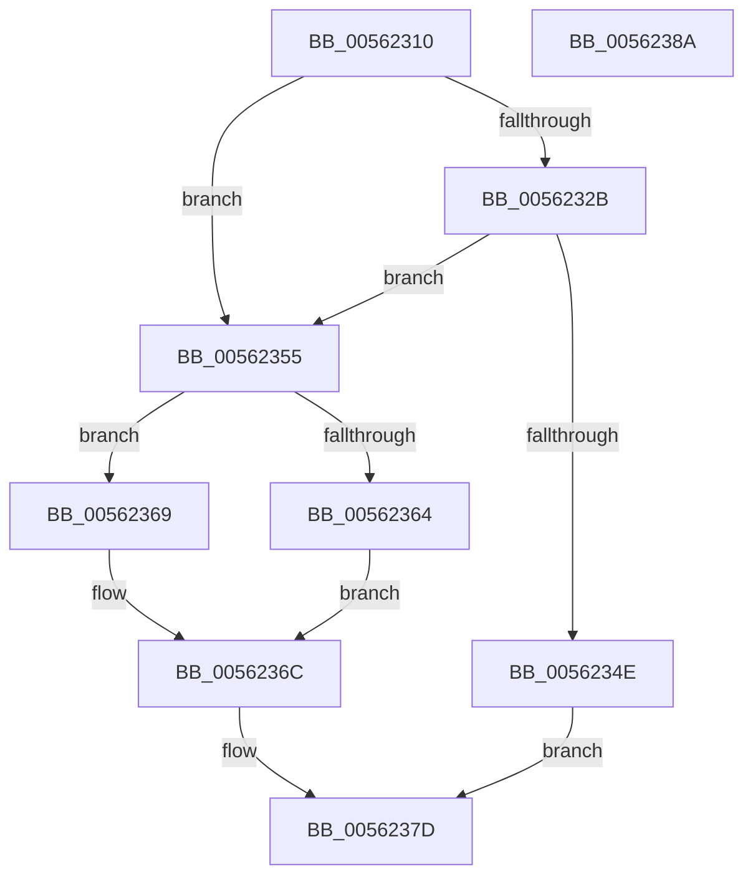

# HalpHpetInitialize

- RVA: `0x00562310`–`0x0056238B` (길이 `123` bytes)
- VA: `0x0000000140562310`
- 실행 섹션: `.text`
- PDB 이름 있음: `예`; PDB Function 태그: `아니요`
- unwind 정보 RVA: `0x0005CAAC`
- 디코드: `37`개 명령, `123/123` bytes 표시
- 미해석 바이트: `0` (있으면 어셈블리에 `.byte`로 보존)

> 이 문서는 커널 이미지의 기계어와 PDB 기호를 분석해 생성했습니다. 4번과 5번은 함수 원형과 자료형을 바이너리 사용 방식에서 추정한 C 해석이며 원본 소스 복구 결과는 아닙니다.

## 1. Dependencies

- 직접 호출 지점: **1**; 고유 호출 대상: **1**
- 직접 호출자로 확인된 함수: **0**
- RIP 상대 이미지 참조: **4**

### Outgoing calls
- `0x0056233A` → [HalMapIoSpace](../4F/HalMapIoSpace_function_004FCD40.md) (function, `0x004FCD40`)

### Direct callers
- 이 함수 시작 RVA로 연결되는 직접 call은 확인되지 않았습니다. 간접 호출은 완전히 역산할 수 없습니다.

### Static image references
- `0x0056231A` → RVA `0x00F8FBB0` (`.data`; read)
- `0x0056232B` → RVA `0x00F8FBA8` (`.data`; read)
- `0x0056233F` → RVA `0x00F8FBB0` (`.data`; write)
- `0x0056235C` → RVA `0x00F8FBB8` (`.data`; read)

## 2. Other-region calls and transfers

- 다른 실행 섹션으로 향하는 call: **0**
- 별도 외부 분기/꼬리 이동을 확인하지 못했습니다.

## 3. Assembly (complete function range)

```asm
00562310  48 89 5C 24 08                  mov qword ptr [rsp + 8], rbx
00562315  57                              push rdi
00562316  48 83 EC 20                     sub rsp, 0x20
0056231A  48 8B 15 8F D8 A2 00            mov rdx, qword ptr [rip + 0xa2d88f]
00562321  33 DB                           xor ebx, ebx
00562323  48 8B F9                        mov rdi, rcx
00562326  48 85 D2                        test rdx, rdx
00562329  75 2A                           jne 0x140562355
0056232B  48 8B 0D 76 D8 A2 00            mov rcx, qword ptr [rip + 0xa2d876]
00562332  45 33 C0                        xor r8d, r8d
00562335  BA 00 04 00 00                  mov edx, 0x400
0056233A  E8 01 AA F9 FF                  call 0x1404fcd40
0056233F  48 89 05 6A D8 A2 00            mov qword ptr [rip + 0xa2d86a], rax
00562346  48 8B D0                        mov rdx, rax
00562349  48 85 C0                        test rax, rax
0056234C  75 07                           jne 0x140562355
0056234E  BB 01 00 00 C0                  mov ebx, 0xc0000001
00562353  EB 28                           jmp 0x14056237d
00562355  90                              nop
00562356  8B 42 10                        mov eax, dword ptr [rdx + 0x10]
00562359  83 C8 01                        or eax, 1
0056235C  38 1D 56 D8 A2 00               cmp byte ptr [rip + 0xa2d856], bl
00562362  74 05                           je 0x140562369
00562364  83 C8 02                        or eax, 2
00562367  EB 03                           jmp 0x14056236c
00562369  83 E0 FD                        and eax, 0xfffffffd
0056236C  89 42 10                        mov dword ptr [rdx + 0x10], eax
0056236F  F0 09 1C 24                     lock or dword ptr [rsp], ebx
00562373  89 42 10                        mov dword ptr [rdx + 0x10], eax
00562376  F0 09 1C 24                     lock or dword ptr [rsp], ebx
0056237A  89 5F 08                        mov dword ptr [rdi + 8], ebx
0056237D  8B C3                           mov eax, ebx
0056237F  48 8B 5C 24 30                  mov rbx, qword ptr [rsp + 0x30]
00562384  48 83 C4 20                     add rsp, 0x20
00562388  5F                              pop rdi
00562389  C3                              ret
0056238A  CC                              int3
```

## 4. C-style interpretation (structured pseudocode)

```c
__int64 __fastcall HalpHpetInitialize(__int64 a1, __int64 a2, int a3)
{
    __int64 result;
    __int64 v_rbx;
    __int64 v_rsp;
    unsigned int v_stack_m28;
    unsigned __int64 v_stack_p8;

    v_stack_p8 = v_rbx;
    v_rsp = (v_rsp) - (32);
    v_rbx = 0;
    if (*(unsigned __int64 *)(v_rip + 10672271) != 0) goto loc_00562355;
    a3 = 0;
    result = HalMapIoSpace(*(unsigned __int64 *)(v_rip + 10672246), (unsigned int)(0x400ULL), a3, a4);
    *(unsigned __int64 *)(v_rip + 10672234) = result;
    if (result != 0) goto loc_00562355;
    goto loc_0056237D;
loc_00562355:
    result = (unsigned int)(((unsigned int)(*(unsigned int *)(result + 16))) | (1));
    if ((*(unsigned __int8 *)(v_rip + 10672214)) == ((unsigned __int8)((unsigned int)(0xC0000001ULL)))) goto loc_00562369;
    result = (unsigned int)((result) | (2));
    goto loc_0056236C;
loc_00562369:
    result = (unsigned int)((result) & (0xFFFFFFFDULL));
loc_0056236C:
    *(unsigned int *)(result + 16) = (unsigned int)(result);
    *(unsigned int *)(result + 16) = (unsigned int)(result);
    *(unsigned int *)(a1 + 8) = (unsigned int)((unsigned int)(0xC0000001ULL));
loc_0056237D:
    v_rsp = (v_rsp) + (32);
    return (unsigned int)((unsigned int)((unsigned int)(0xC0000001ULL)));
}
```

## 5. (Beta) C Style

```c
int64_t HalpHpetInitialize(void *Arg1, int64_t Arg2, int32_t Arg3)
{
    uint8_t *arg1 = (uint8_t *)Arg1;

    int64_t result;
    int64_t local_rbx;
    int64_t local_rsp;
    uint32_t v_stack_m28;
    uint64_t v_stack_p8;

    v_stack_p8 = local_rbx;
    local_rsp = (local_rsp) - (32);
    local_rbx = 0;
    if (*(uint64_t *)(v_rip + 0xA2D88F) != 0) goto loc_00562355;
    Arg3 = 0;
    result = HalMapIoSpace(*(uint64_t *)(v_rip + 0xA2D876), (uint32_t)(0x400ULL), Arg3, a4);
    *(uint64_t *)(v_rip + 0xA2D86A) = result;
    if (result != 0) goto loc_00562355;
    goto loc_0056237D;
loc_00562355:
    result = (uint32_t)(((uint32_t)(*(uint32_t *)(result + 0x10))) | (1));
    if ((*(uint8_t *)(v_rip + 0xA2D856)) == ((uint8_t)((uint32_t)(0xC0000001ULL)))) goto loc_00562369;
    result = (uint32_t)((result) | (2));
    goto loc_0056236C;
loc_00562369:
    result = (uint32_t)((result) & (0xFFFFFFFDULL));
loc_0056236C:
    *(uint32_t *)(result + 0x10) = (uint32_t)(result);
    *(uint32_t *)(result + 0x10) = (uint32_t)(result);
    *(uint32_t *)(arg1 + 0x8) = (uint32_t)((uint32_t)(0xC0000001ULL));
loc_0056237D:
    local_rsp = (local_rsp) + (32);
    return (uint32_t)((uint32_t)((uint32_t)(0xC0000001ULL)));
}
```

### 관측된 메모리 오프셋

구조체 형식이 확인되지 않은 접근은 인자 기준의 오프셋으로만 기록했습니다.

| 기준 인자 | 오프셋 표현 | 폭 (bit) | 접근 |
|---|---:|---:|---|
| `Arg1` | `+ 0x8` | `32` | `W` |

## 6. Execution-region graph

[열기: 2D/3D 그래프와 함수 탐색 컨트롤 패널](../../../control-panel.html?section=text&rva=0x00562310&view=graph)

- 2D 그래프는 위에서 아래로 흐르고, 3D 그래프는 빈 공간을 드래그해 회전합니다. Shift+드래그는 이동, 휠은 확대·축소, 함수 노드 선택은 대상 보고서 이동입니다.

### Static fallback


