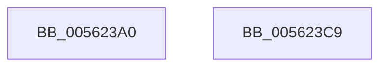

# HalpHpetStop

- RVA: `0x005623A0`–`0x005623CA` (길이 `42` bytes)
- VA: `0x00000001405623A0`
- 실행 섹션: `.text`
- PDB 이름 있음: `예`; PDB Function 태그: `아니요`
- unwind 정보 RVA: `0x000DB714`
- 디코드: `12`개 명령, `42/42` bytes 표시
- 미해석 바이트: `0` (있으면 어셈블리에 `.byte`로 보존)

> 이 문서는 커널 이미지의 기계어와 PDB 기호를 분석해 생성했습니다. 4번과 5번은 함수 원형과 자료형을 바이너리 사용 방식에서 추정한 C 해석이며 원본 소스 복구 결과는 아닙니다.

## 1. Dependencies

- 직접 호출 지점: **0**; 고유 호출 대상: **0**
- 직접 호출자로 확인된 함수: **0**
- RIP 상대 이미지 참조: **1**

### Outgoing calls
- 직접 디코드된 call 명령이 없습니다.

### Direct callers
- 이 함수 시작 RVA로 연결되는 직접 call은 확인되지 않았습니다. 간접 호출은 완전히 역산할 수 없습니다.

### Static image references
- `0x005623A9` → RVA `0x00F8FBB0` (`.data`; read)

## 2. Other-region calls and transfers

- 다른 실행 섹션으로 향하는 call: **0**
- 별도 외부 분기/꼬리 이동을 확인하지 못했습니다.

## 3. Assembly (complete function range)

```asm
005623A0  8B 41 20                        mov eax, dword ptr [rcx + 0x20]
005623A3  4C 63 01                        movsxd r8, dword ptr [rcx]
005623A6  83 E0 FB                        and eax, 0xfffffffb
005623A9  48 8B 15 00 D8 A2 00            mov rdx, qword ptr [rip + 0xa2d800]
005623B0  49 83 C0 08                     add r8, 8
005623B4  49 C1 E0 05                     shl r8, 5
005623B8  41 89 04 10                     mov dword ptr [r8 + rdx], eax
005623BC  F0 83 0C 24 00                  lock or dword ptr [rsp], 0
005623C1  83 61 08 00                     and dword ptr [rcx + 8], 0
005623C5  89 41 20                        mov dword ptr [rcx + 0x20], eax
005623C8  C3                              ret
005623C9  CC                              int3
```

## 4. C-style interpretation (structured pseudocode)

```c
__int64 __fastcall HalpHpetStop(__int64 a1)
{
    __int64 result;
    unsigned int v_stack_p0;

    result = (unsigned int)(((unsigned int)(*(unsigned int *)(a1 + 32))) & (0xFFFFFFFBULL));
    a3 = ((int)(*(unsigned int *)(a1))) + (8);
    a3 = (a3) << (5);
    *(unsigned int *)(a3 + *(unsigned __int64 *)(v_rip + 10672128) * 1) = (unsigned int)(result);
    *(unsigned int *)(a1 + 32) = (unsigned int)(result);
    return result;
}
```

## 5. (Beta) C Style

```c
int64_t HalpHpetStop(void *Arg1)
{
    uint8_t *arg1 = (uint8_t *)Arg1;

    int64_t result;
    uint32_t v_stack_p0;

    result = (uint32_t)(((uint32_t)(*(uint32_t *)(arg1 + 0x20))) & (0xFFFFFFFBULL));
    a3 = ((int32_t)(*(uint32_t *)(arg1))) + (8);
    a3 = (a3) << (5);
    *(uint32_t *)(a3 + *(uint64_t *)(v_rip + 0xA2D800) * 1) = (uint32_t)(result);
    *(uint32_t *)(arg1 + 0x20) = (uint32_t)(result);
    return result;
}
```

### 관측된 메모리 오프셋

구조체 형식이 확인되지 않은 접근은 인자 기준의 오프셋으로만 기록했습니다.

| 기준 인자 | 오프셋 표현 | 폭 (bit) | 접근 |
|---|---:|---:|---|
| `Arg1` | `+ 0x0` | `32` | `R` |
| `Arg1` | `+ 0x8` | `32` | `R/W` |
| `Arg1` | `+ 0x20` | `32` | `R` |
| `Arg1` | `+ 0x20` | `32` | `W` |

## 6. Execution-region graph

[열기: 2D/3D 그래프와 함수 탐색 컨트롤 패널](../../../control-panel.html?section=text&rva=0x005623A0&view=graph)

- 2D 그래프는 위에서 아래로 흐르고, 3D 그래프는 빈 공간을 드래그해 회전합니다. Shift+드래그는 이동, 휠은 확대·축소, 함수 노드 선택은 대상 보고서 이동입니다.

### Static fallback


