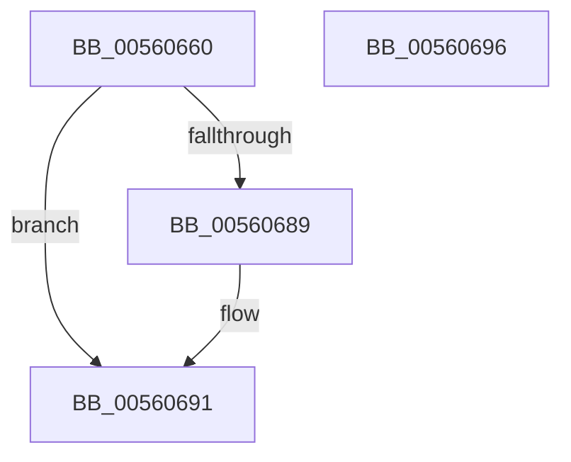

# HalpHvCounterUpdateCallback

- RVA: `0x00560660`–`0x00560697` (길이 `55` bytes)
- VA: `0x0000000140560660`
- 실행 섹션: `.text`
- PDB 이름 있음: `예`; PDB Function 태그: `아니요`
- unwind 정보 RVA: `0x0005D2F4`
- 디코드: `13`개 명령, `55/55` bytes 표시
- 미해석 바이트: `0` (있으면 어셈블리에 `.byte`로 보존)

> 이 문서는 커널 이미지의 기계어와 PDB 기호를 분석해 생성했습니다. 4번과 5번은 함수 원형과 자료형을 바이너리 사용 방식에서 추정한 C 해석이며 원본 소스 복구 결과는 아닙니다.

## 1. Dependencies

- 직접 호출 지점: **1**; 고유 호출 대상: **1**
- 직접 호출자로 확인된 함수: **0**
- RIP 상대 이미지 참조: **3**

### Outgoing calls
- `0x00560680` → [HalSocRequestApi](../4B/HalSocRequestApi_function_004B848C.md) (function, `0x004B848C`)

### Direct callers
- 이 함수 시작 RVA로 연결되는 직접 call은 확인되지 않았습니다. 간접 호출은 완전히 역산할 수 없습니다.

### Static image references
- `0x00560664` → RVA `0x00E11760` (`.data`; read)
- `0x00560679` → RVA `0x00560660` (`HalpHvCounterUpdateCallback`; read)
- `0x00560689` → RVA `0x00E11760` (`.data`; read/write)

## 2. Other-region calls and transfers

- 다른 실행 섹션으로 향하는 call: **0**
- 별도 외부 분기/꼬리 이동을 확인하지 못했습니다.

## 3. Assembly (complete function range)

```asm
00560660  48 83 EC 38                     sub rsp, 0x38
00560664  48 8D 05 F5 10 8B 00            lea rax, [rip + 0x8b10f5]
0056066B  41 B9 08 00 00 00               mov r9d, 8
00560671  44 8B C1                        mov r8d, ecx
00560674  48 89 44 24 20                  mov qword ptr [rsp + 0x20], rax
00560679  48 8D 15 E0 FF FF FF            lea rdx, [rip - 0x20]
00560680  E8 07 7E F5 FF                  call 0x1404b848c
00560685  85 C0                           test eax, eax
00560687  79 08                           jns 0x140560691
00560689  48 83 25 CF 10 8B 00 00         and qword ptr [rip + 0x8b10cf], 0
00560691  48 83 C4 38                     add rsp, 0x38
00560695  C3                              ret
00560696  CC                              int3
```

## 4. C-style interpretation (structured pseudocode)

```c
__int64 __fastcall HalpHvCounterUpdateCallback(int a1)
{
    __int64 result;
    __int64 v_rsp;
    unsigned __int64 v_stack_m18;

    v_rsp = (v_rsp) - (56);
    v_stack_m18 = v_rip + 9113845;
    result = HalSocRequestApi(a1, v_rip - 32, (unsigned int)(a1), 8);
    if (sign_flag) {
    }
    v_rsp = (v_rsp) + (56);
    return result;
}
```

## 5. (Beta) C Style

```c
int64_t HalpHvCounterUpdateCallback(int32_t Arg1)
{
    int64_t result;
    int64_t local_rsp;
    uint64_t v_stack_m18;

    local_rsp = (local_rsp) - (56);
    v_stack_m18 = v_rip + 9113845;
    result = HalSocRequestApi(Arg1, v_rip - 32, (uint32_t)(Arg1), 8);
    if (sign_flag) {
    }
    local_rsp = (local_rsp) + (56);
    return result;
}
```

## 6. Execution-region graph

[열기: 2D/3D 그래프와 함수 탐색 컨트롤 패널](../../../control-panel.html?section=text&rva=0x00560660&view=graph)

- 2D 그래프는 위에서 아래로 흐르고, 3D 그래프는 빈 공간을 드래그해 회전합니다. Shift+드래그는 이동, 휠은 확대·축소, 함수 노드 선택은 대상 보고서 이동입니다.

### Static fallback


