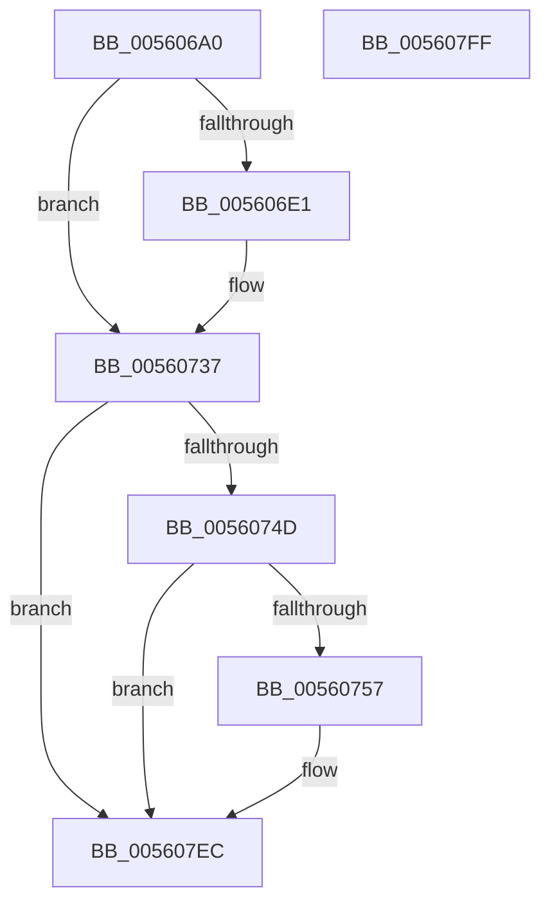

# HalpHvDiscover

- RVA: `0x005606A0`–`0x00560800` (길이 `352` bytes)
- VA: `0x00000001405606A0`
- 실행 섹션: `.text`
- PDB 이름 있음: `예`; PDB Function 태그: `아니요`
- unwind 정보 RVA: `0x000C4A34`
- 디코드: `74`개 명령, `352/352` bytes 표시
- 미해석 바이트: `0` (있으면 어셈블리에 `.byte`로 보존)

> 이 문서는 커널 이미지의 기계어와 PDB 기호를 분석해 생성했습니다. 4번과 5번은 함수 원형과 자료형을 바이너리 사용 방식에서 추정한 C 해석이며 원본 소스 복구 결과는 아닙니다.

## 1. Dependencies

- 직접 호출 지점: **7**; 고유 호출 대상: **5**
- 직접 호출자로 확인된 함수: **1**
- RIP 상대 이미지 참조: **9**

### Outgoing calls
- `0x005606D3` → [HalSocRequestApi](../4B/HalSocRequestApi_function_004B848C.md) (function, `0x004B848C`)
- `0x005606EA` → [memset](../6C/memset_function_006C6C40.md) (function, `0x006C6C40`)
- `0x00560732` → [HalpTimerRegister](HalpTimerRegister_function_005616BC.md) (function, `0x005616BC`)
- `0x00560740` → [HalSocRequestConfigurationData](HalSocRequestConfigurationData_function_00562ADC.md) (function, `0x00562ADC`)
- `0x00560760` → [memset](../6C/memset_function_006C6C40.md) (function, `0x006C6C40`)
- `0x00560774` → [HalQueryMaximumProcessorCount](../4A/HalQueryMaximumProcessorCount_function_004AC9A0.md) (function, `0x004AC9A0`)
- `0x005607E7` → [HalpTimerRegister](HalpTimerRegister_function_005616BC.md) (function, `0x005616BC`)

### Direct callers
- [HalpTimerRegisterBuiltinPluginsCommon](../54/HalpTimerRegisterBuiltinPluginsCommon_function_0054A014.md) at `0x0054A059`

### Static image references
- `0x005606BC` → RVA `0x00E11760` (`.data`; read)
- `0x005606C3` → RVA `0x00560660` (`HalpHvCounterUpdateCallback`; read)
- `0x005606EF` → RVA `0x0048FDC0` (`HalAdjustResourceList`; read)
- `0x00560705` → RVA `0x00378F50` (`HalpHvCounterQueryCounter`; read)
- `0x0056079E` → RVA `0x00560810` (`HalpHvTimerInitialize`; read)
- `0x005607B4` → RVA `0x00560930` (`HalpHvTimerSetInterruptVector`; read)
- `0x005607BF` → RVA `0x00378EB0` (`HalpHvTimerArm`; read)
- `0x005607CA` → RVA `0x00208920` (`HalpHvTimerAcknowledgeInterrupt`; read)
- `0x005607D5` → RVA `0x004C6AB0` (`HalpHvTimerStop`; read)

## 2. Other-region calls and transfers

- 다른 실행 섹션으로 향하는 call: **0**
- 별도 외부 분기/꼬리 이동을 확인하지 못했습니다.

## 3. Assembly (complete function range)

```asm
005606A0  48 89 7C 24 10                  mov qword ptr [rsp + 0x10], rdi
005606A5  55                              push rbp
005606A6  48 8D 6C 24 A9                  lea rbp, [rsp - 0x57]
005606AB  48 81 EC C0 00 00 00            sub rsp, 0xc0
005606B2  41 B9 08 00 00 00               mov r9d, 8
005606B8  C6 45 67 00                     mov byte ptr [rbp + 0x67], 0
005606BC  48 8D 05 9D 10 8B 00            lea rax, [rip + 0x8b109d]
005606C3  48 8D 15 96 FF FF FF            lea rdx, [rip - 0x6a]
005606CA  48 89 44 24 20                  mov qword ptr [rsp + 0x20], rax
005606CF  45 8D 41 FB                     lea r8d, [r9 - 5]
005606D3  E8 B4 7D F5 FF                  call 0x1404b848c
005606D8  BF 90 00 00 00                  mov edi, 0x90
005606DD  85 C0                           test eax, eax
005606DF  78 56                           js 0x140560737
005606E1  44 8B C7                        mov r8d, edi
005606E4  48 8D 4D C7                     lea rcx, [rbp - 0x39]
005606E8  33 D2                           xor edx, edx
005606EA  E8 51 65 16 00                  call 0x1406c6c40
005606EF  48 8D 05 CA F6 F2 FF            lea rax, [rip - 0xd0936]
005606F6  C7 45 C7 01 00 00 00            mov dword ptr [rbp - 0x39], 1
005606FD  48 89 45 CF                     mov qword ptr [rbp - 0x31], rax
00560701  48 8D 4D C7                     lea rcx, [rbp - 0x39]
00560705  48 8D 05 44 88 E1 FF            lea rax, [rip - 0x1e77bc]
0056070C  89 7D CB                        mov dword ptr [rbp - 0x35], edi
0056070F  33 D2                           xor edx, edx
00560711  48 89 45 D7                     mov qword ptr [rbp - 0x29], rax
00560715  C7 45 2B 40 00 00 00            mov dword ptr [rbp + 0x2b], 0x40
0056071C  C7 45 4F 08 00 00 00            mov dword ptr [rbp + 0x4f], 8
00560723  C7 45 3B 02 00 00 00            mov dword ptr [rbp + 0x3b], 2
0056072A  48 C7 45 2F 80 96 98 00         mov qword ptr [rbp + 0x2f], 0x989680
00560732  E8 85 0F 00 00                  call 0x1405616bc
00560737  4C 8D 45 67                     lea r8, [rbp + 0x67]
0056073B  B9 03 00 00 00                  mov ecx, 3
00560740  E8 97 23 00 00                  call 0x140562adc
00560745  85 C0                           test eax, eax
00560747  0F 88 9F 00 00 00               js 0x1405607ec
0056074D  80 7D 67 00                     cmp byte ptr [rbp + 0x67], 0
00560751  0F 84 95 00 00 00               je 0x1405607ec
00560757  4C 8B C7                        mov r8, rdi
0056075A  48 8D 4D C7                     lea rcx, [rbp - 0x39]
0056075E  33 D2                           xor edx, edx
00560760  E8 DB 64 16 00                  call 0x1406c6c40
00560765  48 83 65 1F 00                  and qword ptr [rbp + 0x1f], 0
0056076A  C7 45 C7 01 00 00 00            mov dword ptr [rbp - 0x39], 1
00560771  89 7D CB                        mov dword ptr [rbp - 0x35], edi
00560774  E8 27 C2 F4 FF                  call 0x1404ac9a0
00560779  33 D2                           xor edx, edx
0056077B  C7 45 2B 40 00 00 00            mov dword ptr [rbp + 0x2b], 0x40
00560782  48 C7 45 2F 80 96 98 00         mov qword ptr [rbp + 0x2f], 0x989680
0056078A  C7 45 4F 08 00 00 00            mov dword ptr [rbp + 0x4f], 8
00560791  8D 0C 40                        lea ecx, [rax + rax*2]
00560794  C7 45 3B 61 88 00 00            mov dword ptr [rbp + 0x3b], 0x8861
0056079B  C1 E1 03                        shl ecx, 3
0056079E  48 8D 05 6B 00 00 00            lea rax, [rip + 0x6b]
005607A5  48 89 45 CF                     mov qword ptr [rbp - 0x31], rax
005607A9  48 8D 05 A0 87 E1 FF            lea rax, [rip - 0x1e7860]
005607B0  48 89 45 D7                     mov qword ptr [rbp - 0x29], rax
005607B4  48 8D 05 75 01 00 00            lea rax, [rip + 0x175]
005607BB  48 89 45 0F                     mov qword ptr [rbp + 0xf], rax
005607BF  48 8D 05 EA 86 E1 FF            lea rax, [rip - 0x1e7916]
005607C6  48 89 45 E7                     mov qword ptr [rbp - 0x19], rax
005607CA  48 8D 05 4F 81 CA FF            lea rax, [rip - 0x357eb1]
005607D1  48 89 45 DF                     mov qword ptr [rbp - 0x21], rax
005607D5  48 8D 05 D4 62 F6 FF            lea rax, [rip - 0x99d2c]
005607DC  89 4D 27                        mov dword ptr [rbp + 0x27], ecx
005607DF  48 8D 4D C7                     lea rcx, [rbp - 0x39]
005607E3  48 89 45 EF                     mov qword ptr [rbp - 0x11], rax
005607E7  E8 D0 0E 00 00                  call 0x1405616bc
005607EC  48 8B BC 24 D8 00 00 00         mov rdi, qword ptr [rsp + 0xd8]
005607F4  33 C0                           xor eax, eax
005607F6  48 81 C4 C0 00 00 00            add rsp, 0xc0
005607FD  5D                              pop rbp
005607FE  C3                              ret
005607FF  CC                              int3
```

## 4. C-style interpretation (structured pseudocode)

```c
__int64 __fastcall HalpHvDiscover(void)
{
    __int64 result;
    __int64 v_rsp;
    unsigned int v_stack_m10;
    unsigned int v_stack_m24;
    unsigned __int64 v_stack_m30;
    unsigned int v_stack_m34;
    unsigned int v_stack_m38;
    unsigned __int64 v_stack_m40;
    unsigned __int64 v_stack_m50;
    unsigned __int64 v_stack_m5F;
    unsigned __int64 v_stack_m70;
    unsigned __int64 v_stack_m78;
    unsigned __int64 v_stack_m80;
    unsigned __int64 v_stack_m88;
    unsigned __int64 v_stack_m90;
    unsigned int v_stack_m94;
    unsigned __int64 v_stack_m98;
    unsigned __int64 v_stack_mA8;
    unsigned __int64 v_stack_p10;
    unsigned __int8 v_stack_p8;

    v_stack_p10 = v_rdi;
    v_rsp = (v_rsp) - (192);
    v_stack_p8 = 0;
    v_stack_mA8 = v_rip + 9113757;
    result = HalSocRequestApi(a1, v_rip - 106, 8 - 5, 8);
    if (!(sign_flag)) {
        a3 = 144;
        a1 = v_stack_m98;
        a2 = 0;
        result = memset(a1, a2, a3, 8);
        result = v_rip - 854326;
        v_stack_m98 = 1;
        v_stack_m90 = result;
        a1 = v_stack_m98;
        result = v_rip - 1996732;
        v_stack_m94 = 144;
        a2 = 0;
        v_stack_m88 = result;
        v_stack_m34 = 64;
        v_stack_m10 = 8;
        v_stack_m24 = 2;
        v_stack_m30 = 0x989680ULL;
        result = HalpTimerRegister(a1, a2, a3, 8);
    }
    result = HalSocRequestConfigurationData(3, a2, v_stack_p8, 8);
    if (sign_flag) goto loc_005607EC;
    if (v_stack_p8 != 0) {
        a3 = 144;
        a1 = v_stack_m98;
        a2 = 0;
        result = memset(a1, a2, a3, 8);
        v_stack_m98 = 1;
        v_stack_m94 = 144;
        result = HalQueryMaximumProcessorCount(a1, a2, a3, 8);
        a2 = 0;
        v_stack_m34 = 64;
        v_stack_m30 = 0x989680ULL;
        v_stack_m10 = 8;
        a1 = result + result * 2;
        v_stack_m24 = 0x8861ULL;
        a1 = (unsigned int)((a1) << (3));
        result = v_rip + 107;
        v_stack_m90 = result;
        result = v_rip - 1996896;
        v_stack_m88 = result;
        result = v_rip + 373;
        v_stack_m50 = result;
        result = v_rip - 1997078;
        v_stack_m78 = result;
        result = v_rip - 3505841;
        v_stack_m80 = result;
        result = v_rip - 630060;
        v_stack_m38 = (unsigned int)(a1);
        a1 = v_stack_m98;
        v_stack_m70 = result;
        result = HalpTimerRegister(a1, a2, a3, 8);
    }
    result = 0;
    v_rsp = (v_rsp) + (192);
    return result;
}
```

## 5. (Beta) C Style

```c
void HalpHvDiscover(void)
{
    int64_t result;
    int64_t local_rsp;
    uint32_t v_stack_m10;
    uint32_t v_stack_m24;
    uint64_t v_stack_m30;
    uint32_t v_stack_m34;
    uint32_t v_stack_m38;
    uint64_t v_stack_m40;
    uint64_t v_stack_m50;
    uint64_t v_stack_m5F;
    uint64_t v_stack_m70;
    uint64_t v_stack_m78;
    uint64_t v_stack_m80;
    uint64_t v_stack_m88;
    uint64_t v_stack_m90;
    uint32_t v_stack_m94;
    uint64_t v_stack_m98;
    uint64_t v_stack_mA8;
    uint64_t v_stack_p10;
    uint8_t v_stack_p8;

    v_stack_p10 = local_rdi;
    local_rsp = (local_rsp) - (192);
    v_stack_p8 = 0;
    v_stack_mA8 = v_rip + 9113757;
    result = HalSocRequestApi(a1, v_rip - 106, 8 - 5, 8);
    if (!(sign_flag)) {
        a3 = 144;
        a1 = v_stack_m98;
        a2 = 0;
        result = memset(a1, a2, a3, 8);
        result = v_rip - 854326;
        v_stack_m98 = 1;
        v_stack_m90 = result;
        a1 = v_stack_m98;
        result = v_rip - 1996732;
        v_stack_m94 = 144;
        a2 = 0;
        v_stack_m88 = result;
        v_stack_m34 = 64;
        v_stack_m10 = 8;
        v_stack_m24 = 2;
        v_stack_m30 = 0x989680ULL;
        result = HalpTimerRegister(a1, a2, a3, 8);
    }
    result = HalSocRequestConfigurationData(3, a2, v_stack_p8, 8);
    if (sign_flag) goto loc_005607EC;
    if (v_stack_p8 != 0) {
        a3 = 144;
        a1 = v_stack_m98;
        a2 = 0;
        result = memset(a1, a2, a3, 8);
        v_stack_m98 = 1;
        v_stack_m94 = 144;
        result = HalQueryMaximumProcessorCount(a1, a2, a3, 8);
        a2 = 0;
        v_stack_m34 = 64;
        v_stack_m30 = 0x989680ULL;
        v_stack_m10 = 8;
        a1 = result + result * 2;
        v_stack_m24 = 0x8861ULL;
        a1 = (uint32_t)((a1) << (3));
        result = v_rip + 107;
        v_stack_m90 = result;
        result = v_rip - 1996896;
        v_stack_m88 = result;
        result = v_rip + 373;
        v_stack_m50 = result;
        result = v_rip - 1997078;
        v_stack_m78 = result;
        result = v_rip - 3505841;
        v_stack_m80 = result;
        result = v_rip - 630060;
        v_stack_m38 = (uint32_t)(a1);
        a1 = v_stack_m98;
        v_stack_m70 = result;
        result = HalpTimerRegister(a1, a2, a3, 8);
    }
    result = 0;
    local_rsp = (local_rsp) + (192);
    return result;
}
```

## 6. Execution-region graph

[열기: 2D/3D 그래프와 함수 탐색 컨트롤 패널](../../../control-panel.html?section=text&rva=0x005606A0&view=graph)

- 2D 그래프는 위에서 아래로 흐르고, 3D 그래프는 빈 공간을 드래그해 회전합니다. Shift+드래그는 이동, 휠은 확대·축소, 함수 노드 선택은 대상 보고서 이동입니다.

### Static fallback


