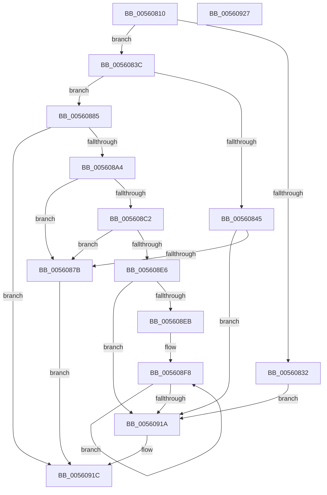

# HalpHvTimerInitialize

- RVA: `0x00560810`–`0x00560928` (길이 `280` bytes)
- VA: `0x0000000140560810`
- 실행 섹션: `.text`
- PDB 이름 있음: `예`; PDB Function 태그: `아니요`
- unwind 정보 RVA: `0x0006E5F8`
- 디코드: `73`개 명령, `280/280` bytes 표시
- 미해석 바이트: `0` (있으면 어셈블리에 `.byte`로 보존)

> 이 문서는 커널 이미지의 기계어와 PDB 기호를 분석해 생성했습니다. 4번과 5번은 함수 원형과 자료형을 바이너리 사용 방식에서 추정한 C 해석이며 원본 소스 복구 결과는 아닙니다.

## 1. Dependencies

- 직접 호출 지점: **6**; 고유 호출 대상: **5**
- 직접 호출자로 확인된 함수: **0**
- RIP 상대 이미지 참조: **3**

### Outgoing calls
- `0x00560832` → [HalpHvTimerAcknowledgeInterrupt](../20/HalpHvTimerAcknowledgeInterrupt_function_00208920.md) (function, `0x00208920`)
- `0x00560868` → [guard_dispatch_icall](../6B/guard_dispatch_icall_function_006BAAD0.md) (function, `0x006BAAD0`)
- `0x0056089B` → [HalSocRequestApi](../4B/HalSocRequestApi_function_004B848C.md) (function, `0x004B848C`)
- `0x005608A4` → [HalQueryMaximumProcessorCount](../4A/HalQueryMaximumProcessorCount_function_004AC9A0.md) (function, `0x004AC9A0`)
- `0x005608B8` → [guard_dispatch_icall](../6B/guard_dispatch_icall_function_006BAAD0.md) (function, `0x006BAAD0`)
- `0x005608D5` → [HalMapIoSpace](../4F/HalMapIoSpace_function_004FCD40.md) (function, `0x004FCD40`)

### Direct callers
- 이 함수 시작 RVA로 연결되는 직접 call은 확인되지 않았습니다. 간접 호출은 완전히 역산할 수 없습니다.

### Static image references
- `0x0056083C` → RVA `0x00FC1ED0` (`.data`; read)
- `0x00560861` → RVA `0x00FC1E68` (`.data`; read)
- `0x00560887` → RVA `0x00E11758` (`.data`; read)

## 2. Other-region calls and transfers

- 다른 실행 섹션으로 향하는 call: **0**
- 별도 외부 분기/꼬리 이동을 확인하지 못했습니다.

## 3. Assembly (complete function range)

```asm
00560810  48 89 5C 24 08                  mov qword ptr [rsp + 8], rbx
00560815  57                              push rdi
00560816  48 83 EC 30                     sub rsp, 0x30
0056081A  65 44 8B 04 25 A4 01 00 00      mov r8d, dword ptr gs:[0x1a4]
00560823  48 8B D9                        mov rbx, rcx
00560826  4B 8D 3C 40                     lea rdi, [r8 + r8*2]
0056082A  48 83 7C F9 08 00               cmp qword ptr [rcx + rdi*8 + 8], 0
00560830  74 0A                           je 0x14056083c
00560832  E8 E9 80 CA FF                  call 0x140208920
00560837  E9 DE 00 00 00                  jmp 0x14056091a
0056083C  80 3D 8D 16 A6 00 00            cmp byte ptr [rip + 0xa6168d], 0
00560843  74 40                           je 0x140560885
00560845  B9 83 00 00 40                  mov ecx, 0x40000083
0056084A  0F 32                           rdmsr
0056084C  48 C1 E2 20                     shl rdx, 0x20
00560850  41 8B C8                        mov ecx, r8d
00560853  48 0B C2                        or rax, rdx
00560856  48 25 00 F0 FF FF               and rax, 0xfffffffffffff000
0056085C  48 89 44 FB 10                  mov qword ptr [rbx + rdi*8 + 0x10], rax
00560861  48 8B 05 00 16 A6 00            mov rax, qword ptr [rip + 0xa61600]
00560868  E8 63 A2 15 00                  call 0x1406baad0
0056086D  48 89 44 FB 08                  mov qword ptr [rbx + rdi*8 + 8], rax
00560872  48 85 C0                        test rax, rax
00560875  0F 85 9F 00 00 00               jne 0x14056091a
0056087B  B8 9A 00 00 C0                  mov eax, 0xc000009a
00560880  E9 97 00 00 00                  jmp 0x14056091c
00560885  33 D2                           xor edx, edx
00560887  48 8D 05 CA 0E 8B 00            lea rax, [rip + 0x8b0eca]
0056088E  48 89 44 24 20                  mov qword ptr [rsp + 0x20], rax
00560893  44 8D 4A 08                     lea r9d, [rdx + 8]
00560897  44 8D 42 04                     lea r8d, [rdx + 4]
0056089B  E8 EC 7B F5 FF                  call 0x1404b848c
005608A0  85 C0                           test eax, eax
005608A2  78 78                           js 0x14056091c
005608A4  E8 F7 C0 F4 FF                  call 0x1404ac9a0
005608A9  8B F8                           mov edi, eax
005608AB  48 83 C9 FF                     or rcx, 0xffffffffffffffff
005608AF  48 8B 05 A2 0E 8B 00            mov rax, qword ptr [rip + 0x8b0ea2]
005608B6  8B D7                           mov edx, edi
005608B8  E8 13 A2 15 00                  call 0x1406baad0
005608BD  48 85 C0                        test rax, rax
005608C0  74 B9                           je 0x14056087b
005608C2  8B D7                           mov edx, edi
005608C4  48 89 43 10                     mov qword ptr [rbx + 0x10], rax
005608C8  48 C1 E2 0C                     shl rdx, 0xc
005608CC  41 B8 01 00 00 00               mov r8d, 1
005608D2  48 8B C8                        mov rcx, rax
005608D5  E8 66 C4 F9 FF                  call 0x1404fcd40
005608DA  48 8D 4B 08                     lea rcx, [rbx + 8]
005608DE  48 89 01                        mov qword ptr [rcx], rax
005608E1  48 85 C0                        test rax, rax
005608E4  74 95                           je 0x14056087b
005608E6  83 FF 01                        cmp edi, 1
005608E9  76 2F                           jbe 0x14056091a
005608EB  48 83 C3 20                     add rbx, 0x20
005608EF  8D 57 FF                        lea edx, [rdi - 1]
005608F2  41 B8 00 10 00 00               mov r8d, 0x1000
005608F8  48 8B 41 08                     mov rax, qword ptr [rcx + 8]
005608FC  49 03 C0                        add rax, r8
005608FF  48 89 43 08                     mov qword ptr [rbx + 8], rax
00560903  48 8B 01                        mov rax, qword ptr [rcx]
00560906  48 8D 49 18                     lea rcx, [rcx + 0x18]
0056090A  49 03 C0                        add rax, r8
0056090D  48 89 03                        mov qword ptr [rbx], rax
00560910  48 8D 5B 18                     lea rbx, [rbx + 0x18]
00560914  48 83 EA 01                     sub rdx, 1
00560918  75 DE                           jne 0x1405608f8
0056091A  33 C0                           xor eax, eax
0056091C  48 8B 5C 24 40                  mov rbx, qword ptr [rsp + 0x40]
00560921  48 83 C4 30                     add rsp, 0x30
00560925  5F                              pop rdi
00560926  C3                              ret
00560927  CC                              int3
```

## 4. C-style interpretation (structured pseudocode)

```c
__int64 __fastcall HalpHvTimerInitialize(__int64 a1, __int64 a2)
{
    __int64 result;
    __int64 v_rbx;
    __int64 v_rsp;
    unsigned __int64 v_stack_m18;
    unsigned __int64 v_stack_p8;

    v_stack_p8 = v_rbx;
    v_rsp = (v_rsp) - (48);
    if ((*(unsigned __int64 *)(a1 + (unsigned int)(*(unsigned int *)(gs_base + (0 + 420))) + (unsigned int)(*(unsigned int *)(gs_base + (0 + 420))) * 2 * 8 + 8)) == 0) goto loc_0056083C;
    result = HalpHvTimerAcknowledgeInterrupt(a1, a2, (unsigned int)(*(unsigned int *)(gs_base + (0 + 420))), a4);
    goto loc_0056091A;
loc_0056083C:
    if ((*(unsigned __int8 *)(v_rip + 10884749)) == 0) goto loc_00560885;
    a2 = (a2) << (32);
    result = (result) | (a2);
    result = (result) & (0xFFFFFFFFFFFFF000ULL);
    *(unsigned __int64 *)(a1 + (unsigned int)(*(unsigned int *)(gs_base + (0 + 420))) + (unsigned int)(*(unsigned int *)(gs_base + (0 + 420))) * 2 * 8 + 16) = result;
    result = guard_dispatch_icall((unsigned int)((unsigned int)((unsigned int)(*(unsigned int *)(gs_base + (0 + 420))))), a2, (unsigned int)(*(unsigned int *)(gs_base + (0 + 420))), a4);
    *(unsigned __int64 *)(a1 + (unsigned int)(*(unsigned int *)(gs_base + (0 + 420))) + (unsigned int)(*(unsigned int *)(gs_base + (0 + 420))) * 2 * 8 + 8) = result;
    if (result != 0) goto loc_0056091A;
loc_0056087B:
    goto loc_0056091C;
loc_00560885:
    a2 = 0;
    v_stack_m18 = v_rip + 9113290;
    result = HalSocRequestApi((unsigned int)((unsigned int)((unsigned int)(*(unsigned int *)(gs_base + (0 + 420))))), a2, a2 + 4, a2 + 8);
    if (sign_flag) goto loc_0056091C;
    result = HalQueryMaximumProcessorCount((unsigned int)((unsigned int)((unsigned int)(*(unsigned int *)(gs_base + (0 + 420))))), a2, a2 + 4, a2 + 8);
    a1 = ((unsigned int)((unsigned int)((unsigned int)(*(unsigned int *)(gs_base + (0 + 420)))))) | (-1);
    result = guard_dispatch_icall(a1, (unsigned int)((unsigned int)((unsigned int)((unsigned int)(result)))), a2 + 4, a2 + 8);
    if (result == 0) goto loc_0056087B;
    *(unsigned __int64 *)(a1 + 16) = result;
    a2 = ((unsigned int)((unsigned int)((unsigned int)((unsigned int)(result))))) << (12);
    result = HalMapIoSpace(result, a2, 1, a2 + 8);
    *(unsigned __int64 *)(a1 + 8) = result;
    if (result == 0) goto loc_0056087B;
    if (((unsigned int)((unsigned int)((unsigned int)(result)))) <= 1) goto loc_0056091A;
    v_rbx = (a1) + (32);
loc_005608F8:
    result = (*(unsigned __int64 *)(a1 + 8 + 8)) + ((unsigned int)(0x1000ULL));
    *(unsigned __int64 *)(v_rbx + 8) = result;
    result = (*(unsigned __int64 *)(a1 + 8)) + ((unsigned int)(0x1000ULL));
    *(unsigned __int64 *)(v_rbx) = result;
    a2 = ((unsigned int)((unsigned int)(result)) - 1) - (1);
    if (condition_is_not_equal) goto loc_005608F8;
loc_0056091A:
    result = 0;
loc_0056091C:
    v_rsp = (v_rsp) + (48);
    return result;
}
```

## 5. (Beta) C Style

```c
int64_t HalpHvTimerInitialize(void *Arg1, int64_t Arg2)
{
    uint8_t *arg1 = (uint8_t *)Arg1;

    int64_t result;
    int64_t local_rbx;
    int64_t local_rsp;
    uint64_t v_stack_m18;
    uint64_t v_stack_p8;

    v_stack_p8 = local_rbx;
    local_rsp = (local_rsp) - (48);
    if ((*(uint64_t *)(arg1 + (uint32_t)(*(uint32_t *)(gs_base + (0 + 0x1A4))) + (uint32_t)(*(uint32_t *)(gs_base + (0 + 0x1A4))) * 2 * 8 + 0x8)) == 0) goto loc_0056083C;
    result = HalpHvTimerAcknowledgeInterrupt(Arg1, Arg2, (uint32_t)(*(uint32_t *)(gs_base + (0 + 0x1A4))), a4);
    goto loc_0056091A;
loc_0056083C:
    if ((*(uint8_t *)(v_rip + 0xA6168D)) == 0) goto loc_00560885;
    Arg2 = (Arg2) << (32);
    result = (result) | (Arg2);
    result = (result) & (0xFFFFFFFFFFFFF000ULL);
    *(uint64_t *)(arg1 + (uint32_t)(*(uint32_t *)(gs_base + (0 + 0x1A4))) + (uint32_t)(*(uint32_t *)(gs_base + (0 + 0x1A4))) * 2 * 8 + 0x10) = result;
    result = guard_dispatch_icall((uint32_t)((uint32_t)((uint32_t)(*(uint32_t *)(gs_base + (0 + 0x1A4))))), Arg2, (uint32_t)(*(uint32_t *)(gs_base + (0 + 0x1A4))), a4);
    *(uint64_t *)(arg1 + (uint32_t)(*(uint32_t *)(gs_base + (0 + 0x1A4))) + (uint32_t)(*(uint32_t *)(gs_base + (0 + 0x1A4))) * 2 * 8 + 0x8) = result;
    if (result != 0) goto loc_0056091A;
loc_0056087B:
    goto loc_0056091C;
loc_00560885:
    Arg2 = 0;
    v_stack_m18 = v_rip + 9113290;
    result = HalSocRequestApi((uint32_t)((uint32_t)((uint32_t)(*(uint32_t *)(gs_base + (0 + 0x1A4))))), Arg2, Arg2 + 4, Arg2 + 8);
    if (sign_flag) goto loc_0056091C;
    result = HalQueryMaximumProcessorCount((uint32_t)((uint32_t)((uint32_t)(*(uint32_t *)(gs_base + (0 + 0x1A4))))), Arg2, Arg2 + 4, Arg2 + 8);
    Arg1 = ((uint32_t)((uint32_t)((uint32_t)(*(uint32_t *)(gs_base + (0 + 0x1A4)))))) | (-1);
    result = guard_dispatch_icall(Arg1, (uint32_t)((uint32_t)((uint32_t)((uint32_t)(result)))), Arg2 + 4, Arg2 + 8);
    if (result == 0) goto loc_0056087B;
    *(uint64_t *)(arg1 + 0x10) = result;
    Arg2 = ((uint32_t)((uint32_t)((uint32_t)((uint32_t)(result))))) << (12);
    result = HalMapIoSpace(result, Arg2, 1, Arg2 + 8);
    *(uint64_t *)(arg1 + 0x8) = result;
    if (result == 0) goto loc_0056087B;
    if (((uint32_t)((uint32_t)((uint32_t)(result)))) <= 1) goto loc_0056091A;
    local_rbx = (Arg1) + (32);
loc_005608F8:
    result = (*(uint64_t *)(arg1 + 0x8 + 0x8)) + ((uint32_t)(0x1000ULL));
    *(uint64_t *)(local_rbx + 0x8) = result;
    result = (*(uint64_t *)(arg1 + 0x8)) + ((uint32_t)(0x1000ULL));
    *(uint64_t *)(local_rbx) = result;
    Arg2 = ((uint32_t)((uint32_t)(result)) - 1) - (1);
    if (condition_is_not_equal) goto loc_005608F8;
loc_0056091A:
    result = 0;
loc_0056091C:
    local_rsp = (local_rsp) + (48);
    return result;
}
```

### 관측된 메모리 오프셋

구조체 형식이 확인되지 않은 접근은 인자 기준의 오프셋으로만 기록했습니다.

| 기준 인자 | 오프셋 표현 | 폭 (bit) | 접근 |
|---|---:|---:|---|
| `Arg1` | `+ 0x0` | `64` | `R` |
| `Arg1` | `+ 0x0` | `64` | `W` |
| `Arg1` | `+ 0x8` | `64` | `R` |
| `Arg1` | `+ 0x8` | `64` | `W` |
| `Arg1` | `+ 0x8 + rdi*8` | `64` | `R` |
| `Arg1` | `+ 0x8 + rdi*8` | `64` | `W` |
| `Arg1` | `+ 0x10` | `64` | `W` |
| `Arg1` | `+ 0x10 + rdi*8` | `64` | `W` |
| `Arg1` | `+ 0x18` | `64` | `R` |

## 6. Execution-region graph

[열기: 2D/3D 그래프와 함수 탐색 컨트롤 패널](../../../control-panel.html?section=text&rva=0x00560810&view=graph)

- 2D 그래프는 위에서 아래로 흐르고, 3D 그래프는 빈 공간을 드래그해 회전합니다. Shift+드래그는 이동, 휠은 확대·축소, 함수 노드 선택은 대상 보고서 이동입니다.

### Static fallback


