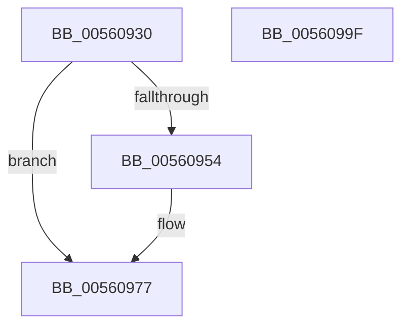

# HalpHvTimerSetInterruptVector

- RVA: `0x00560930`–`0x005609A0` (길이 `112` bytes)
- VA: `0x0000000140560930`
- 실행 섹션: `.text`
- PDB 이름 있음: `예`; PDB Function 태그: `아니요`
- unwind 정보 RVA: `0x000DB714`
- 디코드: `32`개 명령, `112/112` bytes 표시
- 미해석 바이트: `0` (있으면 어셈블리에 `.byte`로 보존)

> 이 문서는 커널 이미지의 기계어와 PDB 기호를 분석해 생성했습니다. 4번과 5번은 함수 원형과 자료형을 바이너리 사용 방식에서 추정한 C 해석이며 원본 소스 복구 결과는 아닙니다.

## 1. Dependencies

- 직접 호출 지점: **0**; 고유 호출 대상: **0**
- 직접 호출자로 확인된 함수: **0**
- RIP 상대 이미지 참조: **0**

### Outgoing calls
- 직접 디코드된 call 명령이 없습니다.

### Direct callers
- 이 함수 시작 RVA로 연결되는 직접 call은 확인되지 않았습니다. 간접 호출은 완전히 역산할 수 없습니다.

### Static image references
- 디코드된 RIP-relative 메모리 참조가 없습니다.

## 2. Other-region calls and transfers

- 다른 실행 섹션으로 향하는 call: **0**
- 별도 외부 분기/꼬리 이동을 확인하지 못했습니다.

## 3. Assembly (complete function range)

```asm
00560930  65 44 8B 04 25 A4 01 00 00      mov r8d, dword ptr gs:[0x1a4]
00560939  4C 8B D1                        mov r10, rcx
0056093C  B9 83 00 00 40                  mov ecx, 0x40000083
00560941  44 8B DA                        mov r11d, edx
00560944  0F 32                           rdmsr
00560946  48 C1 E2 20                     shl rdx, 0x20
0056094A  48 0B C2                        or rax, rdx
0056094D  45 8B C8                        mov r9d, r8d
00560950  A8 01                           test al, 1
00560952  75 23                           jne 0x140560977
00560954  48 8B D0                        mov rdx, rax
00560957  4F 8D 04 40                     lea r8, [r8 + r8*2]
0056095B  4B 33 54 C2 10                  xor rdx, qword ptr [r10 + r8*8 + 0x10]
00560960  48 81 E2 01 F0 FF FF            and rdx, 0xfffffffffffff001
00560967  48 33 D0                        xor rdx, rax
0056096A  48 83 CA 01                     or rdx, 1
0056096E  48 8B C2                        mov rax, rdx
00560971  48 C1 EA 20                     shr rdx, 0x20
00560975  0F 30                           wrmsr
00560977  41 0F B6 D3                     movzx edx, r11b
0056097B  B9 93 00 00 40                  mov ecx, 0x40000093
00560980  8B C2                           mov eax, edx
00560982  48 C1 EA 20                     shr rdx, 0x20
00560986  0F 30                           wrmsr
00560988  4B 8D 0C 49                     lea rcx, [r9 + r9*2]
0056098C  B8 08 00 03 00                  mov eax, 0x30008
00560991  49 89 04 CA                     mov qword ptr [r10 + rcx*8], rax
00560995  33 D2                           xor edx, edx
00560997  B9 B0 00 00 40                  mov ecx, 0x400000b0
0056099C  0F 30                           wrmsr
0056099E  C3                              ret
0056099F  CC                              int3
```

## 4. C-style interpretation (structured pseudocode)

```c
__int64 __fastcall HalpHvTimerSetInterruptVector(__int64 a1, __int64 a2)
{
    __int64 result;

    a2 = (a2) << (32);
    result = (result) | (a2);
    if ((((unsigned __int8)(result)) & (1)) == 0) {
        a2 = result;
        a3 = (unsigned int)(*(unsigned int *)(gs_base + (0 + 420))) + (unsigned int)(*(unsigned int *)(gs_base + (0 + 420))) * 2;
        a2 = (a2) ^ (*(unsigned __int64 *)(a1 + a3 * 8 + 16));
        a2 = (a2) & (0xFFFFFFFFFFFFF001ULL);
        a2 = (a2) ^ (result);
        a2 = (a2) | (1);
        result = a2;
        a2 = (a2) >> (32);
    }
    a2 = ((unsigned __int8)((unsigned int)((unsigned int)(a2)))) >> (32);
    *(unsigned __int64 *)(a1 + (unsigned int)((unsigned int)((unsigned int)(*(unsigned int *)(gs_base + (0 + 420))))) + (unsigned int)((unsigned int)((unsigned int)(*(unsigned int *)(gs_base + (0 + 420))))) * 2 * 8) = (unsigned int)(0x30008ULL);
    a2 = 0;
    return (unsigned int)(0x30008ULL);
}
```

## 5. (Beta) C Style

```c
int64_t HalpHvTimerSetInterruptVector(void *Arg1, int64_t Arg2)
{
    uint8_t *arg1 = (uint8_t *)Arg1;

    int64_t result;

    Arg2 = (Arg2) << (32);
    result = (result) | (Arg2);
    if ((((uint8_t)(result)) & (1)) == 0) {
        Arg2 = result;
        a3 = (uint32_t)(*(uint32_t *)(gs_base + (0 + 0x1A4))) + (uint32_t)(*(uint32_t *)(gs_base + (0 + 0x1A4))) * 2;
        Arg2 = (Arg2) ^ (*(uint64_t *)(arg1 + a3 * 8 + 0x10));
        Arg2 = (Arg2) & (0xFFFFFFFFFFFFF001ULL);
        Arg2 = (Arg2) ^ (result);
        Arg2 = (Arg2) | (1);
        result = Arg2;
        Arg2 = (Arg2) >> (32);
    }
    Arg2 = ((uint8_t)((uint32_t)((uint32_t)(Arg2)))) >> (32);
    *(uint64_t *)(arg1 + (uint32_t)((uint32_t)((uint32_t)(*(uint32_t *)(gs_base + (0 + 0x1A4))))) + (uint32_t)((uint32_t)((uint32_t)(*(uint32_t *)(gs_base + (0 + 0x1A4))))) * 2 * 8) = (uint32_t)(0x30008ULL);
    Arg2 = 0;
    return (uint32_t)(0x30008ULL);
}
```

### 관측된 메모리 오프셋

구조체 형식이 확인되지 않은 접근은 인자 기준의 오프셋으로만 기록했습니다.

| 기준 인자 | 오프셋 표현 | 폭 (bit) | 접근 |
|---|---:|---:|---|
| `Arg1` | `+ 0x0 + rcx*8` | `64` | `W` |
| `Arg1` | `+ 0x10 + r8*8` | `64` | `R` |

## 6. Execution-region graph

[열기: 2D/3D 그래프와 함수 탐색 컨트롤 패널](../../../control-panel.html?section=text&rva=0x00560930&view=graph)

- 2D 그래프는 위에서 아래로 흐르고, 3D 그래프는 빈 공간을 드래그해 회전합니다. Shift+드래그는 이동, 휠은 확대·축소, 함수 노드 선택은 대상 보고서 이동입니다.

### Static fallback


