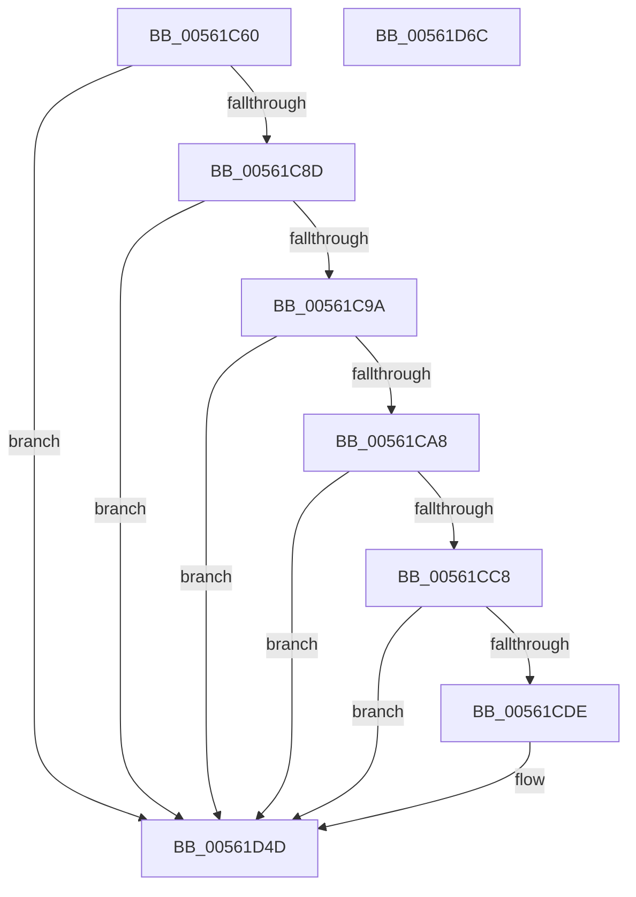

# HalpHvWatchdogDiscover

- RVA: `0x00561C60`–`0x00561D6D` (길이 `269` bytes)
- VA: `0x0000000140561C60`
- 실행 섹션: `.text`
- PDB 이름 있음: `예`; PDB Function 태그: `아니요`
- unwind 정보 RVA: `0x0006FCAC`
- 디코드: `60`개 명령, `269/269` bytes 표시
- 미해석 바이트: `0` (있으면 어셈블리에 `.byte`로 보존)

> 이 문서는 커널 이미지의 기계어와 PDB 기호를 분석해 생성했습니다. 4번과 5번은 함수 원형과 자료형을 바이너리 사용 방식에서 추정한 C 해석이며 원본 소스 복구 결과는 아닙니다.

## 1. Dependencies

- 직접 호출 지점: **4**; 고유 호출 대상: **4**
- 직접 호출자로 확인된 함수: **1**
- RIP 상대 이미지 참조: **6**

### Outgoing calls
- `0x00561C8D` → [HalpIsMicrosoftCompatibleHvLoaded](../4A/HalpIsMicrosoftCompatibleHvLoaded_function_004AFAAC.md) (function, `0x004AFAAC`)
- `0x00561CEC` → [memset](../6C/memset_function_006C6C40.md) (function, `0x006C6C40`)
- `0x00561D48` → [HalpTimerRegister](HalpTimerRegister_function_005616BC.md) (function, `0x005616BC`)
- `0x00561D56` → [_security_check_cookie](../6A/_security_check_cookie_function_006AC640.md) (function, `0x006AC640`)

### Direct callers
- [HalpTimerRegisterBuiltinPluginsCommon](../54/HalpTimerRegisterBuiltinPluginsCommon_function_0054A014.md) at `0x0054A050`

### Static image references
- `0x00561C72` → RVA `0x00E0A740` (`.data`; read)
- `0x00561C80` → RVA `0x00FC2170` (`.data`; read)
- `0x00561C9A` → RVA `0x00FC1C60` (`.data`; read)
- `0x00561CF6` → RVA `0x00561D80` (`HalpHvWatchdogInitialize`; read)
- `0x00561D0B` → RVA `0x0042BF90` (`HalpHvWatchdogArm`; read)
- `0x00561D1D` → RVA `0x00561DA0` (`HalpHvWatchdogStop`; read)

## 2. Other-region calls and transfers

- 다른 실행 섹션으로 향하는 call: **0**
- 별도 외부 분기/꼬리 이동을 확인하지 못했습니다.

## 3. Assembly (complete function range)

```asm
00561C60  48 89 5C 24 08                  mov qword ptr [rsp + 8], rbx
00561C65  55                              push rbp
00561C66  48 8D 6C 24 A9                  lea rbp, [rsp - 0x57]
00561C6B  48 81 EC D0 00 00 00            sub rsp, 0xd0
00561C72  48 8B 05 C7 8A 8A 00            mov rax, qword ptr [rip + 0x8a8ac7]
00561C79  48 33 C4                        xor rax, rsp
00561C7C  48 89 45 47                     mov qword ptr [rbp + 0x47], rax
00561C80  80 3D E9 04 A6 00 00            cmp byte ptr [rip + 0xa604e9], 0
00561C87  0F 85 C0 00 00 00               jne 0x140561d4d
00561C8D  E8 1A DE F4 FF                  call 0x1404afaac
00561C92  84 C0                           test al, al
00561C94  0F 84 B3 00 00 00               je 0x140561d4d
00561C9A  8B 05 C0 FF A5 00               mov eax, dword ptr [rip + 0xa5ffc0]
00561CA0  A8 20                           test al, 0x20
00561CA2  0F 85 A5 00 00 00               jne 0x140561d4d
00561CA8  33 C9                           xor ecx, ecx
00561CAA  B8 03 00 00 40                  mov eax, 0x40000003
00561CAF  0F A2                           cpuid
00561CB1  0F 57 C0                        xorps xmm0, xmm0
00561CB4  0F 11 45 37                     movups xmmword ptr [rbp + 0x37], xmm0
00561CB8  89 45 37                        mov dword ptr [rbp + 0x37], eax
00561CBB  89 5D 3B                        mov dword ptr [rbp + 0x3b], ebx
00561CBE  0F BA E2 16                     bt edx, 0x16
00561CC2  0F 83 85 00 00 00               jae 0x140561d4d
00561CC8  48 8B 45 37                     mov rax, qword ptr [rbp + 0x37]
00561CCC  48 B9 08 00 00 00 00 10 00 00   movabs rcx, 0x100000000008
00561CD6  48 23 C1                        and rax, rcx
00561CD9  48 3B C1                        cmp rax, rcx
00561CDC  75 6F                           jne 0x140561d4d
00561CDE  BB 90 00 00 00                  mov ebx, 0x90
00561CE3  48 8D 4D A7                     lea rcx, [rbp - 0x59]
00561CE7  44 8B C3                        mov r8d, ebx
00561CEA  33 D2                           xor edx, edx
00561CEC  E8 4F 4F 16 00                  call 0x1406c6c40
00561CF1  48 83 65 FF 00                  and qword ptr [rbp - 1], 0
00561CF6  48 8D 05 83 00 00 00            lea rax, [rip + 0x83]
00561CFD  83 65 07 00                     and dword ptr [rbp + 7], 0
00561D01  48 8D 4D A7                     lea rcx, [rbp - 0x59]
00561D05  48 89 45 AF                     mov qword ptr [rbp - 0x51], rax
00561D09  33 D2                           xor edx, edx
00561D0B  48 8D 05 7E A2 EC FF            lea rax, [rip - 0x135d82]
00561D12  C7 45 A7 01 00 00 00            mov dword ptr [rbp - 0x59], 1
00561D19  48 89 45 C7                     mov qword ptr [rbp - 0x39], rax
00561D1D  48 8D 05 7C 00 00 00            lea rax, [rip + 0x7c]
00561D24  48 89 45 CF                     mov qword ptr [rbp - 0x31], rax
00561D28  89 5D AB                        mov dword ptr [rbp - 0x55], ebx
00561D2B  C7 45 0B 40 00 00 00            mov dword ptr [rbp + 0xb], 0x40
00561D32  48 C7 45 0F 80 96 98 00         mov qword ptr [rbp + 0xf], 0x989680
00561D3A  C7 45 2F 08 00 00 00            mov dword ptr [rbp + 0x2f], 8
00561D41  C7 45 1B 20 80 02 00            mov dword ptr [rbp + 0x1b], 0x28020
00561D48  E8 6F F9 FF FF                  call 0x1405616bc
00561D4D  33 C0                           xor eax, eax
00561D4F  48 8B 4D 47                     mov rcx, qword ptr [rbp + 0x47]
00561D53  48 33 CC                        xor rcx, rsp
00561D56  E8 E5 A8 14 00                  call 0x1406ac640
00561D5B  48 8B 9C 24 E0 00 00 00         mov rbx, qword ptr [rsp + 0xe0]
00561D63  48 81 C4 D0 00 00 00            add rsp, 0xd0
00561D6A  5D                              pop rbp
00561D6B  C3                              ret
00561D6C  CC                              int3
```

## 4. C-style interpretation (structured pseudocode)

```c
__int64 __fastcall HalpHvWatchdogDiscover(int a1, int a2)
{
    __int64 result;
    __int64 v_rbx;
    __int64 v_rsp;
    unsigned __int64 v_stack_m18;
    unsigned int v_stack_m24;
    unsigned __int64 v_stack_m28;
    unsigned int v_stack_m30;
    unsigned int v_stack_m44;
    unsigned __int64 v_stack_m50;
    unsigned int v_stack_m54;
    unsigned int v_stack_m58;
    unsigned __int64 v_stack_m5F;
    unsigned __int64 v_stack_m60;
    unsigned __int64 v_stack_m90;
    unsigned __int64 v_stack_m98;
    unsigned __int64 v_stack_mB0;
    unsigned int v_stack_mB4;
    unsigned __int64 v_stack_mB8;
    unsigned __int64 v_stack_p8;

    v_stack_p8 = v_rbx;
    v_rsp = (v_rsp) - (208);
    result = (*(unsigned __int64 *)(v_rip + 9079495)) ^ (v_rsp);
    v_stack_m18 = result;
    if ((*(unsigned __int8 *)(v_rip + 10880233)) != 0) goto loc_00561D4D;
    result = HalpIsMicrosoftCompatibleHvLoaded(a1, a2, a3, a4);
    if ((unsigned __int8)(result) == 0) goto loc_00561D4D;
    if ((((unsigned __int8)((unsigned int)(*(unsigned int *)(v_rip + 10878912)))) & (32)) != 0) goto loc_00561D4D;
    a1 = 0;
    v_stack_m28 = v_xmm0;
    v_stack_m28 = (unsigned int)((unsigned int)(0x40000003ULL));
    v_stack_m24 = (unsigned int)(v_rbx);
    if (condition_is_above_or_equal) goto loc_00561D4D;
    result = (v_stack_m28) & (0);
    if (result == 0) {
        v_rbx = 144;
        a1 = v_stack_mB8;
        a3 = (unsigned int)(v_rbx);
        a2 = 0;
        result = memset(a1, a2, a3, a4);
        result = v_rip + 131;
        a1 = v_stack_mB8;
        v_stack_mB0 = result;
        a2 = 0;
        result = v_rip - 1269122;
        v_stack_mB8 = 1;
        v_stack_m98 = result;
        result = v_rip + 124;
        v_stack_m90 = result;
        v_stack_mB4 = (unsigned int)(v_rbx);
        v_stack_m54 = 64;
        v_stack_m50 = 0x989680ULL;
        v_stack_m30 = 8;
        v_stack_m44 = 0x28020ULL;
        result = HalpTimerRegister(a1, a2, a3, a4);
    }
    result = 0;
    a1 = (v_stack_m18) ^ (v_rsp);
    result = _security_check_cookie(a1, a2, a3, a4);
    v_rsp = (v_rsp) + (208);
    return result;
}
```

## 5. (Beta) C Style

```c
int64_t HalpHvWatchdogDiscover(int32_t Arg1, int32_t Arg2)
{
    int64_t result;
    int64_t local_rbx;
    int64_t local_rsp;
    uint64_t v_stack_m18;
    uint32_t v_stack_m24;
    uint64_t v_stack_m28;
    uint32_t v_stack_m30;
    uint32_t v_stack_m44;
    uint64_t v_stack_m50;
    uint32_t v_stack_m54;
    uint32_t v_stack_m58;
    uint64_t v_stack_m5F;
    uint64_t v_stack_m60;
    uint64_t v_stack_m90;
    uint64_t v_stack_m98;
    uint64_t v_stack_mB0;
    uint32_t v_stack_mB4;
    uint64_t v_stack_mB8;
    uint64_t v_stack_p8;

    v_stack_p8 = local_rbx;
    local_rsp = (local_rsp) - (208);
    result = (*(uint64_t *)(v_rip + 0x8A8AC7)) ^ (local_rsp);
    v_stack_m18 = result;
    if ((*(uint8_t *)(v_rip + 0xA604E9)) != 0) goto loc_00561D4D;
    result = HalpIsMicrosoftCompatibleHvLoaded(Arg1, Arg2, a3, a4);
    if ((uint8_t)(result) == 0) goto loc_00561D4D;
    if ((((uint8_t)((uint32_t)(*(uint32_t *)(v_rip + 0xA5FFC0)))) & (32)) != 0) goto loc_00561D4D;
    Arg1 = 0;
    v_stack_m28 = v_xmm0;
    v_stack_m28 = (uint32_t)((uint32_t)(0x40000003ULL));
    v_stack_m24 = (uint32_t)(local_rbx);
    if (condition_is_above_or_equal) goto loc_00561D4D;
    result = (v_stack_m28) & (0);
    if (result == 0) {
        local_rbx = 144;
        Arg1 = v_stack_mB8;
        a3 = (uint32_t)(local_rbx);
        Arg2 = 0;
        result = memset(Arg1, Arg2, a3, a4);
        result = v_rip + 131;
        Arg1 = v_stack_mB8;
        v_stack_mB0 = result;
        Arg2 = 0;
        result = v_rip - 1269122;
        v_stack_mB8 = 1;
        v_stack_m98 = result;
        result = v_rip + 124;
        v_stack_m90 = result;
        v_stack_mB4 = (uint32_t)(local_rbx);
        v_stack_m54 = 64;
        v_stack_m50 = 0x989680ULL;
        v_stack_m30 = 8;
        v_stack_m44 = 0x28020ULL;
        result = HalpTimerRegister(Arg1, Arg2, a3, a4);
    }
    result = 0;
    Arg1 = (v_stack_m18) ^ (local_rsp);
    result = _security_check_cookie(Arg1, Arg2, a3, a4);
    local_rsp = (local_rsp) + (208);
    return result;
}
```

## 6. Execution-region graph

[열기: 2D/3D 그래프와 함수 탐색 컨트롤 패널](../../../control-panel.html?section=text&rva=0x00561C60&view=graph)

- 2D 그래프는 위에서 아래로 흐르고, 3D 그래프는 빈 공간을 드래그해 회전합니다. Shift+드래그는 이동, 휠은 확대·축소, 함수 노드 선택은 대상 보고서 이동입니다.

### Static fallback


