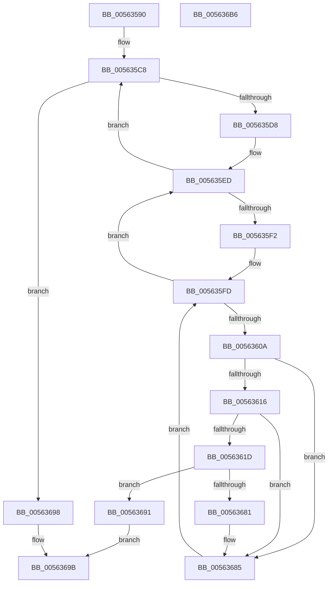

# HalpInterruptMaskLevelTriggeredLines

- RVA: `0x00563590`–`0x005636B7` (길이 `295` bytes)
- VA: `0x0000000140563590`
- 실행 섹션: `.text`
- PDB 이름 있음: `예`; PDB Function 태그: `아니요`
- unwind 정보 RVA: `0x000C4BE8`
- 디코드: `86`개 명령, `295/295` bytes 표시
- 미해석 바이트: `0` (있으면 어셈블리에 `.byte`로 보존)

> 이 문서는 커널 이미지의 기계어와 PDB 기호를 분석해 생성했습니다. 4번과 5번은 함수 원형과 자료형을 바이너리 사용 방식에서 추정한 C 해석이며 원본 소스 복구 결과는 아닙니다.

## 1. Dependencies

- 직접 호출 지점: **2**; 고유 호출 대상: **2**
- 직접 호출자로 확인된 함수: **0**
- RIP 상대 이미지 참조: **1**

### Outgoing calls
- `0x00563675` → [HalpInterruptSetLineStateInternal](../2D/HalpInterruptSetLineStateInternal_function_002D2104.md) (function, `0x002D2104`)
- `0x00563691` → [HalpInterruptRestoreAllControllerState](../../pagelk/B5/HalpInterruptRestoreAllControllerState_function_00B5C160.md) (function, `0x00B5C160`)

### Direct callers
- 이 함수 시작 RVA로 연결되는 직접 call은 확인되지 않았습니다. 간접 호출은 완전히 역산할 수 없습니다.

### Static image references
- `0x005635AF` → RVA `0x00FC38F0` (`.data`; read)

## 2. Other-region calls and transfers

- 다른 실행 섹션으로 향하는 call: **1**
  - `0x00563691` → [HalpInterruptRestoreAllControllerState](../../pagelk/B5/HalpInterruptRestoreAllControllerState_function_00B5C160.md) (`.text` → `PAGELK`)
- 별도 외부 분기/꼬리 이동을 확인하지 못했습니다.

## 3. Assembly (complete function range)

```asm
00563590  48 89 5C 24 18                  mov qword ptr [rsp + 0x18], rbx
00563595  55                              push rbp
00563596  56                              push rsi
00563597  57                              push rdi
00563598  41 54                           push r12
0056359A  41 55                           push r13
0056359C  41 56                           push r14
0056359E  41 57                           push r15
005635A0  48 8B EC                        mov rbp, rsp
005635A3  48 83 EC 60                     sub rsp, 0x60
005635A7  48 83 65 40 00                  and qword ptr [rbp + 0x40], 0
005635AC  0F 57 C0                        xorps xmm0, xmm0
005635AF  48 8B 1D 3A 03 A6 00            mov rbx, qword ptr [rip + 0xa6033a]
005635B6  33 C0                           xor eax, eax
005635B8  48 89 45 F0                     mov qword ptr [rbp - 0x10], rax
005635BC  0F 11 45 C0                     movups xmmword ptr [rbp - 0x40], xmm0
005635C0  0F 11 45 D0                     movups xmmword ptr [rbp - 0x30], xmm0
005635C4  0F 11 45 E0                     movups xmmword ptr [rbp - 0x20], xmm0
005635C8  48 8D 05 21 03 A6 00            lea rax, [rip + 0xa60321]
005635CF  48 3B D8                        cmp rbx, rax
005635D2  0F 84 C0 00 00 00               je 0x140563698
005635D8  4C 8B CB                        mov r9, rbx
005635DB  48 89 5D 48                     mov qword ptr [rbp + 0x48], rbx
005635DF  48 8B 1B                        mov rbx, qword ptr [rbx]
005635E2  4D 8D A9 08 01 00 00            lea r13, [r9 + 0x108]
005635E9  49 8B 75 00                     mov rsi, qword ptr [r13]
005635ED  49 3B F5                        cmp rsi, r13
005635F0  74 D6                           je 0x1405635c8
005635F2  45 33 F6                        xor r14d, r14d
005635F5  4C 8B FE                        mov r15, rsi
005635F8  48 8B 36                        mov rsi, qword ptr [rsi]
005635FB  33 FF                           xor edi, edi
005635FD  41 8B 4F 18                     mov ecx, dword ptr [r15 + 0x18]
00563601  41 2B 4F 14                     sub ecx, dword ptr [r15 + 0x14]
00563605  44 3B F1                        cmp r14d, ecx
00563608  7D E3                           jge 0x1405635ed
0056360A  49 8B 4F 28                     mov rcx, qword ptr [r15 + 0x28]
0056360E  8B 44 0F 0C                     mov eax, dword ptr [rdi + rcx + 0xc]
00563612  A8 10                           test al, 0x10
00563614  74 6F                           je 0x140563685
00563616  83 7C 0F 08 00                  cmp dword ptr [rdi + rcx + 8], 0
0056361B  75 68                           jne 0x140563685
0056361D  0F 10 14 0F                     movups xmm2, xmmword ptr [rdi + rcx]
00563621  4C 8D 45 C0                     lea r8, [rbp - 0x40]
00563625  48 8D 55 40                     lea rdx, [rbp + 0x40]
00563629  0F 11 55 C0                     movups xmmword ptr [rbp - 0x40], xmm2
0056362D  0F 10 44 0F 10                  movups xmm0, xmmword ptr [rdi + rcx + 0x10]
00563632  66 0F 73 DA 08                  psrldq xmm2, 8
00563637  0F 11 45 D0                     movups xmmword ptr [rbp - 0x30], xmm0
0056363B  0F 10 4C 0F 20                  movups xmm1, xmmword ptr [rdi + rcx + 0x20]
00563640  66 48 0F 7E D0                  movq rax, xmm2
00563645  0F 11 4D E0                     movups xmmword ptr [rbp - 0x20], xmm1
00563649  48 C1 E8 20                     shr rax, 0x20
0056364D  F2 0F 10 44 0F 30               movsd xmm0, qword ptr [rdi + rcx + 0x30]
00563653  83 E0 EF                        and eax, 0xffffffef
00563656  F2 0F 11 45 F0                  movsd qword ptr [rbp - 0x10], xmm0
0056365B  89 45 CC                        mov dword ptr [rbp - 0x34], eax
0056365E  41 8B 81 00 01 00 00            mov eax, dword ptr [r9 + 0x100]
00563665  89 45 40                        mov dword ptr [rbp + 0x40], eax
00563668  41 8B 4F 14                     mov ecx, dword ptr [r15 + 0x14]
0056366C  41 03 CE                        add ecx, r14d
0056366F  89 4D 44                        mov dword ptr [rbp + 0x44], ecx
00563672  49 8B C9                        mov rcx, r9
00563675  E8 8A EA D6 FF                  call 0x1402d2104
0056367A  44 8B E0                        mov r12d, eax
0056367D  85 C0                           test eax, eax
0056367F  78 10                           js 0x140563691
00563681  4C 8B 4D 48                     mov r9, qword ptr [rbp + 0x48]
00563685  41 FF C6                        inc r14d
00563688  48 83 C7 38                     add rdi, 0x38
0056368C  E9 6C FF FF FF                  jmp 0x1405635fd
00563691  E8 CA 8A 5F 00                  call 0x140b5c160
00563696  EB 03                           jmp 0x14056369b
00563698  45 33 E4                        xor r12d, r12d
0056369B  48 8B 9C 24 B0 00 00 00         mov rbx, qword ptr [rsp + 0xb0]
005636A3  41 8B C4                        mov eax, r12d
005636A6  48 83 C4 60                     add rsp, 0x60
005636AA  41 5F                           pop r15
005636AC  41 5E                           pop r14
005636AE  41 5D                           pop r13
005636B0  41 5C                           pop r12
005636B2  5F                              pop rdi
005636B3  5E                              pop rsi
005636B4  5D                              pop rbp
005636B5  C3                              ret
005636B6  CC                              int3
```

## 4. C-style interpretation (structured pseudocode)

```c
__int64 __fastcall HalpInterruptMaskLevelTriggeredLines(void)
{
    __int64 result;
    __int64 v_r12;
    __int64 v_r14;
    __int64 v_rdi;
    __int64 v_rsp;
    unsigned __int64 v_stack_m48;
    unsigned __int64 v_stack_m58;
    unsigned __int64 v_stack_m68;
    unsigned int v_stack_m6C;
    unsigned __int64 v_stack_m78;
    unsigned __int64 v_stack_p10;
    unsigned __int64 v_stack_p18;
    unsigned __int64 v_stack_p8;
    unsigned int v_stack_pC;

    v_stack_p18 = v_rbx;
    v_rsp = (v_rsp) - (96);
    result = 0;
    v_stack_m48 = 0;
    v_stack_m78 = v_xmm0;
    v_stack_m68 = v_xmm0;
    v_stack_m58 = v_xmm0;
loc_005635C8:
    if ((*(unsigned __int64 *)(v_rip + 10879802)) == (v_rip + 10879777)) goto loc_00563698;
    v_stack_p10 = *(unsigned __int64 *)(v_rip + 10879802);
loc_005635ED:
    if ((*(unsigned __int64 *)(*(unsigned __int64 *)(v_rip + 10879802) + 264)) == (*(unsigned __int64 *)(v_rip + 10879802) + 264)) goto loc_005635C8;
    v_r14 = 0;
    v_rdi = 0;
loc_005635FD:
    a1 = (unsigned int)(((unsigned int)(*(unsigned int *)(*(unsigned __int64 *)(*(unsigned __int64 *)(v_rip + 10879802) + 264) + 24))) - (*(unsigned int *)(*(unsigned __int64 *)(*(unsigned __int64 *)(v_rip + 10879802) + 264) + 20)));
    if (0 >= ((unsigned int)(a1))) goto loc_005635ED;
    if ((((unsigned __int8)((unsigned int)(*(unsigned int *)(v_rdi + *(unsigned __int64 *)(*(unsigned __int64 *)(*(unsigned __int64 *)(v_rip + 10879802) + 264) + 40) * 1 + 12)))) & (16)) == 0) goto loc_00563685;
    if ((*(unsigned int *)(v_rdi + *(unsigned __int64 *)(*(unsigned __int64 *)(*(unsigned __int64 *)(v_rip + 10879802) + 264) + 40) * 1 + 8)) != 0) goto loc_00563685;
    v_stack_m78 = v_xmm2;
    v_stack_m68 = v_xmm0;
    v_stack_m58 = v_xmm1;
    result = ((unsigned int)(*(unsigned int *)(v_rdi + *(unsigned __int64 *)(*(unsigned __int64 *)(*(unsigned __int64 *)(v_rip + 10879802) + 264) + 40) * 1 + 12))) >> (32);
    result = (unsigned int)((result) & (0xFFFFFFEFULL));
    v_stack_m48 = v_xmm0;
    v_stack_m6C = (unsigned int)(result);
    v_stack_p8 = (unsigned int)((unsigned int)(*(unsigned int *)(*(unsigned __int64 *)(v_rip + 10879802) + 256)));
    a1 = (unsigned int)(((unsigned int)(*(unsigned int *)(*(unsigned __int64 *)(*(unsigned __int64 *)(v_rip + 10879802) + 264) + 20))) + (0));
    v_stack_pC = (unsigned int)(a1);
    result = HalpInterruptSetLineStateInternal(*(unsigned __int64 *)(v_rip + 10879802), v_stack_p8, v_stack_m78, *(unsigned __int64 *)(v_rip + 10879802));
    if (sign_flag) goto loc_00563691;
loc_00563685:
    v_r14 = (unsigned int)((v_r14) + 1);
    v_rdi = (v_rdi) + (56);
    goto loc_005635FD;
loc_00563691:
    result = HalpInterruptRestoreAllControllerState(*(unsigned __int64 *)(v_rip + 10879802), v_stack_p8, v_stack_m78, v_stack_p10);
    goto loc_0056369B;
loc_00563698:
    v_r12 = 0;
loc_0056369B:
    v_rsp = (v_rsp) + (96);
    return 0;
}
```

## 5. (Beta) C Style

```c
void HalpInterruptMaskLevelTriggeredLines(void)
{
    int64_t result;
    int64_t local_r12;
    int64_t local_r14;
    int64_t local_rdi;
    int64_t local_rsp;
    uint64_t v_stack_m48;
    uint64_t v_stack_m58;
    uint64_t v_stack_m68;
    uint32_t v_stack_m6C;
    uint64_t v_stack_m78;
    uint64_t v_stack_p10;
    uint64_t v_stack_p18;
    uint64_t v_stack_p8;
    uint32_t v_stack_pC;

    v_stack_p18 = local_rbx;
    local_rsp = (local_rsp) - (96);
    result = 0;
    v_stack_m48 = 0;
    v_stack_m78 = v_xmm0;
    v_stack_m68 = v_xmm0;
    v_stack_m58 = v_xmm0;
loc_005635C8:
    if ((*(uint64_t *)(v_rip + 0xA6033A)) == (v_rip + 10879777)) goto loc_00563698;
    v_stack_p10 = *(uint64_t *)(v_rip + 0xA6033A);
loc_005635ED:
    if ((*(uint64_t *)(*(uint64_t *)(v_rip + 0xA6033A) + 0x108)) == (*(uint64_t *)(v_rip + 0xA6033A) + 264)) goto loc_005635C8;
    local_r14 = 0;
    local_rdi = 0;
loc_005635FD:
    a1 = (uint32_t)(((uint32_t)(*(uint32_t *)(*(uint64_t *)(*(uint64_t *)(v_rip + 0xA6033A) + 0x108) + 0x18))) - (*(uint32_t *)(*(uint64_t *)(*(uint64_t *)(v_rip + 0xA6033A) + 0x108) + 0x14)));
    if (0 >= ((uint32_t)(a1))) goto loc_005635ED;
    if ((((uint8_t)((uint32_t)(*(uint32_t *)(local_rdi + *(uint64_t *)(*(uint64_t *)(*(uint64_t *)(v_rip + 0xA6033A) + 0x108) + 0x28) * 1 + 0xC)))) & (16)) == 0) goto loc_00563685;
    if ((*(uint32_t *)(local_rdi + *(uint64_t *)(*(uint64_t *)(*(uint64_t *)(v_rip + 0xA6033A) + 0x108) + 0x28) * 1 + 0x8)) != 0) goto loc_00563685;
    v_stack_m78 = v_xmm2;
    v_stack_m68 = v_xmm0;
    v_stack_m58 = v_xmm1;
    result = ((uint32_t)(*(uint32_t *)(local_rdi + *(uint64_t *)(*(uint64_t *)(*(uint64_t *)(v_rip + 0xA6033A) + 0x108) + 0x28) * 1 + 0xC))) >> (32);
    result = (uint32_t)((result) & (0xFFFFFFEFULL));
    v_stack_m48 = v_xmm0;
    v_stack_m6C = (uint32_t)(result);
    v_stack_p8 = (uint32_t)((uint32_t)(*(uint32_t *)(*(uint64_t *)(v_rip + 0xA6033A) + 0x100)));
    a1 = (uint32_t)(((uint32_t)(*(uint32_t *)(*(uint64_t *)(*(uint64_t *)(v_rip + 0xA6033A) + 0x108) + 0x14))) + (0));
    v_stack_pC = (uint32_t)(a1);
    result = HalpInterruptSetLineStateInternal(*(uint64_t *)(v_rip + 0xA6033A), v_stack_p8, v_stack_m78, *(uint64_t *)(v_rip + 0xA6033A));
    if (sign_flag) goto loc_00563691;
loc_00563685:
    local_r14 = (uint32_t)((local_r14) + 1);
    local_rdi = (local_rdi) + (56);
    goto loc_005635FD;
loc_00563691:
    result = HalpInterruptRestoreAllControllerState(*(uint64_t *)(v_rip + 0xA6033A), v_stack_p8, v_stack_m78, v_stack_p10);
    goto loc_0056369B;
loc_00563698:
    local_r12 = 0;
loc_0056369B:
    local_rsp = (local_rsp) + (96);
    return 0;
}
```

## 6. Execution-region graph

[열기: 2D/3D 그래프와 함수 탐색 컨트롤 패널](../../../control-panel.html?section=text&rva=0x00563590&view=graph)

- 2D 그래프는 위에서 아래로 흐르고, 3D 그래프는 빈 공간을 드래그해 회전합니다. Shift+드래그는 이동, 휠은 확대·축소, 함수 노드 선택은 대상 보고서 이동입니다.

### Static fallback


