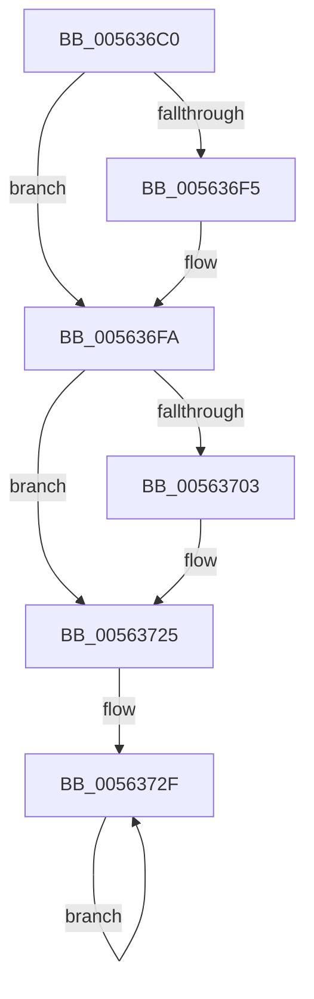

# HalpInterruptOfflineProcessor

- RVA: `0x005636C0`–`0x00563732` (길이 `114` bytes)
- VA: `0x00000001405636C0`
- 실행 섹션: `.text`
- PDB 이름 있음: `예`; PDB Function 태그: `아니요`
- unwind 정보 RVA: `0x000C4BDC`
- 디코드: `29`개 명령, `114/114` bytes 표시
- 미해석 바이트: `0` (있으면 어셈블리에 `.byte`로 보존)

> 이 문서는 커널 이미지의 기계어와 PDB 기호를 분석해 생성했습니다. 4번과 5번은 함수 원형과 자료형을 바이너리 사용 방식에서 추정한 C 해석이며 원본 소스 복구 결과는 아닙니다.

## 1. Dependencies

- 직접 호출 지점: **2**; 고유 호출 대상: **2**
- 직접 호출자로 확인된 함수: **1**
- RIP 상대 이미지 참조: **3**

### Outgoing calls
- `0x005636F5` → [KiRaiseIrqlProcessIrqlFlags](../4F/KiRaiseIrqlProcessIrqlFlags_function_004F56FC.md) (function, `0x004F56FC`)
- `0x00563720` → [guard_dispatch_icall](../6B/guard_dispatch_icall_function_006BAAD0.md) (function, `0x006BAAD0`)

### Direct callers
- [HalpDpOfflineProcessorForReplace](../../pagelk/B5/HalpDpOfflineProcessorForReplace_function_00B5FC20.md) at `0x00B5FC7F`

### Static image references
- `0x005636CA` → RVA `0x00E101F0` (`.data`; read)
- `0x005636ED` → RVA `0x00FC6D20` (`ALMOSTRO`; read)
- `0x00563725` → RVA `0x00E0A774` (`.data`; read/write)

## 2. Other-region calls and transfers

- 다른 실행 섹션으로 향하는 call: **0**
- 별도 외부 분기/꼬리 이동을 확인하지 못했습니다.

## 3. Assembly (complete function range)

```asm
005636C0  48 89 5C 24 08                  mov qword ptr [rsp + 8], rbx
005636C5  57                              push rdi
005636C6  48 83 EC 40                     sub rsp, 0x40
005636CA  48 8B 3D 1F CB 8A 00            mov rdi, qword ptr [rip + 0x8acb1f]
005636D1  33 C0                           xor eax, eax
005636D3  0F 57 C0                        xorps xmm0, xmm0
005636D6  89 44 24 30                     mov dword ptr [rsp + 0x30], eax
005636DA  0F 11 44 24 20                  movups xmmword ptr [rsp + 0x20], xmm0
005636DF  48 8B D9                        mov rbx, rcx
005636E2  44 0F 20 C1                     mov rcx, cr8
005636E6  8D 50 0F                        lea edx, [rax + 0xf]
005636E9  44 0F 22 C2                     mov cr8, rdx
005636ED  39 05 2D 36 A6 00               cmp dword ptr [rip + 0xa6362d], eax
005636F3  74 05                           je 0x1405636fa
005636F5  E8 02 20 F9 FF                  call 0x1404f56fc
005636FA  48 8B 47 50                     mov rax, qword ptr [rdi + 0x50]
005636FE  48 85 C0                        test rax, rax
00563701  74 22                           je 0x140563725
00563703  33 C9                           xor ecx, ecx
00563705  48 8D 54 24 20                  lea rdx, [rsp + 0x20]
0056370A  48 89 4C 24 30                  mov qword ptr [rsp + 0x30], rcx
0056370F  48 8B 4F 10                     mov rcx, qword ptr [rdi + 0x10]
00563713  0F 11 44 24 20                  movups xmmword ptr [rsp + 0x20], xmm0
00563718  C7 44 24 20 04 00 00 00         mov dword ptr [rsp + 0x20], 4
00563720  E8 AB 73 15 00                  call 0x1406baad0
00563725  F0 FF 0D 48 70 8A 00            lock dec dword ptr [rip + 0x8a7048]
0056372C  F0 FF 03                        lock inc dword ptr [rbx]
0056372F  F4                              hlt
00563730  EB FD                           jmp 0x14056372f
```

## 4. C-style interpretation (structured pseudocode)

```c
__int64 __fastcall HalpInterruptOfflineProcessor(__int64 a1)
{
    __int64 result;
    __int64 v_rsp;
    unsigned int v_stack_m18;
    unsigned __int64 v_stack_m28;
    unsigned __int64 v_stack_p8;

    v_stack_p8 = v_rbx;
    v_rsp = (v_rsp) - (64);
    result = 0;
    v_stack_m18 = 0;
    v_stack_m28 = v_xmm0;
    if ((*(unsigned int *)(v_rip + 10892845)) != 0) {
        result = KiRaiseIrqlProcessIrqlFlags(v_cr8, result + 15, a3, a4);
    }
    result = *(unsigned __int64 *)(*(unsigned __int64 *)(v_rip + 9095967) + 80);
    if (*(unsigned __int64 *)(*(unsigned __int64 *)(v_rip + 9095967) + 80) != 0) {
        a1 = 0;
        a2 = v_stack_m28;
        v_stack_m18 = 0;
        a1 = *(unsigned __int64 *)(*(unsigned __int64 *)(v_rip + 9095967) + 16);
        v_stack_m28 = v_xmm0;
        v_stack_m28 = 4;
        result = guard_dispatch_icall(a1, a2, a3, a4);
    }
loc_0056372F:
    goto loc_0056372F;
}
```

## 5. (Beta) C Style

```c
int64_t HalpInterruptOfflineProcessor(void *Arg1)
{
    uint8_t *arg1 = (uint8_t *)Arg1;

    int64_t result;
    int64_t local_rsp;
    uint32_t v_stack_m18;
    uint64_t v_stack_m28;
    uint64_t v_stack_p8;

    v_stack_p8 = local_rbx;
    local_rsp = (local_rsp) - (64);
    result = 0;
    v_stack_m18 = 0;
    v_stack_m28 = v_xmm0;
    if ((*(uint32_t *)(v_rip + 0xA6362D)) != 0) {
        result = KiRaiseIrqlProcessIrqlFlags(v_cr8, result + 15, a3, a4);
    }
    result = *(uint64_t *)(*(uint64_t *)(v_rip + 0x8ACB1F) + 0x50);
    if (*(uint64_t *)(*(uint64_t *)(v_rip + 0x8ACB1F) + 0x50) != 0) {
        Arg1 = 0;
        a2 = v_stack_m28;
        v_stack_m18 = 0;
        Arg1 = *(uint64_t *)(*(uint64_t *)(v_rip + 0x8ACB1F) + 0x10);
        v_stack_m28 = v_xmm0;
        v_stack_m28 = 4;
        result = guard_dispatch_icall(Arg1, a2, a3, a4);
    }
loc_0056372F:
    goto loc_0056372F;
}
```

### 관측된 메모리 오프셋

구조체 형식이 확인되지 않은 접근은 인자 기준의 오프셋으로만 기록했습니다.

| 기준 인자 | 오프셋 표현 | 폭 (bit) | 접근 |
|---|---:|---:|---|
| `Arg1` | `+ 0x0` | `32` | `R/W` |

## 6. Execution-region graph

[열기: 2D/3D 그래프와 함수 탐색 컨트롤 패널](../../../control-panel.html?section=text&rva=0x005636C0&view=graph)

- 2D 그래프는 위에서 아래로 흐르고, 3D 그래프는 빈 공간을 드래그해 회전합니다. Shift+드래그는 이동, 휠은 확대·축소, 함수 노드 선택은 대상 보고서 이동입니다.

### Static fallback


