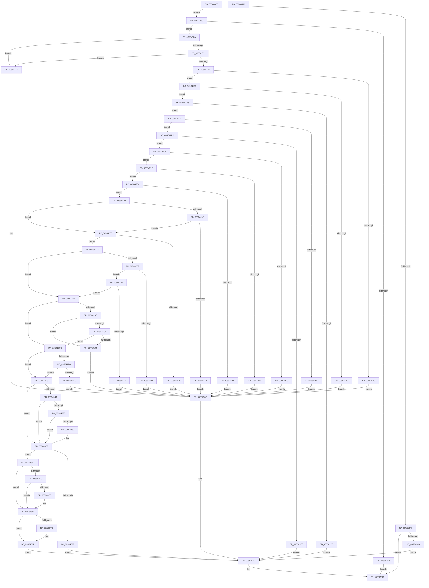

# HalpInterruptRegisterController

- RVA: `0x005640F0`–`0x005645AA` (길이 `1,210` bytes)
- VA: `0x00000001405640F0`
- 실행 섹션: `.text`
- PDB 이름 있음: `예`; PDB Function 태그: `아니요`
- unwind 정보 RVA: `0x000C4D20`
- 디코드: `262`개 명령, `1,210/1,210` bytes 표시
- 미해석 바이트: `0` (있으면 어셈블리에 `.byte`로 보존)

> 이 문서는 커널 이미지의 기계어와 PDB 기호를 분석해 생성했습니다. 4번과 5번은 함수 원형과 자료형을 바이너리 사용 방식에서 추정한 C 해석이며 원본 소스 복구 결과는 아닙니다.

## 1. Dependencies

- 직접 호출 지점: **9**; 고유 호출 대상: **9**
- 직접 호출자로 확인된 함수: **2**
- RIP 상대 이미지 참조: **9**

### Outgoing calls
- `0x005641EC` → [HalpInterruptLookupController](../2D/HalpInterruptLookupController_function_002D20D4.md) (function, `0x002D20D4`)
- `0x0056432E` → [HalpExtBuildResourceIdString](../54/HalpExtBuildResourceIdString_function_0054E494.md) (function, `0x0054E494`)
- `0x0056433D` → [RtlInitUnicodeString](../42/RtlInitUnicodeString_function_0042A780.md) (function, `0x0042A780`)
- `0x0056434A` → [HalpIsPartitionCpuManager](../4F/HalpIsPartitionCpuManager_function_004F8DEC.md) (function, `0x004F8DEC`)
- `0x0056438A` → [HalpMmAllocateMemoryInternal](../54/HalpMmAllocateMemoryInternal_function_00544990.md) (function, `0x00544990`)
- `0x005643BF` → [memset](../6C/memset_function_006C6C40.md) (function, `0x006C6C40`)
- `0x005644FF` → [memcpy](../6C/memcpy_function_006C6840.md) (function, `0x006C6840`)
- `0x00564520` → [RtlCopyUnicodeString](../3F/RtlCopyUnicodeString_function_003FEF30.md) (function, `0x003FEF30`)
- `0x00564588` → [_security_check_cookie](../6A/_security_check_cookie_function_006AC640.md) (function, `0x006AC640`)

### Direct callers
- [HalpApicRegisterIoUnit](HalpApicRegisterIoUnit_function_0056A298.md) at `0x0056A4E7`
- [HalpPicDiscover](HalpPicDiscover_function_0056A7C4.md) at `0x0056A897`
- [HalpPicDiscover](HalpPicDiscover_function_0056A7C4.md) at `0x0056A92A`

### Static image references
- `0x00564109` → RVA `0x00E0A740` (`.data`; read)
- `0x00564121` → RVA `0x00E0A840` (`.data`; read)
- `0x00564137` → RVA `0x00E117C0` (`.data`; write)
- `0x00564353` → RVA `0x00FC1CA8` (`.data`; read)
- `0x005643A7` → RVA `0x00E117C4` (`.data`; write)
- `0x00564525` → RVA `0x00FC38F8` (`.data`; read)
- `0x0056452C` → RVA `0x00FC38F0` (`.data`; read)
- `0x0056453F` → RVA `0x00E101D0` (`.data`; read/write)
- `0x00564552` → RVA `0x00FC38F8` (`.data`; write)

## 2. Other-region calls and transfers

- 다른 실행 섹션으로 향하는 call: **0**
- 별도 외부 분기/꼬리 이동을 확인하지 못했습니다.

## 3. Assembly (complete function range)

```asm
005640F0  48 89 5C 24 10                  mov qword ptr [rsp + 0x10], rbx
005640F5  48 89 6C 24 18                  mov qword ptr [rsp + 0x18], rbp
005640FA  56                              push rsi
005640FB  57                              push rdi
005640FC  41 54                           push r12
005640FE  41 56                           push r14
00564100  41 57                           push r15
00564102  48 81 EC 20 01 00 00            sub rsp, 0x120
00564109  48 8B 05 30 66 8A 00            mov rax, qword ptr [rip + 0x8a6630]
00564110  48 33 C4                        xor rax, rsp
00564113  48 89 84 24 10 01 00 00         mov qword ptr [rsp + 0x110], rax
0056411B  45 33 E4                        xor r12d, r12d
0056411E  0F 57 C0                        xorps xmm0, xmm0
00564121  44 38 25 18 67 8A 00            cmp byte ptr [rip + 0x8a6718], r12b
00564128  48 8B D9                        mov rbx, rcx
0056412B  0F 11 44 24 58                  movups xmmword ptr [rsp + 0x58], xmm0
00564130  75 1E                           jne 0x140564150
00564132  41 8D 6C 24 02                  lea ebp, [r12 + 2]
00564137  89 2D 83 D6 8A 00               mov dword ptr [rip + 0x8ad683], ebp
0056413D  B8 89 01 00 C0                  mov eax, 0xc0000189
00564142  48 85 C9                        test rcx, rcx
00564145  0F 84 32 04 00 00               je 0x14056457d
0056414B  E9 21 04 00 00                  jmp 0x140564571
00564150  BE 01 00 00 00                  mov esi, 1
00564155  48 85 DB                        test rbx, rbx
00564158  75 10                           jne 0x14056416a
0056415A  B8 0D 00 00 C0                  mov eax, 0xc000000d
0056415F  89 35 5B D6 8A 00               mov dword ptr [rip + 0x8ad65b], esi
00564165  E9 13 04 00 00                  jmp 0x14056457d
0056416A  39 31                           cmp dword ptr [rcx], esi
0056416C  0F 85 F0 03 00 00               jne 0x140564562
00564172  BF 00 01 00 00                  mov edi, 0x100
00564177  39 79 04                        cmp dword ptr [rcx + 4], edi
0056417A  0F 85 E2 03 00 00               jne 0x140564562
00564180  44 8B 81 EC 00 00 00            mov r8d, dword ptr [rcx + 0xec]
00564187  41 F7 C0 00 F0 FF FF            test r8d, 0xfffff000
0056418E  74 0F                           je 0x14056419f
00564190  C7 05 26 D6 8A 00 11 00 00 00   mov dword ptr [rip + 0x8ad626], 0x11
0056419A  E9 CD 03 00 00                  jmp 0x14056456c
0056419F  8B 81 E4 00 00 00               mov eax, dword ptr [rcx + 0xe4]
005641A5  85 C0                           test eax, eax
005641A7  75 0F                           jne 0x1405641b8
005641A9  C7 05 0D D6 8A 00 04 00 00 00   mov dword ptr [rip + 0x8ad60d], 4
005641B3  E9 B4 03 00 00                  jmp 0x14056456c
005641B8  FF C8                           dec eax
005641BA  3B C6                           cmp eax, esi
005641BC  76 14                           jbe 0x1405641d2
005641BE  B8 BB 00 00 C0                  mov eax, 0xc00000bb
005641C3  C7 05 F3 D5 8A 00 17 00 00 00   mov dword ptr [rip + 0x8ad5f3], 0x17
005641CD  E9 9F 03 00 00                  jmp 0x140564571
005641D2  8B 89 E8 00 00 00               mov ecx, dword ptr [rcx + 0xe8]
005641D8  83 F9 FF                        cmp ecx, -1
005641DB  75 0F                           jne 0x1405641ec
005641DD  C7 05 D9 D5 8A 00 05 00 00 00   mov dword ptr [rip + 0x8ad5d9], 5
005641E7  E9 80 03 00 00                  jmp 0x14056456c
005641EC  E8 E3 DE D6 FF                  call 0x1402d20d4
005641F1  48 85 C0                        test rax, rax
005641F4  74 14                           je 0x14056420a
005641F6  B8 BD 00 00 C0                  mov eax, 0xc00000bd
005641FB  C7 05 BB D5 8A 00 05 00 00 00   mov dword ptr [rip + 0x8ad5bb], 5
00564205  E9 67 03 00 00                  jmp 0x140564571
0056420A  4C 39 63 58                     cmp qword ptr [rbx + 0x58], r12
0056420E  75 0F                           jne 0x14056421f
00564210  C7 05 A6 D5 8A 00 0B 00 00 00   mov dword ptr [rip + 0x8ad5a6], 0xb
0056421A  E9 4D 03 00 00                  jmp 0x14056456c
0056421F  4C 39 63 60                     cmp qword ptr [rbx + 0x60], r12
00564223  75 0F                           jne 0x140564234
00564225  C7 05 91 D5 8A 00 0C 00 00 00   mov dword ptr [rip + 0x8ad591], 0xc
0056422F  E9 38 03 00 00                  jmp 0x14056456c
00564234  4C 39 63 40                     cmp qword ptr [rbx + 0x40], r12
00564238  74 0F                           je 0x140564249
0056423A  C7 05 7C D5 8A 00 10 00 00 00   mov dword ptr [rip + 0x8ad57c], 0x10
00564244  E9 23 03 00 00                  jmp 0x14056456c
00564249  44 84 C6                        test sil, r8b
0056424C  74 15                           je 0x140564263
0056424E  4C 39 63 08                     cmp qword ptr [rbx + 8], r12
00564252  75 0F                           jne 0x140564263
00564254  C7 05 62 D5 8A 00 07 00 00 00   mov dword ptr [rip + 0x8ad562], 7
0056425E  E9 09 03 00 00                  jmp 0x14056456c
00564263  4C 39 63 10                     cmp qword ptr [rbx + 0x10], r12
00564267  75 0F                           jne 0x140564278
00564269  C7 05 4D D5 8A 00 08 00 00 00   mov dword ptr [rip + 0x8ad54d], 8
00564273  E9 F4 02 00 00                  jmp 0x14056456c
00564278  BD 02 00 00 00                  mov ebp, 2
0056427D  44 84 C5                        test bpl, r8b
00564280  74 2D                           je 0x1405642af
00564282  4C 39 63 18                     cmp qword ptr [rbx + 0x18], r12
00564286  75 0F                           jne 0x140564297
00564288  C7 05 2E D5 8A 00 09 00 00 00   mov dword ptr [rip + 0x8ad52e], 9
00564292  E9 D5 02 00 00                  jmp 0x14056456c
00564297  44 39 A3 F0 00 00 00            cmp dword ptr [rbx + 0xf0], r12d
0056429E  75 0F                           jne 0x1405642af
005642A0  C7 05 16 D5 8A 00 0A 00 00 00   mov dword ptr [rip + 0x8ad516], 0xa
005642AA  E9 BD 02 00 00                  jmp 0x14056456c
005642AF  44 39 A3 FC 00 00 00            cmp dword ptr [rbx + 0xfc], r12d
005642B6  74 21                           je 0x1405642d9
005642B8  4C 39 A3 80 00 00 00            cmp qword ptr [rbx + 0x80], r12
005642BF  74 09                           je 0x1405642ca
005642C1  4C 39 A3 88 00 00 00            cmp qword ptr [rbx + 0x88], r12
005642C8  75 0F                           jne 0x1405642d9
005642CA  C7 05 EC D4 8A 00 0E 00 00 00   mov dword ptr [rip + 0x8ad4ec], 0xe
005642D4  E9 93 02 00 00                  jmp 0x14056456c
005642D9  41 0F BA E0 0A                  bt r8d, 0xa
005642DE  73 18                           jae 0x1405642f8
005642E0  4C 39 A3 B0 00 00 00            cmp qword ptr [rbx + 0xb0], r12
005642E7  75 0F                           jne 0x1405642f8
005642E9  C7 05 CD D4 8A 00 18 00 00 00   mov dword ptr [rip + 0x8ad4cd], 0x18
005642F3  E9 74 02 00 00                  jmp 0x14056456c
005642F8  44 0F B7 8B E4 00 00 00         movzx r9d, word ptr [rbx + 0xe4]
00564300  48 8D 44 24 70                  lea rax, [rsp + 0x70]
00564305  48 89 44 24 40                  mov qword ptr [rsp + 0x40], rax
0056430A  41 B8 00 40 00 00               mov r8d, 0x4000
00564310  C7 44 24 38 4B 00 00 00         mov dword ptr [rsp + 0x38], 0x4b
00564318  33 D2                           xor edx, edx
0056431A  89 4C 24 30                     mov dword ptr [rsp + 0x30], ecx
0056431E  B9 4D 53 46 54                  mov ecx, 0x5446534d
00564323  66 44 89 64 24 28               mov word ptr [rsp + 0x28], r12w
00564329  66 89 74 24 20                  mov word ptr [rsp + 0x20], si
0056432E  E8 61 A1 FE FF                  call 0x14054e494
00564333  48 8D 54 24 70                  lea rdx, [rsp + 0x70]
00564338  48 8D 4C 24 58                  lea rcx, [rsp + 0x58]
0056433D  E8 3E 64 EC FF                  call 0x14042a780
00564342  85 BB EC 00 00 00               test dword ptr [rbx + 0xec], edi
00564348  74 18                           je 0x140564362
0056434A  E8 9D 4A F9 FF                  call 0x1404f8dec
0056434F  84 C0                           test al, al
00564351  74 0F                           je 0x140564362
00564353  4C 39 25 4E D9 A5 00            cmp qword ptr [rip + 0xa5d94e], r12
0056435A  74 06                           je 0x140564362
0056435C  31 BB EC 00 00 00               xor dword ptr [rbx + 0xec], edi
00564362  8B 8B E0 00 00 00               mov ecx, dword ptr [rbx + 0xe0]
00564368  BA F8 FF FF FF                  mov edx, 0xfffffff8
0056436D  44 0F B7 74 24 58               movzx r14d, word ptr [rsp + 0x58]
00564373  81 C1 7F 01 00 00               add ecx, 0x17f
00564379  23 CA                           and ecx, edx
0056437B  45 8D 7E 09                     lea r15d, [r14 + 9]
0056437F  44 03 F9                        add r15d, ecx
00564382  44 23 FA                        and r15d, edx
00564385  8B D6                           mov edx, esi
00564387  41 8B CF                        mov ecx, r15d
0056438A  E8 01 06 FE FF                  call 0x140544990
0056438F  48 8B F8                        mov rdi, rax
00564392  48 85 C0                        test rax, rax
00564395  75 20                           jne 0x1405643b7
00564397  C7 05 1F D4 8A 00 06 00 00 00   mov dword ptr [rip + 0x8ad41f], 6
005643A1  8B 83 E4 00 00 00               mov eax, dword ptr [rbx + 0xe4]
005643A7  89 05 17 D4 8A 00               mov dword ptr [rip + 0x8ad417], eax
005643AD  B8 9A 00 00 C0                  mov eax, 0xc000009a
005643B2  E9 BA 01 00 00                  jmp 0x140564571
005643B7  45 8B C7                        mov r8d, r15d
005643BA  33 D2                           xor edx, edx
005643BC  48 8B CF                        mov rcx, rdi
005643BF  E8 7C 28 16 00                  call 0x1406c6c40
005643C4  48 8D 8F 7F 01 00 00            lea rcx, [rdi + 0x17f]
005643CB  BA 80 00 00 00                  mov edx, 0x80
005643D0  48 83 E1 F8                     and rcx, 0xfffffffffffffff8
005643D4  48 89 4F 10                     mov qword ptr [rdi + 0x10], rcx
005643D8  8B 83 E0 00 00 00               mov eax, dword ptr [rbx + 0xe0]
005643DE  48 83 C0 07                     add rax, 7
005643E2  48 03 C8                        add rcx, rax
005643E5  48 8D 87 08 01 00 00            lea rax, [rdi + 0x108]
005643EC  48 83 E1 F8                     and rcx, 0xfffffffffffffff8
005643F0  48 89 8F 68 01 00 00            mov qword ptr [rdi + 0x168], rcx
005643F7  48 8D 4F 20                     lea rcx, [rdi + 0x20]
005643FB  48 89 40 08                     mov qword ptr [rax + 8], rax
005643FF  48 89 00                        mov qword ptr [rax], rax
00564402  48 8D 87 18 01 00 00            lea rax, [rdi + 0x118]
00564409  48 89 40 08                     mov qword ptr [rax + 8], rax
0056440D  48 89 00                        mov qword ptr [rax], rax
00564410  8B 83 E0 00 00 00               mov eax, dword ptr [rbx + 0xe0]
00564416  89 47 18                        mov dword ptr [rdi + 0x18], eax
00564419  48 8D 43 08                     lea rax, [rbx + 8]
0056441D  0F 10 00                        movups xmm0, xmmword ptr [rax]
00564420  0F 11 01                        movups xmmword ptr [rcx], xmm0
00564423  0F 10 48 10                     movups xmm1, xmmword ptr [rax + 0x10]
00564427  0F 11 49 10                     movups xmmword ptr [rcx + 0x10], xmm1
0056442B  0F 10 40 20                     movups xmm0, xmmword ptr [rax + 0x20]
0056442F  0F 11 41 20                     movups xmmword ptr [rcx + 0x20], xmm0
00564433  0F 10 48 30                     movups xmm1, xmmword ptr [rax + 0x30]
00564437  0F 11 49 30                     movups xmmword ptr [rcx + 0x30], xmm1
0056443B  0F 10 40 40                     movups xmm0, xmmword ptr [rax + 0x40]
0056443F  0F 11 41 40                     movups xmmword ptr [rcx + 0x40], xmm0
00564443  0F 10 48 50                     movups xmm1, xmmword ptr [rax + 0x50]
00564447  0F 11 49 50                     movups xmmword ptr [rcx + 0x50], xmm1
0056444B  0F 10 40 60                     movups xmm0, xmmword ptr [rax + 0x60]
0056444F  0F 11 41 60                     movups xmmword ptr [rcx + 0x60], xmm0
00564453  48 03 CA                        add rcx, rdx
00564456  0F 10 40 70                     movups xmm0, xmmword ptr [rax + 0x70]
0056445A  48 03 C2                        add rax, rdx
0056445D  0F 11 41 F0                     movups xmmword ptr [rcx - 0x10], xmm0
00564461  0F 10 08                        movups xmm1, xmmword ptr [rax]
00564464  0F 11 09                        movups xmmword ptr [rcx], xmm1
00564467  0F 10 40 10                     movups xmm0, xmmword ptr [rax + 0x10]
0056446B  0F 11 41 10                     movups xmmword ptr [rcx + 0x10], xmm0
0056446F  0F 10 48 20                     movups xmm1, xmmword ptr [rax + 0x20]
00564473  0F 11 49 20                     movups xmmword ptr [rcx + 0x20], xmm1
00564477  0F 10 40 30                     movups xmm0, xmmword ptr [rax + 0x30]
0056447B  0F 11 41 30                     movups xmmword ptr [rcx + 0x30], xmm0
0056447F  0F 10 48 40                     movups xmm1, xmmword ptr [rax + 0x40]
00564483  0F 11 49 40                     movups xmmword ptr [rcx + 0x40], xmm1
00564487  8B 83 EC 00 00 00               mov eax, dword ptr [rbx + 0xec]
0056448D  89 87 F4 00 00 00               mov dword ptr [rdi + 0xf4], eax
00564493  8B 83 E4 00 00 00               mov eax, dword ptr [rbx + 0xe4]
00564499  89 87 F0 00 00 00               mov dword ptr [rdi + 0xf0], eax
0056449F  8B 83 F0 00 00 00               mov eax, dword ptr [rbx + 0xf0]
005644A5  89 87 FC 00 00 00               mov dword ptr [rdi + 0xfc], eax
005644AB  8B 83 E8 00 00 00               mov eax, dword ptr [rbx + 0xe8]
005644B1  89 87 00 01 00 00               mov dword ptr [rdi + 0x100], eax
005644B7  8B 83 F4 00 00 00               mov eax, dword ptr [rbx + 0xf4]
005644BD  89 87 30 01 00 00               mov dword ptr [rdi + 0x130], eax
005644C3  8B 83 F8 00 00 00               mov eax, dword ptr [rbx + 0xf8]
005644C9  89 87 34 01 00 00               mov dword ptr [rdi + 0x134], eax
005644CF  4C 89 A7 28 01 00 00            mov qword ptr [rdi + 0x128], r12
005644D6  8B 83 FC 00 00 00               mov eax, dword ptr [rbx + 0xfc]
005644DC  89 87 38 01 00 00               mov dword ptr [rdi + 0x138], eax
005644E2  8B 83 E0 00 00 00               mov eax, dword ptr [rbx + 0xe0]
005644E8  85 C0                           test eax, eax
005644EA  74 18                           je 0x140564504
005644EC  48 8B 93 D8 00 00 00            mov rdx, qword ptr [rbx + 0xd8]
005644F3  48 85 D2                        test rdx, rdx
005644F6  74 0C                           je 0x140564504
005644F8  48 8B 4F 10                     mov rcx, qword ptr [rdi + 0x10]
005644FC  44 8B C0                        mov r8d, eax
005644FF  E8 3C 23 16 00                  call 0x1406c6840
00564504  48 8D 8F 60 01 00 00            lea rcx, [rdi + 0x160]
0056450B  66 44 03 F5                     add r14w, bp
0056450F  48 8D 54 24 58                  lea rdx, [rsp + 0x58]
00564514  66 44 89 21                     mov word ptr [rcx], r12w
00564518  66 44 89 B7 62 01 00 00         mov word ptr [rdi + 0x162], r14w
00564520  E8 0B AA E9 FF                  call 0x1403fef30
00564525  48 8B 05 CC F3 A5 00            mov rax, qword ptr [rip + 0xa5f3cc]
0056452C  48 8D 0D BD F3 A5 00            lea rcx, [rip + 0xa5f3bd]
00564533  48 39 08                        cmp qword ptr [rax], rcx
00564536  74 07                           je 0x14056453f
00564538  B9 03 00 00 00                  mov ecx, 3
0056453D  CD 29                           int 0x29
0056453F  01 35 8B BC 8A 00               add dword ptr [rip + 0x8abc8b], esi
00564545  48 89 47 08                     mov qword ptr [rdi + 8], rax
00564549  48 89 0F                        mov qword ptr [rdi], rcx
0056454C  48 89 38                        mov qword ptr [rax], rdi
0056454F  41 8B C4                        mov eax, r12d
00564552  48 89 3D 9F F3 A5 00            mov qword ptr [rip + 0xa5f39f], rdi
00564559  44 89 25 60 D2 8A 00            mov dword ptr [rip + 0x8ad260], r12d
00564560  EB 0F                           jmp 0x140564571
00564562  C7 05 54 D2 8A 00 03 00 00 00   mov dword ptr [rip + 0x8ad254], 3
0056456C  B8 0D 00 00 C0                  mov eax, 0xc000000d
00564571  8B 8B E4 00 00 00               mov ecx, dword ptr [rbx + 0xe4]
00564577  89 0D 47 D2 8A 00               mov dword ptr [rip + 0x8ad247], ecx
0056457D  48 8B 8C 24 10 01 00 00         mov rcx, qword ptr [rsp + 0x110]
00564585  48 33 CC                        xor rcx, rsp
00564588  E8 B3 80 14 00                  call 0x1406ac640
0056458D  4C 8D 9C 24 20 01 00 00         lea r11, [rsp + 0x120]
00564595  49 8B 5B 38                     mov rbx, qword ptr [r11 + 0x38]
00564599  49 8B 6B 40                     mov rbp, qword ptr [r11 + 0x40]
0056459D  49 8B E3                        mov rsp, r11
005645A0  41 5F                           pop r15
005645A2  41 5E                           pop r14
005645A4  41 5C                           pop r12
005645A6  5F                              pop rdi
005645A7  5E                              pop rsi
005645A8  C3                              ret
005645A9  CC                              int3
```

## 4. C-style interpretation (structured pseudocode)

```c
__int64 __fastcall HalpInterruptRegisterController(__int64 a1, int a2)
{
    __int64 result;
    __int64 v_r12;
    __int64 v_r14;
    __int64 v_r15;
    __int64 v_rsp;
    unsigned __int64 v_stack_m108;
    unsigned int v_stack_m110;
    unsigned int v_stack_m118;
    unsigned __int16 v_stack_m120;
    unsigned __int16 v_stack_m128;
    unsigned __int64 v_stack_m28;
    unsigned __int64 v_stack_m38;
    unsigned __int64 v_stack_mD8;
    unsigned __int64 v_stack_mF0;
    unsigned __int64 v_stack_p10;
    unsigned __int64 v_stack_p18;

    v_stack_p10 = v_rbx;
    v_stack_p18 = v_rbp;
    v_rsp = (v_rsp) - (288);
    result = (*(unsigned __int64 *)(v_rip + 9070128)) ^ (v_rsp);
    v_stack_m38 = result;
    v_r12 = 0;
    v_stack_mF0 = v_xmm0;
    if ((*(unsigned __int8 *)(v_rip + 9070360)) != 0) goto loc_00564150;
    *(unsigned int *)(v_rip + 9098883) = (unsigned int)(v_r12 + 2);
    if (a1 == 0) goto loc_0056457D;
    goto loc_00564571;
loc_00564150:
    if (a1 != 0) goto loc_0056416A;
    *(unsigned int *)(v_rip + 9098843) = 1;
    goto loc_0056457D;
loc_0056416A:
    if ((*(unsigned int *)(a1)) != 1) goto loc_00564562;
    if ((*(unsigned int *)(a1 + 4)) != 256) goto loc_00564562;
    if ((((unsigned int)((unsigned int)(*(unsigned int *)(a1 + 236)))) & (0xFFFFF000ULL)) == 0) goto loc_0056419F;
    *(unsigned int *)(v_rip + 9098790) = 17;
    goto loc_0056456C;
loc_0056419F:
    if ((unsigned int)((unsigned int)(*(unsigned int *)(a1 + 228))) != 0) goto loc_005641B8;
    *(unsigned int *)(v_rip + 9098765) = 4;
    goto loc_0056456C;
loc_005641B8:
    result = (unsigned int)(((unsigned int)(*(unsigned int *)(a1 + 228))) - 1);
    if (((unsigned int)(result)) <= 1) goto loc_005641D2;
    *(unsigned int *)(v_rip + 9098739) = 23;
    goto loc_00564571;
loc_005641D2:
    if (((unsigned int)((unsigned int)(*(unsigned int *)(a1 + 232)))) != -1) goto loc_005641EC;
    *(unsigned int *)(v_rip + 9098713) = 5;
    goto loc_0056456C;
loc_005641EC:
    result = HalpInterruptLookupController((unsigned int)(*(unsigned int *)(a1 + 232)), a2, (unsigned int)(*(unsigned int *)(a1 + 236)), a4);
    if (result == 0) goto loc_0056420A;
    *(unsigned int *)(v_rip + 9098683) = 5;
    goto loc_00564571;
loc_0056420A:
    if ((*(unsigned __int64 *)(a1 + 88)) != 0) goto loc_0056421F;
    *(unsigned int *)(v_rip + 9098662) = 11;
    goto loc_0056456C;
loc_0056421F:
    if ((*(unsigned __int64 *)(a1 + 96)) != 0) goto loc_00564234;
    *(unsigned int *)(v_rip + 9098641) = 12;
    goto loc_0056456C;
loc_00564234:
    if ((*(unsigned __int64 *)(a1 + 64)) == 0) goto loc_00564249;
    *(unsigned int *)(v_rip + 9098620) = 16;
    goto loc_0056456C;
loc_00564249:
    if (((1) & ((unsigned __int8)((unsigned int)(*(unsigned int *)(a1 + 236))))) == 0) goto loc_00564263;
    if ((*(unsigned __int64 *)(a1 + 8)) != 0) goto loc_00564263;
    *(unsigned int *)(v_rip + 9098594) = 7;
    goto loc_0056456C;
loc_00564263:
    if ((*(unsigned __int64 *)(a1 + 16)) != 0) goto loc_00564278;
    *(unsigned int *)(v_rip + 9098573) = 8;
    goto loc_0056456C;
loc_00564278:
    if (((2) & ((unsigned __int8)((unsigned int)(*(unsigned int *)(a1 + 236))))) == 0) goto loc_005642AF;
    if ((*(unsigned __int64 *)(a1 + 24)) != 0) goto loc_00564297;
    *(unsigned int *)(v_rip + 9098542) = 9;
    goto loc_0056456C;
loc_00564297:
    if ((*(unsigned int *)(a1 + 240)) != 0) goto loc_005642AF;
    *(unsigned int *)(v_rip + 9098518) = 10;
    goto loc_0056456C;
loc_005642AF:
    if ((*(unsigned int *)(a1 + 252)) == 0) goto loc_005642D9;
    if ((*(unsigned __int64 *)(a1 + 128)) == 0) goto loc_005642CA;
    if ((*(unsigned __int64 *)(a1 + 136)) != 0) goto loc_005642D9;
loc_005642CA:
    *(unsigned int *)(v_rip + 9098476) = 14;
    goto loc_0056456C;
loc_005642D9:
    if ((*(unsigned __int64 *)(a1 + 136)) >= 0) goto loc_005642F8;
    if ((*(unsigned __int64 *)(a1 + 176)) != 0) goto loc_005642F8;
    *(unsigned int *)(v_rip + 9098445) = 24;
    goto loc_0056456C;
loc_005642F8:
    v_stack_m108 = v_stack_mD8;
    v_stack_m110 = 75;
    a2 = 0;
    v_stack_m118 = (unsigned int)((unsigned int)(*(unsigned int *)(a1 + 232)));
    v_stack_m120 = 0;
    v_stack_m128 = 1;
    result = HalpExtBuildResourceIdString((unsigned int)(0x5446534DULL), a2, (unsigned int)(0x4000ULL), *(unsigned __int16 *)(a1 + 228));
    result = RtlInitUnicodeString(v_stack_mF0, v_stack_mD8, (unsigned int)(0x4000ULL), *(unsigned __int16 *)(a1 + 228));
    if (((*(unsigned int *)(a1 + 236)) & (256)) == 0) goto loc_00564362;
    result = HalpIsPartitionCpuManager(v_stack_mF0, v_stack_mD8, (unsigned int)(0x4000ULL), *(unsigned __int16 *)(a1 + 228));
    if ((unsigned __int8)(result) == 0) goto loc_00564362;
    if ((*(unsigned __int64 *)(v_rip + 10869070)) != 0) {
    }
    a1 = (unsigned int)(((unsigned int)(*(unsigned int *)(a1 + 224))) + (383));
    a1 = (unsigned int)((a1) & ((unsigned int)((unsigned int)(0xFFFFFFF8ULL))));
    v_r15 = (unsigned int)((v_stack_mF0 + 9) + ((unsigned int)(a1)));
    v_r15 = (unsigned int)((v_r15) & ((unsigned int)((unsigned int)(0xFFFFFFF8ULL))));
    result = HalpMmAllocateMemoryInternal((unsigned int)((unsigned int)(v_r15)), 1, (unsigned int)(0x4000ULL), *(unsigned __int16 *)(a1 + 228));
    if (result != 0) goto loc_005643B7;
    *(unsigned int *)(v_rip + 9098271) = 6;
    *(unsigned int *)(v_rip + 9098263) = (unsigned int)((unsigned int)(*(unsigned int *)(a1 + 228)));
    goto loc_00564571;
loc_005643B7:
    a2 = 0;
    result = memset(result, a2, (unsigned int)((unsigned int)(v_r15)), *(unsigned __int16 *)(a1 + 228));
    a1 = (result + 383) & (-8);
    *(unsigned __int64 *)(result + 16) = a1;
    result = ((unsigned int)(*(unsigned int *)(a1 + 224))) + (7);
    a1 = (a1) + (result);
    a1 = (a1) & (-8);
    *(unsigned __int64 *)(result + 360) = a1;
    *(unsigned __int64 *)(result + 264 + 8) = result + 264;
    *(unsigned __int64 *)(result + 264) = result + 264;
    *(unsigned __int64 *)(result + 280 + 8) = result + 280;
    *(unsigned __int64 *)(result + 280) = result + 280;
    *(unsigned int *)(result + 24) = (unsigned int)((unsigned int)(*(unsigned int *)(a1 + 224)));
    *(unsigned __int64 *)(result + 32) = v_xmm0;
    *(unsigned __int64 *)(result + 32 + 16) = v_xmm1;
    *(unsigned __int64 *)(result + 32 + 32) = v_xmm0;
    *(unsigned __int64 *)(result + 32 + 48) = v_xmm1;
    *(unsigned __int64 *)(result + 32 + 64) = v_xmm0;
    *(unsigned __int64 *)(result + 32 + 80) = v_xmm1;
    *(unsigned __int64 *)(result + 32 + 96) = v_xmm0;
    a1 = (result + 32) + (128);
    result = (a1 + 8) + (128);
    *(unsigned __int64 *)(a1 - 16) = v_xmm0;
    *(unsigned __int64 *)(a1) = v_xmm1;
    *(unsigned __int64 *)(a1 + 16) = v_xmm0;
    *(unsigned __int64 *)(a1 + 32) = v_xmm1;
    *(unsigned __int64 *)(a1 + 48) = v_xmm0;
    *(unsigned __int64 *)(a1 + 64) = v_xmm1;
    *(unsigned int *)(result + 244) = (unsigned int)((unsigned int)(*(unsigned int *)(a1 + 236)));
    *(unsigned int *)(result + 240) = (unsigned int)((unsigned int)(*(unsigned int *)(a1 + 228)));
    *(unsigned int *)(result + 252) = (unsigned int)((unsigned int)(*(unsigned int *)(a1 + 240)));
    *(unsigned int *)(result + 256) = (unsigned int)((unsigned int)(*(unsigned int *)(a1 + 232)));
    *(unsigned int *)(result + 304) = (unsigned int)((unsigned int)(*(unsigned int *)(a1 + 244)));
    *(unsigned int *)(result + 308) = (unsigned int)((unsigned int)(*(unsigned int *)(a1 + 248)));
    *(unsigned __int64 *)(result + 296) = 0;
    *(unsigned int *)(result + 312) = (unsigned int)((unsigned int)(*(unsigned int *)(a1 + 252)));
    if ((unsigned int)((unsigned int)(*(unsigned int *)(a1 + 224))) == 0) goto loc_00564504;
    result = (unsigned int)(*(unsigned int *)(a1 + 224));
    if (*(unsigned __int64 *)(a1 + 216) != 0) {
        a1 = *(unsigned __int64 *)(result + 16);
        a3 = (unsigned int)((unsigned int)(*(unsigned int *)(a1 + 224)));
        result = memcpy(a1, *(unsigned __int64 *)(a1 + 216), a3, *(unsigned __int16 *)(a1 + 228));
    }
    v_r14 = (unsigned __int16)((v_stack_mF0) + (2));
    *(unsigned __int16 *)(result + 352) = 0;
    *(unsigned __int16 *)(result + 354) = (unsigned __int16)(v_r14);
    result = RtlCopyUnicodeString(result + 352, v_stack_mF0, a3, *(unsigned __int16 *)(a1 + 228));
    if ((*(unsigned __int64 *)(*(unsigned __int64 *)(v_rip + 10875852))) != (v_rip + 10875837)) {
        a1 = 3;
    }
    *(unsigned __int64 *)(result + 8) = *(unsigned __int64 *)(v_rip + 10875852);
    *(unsigned __int64 *)(result) = a1;
    *(unsigned __int64 *)(*(unsigned __int64 *)(v_rip + 10875852)) = result;
    *(unsigned __int64 *)(v_rip + 10875807) = result;
    *(unsigned int *)(v_rip + 9097824) = 0;
    goto loc_00564571;
loc_00564562:
    *(unsigned int *)(v_rip + 9097812) = 3;
loc_0056456C:
loc_00564571:
    *(unsigned int *)(v_rip + 9097799) = (unsigned int)((unsigned int)(*(unsigned int *)(a1 + 228)));
loc_0056457D:
    a1 = (v_stack_m38) ^ (v_rsp);
    result = _security_check_cookie(a1, v_stack_mF0, a3, *(unsigned __int16 *)(a1 + 228));
    return result;
}
```

## 5. (Beta) C Style

```c
int64_t HalpInterruptRegisterController(void *Arg1, int32_t Arg2)
{
    uint8_t *arg1 = (uint8_t *)Arg1;

    int64_t result;
    int64_t local_r12;
    int64_t local_r14;
    int64_t local_r15;
    int64_t local_rsp;
    uint64_t v_stack_m108;
    uint32_t v_stack_m110;
    uint32_t v_stack_m118;
    uint16_t v_stack_m120;
    uint16_t v_stack_m128;
    uint64_t v_stack_m28;
    uint64_t v_stack_m38;
    uint64_t v_stack_mD8;
    uint64_t v_stack_mF0;
    uint64_t v_stack_p10;
    uint64_t v_stack_p18;

    v_stack_p10 = local_rbx;
    v_stack_p18 = local_rbp;
    local_rsp = (local_rsp) - (288);
    result = (*(uint64_t *)(v_rip + 0x8A6630)) ^ (local_rsp);
    v_stack_m38 = result;
    local_r12 = 0;
    v_stack_mF0 = v_xmm0;
    if ((*(uint8_t *)(v_rip + 0x8A6718)) != 0) goto loc_00564150;
    *(uint32_t *)(v_rip + 0x8AD683) = (uint32_t)(local_r12 + 2);
    if (Arg1 == NULL) goto loc_0056457D;
    goto loc_00564571;
loc_00564150:
    if (Arg1 != NULL) goto loc_0056416A;
    *(uint32_t *)(v_rip + 0x8AD65B) = 1;
    goto loc_0056457D;
loc_0056416A:
    if ((*(uint32_t *)(arg1)) != 1) goto loc_00564562;
    if ((*(uint32_t *)(arg1 + 0x4)) != 256) goto loc_00564562;
    if ((((uint32_t)((uint32_t)(*(uint32_t *)(arg1 + 0xEC)))) & (0xFFFFF000ULL)) == 0) goto loc_0056419F;
    *(uint32_t *)(v_rip + 0x8AD626) = 17;
    goto loc_0056456C;
loc_0056419F:
    if ((uint32_t)((uint32_t)(*(uint32_t *)(arg1 + 0xE4))) != 0) goto loc_005641B8;
    *(uint32_t *)(v_rip + 0x8AD60D) = 4;
    goto loc_0056456C;
loc_005641B8:
    result = (uint32_t)(((uint32_t)(*(uint32_t *)(arg1 + 0xE4))) - 1);
    if (((uint32_t)(result)) <= 1) goto loc_005641D2;
    *(uint32_t *)(v_rip + 0x8AD5F3) = 23;
    goto loc_00564571;
loc_005641D2:
    if (((uint32_t)((uint32_t)(*(uint32_t *)(arg1 + 0xE8)))) != -1) goto loc_005641EC;
    *(uint32_t *)(v_rip + 0x8AD5D9) = 5;
    goto loc_0056456C;
loc_005641EC:
    result = HalpInterruptLookupController((uint32_t)(*(uint32_t *)(arg1 + 0xE8)), Arg2, (uint32_t)(*(uint32_t *)(arg1 + 0xEC)), a4);
    if (result == 0) goto loc_0056420A;
    *(uint32_t *)(v_rip + 0x8AD5BB) = 5;
    goto loc_00564571;
loc_0056420A:
    if ((*(uint64_t *)(arg1 + 0x58)) != 0) goto loc_0056421F;
    *(uint32_t *)(v_rip + 0x8AD5A6) = 11;
    goto loc_0056456C;
loc_0056421F:
    if ((*(uint64_t *)(arg1 + 0x60)) != 0) goto loc_00564234;
    *(uint32_t *)(v_rip + 0x8AD591) = 12;
    goto loc_0056456C;
loc_00564234:
    if ((*(uint64_t *)(arg1 + 0x40)) == 0) goto loc_00564249;
    *(uint32_t *)(v_rip + 0x8AD57C) = 16;
    goto loc_0056456C;
loc_00564249:
    if (((1) & ((uint8_t)((uint32_t)(*(uint32_t *)(arg1 + 0xEC))))) == 0) goto loc_00564263;
    if ((*(uint64_t *)(arg1 + 0x8)) != 0) goto loc_00564263;
    *(uint32_t *)(v_rip + 0x8AD562) = 7;
    goto loc_0056456C;
loc_00564263:
    if ((*(uint64_t *)(arg1 + 0x10)) != 0) goto loc_00564278;
    *(uint32_t *)(v_rip + 0x8AD54D) = 8;
    goto loc_0056456C;
loc_00564278:
    if (((2) & ((uint8_t)((uint32_t)(*(uint32_t *)(arg1 + 0xEC))))) == 0) goto loc_005642AF;
    if ((*(uint64_t *)(arg1 + 0x18)) != 0) goto loc_00564297;
    *(uint32_t *)(v_rip + 0x8AD52E) = 9;
    goto loc_0056456C;
loc_00564297:
    if ((*(uint32_t *)(arg1 + 0xF0)) != 0) goto loc_005642AF;
    *(uint32_t *)(v_rip + 0x8AD516) = 10;
    goto loc_0056456C;
loc_005642AF:
    if ((*(uint32_t *)(arg1 + 0xFC)) == 0) goto loc_005642D9;
    if ((*(uint64_t *)(arg1 + 0x80)) == 0) goto loc_005642CA;
    if ((*(uint64_t *)(arg1 + 0x88)) != 0) goto loc_005642D9;
loc_005642CA:
    *(uint32_t *)(v_rip + 0x8AD4EC) = 14;
    goto loc_0056456C;
loc_005642D9:
    if ((*(uint64_t *)(arg1 + 0x88)) >= 0) goto loc_005642F8;
    if ((*(uint64_t *)(arg1 + 0xB0)) != 0) goto loc_005642F8;
    *(uint32_t *)(v_rip + 0x8AD4CD) = 24;
    goto loc_0056456C;
loc_005642F8:
    v_stack_m108 = v_stack_mD8;
    v_stack_m110 = 75;
    Arg2 = 0;
    v_stack_m118 = (uint32_t)((uint32_t)(*(uint32_t *)(arg1 + 0xE8)));
    v_stack_m120 = 0;
    v_stack_m128 = 1;
    result = HalpExtBuildResourceIdString((uint32_t)(0x5446534DULL), Arg2, (uint32_t)(0x4000ULL), *(uint16_t *)(arg1 + 0xE4));
    result = RtlInitUnicodeString(v_stack_mF0, v_stack_mD8, (uint32_t)(0x4000ULL), *(uint16_t *)(arg1 + 0xE4));
    if (((*(uint32_t *)(arg1 + 0xEC)) & (256)) == 0) goto loc_00564362;
    result = HalpIsPartitionCpuManager(v_stack_mF0, v_stack_mD8, (uint32_t)(0x4000ULL), *(uint16_t *)(arg1 + 0xE4));
    if ((uint8_t)(result) == 0) goto loc_00564362;
    if ((*(uint64_t *)(v_rip + 0xA5D94E)) != 0) {
    }
    Arg1 = (uint32_t)(((uint32_t)(*(uint32_t *)(arg1 + 0xE0))) + (383));
    Arg1 = (uint32_t)((Arg1) & ((uint32_t)((uint32_t)(0xFFFFFFF8ULL))));
    local_r15 = (uint32_t)((v_stack_mF0 + 9) + ((uint32_t)(Arg1)));
    local_r15 = (uint32_t)((local_r15) & ((uint32_t)((uint32_t)(0xFFFFFFF8ULL))));
    result = HalpMmAllocateMemoryInternal((uint32_t)((uint32_t)(local_r15)), 1, (uint32_t)(0x4000ULL), *(uint16_t *)(arg1 + 0xE4));
    if (result != 0) goto loc_005643B7;
    *(uint32_t *)(v_rip + 0x8AD41F) = 6;
    *(uint32_t *)(v_rip + 0x8AD417) = (uint32_t)((uint32_t)(*(uint32_t *)(arg1 + 0xE4)));
    goto loc_00564571;
loc_005643B7:
    Arg2 = 0;
    result = memset(result, Arg2, (uint32_t)((uint32_t)(local_r15)), *(uint16_t *)(arg1 + 0xE4));
    Arg1 = (result + 383) & (-8);
    *(void **)(result + 0x10) = Arg1;
    result = ((uint32_t)(*(uint32_t *)(arg1 + 0xE0))) + (7);
    Arg1 = (Arg1) + (result);
    Arg1 = (Arg1) & (-8);
    *(void **)(result + 0x168) = Arg1;
    *(uint64_t *)(result + 0x108 + 0x8) = result + 264;
    *(uint64_t *)(result + 0x108) = result + 264;
    *(uint64_t *)(result + 0x118 + 0x8) = result + 280;
    *(uint64_t *)(result + 0x118) = result + 280;
    *(uint32_t *)(result + 0x18) = (uint32_t)((uint32_t)(*(uint32_t *)(arg1 + 0xE0)));
    *(uint64_t *)(result + 0x20) = v_xmm0;
    *(uint64_t *)(result + 0x20 + 0x10) = v_xmm1;
    *(uint64_t *)(result + 0x20 + 0x20) = v_xmm0;
    *(uint64_t *)(result + 0x20 + 0x30) = v_xmm1;
    *(uint64_t *)(result + 0x20 + 0x40) = v_xmm0;
    *(uint64_t *)(result + 0x20 + 0x50) = v_xmm1;
    *(uint64_t *)(result + 0x20 + 0x60) = v_xmm0;
    Arg1 = (result + 32) + (128);
    result = (Arg1 + 8) + (128);
    *(uint64_t *)(arg1 - 0x10) = v_xmm0;
    *(uint64_t *)(arg1) = v_xmm1;
    *(uint64_t *)(arg1 + 0x10) = v_xmm0;
    *(uint64_t *)(arg1 + 0x20) = v_xmm1;
    *(uint64_t *)(arg1 + 0x30) = v_xmm0;
    *(uint64_t *)(arg1 + 0x40) = v_xmm1;
    *(uint32_t *)(result + 0xF4) = (uint32_t)((uint32_t)(*(uint32_t *)(arg1 + 0xEC)));
    *(uint32_t *)(result + 0xF0) = (uint32_t)((uint32_t)(*(uint32_t *)(arg1 + 0xE4)));
    *(uint32_t *)(result + 0xFC) = (uint32_t)((uint32_t)(*(uint32_t *)(arg1 + 0xF0)));
    *(uint32_t *)(result + 0x100) = (uint32_t)((uint32_t)(*(uint32_t *)(arg1 + 0xE8)));
    *(uint32_t *)(result + 0x130) = (uint32_t)((uint32_t)(*(uint32_t *)(arg1 + 0xF4)));
    *(uint32_t *)(result + 0x134) = (uint32_t)((uint32_t)(*(uint32_t *)(arg1 + 0xF8)));
    *(uint64_t *)(result + 0x128) = 0;
    *(uint32_t *)(result + 0x138) = (uint32_t)((uint32_t)(*(uint32_t *)(arg1 + 0xFC)));
    if ((uint32_t)((uint32_t)(*(uint32_t *)(arg1 + 0xE0))) == 0) goto loc_00564504;
    result = (uint32_t)(*(uint32_t *)(arg1 + 0xE0));
    if (*(uint64_t *)(arg1 + 0xD8) != 0) {
        Arg1 = *(uint64_t *)(result + 0x10);
        a3 = (uint32_t)((uint32_t)(*(uint32_t *)(arg1 + 0xE0)));
        result = memcpy(Arg1, *(uint64_t *)(arg1 + 0xD8), a3, *(uint16_t *)(arg1 + 0xE4));
    }
    local_r14 = (uint16_t)((v_stack_mF0) + (2));
    *(uint16_t *)(result + 0x160) = 0;
    *(uint16_t *)(result + 0x162) = (uint16_t)(local_r14);
    result = RtlCopyUnicodeString(result + 352, v_stack_mF0, a3, *(uint16_t *)(arg1 + 0xE4));
    if ((*(uint64_t *)(*(uint64_t *)(v_rip + 0xA5F3CC))) != (v_rip + 10875837)) {
        Arg1 = 3;
    }
    *(uint64_t *)(result + 0x8) = *(uint64_t *)(v_rip + 0xA5F3CC);
    *(void **)(result) = Arg1;
    *(uint64_t *)(*(uint64_t *)(v_rip + 0xA5F3CC)) = result;
    *(uint64_t *)(v_rip + 0xA5F39F) = result;
    *(uint32_t *)(v_rip + 0x8AD260) = 0;
    goto loc_00564571;
loc_00564562:
    *(uint32_t *)(v_rip + 0x8AD254) = 3;
loc_0056456C:
loc_00564571:
    *(uint32_t *)(v_rip + 0x8AD247) = (uint32_t)((uint32_t)(*(uint32_t *)(arg1 + 0xE4)));
loc_0056457D:
    Arg1 = (v_stack_m38) ^ (local_rsp);
    result = _security_check_cookie(Arg1, v_stack_mF0, a3, *(uint16_t *)(arg1 + 0xE4));
    return result;
}
```

### 관측된 메모리 오프셋

구조체 형식이 확인되지 않은 접근은 인자 기준의 오프셋으로만 기록했습니다.

| 기준 인자 | 오프셋 표현 | 폭 (bit) | 접근 |
|---|---:|---:|---|
| `Arg1` | `+ 0x0` | `32` | `R` |
| `Arg1` | `+ 0x4` | `32` | `R` |
| `Arg1` | `+ 0xE4` | `32` | `R` |
| `Arg1` | `+ 0xE8` | `32` | `R` |
| `Arg1` | `+ 0xEC` | `32` | `R` |

## 6. Execution-region graph

[열기: 2D/3D 그래프와 함수 탐색 컨트롤 패널](../../../control-panel.html?section=text&rva=0x005640F0&view=graph)

- 2D 그래프는 위에서 아래로 흐르고, 3D 그래프는 빈 공간을 드래그해 회전합니다. Shift+드래그는 이동, 휠은 확대·축소, 함수 노드 선택은 대상 보고서 이동입니다.

### Static fallback


