# HalpInterruptRegisterLine

- RVA: `0x005645B0`–`0x00564882` (길이 `722` bytes)
- VA: `0x00000001405645B0`
- 실행 섹션: `.text`
- PDB 이름 있음: `예`; PDB Function 태그: `아니요`
- unwind 정보 RVA: `0x0005FEF8`
- 디코드: `191`개 명령, `722/722` bytes 표시
- 미해석 바이트: `0` (있으면 어셈블리에 `.byte`로 보존)

> 이 문서는 커널 이미지의 기계어와 PDB 기호를 분석해 생성했습니다. 4번과 5번은 함수 원형과 자료형을 바이너리 사용 방식에서 추정한 C 해석이며 원본 소스 복구 결과는 아닙니다.

## 1. Dependencies

- 직접 호출 지점: **4**; 고유 호출 대상: **4**
- 직접 호출자로 확인된 함수: **3**
- RIP 상대 이미지 참조: **4**

### Outgoing calls
- `0x00564610` → [HalpInterruptLookupController](../2D/HalpInterruptLookupController_function_002D20D4.md) (function, `0x002D20D4`)
- `0x00564693` → [HalpInterruptFindLinesForGsiRange](../2D/HalpInterruptFindLinesForGsiRange_function_002D204C.md) (function, `0x002D204C`)
- `0x00564724` → [HalpMmAllocateMemoryInternal](../54/HalpMmAllocateMemoryInternal_function_00544990.md) (function, `0x00544990`)
- `0x0056474D` → [memset](../6C/memset_function_006C6C40.md) (function, `0x006C6C40`)

### Direct callers
- [HalpApicDescribeLines](HalpApicDescribeLines_function_00569848.md) at `0x00569890`
- [HalpApicDescribeLines](HalpApicDescribeLines_function_00569848.md) at `0x005698BB`
- [HalpApicDescribeLocalLines](HalpApicDescribeLocalLines_function_005698D4.md) at `0x00569919`
- [HalpApicDescribeLocalLines](HalpApicDescribeLocalLines_function_005698D4.md) at `0x0056994E`
- [HalpApicDescribeLocalLines](HalpApicDescribeLocalLines_function_005698D4.md) at `0x0056997F`
- [HalpApicDescribeLocalLines](HalpApicDescribeLocalLines_function_005698D4.md) at `0x005699AB`
- [HalpPicDiscover](HalpPicDiscover_function_0056A7C4.md) at `0x0056A96F`
- [HalpPicDiscover](HalpPicDiscover_function_0056A7C4.md) at `0x0056A99A`
- [HalpPicDiscover](HalpPicDiscover_function_0056A7C4.md) at `0x0056A9DB`
- [HalpPicDiscover](HalpPicDiscover_function_0056A7C4.md) at `0x0056AA05`

### Static image references
- `0x005645D2` → RVA `0x00E0A840` (`.data`; read)
- `0x0056461D` → RVA `0x00E117C0` (`.data`; write)
- `0x005646BC` → RVA `0x00F906C4` (`.data`; read)
- `0x005646C4` → RVA `0x00F906A8` (`.data`; read)

## 2. Other-region calls and transfers

- 다른 실행 섹션으로 향하는 call: **0**
- 별도 외부 분기/꼬리 이동을 확인하지 못했습니다.

## 3. Assembly (complete function range)

```asm
005645B0  48 8B C4                        mov rax, rsp
005645B3  48 89 58 08                     mov qword ptr [rax + 8], rbx
005645B7  48 89 68 10                     mov qword ptr [rax + 0x10], rbp
005645BB  48 89 70 18                     mov qword ptr [rax + 0x18], rsi
005645BF  48 89 78 20                     mov qword ptr [rax + 0x20], rdi
005645C3  41 54                           push r12
005645C5  41 56                           push r14
005645C7  41 57                           push r15
005645C9  48 83 EC 20                     sub rsp, 0x20
005645CD  33 FF                           xor edi, edi
005645CF  4C 8B F1                        mov r14, rcx
005645D2  40 38 3D 67 62 8A 00            cmp byte ptr [rip + 0x8a6267], dil
005645D9  0F 84 72 02 00 00               je 0x140564851
005645DF  65 8B 04 25 A4 01 00 00         mov eax, dword ptr gs:[0x1a4]
005645E7  85 C0                           test eax, eax
005645E9  0F 85 62 02 00 00               jne 0x140564851
005645EF  8B 59 04                        mov ebx, dword ptr [rcx + 4]
005645F2  44 8B 79 08                     mov r15d, dword ptr [rcx + 8]
005645F6  41 3B DF                        cmp ebx, r15d
005645F9  0F 8D 41 02 00 00               jge 0x140564840
005645FF  8B 69 0C                        mov ebp, dword ptr [rcx + 0xc]
00564602  85 ED                           test ebp, ebp
00564604  0F 84 36 02 00 00               je 0x140564840
0056460A  44 8B 21                        mov r12d, dword ptr [rcx]
0056460D  41 8B CC                        mov ecx, r12d
00564610  E8 BF DA D6 FF                  call 0x1402d20d4
00564615  48 8B F0                        mov rsi, rax
00564618  48 85 C0                        test rax, rax
0056461B  75 14                           jne 0x140564631
0056461D  C7 05 99 D1 8A 00 13 00 00 00   mov dword ptr [rip + 0x8ad199], 0x13
00564627  BF 25 02 00 C0                  mov edi, 0xc0000225
0056462C  E9 2F 02 00 00                  jmp 0x140564860
00564631  83 FD 06                        cmp ebp, 6
00564634  74 4D                           je 0x140564683
00564636  8B 88 28 01 00 00               mov ecx, dword ptr [rax + 0x128]
0056463C  8B 80 2C 01 00 00               mov eax, dword ptr [rax + 0x12c]
00564642  3B C8                           cmp ecx, eax
00564644  74 3D                           je 0x140564683
00564646  3B D8                           cmp ebx, eax
00564648  7D 39                           jge 0x140564683
0056464A  44 3B F9                        cmp r15d, ecx
0056464D  7E 34                           jle 0x140564683
0056464F  48 8D 96 08 01 00 00            lea rdx, [rsi + 0x108]
00564656  48 8B 02                        mov rax, qword ptr [rdx]
00564659  48 3B C2                        cmp rax, rdx
0056465C  74 25                           je 0x140564683
0056465E  48 8B C8                        mov rcx, rax
00564661  48 8B 00                        mov rax, qword ptr [rax]
00564664  3B 59 18                        cmp ebx, dword ptr [rcx + 0x18]
00564667  7D F0                           jge 0x140564659
00564669  44 3B 79 14                     cmp r15d, dword ptr [rcx + 0x14]
0056466D  7E EA                           jle 0x140564659
0056466F  C7 05 47 D1 8A 00 14 00 00 00   mov dword ptr [rip + 0x8ad147], 0x14
00564679  BF 82 02 00 C0                  mov edi, 0xc0000282
0056467E  E9 DD 01 00 00                  jmp 0x140564860
00564683  41 8B 4E 18                     mov ecx, dword ptr [r14 + 0x18]
00564687  83 F9 FF                        cmp ecx, -1
0056468A  74 1D                           je 0x1405646a9
0056468C  8B D1                           mov edx, ecx
0056468E  2B D3                           sub edx, ebx
00564690  41 03 D7                        add edx, r15d
00564693  E8 B4 D9 D6 FF                  call 0x1402d204c
00564698  48 85 C0                        test rax, rax
0056469B  74 0C                           je 0x1405646a9
0056469D  C7 05 19 D1 8A 00 15 00 00 00   mov dword ptr [rip + 0x8ad119], 0x15
005646A7  EB D0                           jmp 0x140564679
005646A9  44 2B FB                        sub r15d, ebx
005646AC  83 BE F0 00 00 00 02            cmp dword ptr [rsi + 0xf0], 2
005646B3  75 3B                           jne 0x1405646f0
005646B5  83 F9 FF                        cmp ecx, -1
005646B8  74 36                           je 0x1405646f0
005646BA  8B C7                           mov eax, edi
005646BC  3B 05 02 C0 A2 00               cmp eax, dword ptr [rip + 0xa2c002]
005646C2  73 2C                           jae 0x1405646f0
005646C4  48 8B 15 DD BF A2 00            mov rdx, qword ptr [rip + 0xa2bfdd]
005646CB  8B C8                           mov ecx, eax
005646CD  48 03 C9                        add rcx, rcx
005646D0  44 39 24 CA                     cmp dword ptr [rdx + rcx*8], r12d
005646D4  75 07                           jne 0x1405646dd
005646D6  44 3B 7C CA 0C                  cmp r15d, dword ptr [rdx + rcx*8 + 0xc]
005646DB  77 04                           ja 0x1405646e1
005646DD  FF C0                           inc eax
005646DF  EB DB                           jmp 0x1405646bc
005646E1  0F AE E8                        lfence
005646E4  48 8B 05 BD BF A2 00            mov rax, qword ptr [rip + 0xa2bfbd]
005646EB  44 8B 7C C8 0C                  mov r15d, dword ptr [rax + rcx*8 + 0xc]
005646F0  83 FD 07                        cmp ebp, 7
005646F3  75 0F                           jne 0x140564704
005646F5  41 8D 6F 1F                     lea ebp, [r15 + 0x1f]
005646F9  C1 ED 03                        shr ebp, 3
005646FC  83 C5 07                        add ebp, 7
005646FF  83 E5 F8                        and ebp, 0xfffffff8
00564702  EB 02                           jmp 0x140564706
00564704  8B EF                           mov ebp, edi
00564706  42 8D 04 FD 0B 00 00 00         lea eax, [r15*8 + 0xb]
0056470E  BA 01 00 00 00                  mov edx, 1
00564713  41 03 C7                        add eax, r15d
00564716  44 8D 24 C5 00 00 00 00         lea r12d, [rax*8]
0056471E  44 03 E5                        add r12d, ebp
00564721  41 8B CC                        mov ecx, r12d
00564724  E8 67 02 FE FF                  call 0x140544990
00564729  48 8B D8                        mov rbx, rax
0056472C  48 85 C0                        test rax, rax
0056472F  75 14                           jne 0x140564745
00564731  C7 05 85 D0 8A 00 16 00 00 00   mov dword ptr [rip + 0x8ad085], 0x16
0056473B  BF 9A 00 00 C0                  mov edi, 0xc000009a
00564740  E9 1B 01 00 00                  jmp 0x140564860
00564745  45 8B C4                        mov r8d, r12d
00564748  33 D2                           xor edx, edx
0056474A  48 8B CB                        mov rcx, rbx
0056474D  E8 EE 24 16 00                  call 0x1406c6c40
00564752  85 ED                           test ebp, ebp
00564754  74 0C                           je 0x140564762
00564756  48 8D 43 58                     lea rax, [rbx + 0x58]
0056475A  44 89 7B 48                     mov dword ptr [rbx + 0x48], r15d
0056475E  48 89 43 50                     mov qword ptr [rbx + 0x50], rax
00564762  45 8B 46 04                     mov r8d, dword ptr [r14 + 4]
00564766  45 8B 56 0C                     mov r10d, dword ptr [r14 + 0xc]
0056476A  41 8B 46 18                     mov eax, dword ptr [r14 + 0x18]
0056476E  44 89 43 14                     mov dword ptr [rbx + 0x14], r8d
00564772  89 43 1C                        mov dword ptr [rbx + 0x1c], eax
00564775  47 8D 0C 38                     lea r9d, [r8 + r15]
00564779  44 89 4B 18                     mov dword ptr [rbx + 0x18], r9d
0056477D  44 89 53 20                     mov dword ptr [rbx + 0x20], r10d
00564781  41 83 FA 07                     cmp r10d, 7
00564785  75 16                           jne 0x14056479d
00564787  49 8B 46 20                     mov rax, qword ptr [r14 + 0x20]
0056478B  48 89 43 38                     mov qword ptr [rbx + 0x38], rax
0056478F  41 8B 46 28                     mov eax, dword ptr [r14 + 0x28]
00564793  89 43 40                        mov dword ptr [rbx + 0x40], eax
00564796  41 8B 46 10                     mov eax, dword ptr [r14 + 0x10]
0056479A  89 43 24                        mov dword ptr [rbx + 0x24], eax
0056479D  41 8B C7                        mov eax, r15d
005647A0  48 6B C8 38                     imul rcx, rax, 0x38
005647A4  8B D5                           mov edx, ebp
005647A6  48 83 C2 58                     add rdx, 0x58
005647AA  48 03 D3                        add rdx, rbx
005647AD  48 03 CA                        add rcx, rdx
005647B0  48 89 53 28                     mov qword ptr [rbx + 0x28], rdx
005647B4  48 89 4B 30                     mov qword ptr [rbx + 0x30], rcx
005647B8  41 83 FA 06                     cmp r10d, 6
005647BC  75 2D                           jne 0x1405647eb
005647BE  41 8B 46 14                     mov eax, dword ptr [r14 + 0x14]
005647C2  48 81 C6 18 01 00 00            add rsi, 0x118
005647C9  89 43 10                        mov dword ptr [rbx + 0x10], eax
005647CC  48 8B 46 08                     mov rax, qword ptr [rsi + 8]
005647D0  48 39 30                        cmp qword ptr [rax], rsi
005647D3  75 64                           jne 0x140564839
005647D5  48 89 33                        mov qword ptr [rbx], rsi
005647D8  48 89 43 08                     mov qword ptr [rbx + 8], rax
005647DC  48 89 18                        mov qword ptr [rax], rbx
005647DF  48 89 5E 08                     mov qword ptr [rsi + 8], rbx
005647E3  89 3D D7 CF 8A 00               mov dword ptr [rip + 0x8acfd7], edi
005647E9  EB 75                           jmp 0x140564860
005647EB  8B 86 00 01 00 00               mov eax, dword ptr [rsi + 0x100]
005647F1  89 43 10                        mov dword ptr [rbx + 0x10], eax
005647F4  8B 8E 28 01 00 00               mov ecx, dword ptr [rsi + 0x128]
005647FA  8B 86 2C 01 00 00               mov eax, dword ptr [rsi + 0x12c]
00564800  3B C8                           cmp ecx, eax
00564802  75 12                           jne 0x140564816
00564804  44 89 86 28 01 00 00            mov dword ptr [rsi + 0x128], r8d
0056480B  8B 43 18                        mov eax, dword ptr [rbx + 0x18]
0056480E  89 86 2C 01 00 00               mov dword ptr [rsi + 0x12c], eax
00564814  EB 1A                           jmp 0x140564830
00564816  44 3B C1                        cmp r8d, ecx
00564819  7D 09                           jge 0x140564824
0056481B  44 89 86 28 01 00 00            mov dword ptr [rsi + 0x128], r8d
00564822  EB 0C                           jmp 0x140564830
00564824  44 3B C8                        cmp r9d, eax
00564827  7E 07                           jle 0x140564830
00564829  44 89 8E 2C 01 00 00            mov dword ptr [rsi + 0x12c], r9d
00564830  48 81 C6 08 01 00 00            add rsi, 0x108
00564837  EB 93                           jmp 0x1405647cc
00564839  B9 03 00 00 00                  mov ecx, 3
0056483E  CD 29                           int 0x29
00564840  C7 05 76 CF 8A 00 12 00 00 00   mov dword ptr [rip + 0x8acf76], 0x12
0056484A  BF 0D 00 00 C0                  mov edi, 0xc000000d
0056484F  EB 0F                           jmp 0x140564860
00564851  C7 05 65 CF 8A 00 02 00 00 00   mov dword ptr [rip + 0x8acf65], 2
0056485B  BF 89 01 00 C0                  mov edi, 0xc0000189
00564860  48 8B 5C 24 40                  mov rbx, qword ptr [rsp + 0x40]
00564865  8B C7                           mov eax, edi
00564867  48 8B 7C 24 58                  mov rdi, qword ptr [rsp + 0x58]
0056486C  48 8B 6C 24 48                  mov rbp, qword ptr [rsp + 0x48]
00564871  48 8B 74 24 50                  mov rsi, qword ptr [rsp + 0x50]
00564876  48 83 C4 20                     add rsp, 0x20
0056487A  41 5F                           pop r15
0056487C  41 5E                           pop r14
0056487E  41 5C                           pop r12
00564880  C3                              ret
00564881  CC                              int3
```

## 4. C-style interpretation (structured pseudocode)

```c
__int64 __fastcall HalpInterruptRegisterLine(__int64 a1)
{
    __int64 result;
    __int64 v_r12;
    __int64 v_r15;
    __int64 v_rbp;
    __int64 v_rdi;
    __int64 v_rsi;
    __int64 v_rsp;
    unsigned __int64 v_stack_p10;
    unsigned __int64 v_stack_p18;
    unsigned __int64 v_stack_p20;
    unsigned __int64 v_stack_p8;

    *(unsigned __int64 *)(v_rsp + 8) = v_rbx;
    *(unsigned __int64 *)(v_rsp + 16) = v_rbp;
    *(unsigned __int64 *)(v_rsp + 24) = v_rsi;
    *(unsigned __int64 *)(v_rsp + 32) = v_rdi;
    v_rsp = (v_rsp) - (32);
    v_rdi = 0;
    if ((*(unsigned __int8 *)(v_rip + 9069159)) == 0) goto loc_00564851;
    if ((unsigned int)((unsigned int)(*(unsigned int *)(gs_base + (0 + 420)))) != 0) goto loc_00564851;
    if (((unsigned int)((unsigned int)(*(unsigned int *)(a1 + 4)))) >= ((unsigned int)((unsigned int)(*(unsigned int *)(a1 + 8))))) goto loc_00564840;
    if ((unsigned int)((unsigned int)(*(unsigned int *)(a1 + 12))) == 0) goto loc_00564840;
    result = HalpInterruptLookupController((unsigned int)((unsigned int)((unsigned int)(*(unsigned int *)(a1)))), a2, a3, a4);
    if (result != 0) goto loc_00564631;
    *(unsigned int *)(v_rip + 9097625) = 19;
    goto loc_00564860;
loc_00564631:
    if (((unsigned int)((unsigned int)(*(unsigned int *)(a1 + 12)))) == 6) goto loc_00564683;
    if (((unsigned int)((unsigned int)(*(unsigned int *)(result + 296)))) == ((unsigned int)((unsigned int)(*(unsigned int *)(result + 300))))) goto loc_00564683;
    if (((unsigned int)((unsigned int)(*(unsigned int *)(a1 + 4)))) >= ((unsigned int)((unsigned int)(*(unsigned int *)(result + 300))))) goto loc_00564683;
    if (((unsigned int)((unsigned int)(*(unsigned int *)(a1 + 8)))) <= ((unsigned int)((unsigned int)(*(unsigned int *)(result + 296))))) goto loc_00564683;
loc_00564659:
    if ((*(unsigned __int64 *)(result + 264)) == (result + 264)) goto loc_00564683;
    if (((unsigned int)((unsigned int)(*(unsigned int *)(a1 + 4)))) >= (*(unsigned int *)(*(unsigned __int64 *)(result + 264) + 24))) goto loc_00564659;
    if (((unsigned int)((unsigned int)(*(unsigned int *)(a1 + 8)))) <= (*(unsigned int *)(*(unsigned __int64 *)(result + 264) + 20))) goto loc_00564659;
    *(unsigned int *)(v_rip + 9097543) = 20;
loc_00564679:
    goto loc_00564860;
loc_00564683:
    if (((unsigned int)((unsigned int)(*(unsigned int *)(a1 + 24)))) == -1) goto loc_005646A9;
    a2 = (unsigned int)(((unsigned int)((unsigned int)((unsigned int)(*(unsigned int *)(a1 + 24))))) - ((unsigned int)((unsigned int)(*(unsigned int *)(a1 + 4)))));
    a2 = (unsigned int)((a2) + ((unsigned int)((unsigned int)(*(unsigned int *)(a1 + 8)))));
    result = HalpInterruptFindLinesForGsiRange((unsigned int)(*(unsigned int *)(a1 + 24)), a2, a3, a4);
    if (result == 0) goto loc_005646A9;
    *(unsigned int *)(v_rip + 9097497) = 21;
    goto loc_00564679;
loc_005646A9:
    v_r15 = (unsigned int)(((unsigned int)(*(unsigned int *)(a1 + 8))) - ((unsigned int)((unsigned int)(*(unsigned int *)(a1 + 4)))));
    if ((*(unsigned int *)(result + 240)) != 2) goto loc_005646F0;
    if (((unsigned int)((unsigned int)(*(unsigned int *)(a1 + 24)))) == -1) goto loc_005646F0;
loc_005646BC:
    if (((unsigned int)((unsigned int)((unsigned int)((unsigned int)(0xC0000282ULL))))) >= (*(unsigned int *)(v_rip + 10665986))) goto loc_005646F0;
    a1 = ((unsigned int)((unsigned int)((unsigned int)((unsigned int)((unsigned int)(0xC0000282ULL)))))) + ((unsigned int)((unsigned int)((unsigned int)((unsigned int)((unsigned int)(0xC0000282ULL))))));
    if ((*(unsigned int *)(*(unsigned __int64 *)(v_rip + 10665949) + a1 * 8)) != ((unsigned int)((unsigned int)(*(unsigned int *)(a1))))) goto loc_005646DD;
    if (((unsigned int)(v_r15)) > (*(unsigned int *)(*(unsigned __int64 *)(v_rip + 10665949) + a1 * 8 + 12))) goto loc_005646E1;
loc_005646DD:
    result = (unsigned int)(((unsigned int)((unsigned int)((unsigned int)(0xC0000282ULL)))) + 1);
    goto loc_005646BC;
loc_005646E1:
loc_005646F0:
    if (((unsigned int)((unsigned int)(*(unsigned int *)(a1 + 12)))) != 7) goto loc_00564704;
    v_rbp = (unsigned int)(((unsigned int)(*(unsigned int *)(*(unsigned __int64 *)(v_rip + 10665917) + a1 * 8 + 12)) + 31) >> (3));
    v_rbp = (unsigned int)((v_rbp) + (7));
    v_rbp = (unsigned int)((v_rbp) & (0xFFFFFFF8ULL));
    goto loc_00564706;
loc_00564704:
loc_00564706:
    result = (unsigned int)(((unsigned int)(*(unsigned int *)(*(unsigned __int64 *)(v_rip + 10665917) + a1 * 8 + 12)) * 8 + 11) + ((unsigned int)((unsigned int)(*(unsigned int *)(*(unsigned __int64 *)(v_rip + 10665917) + a1 * 8 + 12)))));
    v_r12 = (unsigned int)((result * 8) + ((unsigned int)((unsigned int)((unsigned int)((unsigned int)(0xC0000282ULL))))));
    result = HalpMmAllocateMemoryInternal((unsigned int)((unsigned int)(v_r12)), 1, a3, a4);
    if (result != 0) goto loc_00564745;
    *(unsigned int *)(v_rip + 9097349) = 22;
    goto loc_00564860;
loc_00564745:
    a2 = 0;
    result = memset(result, a2, (unsigned int)((unsigned int)(v_r12)), a4);
    if ((unsigned int)((unsigned int)((unsigned int)((unsigned int)(0xC0000282ULL)))) != 0) {
        result = result + 88;
        *(unsigned int *)(result + 72) = (unsigned int)((unsigned int)(*(unsigned int *)(*(unsigned __int64 *)(v_rip + 10665917) + a1 * 8 + 12)));
        *(unsigned __int64 *)(result + 80) = result;
    }
    *(unsigned int *)(result + 20) = (unsigned int)((unsigned int)(*(unsigned int *)(a1 + 4)));
    *(unsigned int *)(result + 28) = (unsigned int)((unsigned int)(*(unsigned int *)(a1 + 24)));
    *(unsigned int *)(result + 24) = (unsigned int)((unsigned int)(*(unsigned int *)(a1 + 4)) + (unsigned int)(*(unsigned int *)(*(unsigned __int64 *)(v_rip + 10665917) + a1 * 8 + 12)) * 1);
    *(unsigned int *)(result + 32) = (unsigned int)((unsigned int)(*(unsigned int *)(a1 + 12)));
    result = (unsigned int)(*(unsigned int *)(a1 + 24));
    if (((unsigned int)((unsigned int)(*(unsigned int *)(a1 + 12)))) == 7) {
        result = *(unsigned __int64 *)(a1 + 32);
        *(unsigned __int64 *)(result + 56) = result;
        result = *(unsigned int *)(a1 + 40);
        *(unsigned int *)(result + 64) = (unsigned int)(result);
        result = *(unsigned int *)(a1 + 16);
        *(unsigned int *)(result + 36) = (unsigned int)(result);
    }
    a1 = (result) * ((unsigned int)((unsigned int)((unsigned int)(*(unsigned int *)(*(unsigned __int64 *)(v_rip + 10665917) + a1 * 8 + 12)))));
    a2 = ((unsigned int)((unsigned int)((unsigned int)((unsigned int)((unsigned int)(0xC0000282ULL)))))) + (88);
    a2 = (a2) + (result);
    a1 = (a1) + (a2);
    *(unsigned __int64 *)(result + 40) = a2;
    *(unsigned __int64 *)(result + 48) = a1;
    if (((unsigned int)((unsigned int)(*(unsigned int *)(a1 + 12)))) != 6) goto loc_005647EB;
    v_rsi = (result) + (280);
    *(unsigned int *)(result + 16) = (unsigned int)((unsigned int)(*(unsigned int *)(a1 + 20)));
loc_005647CC:
    if ((*(unsigned __int64 *)(*(unsigned __int64 *)(v_rsi + 8))) != v_rsi) goto loc_00564839;
    *(unsigned __int64 *)(result) = v_rsi;
    *(unsigned __int64 *)(result + 8) = *(unsigned __int64 *)(v_rsi + 8);
    *(unsigned __int64 *)(*(unsigned __int64 *)(v_rsi + 8)) = result;
    *(unsigned __int64 *)(v_rsi + 8) = result;
    *(unsigned int *)(v_rip + 9097175) = (unsigned int)((unsigned int)(0xC000009AULL));
    goto loc_00564860;
loc_005647EB:
    *(unsigned int *)(result + 16) = (unsigned int)((unsigned int)(*(unsigned int *)(v_rsi + 256)));
    if (((unsigned int)((unsigned int)(*(unsigned int *)(v_rsi + 296)))) != ((unsigned int)((unsigned int)(*(unsigned int *)(v_rsi + 300))))) goto loc_00564816;
    *(unsigned int *)(v_rsi + 296) = (unsigned int)((unsigned int)(*(unsigned int *)(a1 + 4)));
    *(unsigned int *)(v_rsi + 300) = (unsigned int)((unsigned int)(*(unsigned int *)(result + 24)));
    goto loc_00564830;
loc_00564816:
    if (((unsigned int)((unsigned int)(*(unsigned int *)(a1 + 4)))) >= ((unsigned int)((unsigned int)(*(unsigned int *)(v_rsi + 296))))) goto loc_00564824;
    *(unsigned int *)(v_rsi + 296) = (unsigned int)((unsigned int)(*(unsigned int *)(a1 + 4)));
    goto loc_00564830;
loc_00564824:
    if (((unsigned int)((unsigned int)(*(unsigned int *)(a1 + 4)) + (unsigned int)(*(unsigned int *)(*(unsigned __int64 *)(v_rip + 10665917) + a1 * 8 + 12)) * 1)) >= = ((unsigned int)((unsigned int)(*(unsigned int *)(result + 24))))) {
        *(unsigned int *)(v_rsi + 300) = (unsigned int)((unsigned int)(*(unsigned int *)(a1 + 4)) + (unsigned int)(*(unsigned int *)(*(unsigned __int64 *)(v_rip + 10665917) + a1 * 8 + 12)) * 1);
    }
    v_rsi = (v_rsi) + (264);
    goto loc_005647CC;
loc_00564839:
loc_00564840:
    *(unsigned int *)(v_rip + 9097078) = 18;
    goto loc_00564860;
loc_00564851:
    *(unsigned int *)(v_rip + 9097061) = 2;
loc_00564860:
    v_rsp = (v_rsp) + (32);
    return (unsigned int)((unsigned int)((unsigned int)(0xC0000189ULL)));
}
```

## 5. (Beta) C Style

```c
int64_t HalpInterruptRegisterLine(void *Arg1)
{
    uint8_t *arg1 = (uint8_t *)Arg1;

    int64_t result;
    int64_t local_r12;
    int64_t local_r15;
    int64_t local_rbp;
    int64_t local_rdi;
    int64_t local_rsi;
    int64_t local_rsp;
    uint64_t v_stack_p10;
    uint64_t v_stack_p18;
    uint64_t v_stack_p20;
    uint64_t v_stack_p8;

    *(uint64_t *)(local_rsp + 0x8) = local_rbx;
    *(uint64_t *)(local_rsp + 0x10) = local_rbp;
    *(uint64_t *)(local_rsp + 0x18) = local_rsi;
    *(uint64_t *)(local_rsp + 0x20) = local_rdi;
    local_rsp = (local_rsp) - (32);
    local_rdi = 0;
    if ((*(uint8_t *)(v_rip + 0x8A6267)) == 0) goto loc_00564851;
    if ((uint32_t)((uint32_t)(*(uint32_t *)(gs_base + (0 + 0x1A4)))) != 0) goto loc_00564851;
    if (((uint32_t)((uint32_t)(*(uint32_t *)(arg1 + 0x4)))) >= ((uint32_t)((uint32_t)(*(uint32_t *)(arg1 + 0x8))))) goto loc_00564840;
    if ((uint32_t)((uint32_t)(*(uint32_t *)(arg1 + 0xC))) == 0) goto loc_00564840;
    result = HalpInterruptLookupController((uint32_t)((uint32_t)((uint32_t)(*(uint32_t *)(arg1)))), a2, a3, a4);
    if (result != 0) goto loc_00564631;
    *(uint32_t *)(v_rip + 0x8AD199) = 19;
    goto loc_00564860;
loc_00564631:
    if (((uint32_t)((uint32_t)(*(uint32_t *)(arg1 + 0xC)))) == 6) goto loc_00564683;
    if (((uint32_t)((uint32_t)(*(uint32_t *)(result + 0x128)))) == ((uint32_t)((uint32_t)(*(uint32_t *)(result + 0x12C))))) goto loc_00564683;
    if (((uint32_t)((uint32_t)(*(uint32_t *)(arg1 + 0x4)))) >= ((uint32_t)((uint32_t)(*(uint32_t *)(result + 0x12C))))) goto loc_00564683;
    if (((uint32_t)((uint32_t)(*(uint32_t *)(arg1 + 0x8)))) <= ((uint32_t)((uint32_t)(*(uint32_t *)(result + 0x128))))) goto loc_00564683;
loc_00564659:
    if ((*(uint64_t *)(result + 0x108)) == (result + 264)) goto loc_00564683;
    if (((uint32_t)((uint32_t)(*(uint32_t *)(arg1 + 0x4)))) >= (*(uint32_t *)(*(uint64_t *)(result + 0x108) + 0x18))) goto loc_00564659;
    if (((uint32_t)((uint32_t)(*(uint32_t *)(arg1 + 0x8)))) <= (*(uint32_t *)(*(uint64_t *)(result + 0x108) + 0x14))) goto loc_00564659;
    *(uint32_t *)(v_rip + 0x8AD147) = 20;
loc_00564679:
    goto loc_00564860;
loc_00564683:
    if (((uint32_t)((uint32_t)(*(uint32_t *)(arg1 + 0x18)))) == -1) goto loc_005646A9;
    a2 = (uint32_t)(((uint32_t)((uint32_t)((uint32_t)(*(uint32_t *)(arg1 + 0x18))))) - ((uint32_t)((uint32_t)(*(uint32_t *)(arg1 + 0x4)))));
    a2 = (uint32_t)((a2) + ((uint32_t)((uint32_t)(*(uint32_t *)(arg1 + 0x8)))));
    result = HalpInterruptFindLinesForGsiRange((uint32_t)(*(uint32_t *)(arg1 + 0x18)), a2, a3, a4);
    if (result == 0) goto loc_005646A9;
    *(uint32_t *)(v_rip + 0x8AD119) = 21;
    goto loc_00564679;
loc_005646A9:
    local_r15 = (uint32_t)(((uint32_t)(*(uint32_t *)(arg1 + 0x8))) - ((uint32_t)((uint32_t)(*(uint32_t *)(arg1 + 0x4)))));
    if ((*(uint32_t *)(result + 0xF0)) != 2) goto loc_005646F0;
    if (((uint32_t)((uint32_t)(*(uint32_t *)(arg1 + 0x18)))) == -1) goto loc_005646F0;
loc_005646BC:
    if (((uint32_t)((uint32_t)((uint32_t)((uint32_t)(0xC0000282ULL))))) >= (*(uint32_t *)(v_rip + 0xA2C002))) goto loc_005646F0;
    Arg1 = ((uint32_t)((uint32_t)((uint32_t)((uint32_t)((uint32_t)(0xC0000282ULL)))))) + ((uint32_t)((uint32_t)((uint32_t)((uint32_t)((uint32_t)(0xC0000282ULL))))));
    if ((*(uint32_t *)(*(uint64_t *)(v_rip + 0xA2BFDD) + arg1 * 8)) != ((uint32_t)((uint32_t)(*(uint32_t *)(arg1))))) goto loc_005646DD;
    if (((uint32_t)(local_r15)) > (*(uint32_t *)(*(uint64_t *)(v_rip + 0xA2BFDD) + arg1 * 8 + 0xC))) goto loc_005646E1;
loc_005646DD:
    result = (uint32_t)(((uint32_t)((uint32_t)((uint32_t)(0xC0000282ULL)))) + 1);
    goto loc_005646BC;
loc_005646E1:
loc_005646F0:
    if (((uint32_t)((uint32_t)(*(uint32_t *)(arg1 + 0xC)))) != 7) goto loc_00564704;
    local_rbp = (uint32_t)(((uint32_t)(*(uint32_t *)(*(uint64_t *)(v_rip + 0xA2BFBD) + arg1 * 8 + 0xC)) + 31) >> (3));
    local_rbp = (uint32_t)((local_rbp) + (7));
    local_rbp = (uint32_t)((local_rbp) & (0xFFFFFFF8ULL));
    goto loc_00564706;
loc_00564704:
loc_00564706:
    result = (uint32_t)(((uint32_t)(*(uint32_t *)(*(uint64_t *)(v_rip + 0xA2BFBD) + arg1 * 8 + 0xC)) * 8 + 11) + ((uint32_t)((uint32_t)(*(uint32_t *)(*(uint64_t *)(v_rip + 0xA2BFBD) + arg1 * 8 + 0xC)))));
    local_r12 = (uint32_t)((result * 8) + ((uint32_t)((uint32_t)((uint32_t)((uint32_t)(0xC0000282ULL))))));
    result = HalpMmAllocateMemoryInternal((uint32_t)((uint32_t)(local_r12)), 1, a3, a4);
    if (result != 0) goto loc_00564745;
    *(uint32_t *)(v_rip + 0x8AD085) = 22;
    goto loc_00564860;
loc_00564745:
    a2 = 0;
    result = memset(result, a2, (uint32_t)((uint32_t)(local_r12)), a4);
    if ((uint32_t)((uint32_t)((uint32_t)((uint32_t)(0xC0000282ULL)))) != 0) {
        result = result + 88;
        *(uint32_t *)(result + 0x48) = (uint32_t)((uint32_t)(*(uint32_t *)(*(uint64_t *)(v_rip + 0xA2BFBD) + arg1 * 8 + 0xC)));
        *(uint64_t *)(result + 0x50) = result;
    }
    *(uint32_t *)(result + 0x14) = (uint32_t)((uint32_t)(*(uint32_t *)(arg1 + 0x4)));
    *(uint32_t *)(result + 0x1C) = (uint32_t)((uint32_t)(*(uint32_t *)(arg1 + 0x18)));
    *(uint32_t *)(result + 0x18) = (uint32_t)((uint32_t)(*(uint32_t *)(arg1 + 0x4)) + (uint32_t)(*(uint32_t *)(*(uint64_t *)(v_rip + 0xA2BFBD) + arg1 * 8 + 0xC)) * 1);
    *(uint32_t *)(result + 0x20) = (uint32_t)((uint32_t)(*(uint32_t *)(arg1 + 0xC)));
    result = (uint32_t)(*(uint32_t *)(arg1 + 0x18));
    if (((uint32_t)((uint32_t)(*(uint32_t *)(arg1 + 0xC)))) == 7) {
        result = *(uint64_t *)(arg1 + 0x20);
        *(uint64_t *)(result + 0x38) = result;
        result = *(uint32_t *)(arg1 + 0x28);
        *(uint32_t *)(result + 0x40) = (uint32_t)(result);
        result = *(uint32_t *)(arg1 + 0x10);
        *(uint32_t *)(result + 0x24) = (uint32_t)(result);
    }
    Arg1 = (result) * ((uint32_t)((uint32_t)((uint32_t)(*(uint32_t *)(*(uint64_t *)(v_rip + 0xA2BFBD) + arg1 * 8 + 0xC)))));
    a2 = ((uint32_t)((uint32_t)((uint32_t)((uint32_t)((uint32_t)(0xC0000282ULL)))))) + (88);
    a2 = (a2) + (result);
    Arg1 = (Arg1) + (a2);
    *(uint64_t *)(result + 0x28) = a2;
    *(void **)(result + 0x30) = Arg1;
    if (((uint32_t)((uint32_t)(*(uint32_t *)(arg1 + 0xC)))) != 6) goto loc_005647EB;
    local_rsi = (result) + (280);
    *(uint32_t *)(result + 0x10) = (uint32_t)((uint32_t)(*(uint32_t *)(arg1 + 0x14)));
loc_005647CC:
    if ((*(uint64_t *)(*(uint64_t *)(local_rsi + 0x8))) != local_rsi) goto loc_00564839;
    *(uint64_t *)(result) = local_rsi;
    *(uint64_t *)(result + 0x8) = *(uint64_t *)(local_rsi + 0x8);
    *(uint64_t *)(*(uint64_t *)(local_rsi + 0x8)) = result;
    *(uint64_t *)(local_rsi + 0x8) = result;
    *(uint32_t *)(v_rip + 0x8ACFD7) = (uint32_t)((uint32_t)(0xC000009AULL));
    goto loc_00564860;
loc_005647EB:
    *(uint32_t *)(result + 0x10) = (uint32_t)((uint32_t)(*(uint32_t *)(local_rsi + 0x100)));
    if (((uint32_t)((uint32_t)(*(uint32_t *)(local_rsi + 0x128)))) != ((uint32_t)((uint32_t)(*(uint32_t *)(local_rsi + 0x12C))))) goto loc_00564816;
    *(uint32_t *)(local_rsi + 0x128) = (uint32_t)((uint32_t)(*(uint32_t *)(arg1 + 0x4)));
    *(uint32_t *)(local_rsi + 0x12C) = (uint32_t)((uint32_t)(*(uint32_t *)(result + 0x18)));
    goto loc_00564830;
loc_00564816:
    if (((uint32_t)((uint32_t)(*(uint32_t *)(arg1 + 0x4)))) >= ((uint32_t)((uint32_t)(*(uint32_t *)(local_rsi + 0x128))))) goto loc_00564824;
    *(uint32_t *)(local_rsi + 0x128) = (uint32_t)((uint32_t)(*(uint32_t *)(arg1 + 0x4)));
    goto loc_00564830;
loc_00564824:
    if (((uint32_t)((uint32_t)(*(uint32_t *)(arg1 + 0x4)) + (uint32_t)(*(uint32_t *)(*(uint64_t *)(v_rip + 0xA2BFBD) + arg1 * 8 + 0xC)) * 1)) >= = ((uint32_t)((uint32_t)(*(uint32_t *)(result + 0x18))))) {
        *(uint32_t *)(local_rsi + 0x12C) = (uint32_t)((uint32_t)(*(uint32_t *)(arg1 + 0x4)) + (uint32_t)(*(uint32_t *)(*(uint64_t *)(v_rip + 0xA2BFBD) + arg1 * 8 + 0xC)) * 1);
    }
    local_rsi = (local_rsi) + (264);
    goto loc_005647CC;
loc_00564839:
loc_00564840:
    *(uint32_t *)(v_rip + 0x8ACF76) = 18;
    goto loc_00564860;
loc_00564851:
    *(uint32_t *)(v_rip + 0x8ACF65) = 2;
loc_00564860:
    local_rsp = (local_rsp) + (32);
    return (uint32_t)((uint32_t)((uint32_t)(0xC0000189ULL)));
}
```

### 관측된 메모리 오프셋

구조체 형식이 확인되지 않은 접근은 인자 기준의 오프셋으로만 기록했습니다.

| 기준 인자 | 오프셋 표현 | 폭 (bit) | 접근 |
|---|---:|---:|---|
| `Arg1` | `+ 0x0` | `32` | `R` |
| `Arg1` | `+ 0x4` | `32` | `R` |
| `Arg1` | `+ 0x8` | `32` | `R` |
| `Arg1` | `+ 0xC` | `32` | `R` |
| `Arg1` | `+ 0x10` | `32` | `R` |
| `Arg1` | `+ 0x14` | `32` | `R` |
| `Arg1` | `+ 0x18` | `32` | `R` |
| `Arg1` | `+ 0x20` | `64` | `R` |
| `Arg1` | `+ 0x28` | `32` | `R` |

## 6. Execution-region graph

[열기: 2D/3D 그래프와 함수 탐색 컨트롤 패널](../../../control-panel.html?section=text&rva=0x005645B0&view=graph)

- 2D 그래프는 위에서 아래로 흐르고, 3D 그래프는 빈 공간을 드래그해 회전합니다. Shift+드래그는 이동, 휠은 확대·축소, 함수 노드 선택은 대상 보고서 이동입니다.

### Static fallback

```mermaid
flowchart TD
  bb_005645B0[BB_005645B0]
  bb_005645DF[BB_005645DF]
  bb_005645EF[BB_005645EF]
  bb_005645FF[BB_005645FF]
  bb_0056460A[BB_0056460A]
  bb_0056461D[BB_0056461D]
  bb_00564631[BB_00564631]
  bb_00564636[BB_00564636]
  bb_00564646[BB_00564646]
  bb_0056464A[BB_0056464A]
  bb_0056464F[BB_0056464F]
  bb_00564659[BB_00564659]
  bb_0056465E[BB_0056465E]
  bb_00564669[BB_00564669]
  bb_0056466F[BB_0056466F]
  bb_00564679[BB_00564679]
  bb_00564683[BB_00564683]
  bb_0056468C[BB_0056468C]
  bb_0056469D[BB_0056469D]
  bb_005646A9[BB_005646A9]
  bb_005646B5[BB_005646B5]
  bb_005646BA[BB_005646BA]
  bb_005646BC[BB_005646BC]
  bb_005646C4[BB_005646C4]
  bb_005646D6[BB_005646D6]
  bb_005646DD[BB_005646DD]
  bb_005646E1[BB_005646E1]
  bb_005646F0[BB_005646F0]
  bb_005646F5[BB_005646F5]
  bb_00564704[BB_00564704]
  bb_00564706[BB_00564706]
  bb_00564731[BB_00564731]
  bb_00564745[BB_00564745]
  bb_00564756[BB_00564756]
  bb_00564762[BB_00564762]
  bb_00564787[BB_00564787]
  bb_0056479D[BB_0056479D]
  bb_005647BE[BB_005647BE]
  bb_005647CC[BB_005647CC]
  bb_005647D5[BB_005647D5]
  bb_005647EB[BB_005647EB]
  bb_00564804[BB_00564804]
  bb_00564816[BB_00564816]
  bb_0056481B[BB_0056481B]
  bb_00564824[BB_00564824]
  bb_00564829[BB_00564829]
  bb_00564830[BB_00564830]
  bb_00564839[BB_00564839]
  bb_00564840[BB_00564840]
  bb_00564851[BB_00564851]
  bb_00564860[BB_00564860]
  bb_00564881[BB_00564881]
  bb_005645B0 -->|branch| bb_00564851
  bb_005645B0 -->|fallthrough| bb_005645DF
  bb_005645DF -->|branch| bb_00564851
  bb_005645DF -->|fallthrough| bb_005645EF
  bb_005645EF -->|branch| bb_00564840
  bb_005645EF -->|fallthrough| bb_005645FF
  bb_005645FF -->|branch| bb_00564840
  bb_005645FF -->|fallthrough| bb_0056460A
  bb_0056460A -->|branch| bb_00564631
  bb_0056460A -->|fallthrough| bb_0056461D
  bb_0056461D -->|branch| bb_00564860
  bb_00564631 -->|branch| bb_00564683
  bb_00564631 -->|fallthrough| bb_00564636
  bb_00564636 -->|branch| bb_00564683
  bb_00564636 -->|fallthrough| bb_00564646
  bb_00564646 -->|branch| bb_00564683
  bb_00564646 -->|fallthrough| bb_0056464A
  bb_0056464A -->|branch| bb_00564683
  bb_0056464A -->|fallthrough| bb_0056464F
  bb_0056464F -->|flow| bb_00564659
  bb_00564659 -->|branch| bb_00564683
  bb_00564659 -->|fallthrough| bb_0056465E
  bb_0056465E -->|branch| bb_00564659
  bb_0056465E -->|fallthrough| bb_00564669
  bb_00564669 -->|branch| bb_00564659
  bb_00564669 -->|fallthrough| bb_0056466F
  bb_0056466F -->|flow| bb_00564679
  bb_00564679 -->|branch| bb_00564860
  bb_00564683 -->|branch| bb_005646A9
  bb_00564683 -->|fallthrough| bb_0056468C
  bb_0056468C -->|branch| bb_005646A9
  bb_0056468C -->|fallthrough| bb_0056469D
  bb_0056469D -->|branch| bb_00564679
  bb_005646A9 -->|branch| bb_005646F0
  bb_005646A9 -->|fallthrough| bb_005646B5
  bb_005646B5 -->|branch| bb_005646F0
  bb_005646B5 -->|fallthrough| bb_005646BA
  bb_005646BA -->|flow| bb_005646BC
  bb_005646BC -->|branch| bb_005646F0
  bb_005646BC -->|fallthrough| bb_005646C4
  bb_005646C4 -->|branch| bb_005646DD
  bb_005646C4 -->|fallthrough| bb_005646D6
  bb_005646D6 -->|branch| bb_005646E1
  bb_005646D6 -->|fallthrough| bb_005646DD
  bb_005646DD -->|branch| bb_005646BC
  bb_005646E1 -->|flow| bb_005646F0
  bb_005646F0 -->|branch| bb_00564704
  bb_005646F0 -->|fallthrough| bb_005646F5
  bb_005646F5 -->|branch| bb_00564706
  bb_00564704 -->|flow| bb_00564706
  bb_00564706 -->|branch| bb_00564745
  bb_00564706 -->|fallthrough| bb_00564731
  bb_00564731 -->|branch| bb_00564860
  bb_00564745 -->|branch| bb_00564762
  bb_00564745 -->|fallthrough| bb_00564756
  bb_00564756 -->|flow| bb_00564762
  bb_00564762 -->|branch| bb_0056479D
  bb_00564762 -->|fallthrough| bb_00564787
  bb_00564787 -->|flow| bb_0056479D
  bb_0056479D -->|branch| bb_005647EB
  bb_0056479D -->|fallthrough| bb_005647BE
  bb_005647BE -->|flow| bb_005647CC
  bb_005647CC -->|branch| bb_00564839
  bb_005647CC -->|fallthrough| bb_005647D5
  bb_005647D5 -->|branch| bb_00564860
  bb_005647EB -->|branch| bb_00564816
  bb_005647EB -->|fallthrough| bb_00564804
  bb_00564804 -->|branch| bb_00564830
  bb_00564816 -->|branch| bb_00564824
  bb_00564816 -->|fallthrough| bb_0056481B
  bb_0056481B -->|branch| bb_00564830
  bb_00564824 -->|branch| bb_00564830
  bb_00564824 -->|fallthrough| bb_00564829
  bb_00564829 -->|flow| bb_00564830
  bb_00564830 -->|branch| bb_005647CC
  bb_00564839 -->|flow| bb_00564840
  bb_00564840 -->|branch| bb_00564860
  bb_00564851 -->|flow| bb_00564860
```


