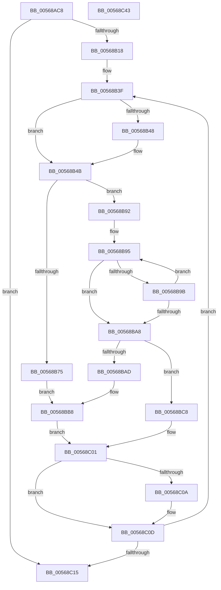

# HalpIommuCleanupPageTable

- RVA: `0x00568AC8`–`0x00568C44` (길이 `380` bytes)
- VA: `0x0000000140568AC8`
- 실행 섹션: `.text`
- PDB 이름 있음: `예`; PDB Function 태그: `아니요`
- unwind 정보 RVA: `0x000C4EE8`
- 디코드: `115`개 명령, `380/380` bytes 표시
- 미해석 바이트: `0` (있으면 어셈블리에 `.byte`로 보존)

> 이 문서는 커널 이미지의 기계어와 PDB 기호를 분석해 생성했습니다. 4번과 5번은 함수 원형과 자료형을 바이너리 사용 방식에서 추정한 C 해석이며 원본 소스 복구 결과는 아닙니다.

## 1. Dependencies

- 직접 호출 지점: **8**; 고유 호출 대상: **4**
- 직접 호출자로 확인된 함수: **1**
- RIP 상대 이미지 참조: **1**

### Outgoing calls
- `0x00568B2C` → [memset](../6C/memset_function_006C6C40.md) (function, `0x006C6C40`)
- `0x00568B3F` → [Feature_DmarptCleanupOutOfBoundsFix__private_IsEnabledDeviceUsageNoInline](Feature_DmarptCleanupOutOfBoundsFix__private_IsEnabledDeviceUsageNoInline_function_00568A74.md) (function, `0x00568A74`)
- `0x00568B83` → [memset](../6C/memset_function_006C6C40.md) (function, `0x006C6C40`)
- `0x00568B8B` → [HalpMmAllocCtxFree](../3E/HalpMmAllocCtxFree_function_003E1904.md) (function, `0x003E1904`)
- `0x00568BB0` → [HalpMmAllocCtxFree](../3E/HalpMmAllocCtxFree_function_003E1904.md) (function, `0x003E1904`)
- `0x00568BE1` → [memset](../6C/memset_function_006C6C40.md) (function, `0x006C6C40`)
- `0x00568C01` → [Feature_DmarptCleanupOutOfBoundsFix__private_IsEnabledDeviceUsageNoInline](Feature_DmarptCleanupOutOfBoundsFix__private_IsEnabledDeviceUsageNoInline_function_00568A74.md) (function, `0x00568A74`)
- `0x00568C1D` → [_security_check_cookie](../6A/_security_check_cookie_function_006AC640.md) (function, `0x006AC640`)

### Direct callers
- [HalpIommuFreeDmaDomain](../55/HalpIommuFreeDmaDomain_function_005550F8.md) at `0x0055513B`

### Static image references
- `0x00568AE7` → RVA `0x00E0A740` (`.data`; read)

## 2. Other-region calls and transfers

- 다른 실행 섹션으로 향하는 call: **0**
- 별도 외부 분기/꼬리 이동을 확인하지 못했습니다.

## 3. Assembly (complete function range)

```asm
00568AC8  4C 8B DC                        mov r11, rsp
00568ACB  49 89 5B 10                     mov qword ptr [r11 + 0x10], rbx
00568ACF  49 89 6B 18                     mov qword ptr [r11 + 0x18], rbp
00568AD3  49 89 73 20                     mov qword ptr [r11 + 0x20], rsi
00568AD7  57                              push rdi
00568AD8  41 54                           push r12
00568ADA  41 55                           push r13
00568ADC  41 56                           push r14
00568ADE  41 57                           push r15
00568AE0  48 81 EC 80 00 00 00            sub rsp, 0x80
00568AE7  48 8B 05 52 1C 8A 00            mov rax, qword ptr [rip + 0x8a1c52]
00568AEE  48 33 C4                        xor rax, rsp
00568AF1  48 89 44 24 70                  mov qword ptr [rsp + 0x70], rax
00568AF6  48 8B 79 10                     mov rdi, qword ptr [rcx + 0x10]
00568AFA  0F 57 C0                        xorps xmm0, xmm0
00568AFD  4C 8B E9                        mov r13, rcx
00568B00  0F 11 44 24 28                  movups xmmword ptr [rsp + 0x28], xmm0
00568B05  0F 11 44 24 38                  movups xmmword ptr [rsp + 0x38], xmm0
00568B0A  0F 11 44 24 48                  movups xmmword ptr [rsp + 0x48], xmm0
00568B0F  48 85 FF                        test rdi, rdi
00568B12  0F 84 FD 00 00 00               je 0x140568c15
00568B18  44 8B 41 18                     mov r8d, dword ptr [rcx + 0x18]
00568B1C  33 ED                           xor ebp, ebp
00568B1E  49 C1 E0 02                     shl r8, 2
00568B22  49 8D 4B B0                     lea rcx, [r11 - 0x50]
00568B26  33 D2                           xor edx, edx
00568B28  49 89 7B 80                     mov qword ptr [r11 - 0x80], rdi
00568B2C  E8 0F E1 15 00                  call 0x1406c6c40
00568B31  4C 8D 74 24 28                  lea r14, [rsp + 0x28]
00568B36  48 8D 74 24 58                  lea rsi, [rsp + 0x58]
00568B3B  4D 8D 7D 24                     lea r15, [r13 + 0x24]
00568B3F  E8 30 FF FF FF                  call 0x140568a74
00568B44  85 C0                           test eax, eax
00568B46  74 03                           je 0x140568b4b
00568B48  49 8B 3E                        mov rdi, qword ptr [r14]
00568B4B  41 8B 0F                        mov ecx, dword ptr [r15]
00568B4E  BA 01 00 00 00                  mov edx, 1
00568B53  45 8B 4D 1C                     mov r9d, dword ptr [r13 + 0x1c]
00568B57  D3 E2                           shl edx, cl
00568B59  41 8B C9                        mov ecx, r9d
00568B5C  8B C2                           mov eax, edx
00568B5E  D3 E0                           shl eax, cl
00568B60  48 63 C8                        movsxd rcx, eax
00568B63  41 8B 45 18                     mov eax, dword ptr [r13 + 0x18]
00568B67  48 03 CF                        add rcx, rdi
00568B6A  FF C8                           dec eax
00568B6C  48 89 4C 24 20                  mov qword ptr [rsp + 0x20], rcx
00568B71  3B E8                           cmp ebp, eax
00568B73  75 1D                           jne 0x140568b92
00568B75  44 8B C2                        mov r8d, edx
00568B78  41 8B C9                        mov ecx, r9d
00568B7B  49 D3 E0                        shl r8, cl
00568B7E  33 D2                           xor edx, edx
00568B80  48 8B CF                        mov rcx, rdi
00568B83  E8 B8 E0 15 00                  call 0x1406c6c40
00568B88  48 8B D7                        mov rdx, rdi
00568B8B  E8 74 8D E7 FF                  call 0x1403e1904
00568B90  EB 26                           jmp 0x140568bb8
00568B92  45 33 E4                        xor r12d, r12d
00568B95  8B 1E                           mov ebx, dword ptr [rsi]
00568B97  3B DA                           cmp ebx, edx
00568B99  73 0D                           jae 0x140568ba8
00568B9B  4C 8B 24 D9                     mov r12, qword ptr [rcx + rbx*8]
00568B9F  FF C3                           inc ebx
00568BA1  89 1E                           mov dword ptr [rsi], ebx
00568BA3  4D 85 E4                        test r12, r12
00568BA6  74 ED                           je 0x140568b95
00568BA8  4D 85 E4                        test r12, r12
00568BAB  75 1B                           jne 0x140568bc8
00568BAD  48 8B D7                        mov rdx, rdi
00568BB0  E8 4F 8D E7 FF                  call 0x1403e1904
00568BB5  44 21 26                        and dword ptr [rsi], r12d
00568BB8  FF CD                           dec ebp
00568BBA  49 83 EF 04                     sub r15, 4
00568BBE  48 83 EE 04                     sub rsi, 4
00568BC2  49 83 EE 08                     sub r14, 8
00568BC6  EB 39                           jmp 0x140568c01
00568BC8  41 8B C9                        mov ecx, r9d
00568BCB  FF CB                           dec ebx
00568BCD  8B C3                           mov eax, ebx
00568BCF  41 B8 01 00 00 00               mov r8d, 1
00568BD5  D3 E0                           shl eax, cl
00568BD7  33 D2                           xor edx, edx
00568BD9  49 D3 E0                        shl r8, cl
00568BDC  8B C8                           mov ecx, eax
00568BDE  48 03 CF                        add rcx, rdi
00568BE1  E8 5A E0 15 00                  call 0x1406c6c40
00568BE6  48 8B 4C 24 20                  mov rcx, qword ptr [rsp + 0x20]
00568BEB  FF C5                           inc ebp
00568BED  49 83 C7 04                     add r15, 4
00568BF1  48 83 C6 04                     add rsi, 4
00568BF5  48 83 24 D9 00                  and qword ptr [rcx + rbx*8], 0
00568BFA  49 83 C6 08                     add r14, 8
00568BFE  4D 89 26                        mov qword ptr [r14], r12
00568C01  E8 6E FE FF FF                  call 0x140568a74
00568C06  85 C0                           test eax, eax
00568C08  75 03                           jne 0x140568c0d
00568C0A  49 8B 3E                        mov rdi, qword ptr [r14]
00568C0D  85 ED                           test ebp, ebp
00568C0F  0F 89 2A FF FF FF               jns 0x140568b3f
00568C15  48 8B 4C 24 70                  mov rcx, qword ptr [rsp + 0x70]
00568C1A  48 33 CC                        xor rcx, rsp
00568C1D  E8 1E 3A 14 00                  call 0x1406ac640
00568C22  4C 8D 9C 24 80 00 00 00         lea r11, [rsp + 0x80]
00568C2A  49 8B 5B 38                     mov rbx, qword ptr [r11 + 0x38]
00568C2E  49 8B 6B 40                     mov rbp, qword ptr [r11 + 0x40]
00568C32  49 8B 73 48                     mov rsi, qword ptr [r11 + 0x48]
00568C36  49 8B E3                        mov rsp, r11
00568C39  41 5F                           pop r15
00568C3B  41 5E                           pop r14
00568C3D  41 5D                           pop r13
00568C3F  41 5C                           pop r12
00568C41  5F                              pop rdi
00568C42  C3                              ret
00568C43  CC                              int3
```

## 4. C-style interpretation (structured pseudocode)

```c
__int64 __fastcall HalpIommuCleanupPageTable(__int64 a1, int a2)
{
    __int64 result;
    __int64 v_r12;
    __int64 v_r14;
    __int64 v_r15;
    __int64 v_rbp;
    __int64 v_rbx;
    __int64 v_rdi;
    __int64 v_rsi;
    __int64 v_rsp;
    unsigned __int64 v_stack_m28;
    unsigned __int64 v_stack_m38;
    unsigned __int64 v_stack_m50;
    unsigned __int64 v_stack_m60;
    unsigned __int64 v_stack_m70;
    unsigned __int64 v_stack_m80;
    unsigned __int64 v_stack_m88;

    *(unsigned __int64 *)(v_rsp + 16) = v_rbx;
    *(unsigned __int64 *)(v_rsp + 24) = v_rbp;
    *(unsigned __int64 *)(v_rsp + 32) = v_rsi;
    v_rsp = (v_rsp) - (128);
    result = (*(unsigned __int64 *)(v_rip + 9051218)) ^ (v_rsp);
    v_stack_m38 = result;
    v_stack_m80 = v_xmm0;
    v_stack_m70 = v_xmm0;
    v_stack_m60 = v_xmm0;
    if (*(unsigned __int64 *)(a1 + 16) == 0) goto loc_00568C15;
    v_rbp = 0;
    a3 = ((unsigned int)(*(unsigned int *)(a1 + 24))) << (2);
    a2 = 0;
    *(unsigned __int64 *)(v_rsp - 128) = *(unsigned __int64 *)(a1 + 16);
    result = memset(v_rsp - 80, a2, a3, a4);
loc_00568B3F:
    result = Feature_DmarptCleanupOutOfBoundsFix__private_IsEnabledDeviceUsageNoInline(v_rsp - 80, a2, a3, a4);
    v_rdi = *(unsigned __int64 *)(a1 + 16);
    if ((unsigned int)(result) != 0) {
        v_rdi = *(unsigned __int64 *)(v_stack_m80);
    }
    a2 = (unsigned int)((1) << ((unsigned __int8)((unsigned int)(*(unsigned int *)(a1 + 36)))));
    result = (unsigned int)(((unsigned int)(a2)) << ((unsigned __int8)((unsigned int)((unsigned int)((unsigned int)(*(unsigned int *)(a1 + 28)))))));
    a1 = ((int)((unsigned int)(result))) + (v_rdi);
    result = (unsigned int)(((unsigned int)(*(unsigned int *)(a1 + 24))) - 1);
    v_stack_m88 = a1;
    if (0 != ((unsigned int)(result))) goto loc_00568B92;
    a3 = ((unsigned int)(a2)) << ((unsigned __int8)((unsigned int)((unsigned int)((unsigned int)(*(unsigned int *)(a1 + 28))))));
    a2 = 0;
    result = memset(v_rdi, a2, a3, (unsigned int)(*(unsigned int *)(a1 + 28)));
    result = HalpMmAllocCtxFree(v_rdi, v_rdi, a3, (unsigned int)(*(unsigned int *)(a1 + 28)));
    goto loc_00568BB8;
loc_00568B92:
    v_r12 = 0;
loc_00568B95:
    if (((unsigned int)((unsigned int)(*(unsigned int *)(v_stack_m50)))) >= ((unsigned int)(v_rdi))) goto loc_00568BA8;
    v_rbx = (unsigned int)(((unsigned int)(*(unsigned int *)(v_stack_m50))) + 1);
    *(unsigned int *)(v_stack_m50) = (unsigned int)(v_rbx);
    if (*(unsigned __int64 *)(v_rdi + (unsigned int)(*(unsigned int *)(v_stack_m50)) * 8) == 0) goto loc_00568B95;
loc_00568BA8:
    if (*(unsigned __int64 *)(v_rdi + (unsigned int)(*(unsigned int *)(v_stack_m50)) * 8) != 0) goto loc_00568BC8;
    result = HalpMmAllocCtxFree(v_rdi, v_rdi, a3, (unsigned int)(*(unsigned int *)(a1 + 28)));
loc_00568BB8:
    v_rbp = (unsigned int)((v_rbp) - 1);
    v_r15 = (a1 + 36) - (4);
    v_rsi = (v_stack_m50) - (4);
    v_r14 = (v_stack_m80) - (8);
    goto loc_00568C01;
loc_00568BC8:
    v_rbx = (unsigned int)((v_rbx) - 1);
    result = (unsigned int)(((unsigned int)((unsigned int)(v_rbx))) << ((unsigned __int8)((unsigned int)((unsigned int)((unsigned int)(*(unsigned int *)(a1 + 28)))))));
    a2 = 0;
    a3 = (1) << ((unsigned __int8)((unsigned int)((unsigned int)((unsigned int)(*(unsigned int *)(a1 + 28))))));
    a1 = ((unsigned int)((unsigned int)(result))) + (v_rdi);
    result = memset(a1, a2, a3, (unsigned int)(*(unsigned int *)(a1 + 28)));
    v_rbp = (unsigned int)((v_rbp) + 1);
    v_r15 = (v_r15) + (4);
    v_rsi = (v_rsi) + (4);
    v_r14 = (v_r14) + (8);
    *(unsigned __int64 *)(v_r14) = *(unsigned __int64 *)(v_rdi + (unsigned int)(*(unsigned int *)(v_stack_m50)) * 8);
loc_00568C01:
    result = Feature_DmarptCleanupOutOfBoundsFix__private_IsEnabledDeviceUsageNoInline(v_stack_m88, a2, a3, (unsigned int)(*(unsigned int *)(a1 + 28)));
    if ((unsigned int)(result) == 0) {
        v_rdi = *(unsigned __int64 *)(v_r14);
    }
    if (!sign_flag) goto loc_00568B3F;
loc_00568C15:
    a1 = (v_stack_m38) ^ (v_rsp);
    result = _security_check_cookie(a1, a2, a3, (unsigned int)(*(unsigned int *)(a1 + 28)));
    return result;
}
```

## 5. (Beta) C Style

```c
int64_t HalpIommuCleanupPageTable(void *Arg1, int32_t Arg2)
{
    uint8_t *arg1 = (uint8_t *)Arg1;

    int64_t result;
    int64_t local_r12;
    int64_t local_r14;
    int64_t local_r15;
    int64_t local_rbp;
    int64_t local_rbx;
    int64_t local_rdi;
    int64_t local_rsi;
    int64_t local_rsp;
    uint64_t v_stack_m28;
    uint64_t v_stack_m38;
    uint64_t v_stack_m50;
    uint64_t v_stack_m60;
    uint64_t v_stack_m70;
    uint64_t v_stack_m80;
    uint64_t v_stack_m88;

    *(uint64_t *)(local_rsp + 0x10) = local_rbx;
    *(uint64_t *)(local_rsp + 0x18) = local_rbp;
    *(uint64_t *)(local_rsp + 0x20) = local_rsi;
    local_rsp = (local_rsp) - (128);
    result = (*(uint64_t *)(v_rip + 0x8A1C52)) ^ (local_rsp);
    v_stack_m38 = result;
    v_stack_m80 = v_xmm0;
    v_stack_m70 = v_xmm0;
    v_stack_m60 = v_xmm0;
    if (*(uint64_t *)(arg1 + 0x10) == 0) goto loc_00568C15;
    local_rbp = 0;
    a3 = ((uint32_t)(*(uint32_t *)(arg1 + 0x18))) << (2);
    Arg2 = 0;
    *(uint64_t *)(local_rsp - 0x80) = *(uint64_t *)(arg1 + 0x10);
    result = memset(local_rsp - 80, Arg2, a3, a4);
loc_00568B3F:
    result = Feature_DmarptCleanupOutOfBoundsFix__private_IsEnabledDeviceUsageNoInline(local_rsp - 80, Arg2, a3, a4);
    local_rdi = *(uint64_t *)(arg1 + 0x10);
    if ((uint32_t)(result) != 0) {
        local_rdi = *(uint64_t *)(v_stack_m80);
    }
    Arg2 = (uint32_t)((1) << ((uint8_t)((uint32_t)(*(uint32_t *)(arg1 + 0x24)))));
    result = (uint32_t)(((uint32_t)(Arg2)) << ((uint8_t)((uint32_t)((uint32_t)((uint32_t)(*(uint32_t *)(arg1 + 0x1C)))))));
    Arg1 = ((int32_t)((uint32_t)(result))) + (local_rdi);
    result = (uint32_t)(((uint32_t)(*(uint32_t *)(arg1 + 0x18))) - 1);
    v_stack_m88 = Arg1;
    if (0 != ((uint32_t)(result))) goto loc_00568B92;
    a3 = ((uint32_t)(Arg2)) << ((uint8_t)((uint32_t)((uint32_t)((uint32_t)(*(uint32_t *)(arg1 + 0x1C))))));
    Arg2 = 0;
    result = memset(local_rdi, Arg2, a3, (uint32_t)(*(uint32_t *)(arg1 + 0x1C)));
    result = HalpMmAllocCtxFree(local_rdi, local_rdi, a3, (uint32_t)(*(uint32_t *)(arg1 + 0x1C)));
    goto loc_00568BB8;
loc_00568B92:
    local_r12 = 0;
loc_00568B95:
    if (((uint32_t)((uint32_t)(*(uint32_t *)(v_stack_m50)))) >= ((uint32_t)(local_rdi))) goto loc_00568BA8;
    local_rbx = (uint32_t)(((uint32_t)(*(uint32_t *)(v_stack_m50))) + 1);
    *(uint32_t *)(v_stack_m50) = (uint32_t)(local_rbx);
    if (*(uint64_t *)(local_rdi + (uint32_t)(*(uint32_t *)(v_stack_m50)) * 8) == 0) goto loc_00568B95;
loc_00568BA8:
    if (*(uint64_t *)(local_rdi + (uint32_t)(*(uint32_t *)(v_stack_m50)) * 8) != 0) goto loc_00568BC8;
    result = HalpMmAllocCtxFree(local_rdi, local_rdi, a3, (uint32_t)(*(uint32_t *)(arg1 + 0x1C)));
loc_00568BB8:
    local_rbp = (uint32_t)((local_rbp) - 1);
    local_r15 = (Arg1 + 36) - (4);
    local_rsi = (v_stack_m50) - (4);
    local_r14 = (v_stack_m80) - (8);
    goto loc_00568C01;
loc_00568BC8:
    local_rbx = (uint32_t)((local_rbx) - 1);
    result = (uint32_t)(((uint32_t)((uint32_t)(local_rbx))) << ((uint8_t)((uint32_t)((uint32_t)((uint32_t)(*(uint32_t *)(arg1 + 0x1C)))))));
    Arg2 = 0;
    a3 = (1) << ((uint8_t)((uint32_t)((uint32_t)((uint32_t)(*(uint32_t *)(arg1 + 0x1C))))));
    Arg1 = ((uint32_t)((uint32_t)(result))) + (local_rdi);
    result = memset(Arg1, Arg2, a3, (uint32_t)(*(uint32_t *)(arg1 + 0x1C)));
    local_rbp = (uint32_t)((local_rbp) + 1);
    local_r15 = (local_r15) + (4);
    local_rsi = (local_rsi) + (4);
    local_r14 = (local_r14) + (8);
    *(uint64_t *)(local_r14) = *(uint64_t *)(local_rdi + (uint32_t)(*(uint32_t *)(v_stack_m50)) * 8);
loc_00568C01:
    result = Feature_DmarptCleanupOutOfBoundsFix__private_IsEnabledDeviceUsageNoInline(v_stack_m88, Arg2, a3, (uint32_t)(*(uint32_t *)(arg1 + 0x1C)));
    if ((uint32_t)(result) == 0) {
        local_rdi = *(uint64_t *)(local_r14);
    }
    if (!sign_flag) goto loc_00568B3F;
loc_00568C15:
    Arg1 = (v_stack_m38) ^ (local_rsp);
    result = _security_check_cookie(Arg1, Arg2, a3, (uint32_t)(*(uint32_t *)(arg1 + 0x1C)));
    return result;
}
```

### 관측된 메모리 오프셋

구조체 형식이 확인되지 않은 접근은 인자 기준의 오프셋으로만 기록했습니다.

| 기준 인자 | 오프셋 표현 | 폭 (bit) | 접근 |
|---|---:|---:|---|
| `Arg1` | `+ 0x0` | `32` | `R` |
| `Arg1` | `+ 0x10` | `64` | `R` |
| `Arg1` | `+ 0x18` | `32` | `R` |
| `Arg1` | `+ 0x1C` | `32` | `R` |
| `Arg1` | `+ 0x24` | `64` | `R` |

## 6. Execution-region graph

[열기: 2D/3D 그래프와 함수 탐색 컨트롤 패널](../../../control-panel.html?section=text&rva=0x00568AC8&view=graph)

- 2D 그래프는 위에서 아래로 흐르고, 3D 그래프는 빈 공간을 드래그해 회전합니다. Shift+드래그는 이동, 휠은 확대·축소, 함수 노드 선택은 대상 보고서 이동입니다.

### Static fallback


