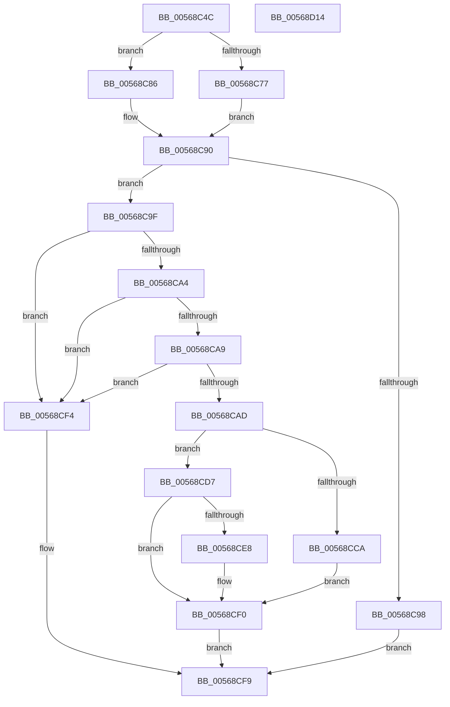

# HalpIommuCreateDmarPageTable

- RVA: `0x00568C4C`–`0x00568D15` (길이 `201` bytes)
- VA: `0x0000000140568C4C`
- 실행 섹션: `.text`
- PDB 이름 있음: `예`; PDB Function 태그: `아니요`
- unwind 정보 RVA: `0x00060130`
- 디코드: `59`개 명령, `201/201` bytes 표시
- 미해석 바이트: `0` (있으면 어셈블리에 `.byte`로 보존)

> 이 문서는 커널 이미지의 기계어와 PDB 기호를 분석해 생성했습니다. 4번과 5번은 함수 원형과 자료형을 바이너리 사용 방식에서 추정한 C 해석이며 원본 소스 복구 결과는 아닙니다.

## 1. Dependencies

- 직접 호출 지점: **4**; 고유 호출 대상: **4**
- 직접 호출자로 확인된 함수: **2**
- RIP 상대 이미지 참조: **0**

### Outgoing calls
- `0x00568C7F` → [HalpMmAllocateMemoryInternal](../54/HalpMmAllocateMemoryInternal_function_00544990.md) (function, `0x00544990`)
- `0x00568C8B` → [HalpMmAllocCtxAlloc](../3E/HalpMmAllocCtxAlloc_function_003E10B8.md) (function, `0x003E10B8`)
- `0x00568CBF` → [HalpIommuInitializeDmarPageTable](HalpIommuInitializeDmarPageTable_function_00568F24.md) (function, `0x00568F24`)
- `0x00568CEB` → [HalpMmAllocCtxFree](../3E/HalpMmAllocCtxFree_function_003E1904.md) (function, `0x003E1904`)

### Direct callers
- [HalpIommuAllocateDmaDomain](../55/HalpIommuAllocateDmaDomain_function_00554904.md) at `0x00554B69`
- [HalpIommuConstructReservedPageTable](../../pagelk/B5/HalpIommuConstructReservedPageTable_function_00B5DD20.md) at `0x00B5DD84`

### Static image references
- 디코드된 RIP-relative 메모리 참조가 없습니다.

## 2. Other-region calls and transfers

- 다른 실행 섹션으로 향하는 call: **0**
- 별도 외부 분기/꼬리 이동을 확인하지 못했습니다.

## 3. Assembly (complete function range)

```asm
00568C4C  48 8B C4                        mov rax, rsp
00568C4F  48 89 58 08                     mov qword ptr [rax + 8], rbx
00568C53  48 89 68 10                     mov qword ptr [rax + 0x10], rbp
00568C57  48 89 70 18                     mov qword ptr [rax + 0x18], rsi
00568C5B  48 89 78 20                     mov qword ptr [rax + 0x20], rdi
00568C5F  41 56                           push r14
00568C61  48 83 EC 40                     sub rsp, 0x40
00568C65  48 8B 6C 24 78                  mov rbp, qword ptr [rsp + 0x78]
00568C6A  41 8B F8                        mov edi, r8d
00568C6D  8B F2                           mov esi, edx
00568C6F  44 8B F1                        mov r14d, ecx
00568C72  48 85 ED                        test rbp, rbp
00568C75  74 0F                           je 0x140568c86
00568C77  BA 01 00 00 00                  mov edx, 1
00568C7C  8D 4A 5F                        lea ecx, [rdx + 0x5f]
00568C7F  E8 0C BD FD FF                  call 0x140544990
00568C84  EB 0A                           jmp 0x140568c90
00568C86  BA 60 00 00 00                  mov edx, 0x60
00568C8B  E8 28 84 E7 FF                  call 0x1403e10b8
00568C90  48 8B D8                        mov rbx, rax
00568C93  48 85 C0                        test rax, rax
00568C96  75 07                           jne 0x140568c9f
00568C98  B8 9A 00 00 C0                  mov eax, 0xc000009a
00568C9D  EB 5A                           jmp 0x140568cf9
00568C9F  83 FF 06                        cmp edi, 6
00568CA2  77 50                           ja 0x140568cf4
00568CA4  83 FE 02                        cmp esi, 2
00568CA7  72 4B                           jb 0x140568cf4
00568CA9  3B FE                           cmp edi, esi
00568CAB  72 47                           jb 0x140568cf4
00568CAD  48 89 5C 24 30                  mov qword ptr [rsp + 0x30], rbx
00568CB2  44 8B C7                        mov r8d, edi
00568CB5  8B D6                           mov edx, esi
00568CB7  48 89 6C 24 28                  mov qword ptr [rsp + 0x28], rbp
00568CBC  41 8B CE                        mov ecx, r14d
00568CBF  E8 60 02 00 00                  call 0x140568f24
00568CC4  8B F8                           mov edi, eax
00568CC6  85 C0                           test eax, eax
00568CC8  78 0D                           js 0x140568cd7
00568CCA  48 8B 8C 24 80 00 00 00         mov rcx, qword ptr [rsp + 0x80]
00568CD2  48 89 19                        mov qword ptr [rcx], rbx
00568CD5  EB 19                           jmp 0x140568cf0
00568CD7  48 8B 84 24 80 00 00 00         mov rax, qword ptr [rsp + 0x80]
00568CDF  48 83 20 00                     and qword ptr [rax], 0
00568CE3  48 85 ED                        test rbp, rbp
00568CE6  75 08                           jne 0x140568cf0
00568CE8  48 8B D3                        mov rdx, rbx
00568CEB  E8 14 8C E7 FF                  call 0x1403e1904
00568CF0  8B C7                           mov eax, edi
00568CF2  EB 05                           jmp 0x140568cf9
00568CF4  B8 0D 00 00 C0                  mov eax, 0xc000000d
00568CF9  48 8B 5C 24 50                  mov rbx, qword ptr [rsp + 0x50]
00568CFE  48 8B 6C 24 58                  mov rbp, qword ptr [rsp + 0x58]
00568D03  48 8B 74 24 60                  mov rsi, qword ptr [rsp + 0x60]
00568D08  48 8B 7C 24 68                  mov rdi, qword ptr [rsp + 0x68]
00568D0D  48 83 C4 40                     add rsp, 0x40
00568D11  41 5E                           pop r14
00568D13  C3                              ret
00568D14  CC                              int3
```

## 4. C-style interpretation (structured pseudocode)

```c
__int64 __fastcall HalpIommuCreateDmarPageTable(int a1, int a2, int a3, __int64 a4, __int64 a5, __int64 a6, __int64 a7)
{
    __int64 result;
    __int64 v_rsp;
    unsigned __int64 v_stack_m18;
    unsigned __int64 v_stack_m20;
    unsigned __int64 v_stack_p10;
    unsigned __int64 v_stack_p18;
    unsigned __int64 v_stack_p20;
    unsigned __int64 v_stack_p8;

    *(unsigned __int64 *)(v_rsp + 8) = v_rbx;
    *(unsigned __int64 *)(v_rsp + 16) = v_rbp;
    *(unsigned __int64 *)(v_rsp + 24) = v_rsi;
    *(unsigned __int64 *)(v_rsp + 32) = v_rdi;
    v_rsp = (v_rsp) - (64);
    if (a6 == 0) goto loc_00568C86;
    result = HalpMmAllocateMemoryInternal(1 + 95, 1, a3, a4);
    goto loc_00568C90;
loc_00568C86:
    result = HalpMmAllocCtxAlloc(1 + 95, 96, a3, a4);
loc_00568C90:
    if (result != 0) goto loc_00568C9F;
    goto loc_00568CF9;
loc_00568C9F:
    if (((unsigned int)((unsigned int)(a3))) > 6) goto loc_00568CF4;
    if (((unsigned int)((unsigned int)(a2))) < 2) goto loc_00568CF4;
    if (((unsigned int)((unsigned int)(a3))) < ((unsigned int)((unsigned int)(a2)))) goto loc_00568CF4;
    v_stack_m18 = result;
    v_stack_m20 = a6;
    result = HalpIommuInitializeDmarPageTable((unsigned int)((unsigned int)((unsigned int)(a1))), (unsigned int)((unsigned int)((unsigned int)(a2))), (unsigned int)((unsigned int)((unsigned int)(a3))), a4);
    if (sign_flag) goto loc_00568CD7;
    *(unsigned __int64 *)(a7) = result;
    goto loc_00568CF0;
loc_00568CD7:
    result = a7;
    if (a6 == 0) {
        a2 = result;
        result = HalpMmAllocCtxFree(a7, a2, (unsigned int)((unsigned int)((unsigned int)(a3))), a4);
    }
    goto loc_00568CF9;
loc_00568CF4:
loc_00568CF9:
    v_rsp = (v_rsp) + (64);
    return (unsigned int)(0xC000000DULL);
}
```

## 5. (Beta) C Style

```c
int64_t HalpIommuCreateDmarPageTable(int32_t Arg1, int32_t Arg2, int32_t Arg3, int64_t Arg4, uint64_t Arg5, int64_t Arg6, void *Arg7)
{
    uint8_t *arg7 = (uint8_t *)Arg7;

    int64_t result;
    int64_t local_rsp;
    uint64_t v_stack_m18;
    uint64_t v_stack_m20;
    uint64_t v_stack_p10;
    uint64_t v_stack_p18;
    uint64_t v_stack_p20;
    uint64_t v_stack_p8;

    *(uint64_t *)(local_rsp + 0x8) = local_rbx;
    *(uint64_t *)(local_rsp + 0x10) = local_rbp;
    *(uint64_t *)(local_rsp + 0x18) = local_rsi;
    *(uint64_t *)(local_rsp + 0x20) = local_rdi;
    local_rsp = (local_rsp) - (64);
    if (Arg6 == 0) goto loc_00568C86;
    result = HalpMmAllocateMemoryInternal(1 + 95, 1, Arg3, Arg4);
    goto loc_00568C90;
loc_00568C86:
    result = HalpMmAllocCtxAlloc(1 + 95, 96, Arg3, Arg4);
loc_00568C90:
    if (result != 0) goto loc_00568C9F;
    goto loc_00568CF9;
loc_00568C9F:
    if (((uint32_t)((uint32_t)(Arg3))) > 6) goto loc_00568CF4;
    if (((uint32_t)((uint32_t)(Arg2))) < 2) goto loc_00568CF4;
    if (((uint32_t)((uint32_t)(Arg3))) < ((uint32_t)((uint32_t)(Arg2)))) goto loc_00568CF4;
    v_stack_m18 = result;
    v_stack_m20 = Arg6;
    result = HalpIommuInitializeDmarPageTable((uint32_t)((uint32_t)((uint32_t)(Arg1))), (uint32_t)((uint32_t)((uint32_t)(Arg2))), (uint32_t)((uint32_t)((uint32_t)(Arg3))), Arg4);
    if (sign_flag) goto loc_00568CD7;
    *(uint64_t *)(arg7) = result;
    goto loc_00568CF0;
loc_00568CD7:
    result = Arg7;
    if (Arg6 == 0) {
        Arg2 = result;
        result = HalpMmAllocCtxFree(Arg7, Arg2, (uint32_t)((uint32_t)((uint32_t)(Arg3))), Arg4);
    }
    goto loc_00568CF9;
loc_00568CF4:
loc_00568CF9:
    local_rsp = (local_rsp) + (64);
    return (uint32_t)(0xC000000DULL);
}
```

### 관측된 메모리 오프셋

구조체 형식이 확인되지 않은 접근은 인자 기준의 오프셋으로만 기록했습니다.

| 기준 인자 | 오프셋 표현 | 폭 (bit) | 접근 |
|---|---:|---:|---|
| `Arg7` | `+ 0x0` | `64` | `R/W` |
| `Arg7` | `+ 0x0` | `64` | `W` |

## 6. Execution-region graph

[열기: 2D/3D 그래프와 함수 탐색 컨트롤 패널](../../../control-panel.html?section=text&rva=0x00568C4C&view=graph)

- 2D 그래프는 위에서 아래로 흐르고, 3D 그래프는 빈 공간을 드래그해 회전합니다. Shift+드래그는 이동, 휠은 확대·축소, 함수 노드 선택은 대상 보고서 이동입니다.

### Static fallback


