# HalpIommuDmarPageTableMarkHiberPhase

- RVA: `0x00568D1C`–`0x00568EB8` (길이 `412` bytes)
- VA: `0x0000000140568D1C`
- 실행 섹션: `.text`
- PDB 이름 있음: `예`; PDB Function 태그: `아니요`
- unwind 정보 RVA: `0x000C4F10`
- 디코드: `132`개 명령, `412/412` bytes 표시
- 미해석 바이트: `0` (있으면 어셈블리에 `.byte`로 보존)

> 이 문서는 커널 이미지의 기계어와 PDB 기호를 분석해 생성했습니다. 4번과 5번은 함수 원형과 자료형을 바이너리 사용 방식에서 추정한 C 해석이며 원본 소스 복구 결과는 아닙니다.

## 1. Dependencies

- 직접 호출 지점: **2**; 고유 호출 대상: **2**
- 직접 호출자로 확인된 함수: **1**
- RIP 상대 이미지 참조: **1**

### Outgoing calls
- `0x00568E40` → [PoSetHiberRange](../47/PoSetHiberRange_function_0047C580.md) (function, `0x0047C580`)
- `0x00568EA1` → [_security_check_cookie](../6A/_security_check_cookie_function_006AC640.md) (function, `0x006AC640`)

### Direct callers
- [HalpIommuDomainMarkHiberLogicalRange](../55/HalpIommuDomainMarkHiberLogicalRange_function_005550B4.md) at `0x005550C5`

### Static image references
- `0x00568D2D` → RVA `0x00E0A740` (`.data`; read)

## 2. Other-region calls and transfers

- 다른 실행 섹션으로 향하는 call: **0**
- 별도 외부 분기/꼬리 이동을 확인하지 못했습니다.

## 3. Assembly (complete function range)

```asm
00568D1C  40 53                           push rbx
00568D1E  55                              push rbp
00568D1F  56                              push rsi
00568D20  57                              push rdi
00568D21  41 54                           push r12
00568D23  41 55                           push r13
00568D25  41 56                           push r14
00568D27  41 57                           push r15
00568D29  48 83 EC 78                     sub rsp, 0x78
00568D2D  48 8B 05 0C 1A 8A 00            mov rax, qword ptr [rip + 0x8a1a0c]
00568D34  48 33 C4                        xor rax, rsp
00568D37  48 89 44 24 60                  mov qword ptr [rsp + 0x60], rax
00568D3C  44 8B 62 1C                     mov r12d, dword ptr [rdx + 0x1c]
00568D40  0F 57 C0                        xorps xmm0, xmm0
00568D43  48 8B F2                        mov rsi, rdx
00568D46  33 FF                           xor edi, edi
00568D48  48 8B 52 10                     mov rdx, qword ptr [rdx + 0x10]
00568D4C  45 33 FF                        xor r15d, r15d
00568D4F  4D 8B F1                        mov r14, r9
00568D52  49 8B E8                        mov rbp, r8
00568D55  4C 8B E9                        mov r13, rcx
00568D58  0F 11 44 24 30                  movups xmmword ptr [rsp + 0x30], xmm0
00568D5D  48 89 54 24 30                  mov qword ptr [rsp + 0x30], rdx
00568D62  0F 11 44 24 40                  movups xmmword ptr [rsp + 0x40], xmm0
00568D67  0F 11 44 24 50                  movups xmmword ptr [rsp + 0x50], xmm0
00568D6C  4D 85 C9                        test r9, r9
00568D6F  0F 84 24 01 00 00               je 0x140568e99
00568D75  8D 5F 01                        lea ebx, [rdi + 1]
00568D78  44 8B 5E 18                     mov r11d, dword ptr [rsi + 0x18]
00568D7C  41 FF CB                        dec r11d
00568D7F  44 8B D7                        mov r10d, edi
00568D82  46 8B 44 96 24                  mov r8d, dword ptr [rsi + r10*4 + 0x24]
00568D87  41 3B FB                        cmp edi, r11d
00568D8A  73 50                           jae 0x140568ddc
00568D8C  41 8B C8                        mov ecx, r8d
00568D8F  8B C3                           mov eax, ebx
00568D91  D3 E0                           shl eax, cl
00568D93  41 8B CC                        mov ecx, r12d
00568D96  D3 E0                           shl eax, cl
00568D98  4C 63 C8                        movsxd r9, eax
00568D9B  4C 03 CA                        add r9, rdx
00568D9E  41 83 F8 40                     cmp r8d, 0x40
00568DA2  72 06                           jb 0x140568daa
00568DA4  48 83 CA FF                     or rdx, 0xffffffffffffffff
00568DA8  EB 0C                           jmp 0x140568db6
00568DAA  41 8B C8                        mov ecx, r8d
00568DAD  48 8B D3                        mov rdx, rbx
00568DB0  48 D3 E2                        shl rdx, cl
00568DB3  48 2B D3                        sub rdx, rbx
00568DB6  42 8B 4C 96 3C                  mov ecx, dword ptr [rsi + r10*4 + 0x3c]
00568DBB  48 8B C5                        mov rax, rbp
00568DBE  48 D3 E8                        shr rax, cl
00568DC1  8B C0                           mov eax, eax
00568DC3  48 23 C2                        and rax, rdx
00568DC6  49 8B 14 C1                     mov rdx, qword ptr [r9 + rax*8]
00568DCA  48 85 D2                        test rdx, rdx
00568DCD  0F 84 C6 00 00 00               je 0x140568e99
00568DD3  03 FB                           add edi, ebx
00568DD5  48 89 54 FC 30                  mov qword ptr [rsp + rdi*8 + 0x30], rdx
00568DDA  EB A3                           jmp 0x140568d7f
00568DDC  41 83 F8 40                     cmp r8d, 0x40
00568DE0  72 06                           jb 0x140568de8
00568DE2  48 83 C8 FF                     or rax, 0xffffffffffffffff
00568DE6  EB 0C                           jmp 0x140568df4
00568DE8  41 8B C8                        mov ecx, r8d
00568DEB  48 8B C3                        mov rax, rbx
00568DEE  48 D3 E0                        shl rax, cl
00568DF1  48 2B C3                        sub rax, rbx
00568DF4  42 8B 4C 96 3C                  mov ecx, dword ptr [rsi + r10*4 + 0x3c]
00568DF9  4C 8B CD                        mov r9, rbp
00568DFC  49 D3 E9                        shr r9, cl
00568DFF  41 8B CC                        mov ecx, r12d
00568E02  44 23 C8                        and r9d, eax
00568E05  C7 44 24 20 68 61 6C 74         mov dword ptr [rsp + 0x20], 0x746c6168
00568E0D  45 8B C1                        mov r8d, r9d
00568E10  8B C3                           mov eax, ebx
00568E12  41 D3 E0                        shl r8d, cl
00568E15  42 8B 4C 9E 24                  mov ecx, dword ptr [rsi + r11*4 + 0x24]
00568E1A  4C 03 C2                        add r8, rdx
00568E1D  D3 E0                           shl eax, cl
00568E1F  41 8B D6                        mov edx, r14d
00568E22  41 2B C1                        sub eax, r9d
00568E25  41 2B D7                        sub edx, r15d
00568E28  3B D0                           cmp edx, eax
00568E2A  41 8B CC                        mov ecx, r12d
00568E2D  0F 46 C2                        cmovbe eax, edx
00568E30  BA 02 00 00 00                  mov edx, 2
00568E35  44 8B C8                        mov r9d, eax
00568E38  8B D8                           mov ebx, eax
00568E3A  41 D3 E1                        shl r9d, cl
00568E3D  49 8B CD                        mov rcx, r13
00568E40  E8 3B 37 F1 FF                  call 0x14047c580
00568E45  44 8B CB                        mov r9d, ebx
00568E48  44 03 FB                        add r15d, ebx
00568E4B  49 C1 E1 0C                     shl r9, 0xc
00568E4F  BB 01 00 00 00                  mov ebx, 1
00568E54  4C 03 CD                        add r9, rbp
00568E57  85 FF                           test edi, edi
00568E59  74 28                           je 0x140568e83
00568E5B  44 8D 47 FF                     lea r8d, [rdi - 1]
00568E5F  48 8B D3                        mov rdx, rbx
00568E62  42 8B 4C 86 3C                  mov ecx, dword ptr [rsi + r8*4 + 0x3c]
00568E67  49 8B C1                        mov rax, r9
00568E6A  48 D3 E2                        shl rdx, cl
00568E6D  48 8B CD                        mov rcx, rbp
00568E70  48 23 CA                        and rcx, rdx
00568E73  48 23 C2                        and rax, rdx
00568E76  48 3B C1                        cmp rax, rcx
00568E79  74 08                           je 0x140568e83
00568E7B  41 8B F8                        mov edi, r8d
00568E7E  45 85 C0                        test r8d, r8d
00568E81  75 D8                           jne 0x140568e5b
00568E83  8B C7                           mov eax, edi
00568E85  49 8B E9                        mov rbp, r9
00568E88  48 8B 54 C4 30                  mov rdx, qword ptr [rsp + rax*8 + 0x30]
00568E8D  41 8B C7                        mov eax, r15d
00568E90  49 3B C6                        cmp rax, r14
00568E93  0F 82 DF FE FF FF               jb 0x140568d78
00568E99  48 8B 4C 24 60                  mov rcx, qword ptr [rsp + 0x60]
00568E9E  48 33 CC                        xor rcx, rsp
00568EA1  E8 9A 37 14 00                  call 0x1406ac640
00568EA6  48 83 C4 78                     add rsp, 0x78
00568EAA  41 5F                           pop r15
00568EAC  41 5E                           pop r14
00568EAE  41 5D                           pop r13
00568EB0  41 5C                           pop r12
00568EB2  5F                              pop rdi
00568EB3  5E                              pop rsi
00568EB4  5D                              pop rbp
00568EB5  5B                              pop rbx
00568EB6  C3                              ret
00568EB7  CC                              int3
```

## 4. C-style interpretation (structured pseudocode)

```c
__int64 __fastcall HalpIommuDmarPageTableMarkHiberPhase(__int64 a1, __int64 a2, __int64 a3, __int64 a4)
{
    __int64 result;
    __int64 v_r11;
    __int64 v_r15;
    __int64 v_rdi;
    __int64 v_rsp;
    unsigned __int64 v_stack_m58;
    unsigned __int64 v_stack_m68;
    unsigned __int64 v_stack_m78;
    unsigned __int64 v_stack_m88;
    unsigned int v_stack_m98;

    v_rsp = (v_rsp) - (120);
    result = (*(unsigned __int64 *)(v_rip + 9050636)) ^ (v_rsp);
    v_stack_m58 = result;
    v_rdi = 0;
    v_r15 = 0;
    v_stack_m88 = v_xmm0;
    v_stack_m88 = *(unsigned __int64 *)(a2 + 16);
    v_stack_m78 = v_xmm0;
    v_stack_m68 = v_xmm0;
    if (a4 == 0) goto loc_00568E99;
loc_00568D78:
    v_r11 = (unsigned int)(((unsigned int)(*(unsigned int *)(a2 + 24))) - 1);
loc_00568D7F:
    if (0 >= ((unsigned int)(v_r11))) goto loc_00568DDC;
    result = (unsigned int)(((unsigned int)((unsigned int)(v_rdi + 1))) << ((unsigned __int8)((unsigned int)((unsigned int)((unsigned int)(*(unsigned int *)(a2 + 0 * 4 + 36)))))));
    result = (unsigned int)((result) << ((unsigned __int8)((unsigned int)((unsigned int)((unsigned int)(*(unsigned int *)(a2 + 28)))))));
    a4 = ((int)((unsigned int)(result))) + (*(unsigned __int64 *)(a2 + 16));
    if (((unsigned int)((unsigned int)(*(unsigned int *)(a2 + 0 * 4 + 36)))) < 64) goto loc_00568DAA;
    a2 = (*(unsigned __int64 *)(a2 + 16)) | (-1);
    goto loc_00568DB6;
loc_00568DAA:
    a2 = (v_rdi + 1) << ((unsigned __int8)((unsigned int)((unsigned int)((unsigned int)(*(unsigned int *)(a2 + 0 * 4 + 36))))));
    a2 = (a2) - (v_rdi + 1);
loc_00568DB6:
    result = (a3) >> ((unsigned __int8)((unsigned int)(*(unsigned int *)(a2 + 0 * 4 + 60))));
    result = ((unsigned int)((unsigned int)(result))) & (a2);
    if (*(unsigned __int64 *)(a4 + result * 8) == 0) goto loc_00568E99;
    v_rdi = (unsigned int)((v_rdi) + ((unsigned int)(v_rdi + 1)));
    *(unsigned __int64 *)(v_rsp + v_rdi * 8 + 48) = *(unsigned __int64 *)(a4 + result * 8);
    goto loc_00568D7F;
loc_00568DDC:
    if (((unsigned int)((unsigned int)(*(unsigned int *)(a2 + 0 * 4 + 36)))) < 64) goto loc_00568DE8;
    result = (result) | (-1);
    goto loc_00568DF4;
loc_00568DE8:
    result = (v_rdi + 1) << ((unsigned __int8)((unsigned int)((unsigned int)((unsigned int)(*(unsigned int *)(a2 + 0 * 4 + 36))))));
    result = (result) - (v_rdi + 1);
loc_00568DF4:
    a4 = (a3) >> ((unsigned __int8)((unsigned int)(*(unsigned int *)(a2 + 0 * 4 + 60))));
    a4 = (unsigned int)((a4) & ((unsigned int)(result)));
    v_stack_m98 = 0x746C6168ULL;
    a3 = (unsigned int)(((unsigned int)((unsigned int)(a4))) << ((unsigned __int8)((unsigned int)((unsigned int)((unsigned int)(*(unsigned int *)(a2 + 28)))))));
    a3 = (a3) + (*(unsigned __int64 *)(a4 + result * 8));
    result = (unsigned int)(((unsigned int)((unsigned int)(v_rdi + 1))) << ((unsigned __int8)((unsigned int)(*(unsigned int *)(a2 + v_r11 * 4 + 36)))));
    result = (unsigned int)((result) - ((unsigned int)(a4)));
    a2 = (unsigned int)(((unsigned int)((unsigned int)(a4))) - (0));
    if (((unsigned int)(a2)) <= ((unsigned int)(result))) { result = (unsigned int)(a2); }
    a4 = (unsigned int)(((unsigned int)((unsigned int)(result))) << ((unsigned __int8)((unsigned int)((unsigned int)((unsigned int)(*(unsigned int *)(a2 + 28)))))));
    result = PoSetHiberRange(a1, 2, a3, a4);
    v_r15 = (unsigned int)((v_r15) + ((unsigned int)((unsigned int)((unsigned int)(result)))));
    a4 = ((unsigned int)((unsigned int)((unsigned int)((unsigned int)(result))))) << (12);
    a4 = (a4) + (a3);
    if ((unsigned int)(v_rdi) == 0) goto loc_00568E83;
loc_00568E5B:
    a2 = (1) << ((unsigned __int8)((unsigned int)(*(unsigned int *)(a2 + v_rdi - 1 * 4 + 60))));
    a1 = (a3) & (a2);
    result = (a4) & (a2);
    if (result == a1) goto loc_00568E83;
    if ((unsigned int)(v_rdi - 1) != 0) goto loc_00568E5B;
loc_00568E83:
    if (((unsigned int)((unsigned int)(v_r15))) < a4) goto loc_00568D78;
loc_00568E99:
    a1 = (v_stack_m58) ^ (v_rsp);
    result = _security_check_cookie(a1, *(unsigned __int64 *)(v_rsp + (unsigned int)((unsigned int)((unsigned int)((unsigned int)(v_rdi - 1)))) * 8 + 48), v_rdi - 1, a4);
    v_rsp = (v_rsp) + (120);
    return result;
}
```

## 5. (Beta) C Style

```c
int64_t HalpIommuDmarPageTableMarkHiberPhase(int64_t Arg1, void *Arg2, int64_t Arg3, int64_t Arg4)
{
    uint8_t *arg2 = (uint8_t *)Arg2;

    int64_t result;
    int64_t local_r11;
    int64_t local_r15;
    int64_t local_rdi;
    int64_t local_rsp;
    uint64_t v_stack_m58;
    uint64_t v_stack_m68;
    uint64_t v_stack_m78;
    uint64_t v_stack_m88;
    uint32_t v_stack_m98;

    local_rsp = (local_rsp) - (120);
    result = (*(uint64_t *)(v_rip + 0x8A1A0C)) ^ (local_rsp);
    v_stack_m58 = result;
    local_rdi = 0;
    local_r15 = 0;
    v_stack_m88 = v_xmm0;
    v_stack_m88 = *(uint64_t *)(arg2 + 0x10);
    v_stack_m78 = v_xmm0;
    v_stack_m68 = v_xmm0;
    if (Arg4 == 0) goto loc_00568E99;
loc_00568D78:
    local_r11 = (uint32_t)(((uint32_t)(*(uint32_t *)(arg2 + 0x18))) - 1);
loc_00568D7F:
    if (0 >= ((uint32_t)(local_r11))) goto loc_00568DDC;
    result = (uint32_t)(((uint32_t)((uint32_t)(local_rdi + 1))) << ((uint8_t)((uint32_t)((uint32_t)((uint32_t)(*(uint32_t *)(arg2 + 0x0 * 4 + 0x24)))))));
    result = (uint32_t)((result) << ((uint8_t)((uint32_t)((uint32_t)((uint32_t)(*(uint32_t *)(arg2 + 0x1C)))))));
    Arg4 = ((int32_t)((uint32_t)(result))) + (*(uint64_t *)(arg2 + 0x10));
    if (((uint32_t)((uint32_t)(*(uint32_t *)(arg2 + 0x0 * 4 + 0x24)))) < 64) goto loc_00568DAA;
    Arg2 = (*(uint64_t *)(arg2 + 0x10)) | (-1);
    goto loc_00568DB6;
loc_00568DAA:
    Arg2 = (local_rdi + 1) << ((uint8_t)((uint32_t)((uint32_t)((uint32_t)(*(uint32_t *)(arg2 + 0x0 * 4 + 0x24))))));
    Arg2 = (Arg2) - (local_rdi + 1);
loc_00568DB6:
    result = (Arg3) >> ((uint8_t)((uint32_t)(*(uint32_t *)(arg2 + 0x0 * 4 + 0x3C))));
    result = ((uint32_t)((uint32_t)(result))) & (Arg2);
    if (*(uint64_t *)(Arg4 + result * 8) == 0) goto loc_00568E99;
    local_rdi = (uint32_t)((local_rdi) + ((uint32_t)(local_rdi + 1)));
    *(uint64_t *)(local_rsp + local_rdi * 8 + 0x30) = *(uint64_t *)(Arg4 + result * 8);
    goto loc_00568D7F;
loc_00568DDC:
    if (((uint32_t)((uint32_t)(*(uint32_t *)(arg2 + 0x0 * 4 + 0x24)))) < 64) goto loc_00568DE8;
    result = (result) | (-1);
    goto loc_00568DF4;
loc_00568DE8:
    result = (local_rdi + 1) << ((uint8_t)((uint32_t)((uint32_t)((uint32_t)(*(uint32_t *)(arg2 + 0x0 * 4 + 0x24))))));
    result = (result) - (local_rdi + 1);
loc_00568DF4:
    Arg4 = (Arg3) >> ((uint8_t)((uint32_t)(*(uint32_t *)(arg2 + 0x0 * 4 + 0x3C))));
    Arg4 = (uint32_t)((Arg4) & ((uint32_t)(result)));
    v_stack_m98 = 0x746C6168ULL;
    Arg3 = (uint32_t)(((uint32_t)((uint32_t)(Arg4))) << ((uint8_t)((uint32_t)((uint32_t)((uint32_t)(*(uint32_t *)(arg2 + 0x1C)))))));
    Arg3 = (Arg3) + (*(uint64_t *)(Arg4 + result * 8));
    result = (uint32_t)(((uint32_t)((uint32_t)(local_rdi + 1))) << ((uint8_t)((uint32_t)(*(uint32_t *)(arg2 + local_r11 * 4 + 0x24)))));
    result = (uint32_t)((result) - ((uint32_t)(Arg4)));
    Arg2 = (uint32_t)(((uint32_t)((uint32_t)(Arg4))) - (0));
    if (((uint32_t)(Arg2)) <= ((uint32_t)(result))) { result = (uint32_t)(Arg2); }
    Arg4 = (uint32_t)(((uint32_t)((uint32_t)(result))) << ((uint8_t)((uint32_t)((uint32_t)((uint32_t)(*(uint32_t *)(arg2 + 0x1C)))))));
    result = PoSetHiberRange(Arg1, 2, Arg3, Arg4);
    local_r15 = (uint32_t)((local_r15) + ((uint32_t)((uint32_t)((uint32_t)(result)))));
    Arg4 = ((uint32_t)((uint32_t)((uint32_t)((uint32_t)(result))))) << (12);
    Arg4 = (Arg4) + (Arg3);
    if ((uint32_t)(local_rdi) == 0) goto loc_00568E83;
loc_00568E5B:
    Arg2 = (1) << ((uint8_t)((uint32_t)(*(uint32_t *)(arg2 + local_rdi - 0x1 * 4 + 0x3C))));
    Arg1 = (Arg3) & (Arg2);
    result = (Arg4) & (Arg2);
    if (result == Arg1) goto loc_00568E83;
    if ((uint32_t)(local_rdi - 1) != 0) goto loc_00568E5B;
loc_00568E83:
    if (((uint32_t)((uint32_t)(local_r15))) < Arg4) goto loc_00568D78;
loc_00568E99:
    Arg1 = (v_stack_m58) ^ (local_rsp);
    result = _security_check_cookie(Arg1, *(uint64_t *)(local_rsp + (uint32_t)((uint32_t)((uint32_t)((uint32_t)(local_rdi - 0x1)))) * 8 + 0x30), local_rdi - 1, Arg4);
    local_rsp = (local_rsp) + (120);
    return result;
}
```

### 관측된 메모리 오프셋

구조체 형식이 확인되지 않은 접근은 인자 기준의 오프셋으로만 기록했습니다.

| 기준 인자 | 오프셋 표현 | 폭 (bit) | 접근 |
|---|---:|---:|---|
| `Arg2` | `+ 0x10` | `64` | `R` |
| `Arg2` | `+ 0x18` | `32` | `R` |
| `Arg2` | `+ 0x1C` | `32` | `R` |
| `Arg2` | `+ 0x24 + r10*4` | `32` | `R` |
| `Arg2` | `+ 0x24 + r11*4` | `32` | `R` |
| `Arg2` | `+ 0x3C + r10*4` | `32` | `R` |
| `Arg2` | `+ 0x3C + r8*4` | `32` | `R` |

## 6. Execution-region graph

[열기: 2D/3D 그래프와 함수 탐색 컨트롤 패널](../../../control-panel.html?section=text&rva=0x00568D1C&view=graph)

- 2D 그래프는 위에서 아래로 흐르고, 3D 그래프는 빈 공간을 드래그해 회전합니다. Shift+드래그는 이동, 휠은 확대·축소, 함수 노드 선택은 대상 보고서 이동입니다.

### Static fallback

```mermaid
flowchart TD
  bb_00568D1C[BB_00568D1C]
  bb_00568D75[BB_00568D75]
  bb_00568D78[BB_00568D78]
  bb_00568D7F[BB_00568D7F]
  bb_00568D8C[BB_00568D8C]
  bb_00568DA4[BB_00568DA4]
  bb_00568DAA[BB_00568DAA]
  bb_00568DB6[BB_00568DB6]
  bb_00568DD3[BB_00568DD3]
  bb_00568DDC[BB_00568DDC]
  bb_00568DE2[BB_00568DE2]
  bb_00568DE8[BB_00568DE8]
  bb_00568DF4[BB_00568DF4]
  bb_00568E5B[BB_00568E5B]
  bb_00568E7B[BB_00568E7B]
  bb_00568E83[BB_00568E83]
  bb_00568E99[BB_00568E99]
  bb_00568EB7[BB_00568EB7]
  bb_00568D1C -->|branch| bb_00568E99
  bb_00568D1C -->|fallthrough| bb_00568D75
  bb_00568D75 -->|flow| bb_00568D78
  bb_00568D78 -->|flow| bb_00568D7F
  bb_00568D7F -->|branch| bb_00568DDC
  bb_00568D7F -->|fallthrough| bb_00568D8C
  bb_00568D8C -->|branch| bb_00568DAA
  bb_00568D8C -->|fallthrough| bb_00568DA4
  bb_00568DA4 -->|branch| bb_00568DB6
  bb_00568DAA -->|flow| bb_00568DB6
  bb_00568DB6 -->|branch| bb_00568E99
  bb_00568DB6 -->|fallthrough| bb_00568DD3
  bb_00568DD3 -->|branch| bb_00568D7F
  bb_00568DDC -->|branch| bb_00568DE8
  bb_00568DDC -->|fallthrough| bb_00568DE2
  bb_00568DE2 -->|branch| bb_00568DF4
  bb_00568DE8 -->|flow| bb_00568DF4
  bb_00568DF4 -->|branch| bb_00568E83
  bb_00568DF4 -->|fallthrough| bb_00568E5B
  bb_00568E5B -->|branch| bb_00568E83
  bb_00568E5B -->|fallthrough| bb_00568E7B
  bb_00568E7B -->|branch| bb_00568E5B
  bb_00568E7B -->|fallthrough| bb_00568E83
  bb_00568E83 -->|branch| bb_00568D78
  bb_00568E83 -->|fallthrough| bb_00568E99
```


