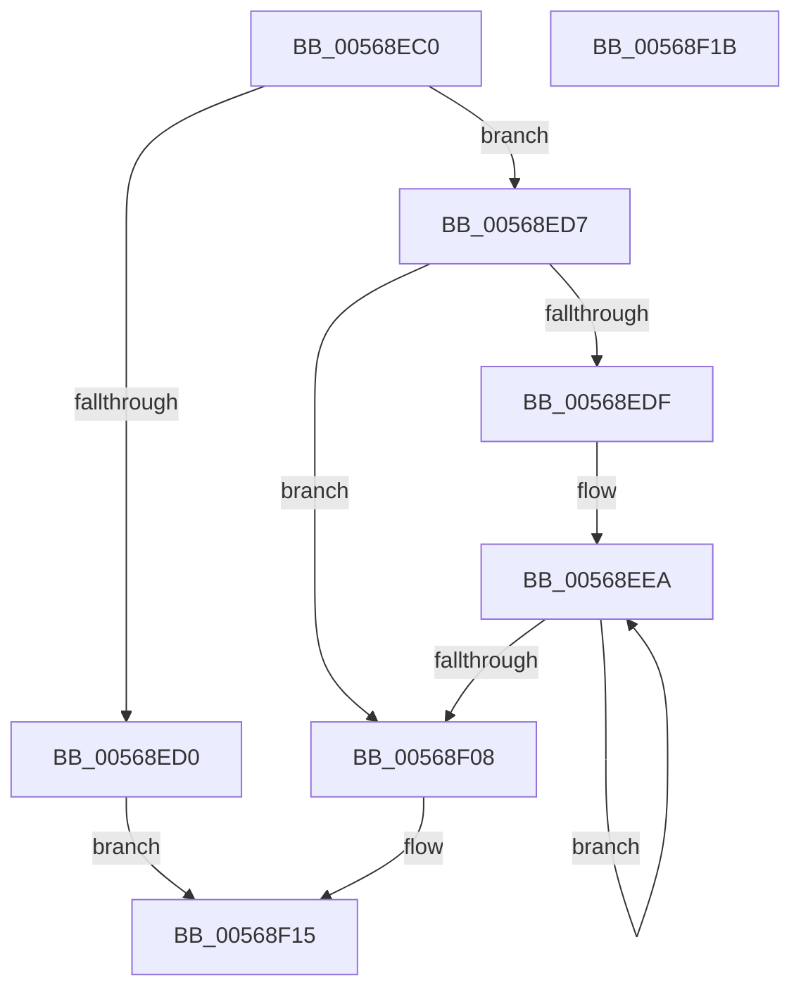

# HalpIommuGetDmarptRootAddress

- RVA: `0x00568EC0`–`0x00568F1C` (길이 `92` bytes)
- VA: `0x0000000140568EC0`
- 실행 섹션: `.text`
- PDB 이름 있음: `예`; PDB Function 태그: `아니요`
- unwind 정보 RVA: `0x0005CF00`
- 디코드: `32`개 명령, `92/92` bytes 표시
- 미해석 바이트: `0` (있으면 어셈블리에 `.byte`로 보존)

> 이 문서는 커널 이미지의 기계어와 PDB 기호를 분석해 생성했습니다. 4번과 5번은 함수 원형과 자료형을 바이너리 사용 방식에서 추정한 C 해석이며 원본 소스 복구 결과는 아닙니다.

## 1. Dependencies

- 직접 호출 지점: **1**; 고유 호출 대상: **1**
- 직접 호출자로 확인된 함수: **3**
- RIP 상대 이미지 참조: **0**

### Outgoing calls
- `0x00568F0B` → [MmGetPhysicalAddress](../23/MmGetPhysicalAddress_function_0023A500.md) (function, `0x0023A500`)

### Direct callers
- [HalpIommuGetHardwareDomain](../4D/HalpIommuGetHardwareDomain_function_004D7BCC.md) at `0x004D7CDC`
- [IommupDomainAttachPasidDevice](../54/IommupDomainAttachPasidDevice_function_0054F984.md) at `0x0054FA64`
- [HalpIommuConstructReservedPageTable](../../pagelk/B5/HalpIommuConstructReservedPageTable_function_00B5DD20.md) at `0x00B5DD98`

### Static image references
- 디코드된 RIP-relative 메모리 참조가 없습니다.

## 2. Other-region calls and transfers

- 다른 실행 섹션으로 향하는 call: **0**
- 별도 외부 분기/꼬리 이동을 확인하지 못했습니다.

## 3. Assembly (complete function range)

```asm
00568EC0  40 53                           push rbx
00568EC2  48 83 EC 20                     sub rsp, 0x20
00568EC6  8B 41 18                        mov eax, dword ptr [rcx + 0x18]
00568EC9  49 8B D8                        mov rbx, r8
00568ECC  3B D0                           cmp edx, eax
00568ECE  76 07                           jbe 0x140568ed7
00568ED0  B8 0D 00 00 C0                  mov eax, 0xc000000d
00568ED5  EB 3E                           jmp 0x140568f15
00568ED7  4C 8B 41 10                     mov r8, qword ptr [rcx + 0x10]
00568EDB  2B C2                           sub eax, edx
00568EDD  74 29                           je 0x140568f08
00568EDF  44 8B 51 1C                     mov r10d, dword ptr [rcx + 0x1c]
00568EE3  48 8D 51 24                     lea rdx, [rcx + 0x24]
00568EE7  44 8B C8                        mov r9d, eax
00568EEA  8B 0A                           mov ecx, dword ptr [rdx]
00568EEC  B8 01 00 00 00                  mov eax, 1
00568EF1  D3 E0                           shl eax, cl
00568EF3  48 8D 52 04                     lea rdx, [rdx + 4]
00568EF7  41 8B CA                        mov ecx, r10d
00568EFA  D3 E0                           shl eax, cl
00568EFC  48 98                           cdqe
00568EFE  4E 8B 04 00                     mov r8, qword ptr [rax + r8]
00568F02  49 83 E9 01                     sub r9, 1
00568F06  75 E2                           jne 0x140568eea
00568F08  49 8B C8                        mov rcx, r8
00568F0B  E8 F0 15 CD FF                  call 0x14023a500
00568F10  48 89 03                        mov qword ptr [rbx], rax
00568F13  33 C0                           xor eax, eax
00568F15  48 83 C4 20                     add rsp, 0x20
00568F19  5B                              pop rbx
00568F1A  C3                              ret
00568F1B  CC                              int3
```

## 4. C-style interpretation (structured pseudocode)

```c
__int64 __fastcall HalpIommuGetDmarptRootAddress(__int64 a1, int a2, __int64 a3)
{
    __int64 result;
    __int64 v_rsp;

    v_rsp = (v_rsp) - (32);
    if (a2 <= ((unsigned int)((unsigned int)(*(unsigned int *)(a1 + 24))))) goto loc_00568ED7;
    goto loc_00568F15;
loc_00568ED7:
    result = (unsigned int)(((unsigned int)(0xC000000DULL)) - (a2));
    if (condition_is_equal) goto loc_00568F08;
loc_00568EEA:
    result = (unsigned int)((1) << ((unsigned __int8)((unsigned int)(*(unsigned int *)(a1 + 36)))));
    result = (unsigned int)((result) << ((unsigned __int8)((unsigned int)((unsigned int)((unsigned int)(*(unsigned int *)(a1 + 28)))))));
    a4 = ((unsigned int)((unsigned int)(result))) - (1);
    if (condition_is_not_equal) goto loc_00568EEA;
loc_00568F08:
    result = MmGetPhysicalAddress(*(unsigned __int64 *)(result + *(unsigned __int64 *)(a1 + 16) * 1), a1 + 36 + 4, *(unsigned __int64 *)(result + *(unsigned __int64 *)(a1 + 16) * 1), a4);
    *(unsigned __int64 *)(a3) = result;
    result = 0;
loc_00568F15:
    v_rsp = (v_rsp) + (32);
    return result;
}
```

## 5. (Beta) C Style

```c
int64_t HalpIommuGetDmarptRootAddress(void *Arg1, int32_t Arg2, void *Arg3)
{
    uint8_t *arg1 = (uint8_t *)Arg1;
    uint8_t *arg3 = (uint8_t *)Arg3;

    int64_t result;
    int64_t local_rsp;

    local_rsp = (local_rsp) - (32);
    if (Arg2 <= ((uint32_t)((uint32_t)(*(uint32_t *)(arg1 + 0x18))))) goto loc_00568ED7;
    goto loc_00568F15;
loc_00568ED7:
    result = (uint32_t)(((uint32_t)(0xC000000DULL)) - (Arg2));
    if (condition_is_equal) goto loc_00568F08;
loc_00568EEA:
    result = (uint32_t)((1) << ((uint8_t)((uint32_t)(*(uint32_t *)(arg1 + 0x24)))));
    result = (uint32_t)((result) << ((uint8_t)((uint32_t)((uint32_t)((uint32_t)(*(uint32_t *)(arg1 + 0x1C)))))));
    a4 = ((uint32_t)((uint32_t)(result))) - (1);
    if (condition_is_not_equal) goto loc_00568EEA;
loc_00568F08:
    result = MmGetPhysicalAddress(*(uint64_t *)(result + *(uint64_t *)(arg1 + 0x10) * 1), Arg1 + 36 + 4, *(uint64_t *)(result + *(uint64_t *)(arg1 + 0x10) * 1), a4);
    *(uint64_t *)(arg3) = result;
    result = 0;
loc_00568F15:
    local_rsp = (local_rsp) + (32);
    return result;
}
```

### 관측된 메모리 오프셋

구조체 형식이 확인되지 않은 접근은 인자 기준의 오프셋으로만 기록했습니다.

| 기준 인자 | 오프셋 표현 | 폭 (bit) | 접근 |
|---|---:|---:|---|
| `Arg1` | `+ 0x0` | `32` | `R` |
| `Arg1` | `+ 0x4` | `64` | `R` |
| `Arg1` | `+ 0x10` | `64` | `R` |
| `Arg1` | `+ 0x18` | `32` | `R` |
| `Arg1` | `+ 0x1C` | `32` | `R` |
| `Arg1` | `+ 0x24` | `64` | `R` |
| `Arg3` | `+ 0x0` | `64` | `W` |

## 6. Execution-region graph

[열기: 2D/3D 그래프와 함수 탐색 컨트롤 패널](../../../control-panel.html?section=text&rva=0x00568EC0&view=graph)

- 2D 그래프는 위에서 아래로 흐르고, 3D 그래프는 빈 공간을 드래그해 회전합니다. Shift+드래그는 이동, 휠은 확대·축소, 함수 노드 선택은 대상 보고서 이동입니다.

### Static fallback


