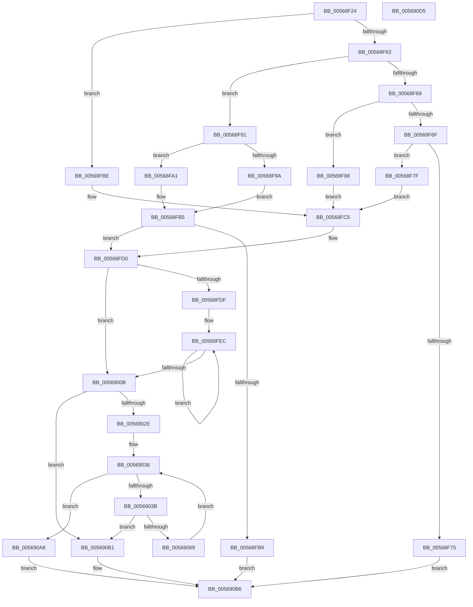

# HalpIommuInitializeDmarPageTable

- RVA: `0x00568F24`–`0x005690D6` (길이 `434` bytes)
- VA: `0x0000000140568F24`
- 실행 섹션: `.text`
- PDB 이름 있음: `예`; PDB Function 태그: `아니요`
- unwind 정보 RVA: `0x0005FEF8`
- 디코드: `127`개 명령, `434/434` bytes 표시
- 미해석 바이트: `0` (있으면 어셈블리에 `.byte`로 보존)

> 이 문서는 커널 이미지의 기계어와 PDB 기호를 분석해 생성했습니다. 4번과 5번은 함수 원형과 자료형을 바이너리 사용 방식에서 추정한 C 해석이며 원본 소스 복구 결과는 아닙니다.

## 1. Dependencies

- 직접 호출 지점: **7**; 고유 호출 대상: **6**
- 직접 호출자로 확인된 함수: **1**
- RIP 상대 이미지 참조: **5**

### Outgoing calls
- `0x00568F57` → [memset](../6C/memset_function_006C6C40.md) (function, `0x006C6C40`)
- `0x00568F91` → [Feature_Test57481295__private_IsEnabledDeviceUsageNoInline](../4F/Feature_Test57481295__private_IsEnabledDeviceUsageNoInline_function_004F7B90.md) (function, `0x004F7B90`)
- `0x00569019` → [HalpIommuAllocateAndZeroPageTable](../3F/HalpIommuAllocateAndZeroPageTable_function_003F8B30.md) (function, `0x003F8B30`)
- `0x0056905B` → [HalpIommuAllocateAndZeroPageTable](../3F/HalpIommuAllocateAndZeroPageTable_function_003F8B30.md) (function, `0x003F8B30`)
- `0x0056906C` → [MmGetPhysicalAddress](../23/MmGetPhysicalAddress_function_0023A500.md) (function, `0x0023A500`)
- `0x00569088` → [guard_dispatch_icall](../6B/guard_dispatch_icall_function_006BAAD0.md) (function, `0x006BAAD0`)
- `0x0056909A` → [HalpIommuFlushPhysicalPtesFromCacheSize](../30/HalpIommuFlushPhysicalPtesFromCacheSize_function_0030885C.md) (function, `0x0030885C`)

### Direct callers
- [HalpIommuCreateDmarPageTable](HalpIommuCreateDmarPageTable_function_00568C4C.md) at `0x00568CBF`

### Static image references
- `0x00568F7F` → RVA `0x00007E90` (`.rdata`; read)
- `0x00568F88` → RVA `0x00007E18` (`.rdata`; read)
- `0x00568FA1` → RVA `0x00007E40` (`.rdata`; read)
- `0x00568FBE` → RVA `0x00007E68` (`.rdata`; read)
- `0x00568FDF` → RVA `0x00026020` (`.rdata`; read)

## 2. Other-region calls and transfers

- 다른 실행 섹션으로 향하는 call: **0**
- 별도 외부 분기/꼬리 이동을 확인하지 못했습니다.

## 3. Assembly (complete function range)

```asm
00568F24  48 8B C4                        mov rax, rsp
00568F27  48 89 58 08                     mov qword ptr [rax + 8], rbx
00568F2B  48 89 68 10                     mov qword ptr [rax + 0x10], rbp
00568F2F  48 89 70 18                     mov qword ptr [rax + 0x18], rsi
00568F33  48 89 78 20                     mov qword ptr [rax + 0x20], rdi
00568F37  41 54                           push r12
00568F39  41 56                           push r14
00568F3B  41 57                           push r15
00568F3D  48 83 EC 20                     sub rsp, 0x20
00568F41  48 8B 5C 24 70                  mov rbx, qword ptr [rsp + 0x70]
00568F46  44 8B FA                        mov r15d, edx
00568F49  33 D2                           xor edx, edx
00568F4B  41 8B F8                        mov edi, r8d
00568F4E  8B F1                           mov esi, ecx
00568F50  48 8B CB                        mov rcx, rbx
00568F53  44 8D 42 60                     lea r8d, [rdx + 0x60]
00568F57  E8 E4 DC 15 00                  call 0x1406c6c40
00568F5C  44 8B CE                        mov r9d, esi
00568F5F  85 F6                           test esi, esi
00568F61  74 5B                           je 0x140568fbe
00568F63  41 83 E9 01                     sub r9d, 1
00568F67  74 28                           je 0x140568f91
00568F69  41 83 E9 01                     sub r9d, 1
00568F6D  74 19                           je 0x140568f88
00568F6F  41 83 F9 01                     cmp r9d, 1
00568F73  74 0A                           je 0x140568f7f
00568F75  B8 0D 00 00 C0                  mov eax, 0xc000000d
00568F7A  E9 37 01 00 00                  jmp 0x1405690b6
00568F7F  48 8D 05 0A EF A9 FF            lea rax, [rip - 0x5610f6]
00568F86  EB 3D                           jmp 0x140568fc5
00568F88  48 8D 05 89 EE A9 FF            lea rax, [rip - 0x561177]
00568F8F  EB 34                           jmp 0x140568fc5
00568F91  E8 FA EB F8 FF                  call 0x1404f7b90
00568F96  85 C0                           test eax, eax
00568F98  75 07                           jne 0x140568fa1
00568F9A  B8 0D 00 00 C0                  mov eax, 0xc000000d
00568F9F  EB 14                           jmp 0x140568fb5
00568FA1  48 8D 05 98 EE A9 FF            lea rax, [rip - 0x561168]
00568FA8  C7 43 1C 03 00 00 00            mov dword ptr [rbx + 0x1c], 3
00568FAF  48 89 43 58                     mov qword ptr [rbx + 0x58], rax
00568FB3  33 C0                           xor eax, eax
00568FB5  85 C0                           test eax, eax
00568FB7  79 17                           jns 0x140568fd0
00568FB9  E9 F8 00 00 00                  jmp 0x1405690b6
00568FBE  48 8D 05 A3 EE A9 FF            lea rax, [rip - 0x56115d]
00568FC5  C7 43 1C 03 00 00 00            mov dword ptr [rbx + 0x1c], 3
00568FCC  48 89 43 58                     mov qword ptr [rbx + 0x58], rax
00568FD0  33 D2                           xor edx, edx
00568FD2  89 33                           mov dword ptr [rbx], esi
00568FD4  89 7B 18                        mov dword ptr [rbx + 0x18], edi
00568FD7  44 8D 42 0C                     lea r8d, [rdx + 0xc]
00568FDB  85 FF                           test edi, edi
00568FDD  74 2C                           je 0x14056900b
00568FDF  48 8D 0D 3A D0 AB FF            lea rcx, [rip - 0x542fc6]
00568FE6  4C 8B CB                        mov r9, rbx
00568FE9  4C 2B C9                        sub r9, rcx
00568FEC  8B 01                           mov eax, dword ptr [rcx]
00568FEE  41 89 44 09 24                  mov dword ptr [r9 + rcx + 0x24], eax
00568FF3  8B C7                           mov eax, edi
00568FF5  2B C2                           sub eax, edx
00568FF7  FF C2                           inc edx
00568FF9  FF C8                           dec eax
00568FFB  44 89 44 83 3C                  mov dword ptr [rbx + rax*4 + 0x3c], r8d
00569000  44 03 01                        add r8d, dword ptr [rcx]
00569003  48 8D 49 04                     lea rcx, [rcx + 4]
00569007  3B D7                           cmp edx, edi
00569009  72 E1                           jb 0x140568fec
0056900B  4C 8B 44 24 68                  mov r8, qword ptr [rsp + 0x68]
00569010  33 D2                           xor edx, edx
00569012  83 63 20 00                     and dword ptr [rbx + 0x20], 0
00569016  48 8B CB                        mov rcx, rbx
00569019  E8 12 FB E8 FF                  call 0x1403f8b30
0056901E  48 89 43 10                     mov qword ptr [rbx + 0x10], rax
00569022  48 8B E8                        mov rbp, rax
00569025  48 85 C0                        test rax, rax
00569028  0F 84 83 00 00 00               je 0x1405690b1
0056902E  45 33 F6                        xor r14d, r14d
00569031  8B F7                           mov esi, edi
00569033  41 2B F7                        sub esi, r15d
00569036  44 3B F6                        cmp r14d, esi
00569039  73 6D                           jae 0x1405690a8
0056903B  42 8B 4C B3 24                  mov ecx, dword ptr [rbx + r14*4 + 0x24]
00569040  41 8D 56 01                     lea edx, [r14 + 1]
00569044  4C 8B 44 24 68                  mov r8, qword ptr [rsp + 0x68]
00569049  B8 01 00 00 00                  mov eax, 1
0056904E  D3 E0                           shl eax, cl
00569050  8B 4B 1C                        mov ecx, dword ptr [rbx + 0x1c]
00569053  D3 E0                           shl eax, cl
00569055  48 8B CB                        mov rcx, rbx
00569058  4C 63 F8                        movsxd r15, eax
0056905B  E8 D0 FA E8 FF                  call 0x1403f8b30
00569060  49 89 04 2F                     mov qword ptr [r15 + rbp], rax
00569064  48 85 C0                        test rax, rax
00569067  74 48                           je 0x1405690b1
00569069  48 8B C8                        mov rcx, rax
0056906C  E8 8F 14 CD FF                  call 0x14023a500
00569071  4C 8B 43 58                     mov r8, qword ptr [rbx + 0x58]
00569075  8B D7                           mov edx, edi
00569077  41 2B D6                        sub edx, r14d
0056907A  48 8B CD                        mov rcx, rbp
0056907D  FF CA                           dec edx
0056907F  4D 8B 08                        mov r9, qword ptr [r8]
00569082  4C 8B C0                        mov r8, rax
00569085  49 8B C1                        mov rax, r9
00569088  E8 43 1A 15 00                  call 0x1406baad0
0056908D  8B 4B 1C                        mov ecx, dword ptr [rbx + 0x1c]
00569090  BA 01 00 00 00                  mov edx, 1
00569095  D3 E2                           shl edx, cl
00569097  48 8B CD                        mov rcx, rbp
0056909A  E8 BD F7 D9 FF                  call 0x14030885c
0056909F  49 8B 2C 2F                     mov rbp, qword ptr [r15 + rbp]
005690A3  41 FF C6                        inc r14d
005690A6  EB 8E                           jmp 0x140569036
005690A8  48 83 63 08 00                  and qword ptr [rbx + 8], 0
005690AD  33 C0                           xor eax, eax
005690AF  EB 05                           jmp 0x1405690b6
005690B1  B8 9A 00 00 C0                  mov eax, 0xc000009a
005690B6  48 8B 5C 24 40                  mov rbx, qword ptr [rsp + 0x40]
005690BB  48 8B 6C 24 48                  mov rbp, qword ptr [rsp + 0x48]
005690C0  48 8B 74 24 50                  mov rsi, qword ptr [rsp + 0x50]
005690C5  48 8B 7C 24 58                  mov rdi, qword ptr [rsp + 0x58]
005690CA  48 83 C4 20                     add rsp, 0x20
005690CE  41 5F                           pop r15
005690D0  41 5E                           pop r14
005690D2  41 5C                           pop r12
005690D4  C3                              ret
005690D5  CC                              int3
```

## 4. C-style interpretation (structured pseudocode)

```c
__int64 __fastcall HalpIommuInitializeDmarPageTable(int a1, int a2, int a3, __int64 a4, __int64 a5, __int64 a6, __int64 a7)
{
    __int64 result;
    __int64 v_r14;
    __int64 v_rsi;
    __int64 v_rsp;
    unsigned __int64 v_stack_p10;
    unsigned __int64 v_stack_p18;
    unsigned __int64 v_stack_p20;
    unsigned __int64 v_stack_p8;

    *(unsigned __int64 *)(v_rsp + 8) = v_rbx;
    *(unsigned __int64 *)(v_rsp + 16) = v_rbp;
    *(unsigned __int64 *)(v_rsp + 24) = v_rsi;
    *(unsigned __int64 *)(v_rsp + 32) = v_rdi;
    v_rsp = (v_rsp) - (32);
    a2 = 0;
    result = memset(a7, a2, a2 + 96, a4);
    if ((unsigned int)((unsigned int)(a1)) == 0) goto loc_00568FBE;
    a4 = (unsigned int)(((unsigned int)((unsigned int)((unsigned int)(a1)))) - (1));
    if (condition_is_equal) goto loc_00568F91;
    a4 = (unsigned int)((a4) - (1));
    if (condition_is_equal) goto loc_00568F88;
    if (((unsigned int)(a4)) == 1) goto loc_00568F7F;
    goto loc_005690B6;
loc_00568F7F:
    goto loc_00568FC5;
loc_00568F88:
    goto loc_00568FC5;
loc_00568F91:
    result = Feature_Test57481295__private_IsEnabledDeviceUsageNoInline(a7, a2, a2 + 96, a4);
    if ((unsigned int)(result) != 0) goto loc_00568FA1;
    goto loc_00568FB5;
loc_00568FA1:
    *(unsigned int *)(a7 + 28) = 3;
    *(unsigned __int64 *)(a7 + 88) = v_rip - 5640552;
    result = 0;
loc_00568FB5:
    if (!sign_flag) goto loc_00568FD0;
    goto loc_005690B6;
loc_00568FBE:
loc_00568FC5:
    *(unsigned int *)(a7 + 28) = 3;
    *(unsigned __int64 *)(a7 + 88) = v_rip - 5640541;
loc_00568FD0:
    a2 = 0;
    *(unsigned int *)(a7) = (unsigned int)((unsigned int)(a1));
    *(unsigned int *)(a7 + 24) = (unsigned int)((unsigned int)(a3));
    if ((unsigned int)((unsigned int)(a3)) == 0) goto loc_0056900B;
    a4 = (a7) - (v_rip - 5517254);
loc_00568FEC:
    *(unsigned int *)(a4 + v_rip - 5517254 * 1 + 36) = (unsigned int)((unsigned int)(*(unsigned int *)(v_rip - 5517254)));
    result = (unsigned int)(((unsigned int)((unsigned int)((unsigned int)(a3)))) - (0));
    a2 = (unsigned int)((a2) + 1);
    result = (unsigned int)((result) - 1);
    *(unsigned int *)(a7 + result * 4 + 60) = (unsigned int)(a2 + 12);
    a3 = (unsigned int)((a2 + 12) + (*(unsigned int *)(v_rip - 5517254)));
    if (a2 < ((unsigned int)((unsigned int)(a3)))) goto loc_00568FEC;
loc_0056900B:
    a2 = 0;
    result = HalpIommuAllocateAndZeroPageTable(a7, a2, a6, a4);
    *(unsigned __int64 *)(a7 + 16) = result;
    if (result == 0) goto loc_005690B1;
    v_r14 = 0;
    v_rsi = (unsigned int)(((unsigned int)((unsigned int)((unsigned int)(a3)))) - ((unsigned int)((unsigned int)(a2))));
loc_00569036:
    if (0 >= ((unsigned int)(v_rsi))) goto loc_005690A8;
    result = (unsigned int)((1) << ((unsigned __int8)((unsigned int)(*(unsigned int *)(a7 + v_r14 * 4 + 36)))));
    result = (unsigned int)((result) << ((unsigned __int8)((unsigned int)(*(unsigned int *)(a7 + 28)))));
    result = HalpIommuAllocateAndZeroPageTable(a7, v_r14 + 1, a6, a4);
    *(unsigned __int64 *)((int)((unsigned int)(result)) + result * 1) = result;
    if (result == 0) goto loc_005690B1;
    result = MmGetPhysicalAddress(result, v_r14 + 1, a6, a4);
    a2 = (unsigned int)(((unsigned int)((unsigned int)((unsigned int)(a3)))) - (0));
    a2 = (unsigned int)((a2) - 1);
    result = guard_dispatch_icall(result, a2, result, *(unsigned __int64 *)(*(unsigned __int64 *)(a7 + 88)));
    a2 = (unsigned int)((1) << ((unsigned __int8)((unsigned int)(*(unsigned int *)(a7 + 28)))));
    result = HalpIommuFlushPhysicalPtesFromCacheSize(result, a2, result, *(unsigned __int64 *)(*(unsigned __int64 *)(a7 + 88)));
    v_r14 = (unsigned int)((v_r14) + 1);
    goto loc_00569036;
loc_005690A8:
    result = 0;
    goto loc_005690B6;
loc_005690B1:
loc_005690B6:
    v_rsp = (v_rsp) + (32);
    return (unsigned int)(0xC000009AULL);
}
```

## 5. (Beta) C Style

```c
int64_t HalpIommuInitializeDmarPageTable(int32_t Arg1, int32_t Arg2, int32_t Arg3, int64_t Arg4, uint64_t Arg5, int64_t Arg6, void *Arg7)
{
    uint8_t *arg7 = (uint8_t *)Arg7;

    int64_t result;
    int64_t local_r14;
    int64_t local_rsi;
    int64_t local_rsp;
    uint64_t v_stack_p10;
    uint64_t v_stack_p18;
    uint64_t v_stack_p20;
    uint64_t v_stack_p8;

    *(uint64_t *)(local_rsp + 0x8) = local_rbx;
    *(uint64_t *)(local_rsp + 0x10) = local_rbp;
    *(uint64_t *)(local_rsp + 0x18) = local_rsi;
    *(uint64_t *)(local_rsp + 0x20) = local_rdi;
    local_rsp = (local_rsp) - (32);
    Arg2 = 0;
    result = memset(Arg7, Arg2, Arg2 + 96, Arg4);
    if ((uint32_t)((uint32_t)(Arg1)) == 0) goto loc_00568FBE;
    Arg4 = (uint32_t)(((uint32_t)((uint32_t)((uint32_t)(Arg1)))) - (1));
    if (condition_is_equal) goto loc_00568F91;
    Arg4 = (uint32_t)((Arg4) - (1));
    if (condition_is_equal) goto loc_00568F88;
    if (((uint32_t)(Arg4)) == 1) goto loc_00568F7F;
    goto loc_005690B6;
loc_00568F7F:
    goto loc_00568FC5;
loc_00568F88:
    goto loc_00568FC5;
loc_00568F91:
    result = Feature_Test57481295__private_IsEnabledDeviceUsageNoInline(Arg7, Arg2, Arg2 + 96, Arg4);
    if ((uint32_t)(result) != 0) goto loc_00568FA1;
    goto loc_00568FB5;
loc_00568FA1:
    *(uint32_t *)(arg7 + 0x1C) = 3;
    *(uint64_t *)(arg7 + 0x58) = v_rip - 5640552;
    result = 0;
loc_00568FB5:
    if (!sign_flag) goto loc_00568FD0;
    goto loc_005690B6;
loc_00568FBE:
loc_00568FC5:
    *(uint32_t *)(arg7 + 0x1C) = 3;
    *(uint64_t *)(arg7 + 0x58) = v_rip - 5640541;
loc_00568FD0:
    Arg2 = 0;
    *(uint32_t *)(arg7) = (uint32_t)((uint32_t)(Arg1));
    *(uint32_t *)(arg7 + 0x18) = (uint32_t)((uint32_t)(Arg3));
    if ((uint32_t)((uint32_t)(Arg3)) == 0) goto loc_0056900B;
    Arg4 = (Arg7) - (v_rip - 5517254);
loc_00568FEC:
    *(uint32_t *)(Arg4 + v_rip - 0x542FC6 * 1 + 0x24) = (uint32_t)((uint32_t)(*(uint32_t *)(v_rip - 0x542FC6)));
    result = (uint32_t)(((uint32_t)((uint32_t)((uint32_t)(Arg3)))) - (0));
    Arg2 = (uint32_t)((Arg2) + 1);
    result = (uint32_t)((result) - 1);
    *(uint32_t *)(arg7 + result * 4 + 0x3C) = (uint32_t)(Arg2 + 12);
    Arg3 = (uint32_t)((Arg2 + 12) + (*(uint32_t *)(v_rip - 0x542FC6)));
    if (Arg2 < ((uint32_t)((uint32_t)(Arg3)))) goto loc_00568FEC;
loc_0056900B:
    Arg2 = 0;
    result = HalpIommuAllocateAndZeroPageTable(Arg7, Arg2, Arg6, Arg4);
    *(uint64_t *)(arg7 + 0x10) = result;
    if (result == 0) goto loc_005690B1;
    local_r14 = 0;
    local_rsi = (uint32_t)(((uint32_t)((uint32_t)((uint32_t)(Arg3)))) - ((uint32_t)((uint32_t)(Arg2))));
loc_00569036:
    if (0 >= ((uint32_t)(local_rsi))) goto loc_005690A8;
    result = (uint32_t)((1) << ((uint8_t)((uint32_t)(*(uint32_t *)(arg7 + local_r14 * 4 + 0x24)))));
    result = (uint32_t)((result) << ((uint8_t)((uint32_t)(*(uint32_t *)(arg7 + 0x1C)))));
    result = HalpIommuAllocateAndZeroPageTable(Arg7, local_r14 + 1, Arg6, Arg4);
    *(uint64_t *)((int32_t)((uint32_t)(result)) + result * 1) = result;
    if (result == 0) goto loc_005690B1;
    result = MmGetPhysicalAddress(result, local_r14 + 1, Arg6, Arg4);
    Arg2 = (uint32_t)(((uint32_t)((uint32_t)((uint32_t)(Arg3)))) - (0));
    Arg2 = (uint32_t)((Arg2) - 1);
    result = guard_dispatch_icall(result, Arg2, result, *(uint64_t *)(*(uint64_t *)(arg7 + 0x58)));
    Arg2 = (uint32_t)((1) << ((uint8_t)((uint32_t)(*(uint32_t *)(arg7 + 0x1C)))));
    result = HalpIommuFlushPhysicalPtesFromCacheSize(result, Arg2, result, *(uint64_t *)(*(uint64_t *)(arg7 + 0x58)));
    local_r14 = (uint32_t)((local_r14) + 1);
    goto loc_00569036;
loc_005690A8:
    result = 0;
    goto loc_005690B6;
loc_005690B1:
loc_005690B6:
    local_rsp = (local_rsp) + (32);
    return (uint32_t)(0xC000009AULL);
}
```

### 관측된 메모리 오프셋

구조체 형식이 확인되지 않은 접근은 인자 기준의 오프셋으로만 기록했습니다.

| 기준 인자 | 오프셋 표현 | 폭 (bit) | 접근 |
|---|---:|---:|---|
| `Arg7` | `+ 0x0` | `32` | `W` |
| `Arg7` | `+ 0x8` | `64` | `R/W` |
| `Arg7` | `+ 0x10` | `64` | `W` |
| `Arg7` | `+ 0x18` | `32` | `W` |
| `Arg7` | `+ 0x1C` | `32` | `R` |
| `Arg7` | `+ 0x1C` | `32` | `W` |
| `Arg7` | `+ 0x20` | `32` | `R/W` |
| `Arg7` | `+ 0x24 + r14*4` | `32` | `R` |
| `Arg7` | `+ 0x24 + rcx*1` | `32` | `W` |
| `Arg7` | `+ 0x3C + rax*4` | `32` | `W` |
| `Arg7` | `+ 0x58` | `64` | `R` |
| `Arg7` | `+ 0x58` | `64` | `W` |

## 6. Execution-region graph

[열기: 2D/3D 그래프와 함수 탐색 컨트롤 패널](../../../control-panel.html?section=text&rva=0x00568F24&view=graph)

- 2D 그래프는 위에서 아래로 흐르고, 3D 그래프는 빈 공간을 드래그해 회전합니다. Shift+드래그는 이동, 휠은 확대·축소, 함수 노드 선택은 대상 보고서 이동입니다.

### Static fallback


