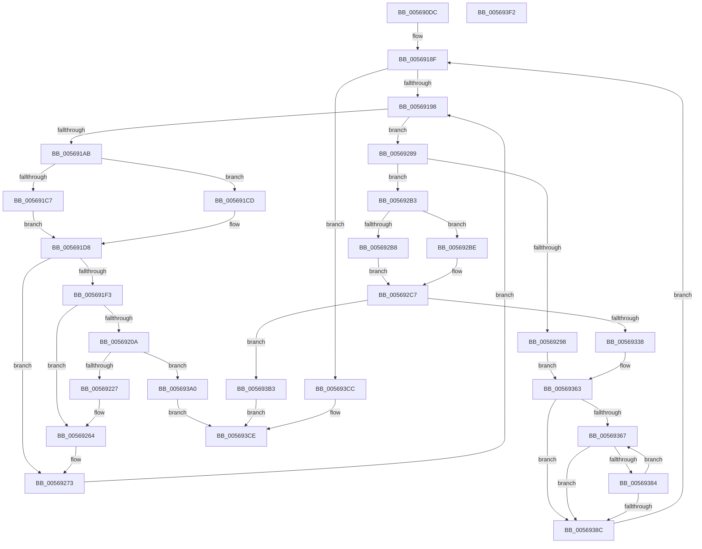

# HalpIommuMapLogicalRange

- RVA: `0x005690DC`–`0x005693F3` (길이 `791` bytes)
- VA: `0x00000001405690DC`
- 실행 섹션: `.text`
- PDB 이름 있음: `예`; PDB Function 태그: `아니요`
- unwind 정보 RVA: `0x000C4F34`
- 디코드: `220`개 명령, `791/791` bytes 표시
- 미해석 바이트: `0` (있으면 어셈블리에 `.byte`로 보존)

> 이 문서는 커널 이미지의 기계어와 PDB 기호를 분석해 생성했습니다. 4번과 5번은 함수 원형과 자료형을 바이너리 사용 방식에서 추정한 C 해석이며 원본 소스 복구 결과는 아닙니다.

## 1. Dependencies

- 직접 호출 지점: **11**; 고유 호출 대상: **8**
- 직접 호출자로 확인된 함수: **3**
- RIP 상대 이미지 참조: **1**

### Outgoing calls
- `0x005691FA` → [KeAcquireSpinLockRaiseToDpc](../20/KeAcquireSpinLockRaiseToDpc_function_00208470.md) (function, `0x00208470`)
- `0x00569215` → [HalpIommuAllocateAndZeroPageTable](../3F/HalpIommuAllocateAndZeroPageTable_function_003F8B30.md) (function, `0x003F8B30`)
- `0x0056922A` → [MmGetPhysicalAddress](../23/MmGetPhysicalAddress_function_0023A500.md) (function, `0x0023A500`)
- `0x0056924F` → [guard_dispatch_icall](../6B/guard_dispatch_icall_function_006BAAD0.md) (function, `0x006BAAD0`)
- `0x0056925B` → [HalpIommuFlushPhysicalPtesFromCacheSize](../30/HalpIommuFlushPhysicalPtesFromCacheSize_function_0030885C.md) (function, `0x0030885C`)
- `0x00569269` → [KeReleaseSpinLock](../39/KeReleaseSpinLock_function_00392BA0.md) (function, `0x00392BA0`)
- `0x00569318` → [guard_dispatch_icall](../6B/guard_dispatch_icall_function_006BAAD0.md) (function, `0x006BAAD0`)
- `0x00569342` → [HalpIommuFlushPhysicalPtesFromCacheSize](../30/HalpIommuFlushPhysicalPtesFromCacheSize_function_0030885C.md) (function, `0x0030885C`)
- `0x005693A7` → [KeReleaseSpinLock](../39/KeReleaseSpinLock_function_00392BA0.md) (function, `0x00392BA0`)
- `0x005693C0` → [HalpIommuUnmapLogicalRange](../30/HalpIommuUnmapLogicalRange_function_00308660.md) (function, `0x00308660`)
- `0x005693D9` → [_security_check_cookie](../6A/_security_check_cookie_function_006AC640.md) (function, `0x006AC640`)

### Direct callers
- [HalpIommuDomainMapLogicalRange](../55/HalpIommuDomainMapLogicalRange_function_00555064.md) at `0x005550A3`
- [sub_006F785E](../6F/Unknown_function_006F785E.md) at `0x006F78A3`
- [HalpIommuConstructReservedPageTable](../../pagelk/B5/HalpIommuConstructReservedPageTable_function_00B5DD20.md) at `0x00B5DDF7`

### Static image references
- `0x005690F0` → RVA `0x00E0A740` (`.data`; read)

## 2. Other-region calls and transfers

- 다른 실행 섹션으로 향하는 call: **0**
- 별도 외부 분기/꼬리 이동을 확인하지 못했습니다.

## 3. Assembly (complete function range)

```asm
005690DC  40 53                           push rbx
005690DE  55                              push rbp
005690DF  56                              push rsi
005690E0  57                              push rdi
005690E1  41 54                           push r12
005690E3  41 55                           push r13
005690E5  41 56                           push r14
005690E7  41 57                           push r15
005690E9  48 81 EC B8 00 00 00            sub rsp, 0xb8
005690F0  48 8B 05 49 16 8A 00            mov rax, qword ptr [rip + 0x8a1649]
005690F7  48 33 C4                        xor rax, rsp
005690FA  48 89 84 24 A0 00 00 00         mov qword ptr [rsp + 0xa0], rax
00569102  44 8B 5A 1C                     mov r11d, dword ptr [rdx + 0x1c]
00569106  33 FF                           xor edi, edi
00569108  48 8B AC 24 28 01 00 00         mov rbp, qword ptr [rsp + 0x128]
00569110  0F 57 C0                        xorps xmm0, xmm0
00569113  48 21 7C 24 50                  and qword ptr [rsp + 0x50], rdi
00569118  41 BC 01 00 00 00               mov r12d, 1
0056911E  4C 8B 94 24 20 01 00 00         mov r10, qword ptr [rsp + 0x120]
00569126  45 8B EC                        mov r13d, r12d
00569129  4C 8B 7A 10                     mov r15, qword ptr [rdx + 0x10]
0056912D  49 81 C2 FF 0F 00 00            add r10, 0xfff
00569134  49 81 E2 00 F0 FF FF            and r10, 0xfffffffffffff000
0056913B  48 89 4C 24 60                  mov qword ptr [rsp + 0x60], rcx
00569140  4C 03 D5                        add r10, rbp
00569143  44 89 44 24 48                  mov dword ptr [rsp + 0x48], r8d
00569148  41 8B CB                        mov ecx, r11d
0056914B  44 89 5C 24 34                  mov dword ptr [rsp + 0x34], r11d
00569150  41 D3 E5                        shl r13d, cl
00569153  41 8B C0                        mov eax, r8d
00569156  F7 D8                           neg eax
00569158  44 89 6C 24 38                  mov dword ptr [rsp + 0x38], r13d
0056915D  0F 11 44 24 70                  movups xmmword ptr [rsp + 0x70], xmm0
00569162  4D 1B F6                        sbb r14, r14
00569165  4C 89 54 24 58                  mov qword ptr [rsp + 0x58], r10
0056916A  4D 23 F1                        and r14, r9
0056916D  4C 89 7C 24 70                  mov qword ptr [rsp + 0x70], r15
00569172  4C 89 74 24 40                  mov qword ptr [rsp + 0x40], r14
00569177  48 8B F2                        mov rsi, rdx
0056917A  0F 11 84 24 80 00 00 00         movups xmmword ptr [rsp + 0x80], xmm0
00569182  48 89 6C 24 68                  mov qword ptr [rsp + 0x68], rbp
00569187  0F 11 84 24 90 00 00 00         movups xmmword ptr [rsp + 0x90], xmm0
0056918F  49 3B EA                        cmp rbp, r10
00569192  0F 83 34 02 00 00               jae 0x1405693cc
00569198  44 8B 4E 18                     mov r9d, dword ptr [rsi + 0x18]
0056919C  41 FF C9                        dec r9d
0056919F  44 8B C7                        mov r8d, edi
005691A2  41 3B F9                        cmp edi, r9d
005691A5  0F 83 DE 00 00 00               jae 0x140569289
005691AB  42 8B 54 86 24                  mov edx, dword ptr [rsi + r8*4 + 0x24]
005691B0  41 8B C4                        mov eax, r12d
005691B3  8B CA                           mov ecx, edx
005691B5  D3 E0                           shl eax, cl
005691B7  41 8B CB                        mov ecx, r11d
005691BA  D3 E0                           shl eax, cl
005691BC  4C 63 F0                        movsxd r14, eax
005691BF  4D 03 F7                        add r14, r15
005691C2  83 FA 40                        cmp edx, 0x40
005691C5  72 06                           jb 0x1405691cd
005691C7  48 83 C8 FF                     or rax, 0xffffffffffffffff
005691CB  EB 0B                           jmp 0x1405691d8
005691CD  8B CA                           mov ecx, edx
005691CF  49 8B C4                        mov rax, r12
005691D2  48 D3 E0                        shl rax, cl
005691D5  49 2B C4                        sub rax, r12
005691D8  42 8B 4C 86 3C                  mov ecx, dword ptr [rsi + r8*4 + 0x3c]
005691DD  48 8B DD                        mov rbx, rbp
005691E0  48 D3 EB                        shr rbx, cl
005691E3  23 D8                           and ebx, eax
005691E5  44 8B E3                        mov r12d, ebx
005691E8  49 83 3C DE 00                  cmp qword ptr [r14 + rbx*8], 0
005691ED  0F 85 80 00 00 00               jne 0x140569273
005691F3  4C 8D 6E 08                     lea r13, [rsi + 8]
005691F7  49 8B CD                        mov rcx, r13
005691FA  E8 71 F2 C9 FF                  call 0x140208470
005691FF  49 83 3C DE 00                  cmp qword ptr [r14 + rbx*8], 0
00569204  88 44 24 30                     mov byte ptr [rsp + 0x30], al
00569208  75 5A                           jne 0x140569264
0056920A  4C 8B 44 24 60                  mov r8, qword ptr [rsp + 0x60]
0056920F  8D 57 01                        lea edx, [rdi + 1]
00569212  48 8B CE                        mov rcx, rsi
00569215  E8 16 F9 E8 FF                  call 0x1403f8b30
0056921A  49 89 04 DE                     mov qword ptr [r14 + rbx*8], rax
0056921E  48 85 C0                        test rax, rax
00569221  0F 84 79 01 00 00               je 0x1405693a0
00569227  48 8B C8                        mov rcx, rax
0056922A  E8 D1 12 CD FF                  call 0x14023a500
0056922F  4C 8B 46 58                     mov r8, qword ptr [rsi + 0x58]
00569233  8B 4C 24 34                     mov ecx, dword ptr [rsp + 0x34]
00569237  8B 56 18                        mov edx, dword ptr [rsi + 0x18]
0056923A  D3 E3                           shl ebx, cl
0056923C  2B D7                           sub edx, edi
0056923E  4D 8B 08                        mov r9, qword ptr [r8]
00569241  49 03 DF                        add rbx, r15
00569244  4C 8B C0                        mov r8, rax
00569247  FF CA                           dec edx
00569249  49 8B C1                        mov rax, r9
0056924C  48 8B CB                        mov rcx, rbx
0056924F  E8 7C 18 15 00                  call 0x1406baad0
00569254  8B 54 24 38                     mov edx, dword ptr [rsp + 0x38]
00569258  48 8B CB                        mov rcx, rbx
0056925B  E8 FC F5 D9 FF                  call 0x14030885c
00569260  8A 44 24 30                     mov al, byte ptr [rsp + 0x30]
00569264  8A D0                           mov dl, al
00569266  49 8B CD                        mov rcx, r13
00569269  E8 32 99 E2 FF                  call 0x140392ba0
0056926E  44 8B 5C 24 34                  mov r11d, dword ptr [rsp + 0x34]
00569273  4F 8B 3C E6                     mov r15, qword ptr [r14 + r12*8]
00569277  FF C7                           inc edi
00569279  41 BC 01 00 00 00               mov r12d, 1
0056927F  4C 89 7C FC 70                  mov qword ptr [rsp + rdi*8 + 0x70], r15
00569284  E9 0F FF FF FF                  jmp 0x140569198
00569289  44 8B 54 24 48                  mov r10d, dword ptr [rsp + 0x48]
0056928E  42 8B 4C 86 24                  mov ecx, dword ptr [rsi + r8*4 + 0x24]
00569293  45 85 D2                        test r10d, r10d
00569296  75 1B                           jne 0x1405692b3
00569298  83 C1 0C                        add ecx, 0xc
0056929B  49 8B C4                        mov rax, r12
0056929E  48 D3 E0                        shl rax, cl
005692A1  4C 8D 04 28                     lea r8, [rax + rbp]
005692A5  48 FF C8                        dec rax
005692A8  48 F7 D0                        not rax
005692AB  4C 23 C0                        and r8, rax
005692AE  E9 B0 00 00 00                  jmp 0x140569363
005692B3  83 F9 40                        cmp ecx, 0x40
005692B6  72 06                           jb 0x1405692be
005692B8  48 83 C8 FF                     or rax, 0xffffffffffffffff
005692BC  EB 09                           jmp 0x1405692c7
005692BE  49 8B C4                        mov rax, r12
005692C1  48 D3 E0                        shl rax, cl
005692C4  49 2B C4                        sub rax, r12
005692C7  42 8B 4C 86 3C                  mov ecx, dword ptr [rsi + r8*4 + 0x3c]
005692CC  48 8B D5                        mov rdx, rbp
005692CF  4C 8B 74 24 40                  mov r14, qword ptr [rsp + 0x40]
005692D4  BB 01 00 00 00                  mov ebx, 1
005692D9  48 D3 EA                        shr rdx, cl
005692DC  45 8B C2                        mov r8d, r10d
005692DF  23 D0                           and edx, eax
005692E1  41 8B CB                        mov ecx, r11d
005692E4  48 8B 44 24 58                  mov rax, qword ptr [rsp + 0x58]
005692E9  44 8B E2                        mov r12d, edx
005692EC  41 D3 E4                        shl r12d, cl
005692EF  48 2B C5                        sub rax, rbp
005692F2  42 8B 4C 8E 24                  mov ecx, dword ptr [rsi + r9*4 + 0x24]
005692F7  4D 03 E7                        add r12, r15
005692FA  D3 E3                           shl ebx, cl
005692FC  49 8B CC                        mov rcx, r12
005692FF  48 C1 E8 0C                     shr rax, 0xc
00569303  2B DA                           sub ebx, edx
00569305  3B C3                           cmp eax, ebx
00569307  49 8B D6                        mov rdx, r14
0056930A  0F 46 D8                        cmovbe ebx, eax
0056930D  48 8B 46 58                     mov rax, qword ptr [rsi + 0x58]
00569311  44 8B CB                        mov r9d, ebx
00569314  48 8B 40 08                     mov rax, qword ptr [rax + 8]
00569318  E8 B3 17 15 00                  call 0x1406baad0
0056931D  4C 8B 6C 24 50                  mov r13, qword ptr [rsp + 0x50]
00569322  8B D0                           mov edx, eax
00569324  C1 E2 0C                        shl edx, 0xc
00569327  4C 03 EA                        add r13, rdx
0056932A  4C 89 6C 24 50                  mov qword ptr [rsp + 0x50], r13
0056932F  4C 89 6C 24 40                  mov qword ptr [rsp + 0x40], r13
00569334  3B C3                           cmp eax, ebx
00569336  75 7B                           jne 0x1405693b3
00569338  8B D3                           mov edx, ebx
0056933A  49 8B CC                        mov rcx, r12
0056933D  0F AF 54 24 38                  imul edx, dword ptr [rsp + 0x38]
00569342  E8 15 F5 D9 FF                  call 0x14030885c
00569347  44 8B 5C 24 34                  mov r11d, dword ptr [rsp + 0x34]
0056934C  41 BC 01 00 00 00               mov r12d, 1
00569352  C1 E3 0C                        shl ebx, 0xc
00569355  8B C3                           mov eax, ebx
00569357  4C 03 F0                        add r14, rax
0056935A  4C 89 74 24 40                  mov qword ptr [rsp + 0x40], r14
0056935F  4C 8D 04 2B                     lea r8, [rbx + rbp]
00569363  85 FF                           test edi, edi
00569365  74 25                           je 0x14056938c
00569367  44 8D 4F FF                     lea r9d, [rdi - 1]
0056936B  49 8B D4                        mov rdx, r12
0056936E  42 8B 4C 8E 3C                  mov ecx, dword ptr [rsi + r9*4 + 0x3c]
00569373  49 8B C0                        mov rax, r8
00569376  48 D3 E2                        shl rdx, cl
00569379  48 23 C2                        and rax, rdx
0056937C  48 23 D5                        and rdx, rbp
0056937F  48 3B C2                        cmp rax, rdx
00569382  74 08                           je 0x14056938c
00569384  41 8B F9                        mov edi, r9d
00569387  45 85 C9                        test r9d, r9d
0056938A  75 DB                           jne 0x140569367
0056938C  4C 8B 54 24 58                  mov r10, qword ptr [rsp + 0x58]
00569391  49 8B E8                        mov rbp, r8
00569394  8B C7                           mov eax, edi
00569396  4C 8B 7C C4 70                  mov r15, qword ptr [rsp + rax*8 + 0x70]
0056939B  E9 EF FD FF FF                  jmp 0x14056918f
005693A0  8A 54 24 30                     mov dl, byte ptr [rsp + 0x30]
005693A4  49 8B CD                        mov rcx, r13
005693A7  E8 F4 97 E2 FF                  call 0x140392ba0
005693AC  B8 9A 00 00 C0                  mov eax, 0xc000009a
005693B1  EB 1B                           jmp 0x1405693ce
005693B3  4C 8B 44 24 68                  mov r8, qword ptr [rsp + 0x68]
005693B8  48 8D 54 24 40                  lea rdx, [rsp + 0x40]
005693BD  48 8B CE                        mov rcx, rsi
005693C0  E8 9B F2 D9 FF                  call 0x140308660
005693C5  B8 0D 00 00 C0                  mov eax, 0xc000000d
005693CA  EB 02                           jmp 0x1405693ce
005693CC  33 C0                           xor eax, eax
005693CE  48 8B 8C 24 A0 00 00 00         mov rcx, qword ptr [rsp + 0xa0]
005693D6  48 33 CC                        xor rcx, rsp
005693D9  E8 62 32 14 00                  call 0x1406ac640
005693DE  48 81 C4 B8 00 00 00            add rsp, 0xb8
005693E5  41 5F                           pop r15
005693E7  41 5E                           pop r14
005693E9  41 5D                           pop r13
005693EB  41 5C                           pop r12
005693ED  5F                              pop rdi
005693EE  5E                              pop rsi
005693EF  5D                              pop rbp
005693F0  5B                              pop rbx
005693F1  C3                              ret
005693F2  CC                              int3
```

## 4. C-style interpretation (structured pseudocode)

```c
__int64 __fastcall HalpIommuMapLogicalRange(__int64 a1, __int64 a2, int a3, __int64 a4, __int64 a5, __int64 a6)
{
    __int64 result;
    __int64 v_r10;
    __int64 v_r12;
    __int64 v_r13;
    __int64 v_r14;
    __int64 v_rbx;
    __int64 v_rdi;
    __int64 v_rsp;
    unsigned __int64 v_stack_m58;
    unsigned __int64 v_stack_m68;
    unsigned __int64 v_stack_m78;
    unsigned __int64 v_stack_m88;
    unsigned __int64 v_stack_m90;
    unsigned __int64 v_stack_m98;
    unsigned __int64 v_stack_mA0;
    unsigned __int64 v_stack_mA8;
    unsigned int v_stack_mB0;
    unsigned __int64 v_stack_mB8;
    unsigned int v_stack_mC0;
    unsigned int v_stack_mC4;
    unsigned __int8 v_stack_mC8;

    v_rsp = (v_rsp) - (184);
    result = (*(unsigned __int64 *)(v_rip + 9049673)) ^ (v_rsp);
    v_stack_m58 = result;
    v_rdi = 0;
    v_r10 = (a5) + (0xFFFULL);
    v_r10 = (v_r10) & (0xFFFFFFFFFFFFF000ULL);
    v_stack_m98 = a1;
    v_r10 = (v_r10) + (a6);
    v_stack_mB0 = a3;
    v_stack_mC4 = (unsigned int)((unsigned int)(*(unsigned int *)(a2 + 28)));
    v_r13 = (unsigned int)((1) << ((unsigned __int8)((unsigned int)((unsigned int)((unsigned int)(*(unsigned int *)(a2 + 28)))))));
    result = (unsigned int)(-((unsigned int)(a3)));
    v_stack_mC0 = (unsigned int)(v_r13);
    v_stack_m88 = v_xmm0;
    v_stack_mA0 = v_r10;
    v_r14 = (v_r14) & (a4);
    v_stack_m88 = *(unsigned __int64 *)(a2 + 16);
    v_stack_mB8 = v_r14;
    v_stack_m78 = v_xmm0;
    v_stack_m90 = a6;
    v_stack_m68 = v_xmm0;
loc_0056918F:
    if (a6 >= v_r10) goto loc_005693CC;
loc_00569198:
    a4 = (unsigned int)(((unsigned int)(*(unsigned int *)(a2 + 24))) - 1);
    if (0 >= ((unsigned int)(a4))) goto loc_00569289;
    result = (unsigned int)((1) << ((unsigned __int8)((unsigned int)((unsigned int)((unsigned int)(*(unsigned int *)(a2 + 0 * 4 + 36)))))));
    result = (unsigned int)((result) << ((unsigned __int8)((unsigned int)((unsigned int)((unsigned int)(*(unsigned int *)(a2 + 28)))))));
    v_r14 = ((int)((unsigned int)(result))) + (*(unsigned __int64 *)(a2 + 16));
    if (((unsigned int)((unsigned int)(*(unsigned int *)(a2 + 0 * 4 + 36)))) < 64) goto loc_005691CD;
    result = (result) | (-1);
    goto loc_005691D8;
loc_005691CD:
    result = (1) << ((unsigned __int8)((unsigned int)((unsigned int)((unsigned int)(*(unsigned int *)(a2 + 0 * 4 + 36))))));
    result = (result) - (1);
loc_005691D8:
    v_rbx = (a6) >> ((unsigned __int8)((unsigned int)(*(unsigned int *)(a2 + 0 * 4 + 60))));
    v_rbx = (unsigned int)((v_rbx) & ((unsigned int)(result)));
    if ((*(unsigned __int64 *)(v_r14 + v_rbx * 8)) != 0) goto loc_00569273;
    result = KeAcquireSpinLockRaiseToDpc(a2 + 8, (unsigned int)(*(unsigned int *)(a2 + 0 * 4 + 36)), 0, a4);
    v_stack_mC8 = (unsigned __int8)(result);
    if ((*(unsigned __int64 *)(v_r14 + v_rbx * 8)) != 0) goto loc_00569264;
    result = HalpIommuAllocateAndZeroPageTable(a2, v_rdi + 1, v_stack_m98, a4);
    *(unsigned __int64 *)(v_r14 + v_rbx * 8) = result;
    if (result == 0) goto loc_005693A0;
    result = MmGetPhysicalAddress(result, v_rdi + 1, v_stack_m98, a4);
    v_rbx = (unsigned int)((v_rbx) << ((unsigned __int8)((unsigned int)(v_stack_mC4))));
    a2 = (unsigned int)(((unsigned int)(*(unsigned int *)(a2 + 24))) - (0));
    v_rbx = (v_rbx) + (*(unsigned __int64 *)(a2 + 16));
    a2 = (unsigned int)((a2) - 1);
    result = guard_dispatch_icall(v_rbx, a2, result, *(unsigned __int64 *)(*(unsigned __int64 *)(a2 + 88)));
    result = HalpIommuFlushPhysicalPtesFromCacheSize(v_rbx, (unsigned int)(v_stack_mC0), result, *(unsigned __int64 *)(*(unsigned __int64 *)(a2 + 88)));
loc_00569264:
    result = KeReleaseSpinLock(a2 + 8, (unsigned __int8)(v_stack_mC8), result, *(unsigned __int64 *)(*(unsigned __int64 *)(a2 + 88)));
loc_00569273:
    v_rdi = (unsigned int)((v_rdi) + 1);
    *(unsigned __int64 *)(v_rsp + v_rdi * 8 + 112) = *(unsigned __int64 *)(v_r14 + (unsigned int)((unsigned int)(v_rbx)) * 8);
    goto loc_00569198;
loc_00569289:
    if ((unsigned int)((unsigned int)(v_stack_mB0)) != 0) goto loc_005692B3;
    a1 = (unsigned int)(((unsigned int)(*(unsigned int *)(a2 + result * 4 + 36))) + (12));
    result = (1) << ((unsigned __int8)(a1));
    result = (result) - 1;
    result = ~(result);
    a3 = (result + a6 * 1) & (result);
    goto loc_00569363;
loc_005692B3:
    if (((unsigned int)(a1)) < 64) goto loc_005692BE;
    result = (result) | (-1);
    goto loc_005692C7;
loc_005692BE:
    result = (1) << ((unsigned __int8)(a1));
    result = (result) - (1);
loc_005692C7:
    a2 = (a6) >> ((unsigned __int8)((unsigned int)(*(unsigned int *)(a2 + a3 * 4 + 60))));
    a2 = (unsigned int)((a2) & ((unsigned int)(result)));
    v_r12 = (unsigned int)(((unsigned int)((unsigned int)(a2))) << ((unsigned __int8)((unsigned int)((unsigned int)((unsigned int)(v_stack_mC4))))));
    result = (v_stack_mA0) - (a6);
    v_r12 = (v_r12) + (*(unsigned __int64 *)(v_r14 + (unsigned int)((unsigned int)(v_rbx)) * 8));
    v_rbx = (unsigned int)((1) << ((unsigned __int8)((unsigned int)(*(unsigned int *)(a2 + *(unsigned __int64 *)(*(unsigned __int64 *)(a2 + 88)) * 4 + 36)))));
    result = (result) >> (12);
    v_rbx = (unsigned int)((v_rbx) - ((unsigned int)(a2)));
    if (((unsigned int)(result)) <= ((unsigned int)(v_rbx))) { v_rbx = (unsigned int)(result); }
    result = guard_dispatch_icall(v_r12, v_stack_mB8, (unsigned int)((unsigned int)((unsigned int)(v_stack_mB0))), (unsigned int)((unsigned int)(v_rbx)));
    a2 = (unsigned int)(((unsigned int)((unsigned int)(result))) << (12));
    v_r13 = (v_stack_mA8) + (a2);
    v_stack_mA8 = v_r13;
    v_stack_mB8 = v_r13;
    if (((unsigned int)(result)) != ((unsigned int)(v_rbx))) goto loc_005693B3;
    a2 = (unsigned int)(((unsigned int)((unsigned int)(v_rbx))) * (v_stack_mC0));
    result = HalpIommuFlushPhysicalPtesFromCacheSize(v_r12, a2, (unsigned int)((unsigned int)((unsigned int)(v_stack_mB0))), (unsigned int)((unsigned int)(v_rbx)));
    v_rbx = (unsigned int)((v_rbx) << (12));
    v_r14 = (v_stack_mB8) + ((unsigned int)((unsigned int)(v_rbx)));
    v_stack_mB8 = v_r14;
loc_00569363:
    if ((unsigned int)(v_rdi) == 0) goto loc_0056938C;
loc_00569367:
    a2 = (1) << ((unsigned __int8)((unsigned int)(*(unsigned int *)(a2 + v_rdi - 1 * 4 + 60))));
    result = (v_rbx + a6 * 1) & (a2);
    a2 = (a2) & (a6);
    if (result == a2) goto loc_0056938C;
    if ((unsigned int)(v_rdi - 1) != 0) goto loc_00569367;
loc_0056938C:
    goto loc_0056918F;
loc_005693A0:
    result = KeReleaseSpinLock(v_r13, v_stack_mC8, v_rbx + a6 * 1, v_rdi - 1);
    goto loc_005693CE;
loc_005693B3:
    result = HalpIommuUnmapLogicalRange(a2, v_stack_mB8, v_stack_m90, v_rdi - 1);
    goto loc_005693CE;
loc_005693CC:
    result = 0;
loc_005693CE:
    a1 = (v_stack_m58) ^ (v_rsp);
    result = _security_check_cookie(a1, v_stack_mB8, v_stack_m90, v_rdi - 1);
    v_rsp = (v_rsp) + (184);
    return result;
}
```

## 5. (Beta) C Style

```c
int64_t HalpIommuMapLogicalRange(int64_t Arg1, void *Arg2, int32_t Arg3, int64_t Arg4, int64_t Arg5, int64_t Arg6)
{
    uint8_t *arg2 = (uint8_t *)Arg2;

    int64_t result;
    int64_t local_r10;
    int64_t local_r12;
    int64_t local_r13;
    int64_t local_r14;
    int64_t local_rbx;
    int64_t local_rdi;
    int64_t local_rsp;
    uint64_t v_stack_m58;
    uint64_t v_stack_m68;
    uint64_t v_stack_m78;
    uint64_t v_stack_m88;
    uint64_t v_stack_m90;
    uint64_t v_stack_m98;
    uint64_t v_stack_mA0;
    uint64_t v_stack_mA8;
    uint32_t v_stack_mB0;
    uint64_t v_stack_mB8;
    uint32_t v_stack_mC0;
    uint32_t v_stack_mC4;
    uint8_t v_stack_mC8;

    local_rsp = (local_rsp) - (184);
    result = (*(uint64_t *)(v_rip + 0x8A1649)) ^ (local_rsp);
    v_stack_m58 = result;
    local_rdi = 0;
    local_r10 = (Arg5) + (0xFFFULL);
    local_r10 = (local_r10) & (0xFFFFFFFFFFFFF000ULL);
    v_stack_m98 = Arg1;
    local_r10 = (local_r10) + (Arg6);
    v_stack_mB0 = Arg3;
    v_stack_mC4 = (uint32_t)((uint32_t)(*(uint32_t *)(arg2 + 0x1C)));
    local_r13 = (uint32_t)((1) << ((uint8_t)((uint32_t)((uint32_t)((uint32_t)(*(uint32_t *)(arg2 + 0x1C)))))));
    result = (uint32_t)(-((uint32_t)(Arg3)));
    v_stack_mC0 = (uint32_t)(local_r13);
    v_stack_m88 = v_xmm0;
    v_stack_mA0 = local_r10;
    local_r14 = (local_r14) & (Arg4);
    v_stack_m88 = *(uint64_t *)(arg2 + 0x10);
    v_stack_mB8 = local_r14;
    v_stack_m78 = v_xmm0;
    v_stack_m90 = Arg6;
    v_stack_m68 = v_xmm0;
loc_0056918F:
    if (Arg6 >= local_r10) goto loc_005693CC;
loc_00569198:
    Arg4 = (uint32_t)(((uint32_t)(*(uint32_t *)(arg2 + 0x18))) - 1);
    if (0 >= ((uint32_t)(Arg4))) goto loc_00569289;
    result = (uint32_t)((1) << ((uint8_t)((uint32_t)((uint32_t)((uint32_t)(*(uint32_t *)(arg2 + 0x0 * 4 + 0x24)))))));
    result = (uint32_t)((result) << ((uint8_t)((uint32_t)((uint32_t)((uint32_t)(*(uint32_t *)(arg2 + 0x1C)))))));
    local_r14 = ((int32_t)((uint32_t)(result))) + (*(uint64_t *)(arg2 + 0x10));
    if (((uint32_t)((uint32_t)(*(uint32_t *)(arg2 + 0x0 * 4 + 0x24)))) < 64) goto loc_005691CD;
    result = (result) | (-1);
    goto loc_005691D8;
loc_005691CD:
    result = (1) << ((uint8_t)((uint32_t)((uint32_t)((uint32_t)(*(uint32_t *)(arg2 + 0x0 * 4 + 0x24))))));
    result = (result) - (1);
loc_005691D8:
    local_rbx = (Arg6) >> ((uint8_t)((uint32_t)(*(uint32_t *)(arg2 + 0x0 * 4 + 0x3C))));
    local_rbx = (uint32_t)((local_rbx) & ((uint32_t)(result)));
    if ((*(uint64_t *)(local_r14 + local_rbx * 8)) != 0) goto loc_00569273;
    result = KeAcquireSpinLockRaiseToDpc(Arg2 + 8, (uint32_t)(*(uint32_t *)(arg2 + 0x0 * 4 + 0x24)), 0, Arg4);
    v_stack_mC8 = (uint8_t)(result);
    if ((*(uint64_t *)(local_r14 + local_rbx * 8)) != 0) goto loc_00569264;
    result = HalpIommuAllocateAndZeroPageTable(Arg2, local_rdi + 1, v_stack_m98, Arg4);
    *(uint64_t *)(local_r14 + local_rbx * 8) = result;
    if (result == 0) goto loc_005693A0;
    result = MmGetPhysicalAddress(result, local_rdi + 1, v_stack_m98, Arg4);
    local_rbx = (uint32_t)((local_rbx) << ((uint8_t)((uint32_t)(v_stack_mC4))));
    Arg2 = (uint32_t)(((uint32_t)(*(uint32_t *)(arg2 + 0x18))) - (0));
    local_rbx = (local_rbx) + (*(uint64_t *)(arg2 + 0x10));
    Arg2 = (uint32_t)((Arg2) - 1);
    result = guard_dispatch_icall(local_rbx, Arg2, result, *(uint64_t *)(*(uint64_t *)(arg2 + 0x58)));
    result = HalpIommuFlushPhysicalPtesFromCacheSize(local_rbx, (uint32_t)(v_stack_mC0), result, *(uint64_t *)(*(uint64_t *)(arg2 + 0x58)));
loc_00569264:
    result = KeReleaseSpinLock(Arg2 + 8, (uint8_t)(v_stack_mC8), result, *(uint64_t *)(*(uint64_t *)(arg2 + 0x58)));
loc_00569273:
    local_rdi = (uint32_t)((local_rdi) + 1);
    *(uint64_t *)(local_rsp + local_rdi * 8 + 0x70) = *(uint64_t *)(local_r14 + (uint32_t)((uint32_t)(local_rbx)) * 8);
    goto loc_00569198;
loc_00569289:
    if ((uint32_t)((uint32_t)(v_stack_mB0)) != 0) goto loc_005692B3;
    Arg1 = (uint32_t)(((uint32_t)(*(uint32_t *)(arg2 + result * 4 + 0x24))) + (12));
    result = (1) << ((uint8_t)(Arg1));
    result = (result) - 1;
    result = ~(result);
    Arg3 = (result + Arg6 * 1) & (result);
    goto loc_00569363;
loc_005692B3:
    if (((uint32_t)(Arg1)) < 64) goto loc_005692BE;
    result = (result) | (-1);
    goto loc_005692C7;
loc_005692BE:
    result = (1) << ((uint8_t)(Arg1));
    result = (result) - (1);
loc_005692C7:
    Arg2 = (Arg6) >> ((uint8_t)((uint32_t)(*(uint32_t *)(arg2 + Arg3 * 4 + 0x3C))));
    Arg2 = (uint32_t)((Arg2) & ((uint32_t)(result)));
    local_r12 = (uint32_t)(((uint32_t)((uint32_t)(Arg2))) << ((uint8_t)((uint32_t)((uint32_t)((uint32_t)(v_stack_mC4))))));
    result = (v_stack_mA0) - (Arg6);
    local_r12 = (local_r12) + (*(uint64_t *)(local_r14 + (uint32_t)((uint32_t)(local_rbx)) * 8));
    local_rbx = (uint32_t)((1) << ((uint8_t)((uint32_t)(*(uint32_t *)(arg2 + *(uint64_t *)(*(uint64_t *)(arg2 + 0x58)) * 4 + 0x24)))));
    result = (result) >> (12);
    local_rbx = (uint32_t)((local_rbx) - ((uint32_t)(Arg2)));
    if (((uint32_t)(result)) <= ((uint32_t)(local_rbx))) { local_rbx = (uint32_t)(result); }
    result = guard_dispatch_icall(local_r12, v_stack_mB8, (uint32_t)((uint32_t)((uint32_t)(v_stack_mB0))), (uint32_t)((uint32_t)(local_rbx)));
    Arg2 = (uint32_t)(((uint32_t)((uint32_t)(result))) << (12));
    local_r13 = (v_stack_mA8) + (Arg2);
    v_stack_mA8 = local_r13;
    v_stack_mB8 = local_r13;
    if (((uint32_t)(result)) != ((uint32_t)(local_rbx))) goto loc_005693B3;
    Arg2 = (uint32_t)(((uint32_t)((uint32_t)(local_rbx))) * (v_stack_mC0));
    result = HalpIommuFlushPhysicalPtesFromCacheSize(local_r12, Arg2, (uint32_t)((uint32_t)((uint32_t)(v_stack_mB0))), (uint32_t)((uint32_t)(local_rbx)));
    local_rbx = (uint32_t)((local_rbx) << (12));
    local_r14 = (v_stack_mB8) + ((uint32_t)((uint32_t)(local_rbx)));
    v_stack_mB8 = local_r14;
loc_00569363:
    if ((uint32_t)(local_rdi) == 0) goto loc_0056938C;
loc_00569367:
    Arg2 = (1) << ((uint8_t)((uint32_t)(*(uint32_t *)(arg2 + local_rdi - 0x1 * 4 + 0x3C))));
    result = (local_rbx + Arg6 * 1) & (Arg2);
    Arg2 = (Arg2) & (Arg6);
    if (result == Arg2) goto loc_0056938C;
    if ((uint32_t)(local_rdi - 1) != 0) goto loc_00569367;
loc_0056938C:
    goto loc_0056918F;
loc_005693A0:
    result = KeReleaseSpinLock(local_r13, v_stack_mC8, local_rbx + Arg6 * 1, local_rdi - 1);
    goto loc_005693CE;
loc_005693B3:
    result = HalpIommuUnmapLogicalRange(Arg2, v_stack_mB8, v_stack_m90, local_rdi - 1);
    goto loc_005693CE;
loc_005693CC:
    result = 0;
loc_005693CE:
    Arg1 = (v_stack_m58) ^ (local_rsp);
    result = _security_check_cookie(Arg1, v_stack_mB8, v_stack_m90, local_rdi - 1);
    local_rsp = (local_rsp) + (184);
    return result;
}
```

### 관측된 메모리 오프셋

구조체 형식이 확인되지 않은 접근은 인자 기준의 오프셋으로만 기록했습니다.

| 기준 인자 | 오프셋 표현 | 폭 (bit) | 접근 |
|---|---:|---:|---|
| `Arg2` | `+ 0x8` | `64` | `R` |
| `Arg2` | `+ 0x10` | `64` | `R` |
| `Arg2` | `+ 0x18` | `32` | `R` |
| `Arg2` | `+ 0x1C` | `32` | `R` |
| `Arg2` | `+ 0x24 + r8*4` | `32` | `R` |
| `Arg2` | `+ 0x24 + r9*4` | `32` | `R` |
| `Arg2` | `+ 0x3C + r8*4` | `32` | `R` |
| `Arg2` | `+ 0x3C + r9*4` | `32` | `R` |
| `Arg2` | `+ 0x58` | `64` | `R` |

## 6. Execution-region graph

[열기: 2D/3D 그래프와 함수 탐색 컨트롤 패널](../../../control-panel.html?section=text&rva=0x005690DC&view=graph)

- 2D 그래프는 위에서 아래로 흐르고, 3D 그래프는 빈 공간을 드래그해 회전합니다. Shift+드래그는 이동, 휠은 확대·축소, 함수 노드 선택은 대상 보고서 이동입니다.

### Static fallback


