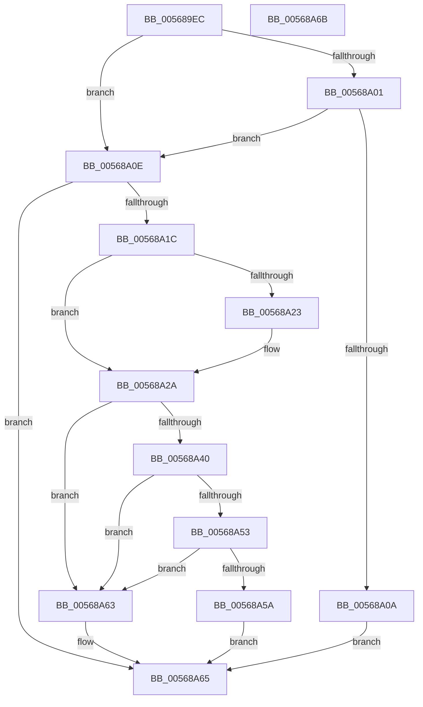

# HalpIommuRegisterBuiltinPlugins

- RVA: `0x005689EC`–`0x00568A6C` (길이 `128` bytes)
- VA: `0x00000001405689EC`
- 실행 섹션: `.text`
- PDB 이름 있음: `예`; PDB Function 태그: `아니요`
- unwind 정보 RVA: `0x0005CF00`
- 디코드: `37`개 명령, `128/128` bytes 표시
- 미해석 바이트: `0` (있으면 어셈블리에 `.byte`로 보존)

> 이 문서는 커널 이미지의 기계어와 PDB 기호를 분석해 생성했습니다. 4번과 5번은 함수 원형과 자료형을 바이너리 사용 방식에서 추정한 C 해석이며 원본 소스 복구 결과는 아닙니다.

## 1. Dependencies

- 직접 호출 지점: **3**; 고유 호출 대상: **3**
- 직접 호출자로 확인된 함수: **1**
- RIP 상대 이미지 참조: **3**

### Outgoing calls
- `0x00568A13` → [HalpIommuHsaDiscover](../../init/C2/HalpIommuHsaDiscover_function_00C25BE8.md) (function, `0x00C25BE8`)
- `0x00568A36` → [HalSocGetAcpiTable](HalSocGetAcpiTable_function_00561580.md) (function, `0x00561580`)
- `0x00568A48` → [HalpIvtProcessDmarTable](../57/HalpIvtProcessDmarTable_function_005793EC.md) (function, `0x005793EC`)

### Direct callers
- [HalpIommuInitDiscard](../../init/C2/HalpIommuInitDiscard_function_00C203F8.md) at `0x00C2060E`

### Static image references
- `0x005689F8` → RVA `0x00FC1710` (`.data`; read)
- `0x00568A01` → RVA `0x00FC1ED0` (`.data`; read)
- `0x00568A23` → RVA `0x00FC1730` (`.data`; write)

## 2. Other-region calls and transfers

- 다른 실행 섹션으로 향하는 call: **1**
  - `0x00568A13` → [HalpIommuHsaDiscover](../../init/C2/HalpIommuHsaDiscover_function_00C25BE8.md) (`.text` → `INIT`)
- 별도 외부 분기/꼬리 이동을 확인하지 못했습니다.

## 3. Assembly (complete function range)

```asm
005689EC  40 53                           push rbx
005689EE  48 83 EC 20                     sub rsp, 0x20
005689F2  48 83 64 24 30 00               and qword ptr [rsp + 0x30], 0
005689F8  80 3D 11 8D A5 00 00            cmp byte ptr [rip + 0xa58d11], 0
005689FF  74 0D                           je 0x140568a0e
00568A01  80 3D C8 94 A5 00 00            cmp byte ptr [rip + 0xa594c8], 0
00568A08  75 04                           jne 0x140568a0e
00568A0A  33 C0                           xor eax, eax
00568A0C  EB 57                           jmp 0x140568a65
00568A0E  48 8D 4C 24 30                  lea rcx, [rsp + 0x30]
00568A13  E8 D0 D1 6B 00                  call 0x140c25be8
00568A18  85 C0                           test eax, eax
00568A1A  78 49                           js 0x140568a65
00568A1C  F6 44 24 30 02                  test byte ptr [rsp + 0x30], 2
00568A21  74 07                           je 0x140568a2a
00568A23  C6 05 06 8D A5 00 01            mov byte ptr [rip + 0xa58d06], 1
00568A2A  B9 44 4D 41 52                  mov ecx, 0x52414d44
00568A2F  C6 44 24 30 00                  mov byte ptr [rsp + 0x30], 0
00568A34  33 DB                           xor ebx, ebx
00568A36  E8 45 8B FF FF                  call 0x140561580
00568A3B  48 85 C0                        test rax, rax
00568A3E  74 23                           je 0x140568a63
00568A40  48 8D 54 24 30                  lea rdx, [rsp + 0x30]
00568A45  48 8B C8                        mov rcx, rax
00568A48  E8 9F 09 01 00                  call 0x1405793ec
00568A4D  8B D8                           mov ebx, eax
00568A4F  85 C0                           test eax, eax
00568A51  78 10                           js 0x140568a63
00568A53  80 7C 24 30 00                  cmp byte ptr [rsp + 0x30], 0
00568A58  74 09                           je 0x140568a63
00568A5A  C6 05 CF 8C A5 00 01            mov byte ptr [rip + 0xa58ccf], 1
00568A61  EB 02                           jmp 0x140568a65
00568A63  8B C3                           mov eax, ebx
00568A65  48 83 C4 20                     add rsp, 0x20
00568A69  5B                              pop rbx
00568A6A  C3                              ret
00568A6B  CC                              int3
```

## 4. C-style interpretation (structured pseudocode)

```c
__int64 __fastcall HalpIommuRegisterBuiltinPlugins(void)
{
    __int64 result;
    __int64 v_rbx;
    __int64 v_rsp;
    unsigned __int64 v_stack_p8;

    v_rsp = (v_rsp) - (32);
    if ((*(unsigned __int8 *)(v_rip + 10849553)) == 0) goto loc_00568A0E;
    if ((*(unsigned __int8 *)(v_rip + 10851528)) != 0) goto loc_00568A0E;
    result = 0;
    goto loc_00568A65;
loc_00568A0E:
    result = HalpIommuHsaDiscover(v_stack_p8, a2, a3, a4);
    if (sign_flag) goto loc_00568A65;
    if (((v_stack_p8) & (2)) != 0) {
        *(unsigned __int8 *)(v_rip + 10849542) = 1;
    }
    v_stack_p8 = 0;
    v_rbx = 0;
    result = HalSocGetAcpiTable((unsigned int)(0x52414D44ULL), a2, a3, a4);
    if (result == 0) goto loc_00568A63;
    result = HalpIvtProcessDmarTable(result, v_stack_p8, a3, a4);
    if (sign_flag) goto loc_00568A63;
    if (v_stack_p8 == 0) goto loc_00568A63;
    *(unsigned __int8 *)(v_rip + 10849487) = 1;
    goto loc_00568A65;
loc_00568A63:
loc_00568A65:
    v_rsp = (v_rsp) + (32);
    return (unsigned int)((unsigned int)((unsigned int)((unsigned int)(result))));
}
```

## 5. (Beta) C Style

```c
void HalpIommuRegisterBuiltinPlugins(void)
{
    int64_t result;
    int64_t local_rbx;
    int64_t local_rsp;
    uint64_t v_stack_p8;

    local_rsp = (local_rsp) - (32);
    if ((*(uint8_t *)(v_rip + 0xA58D11)) == 0) goto loc_00568A0E;
    if ((*(uint8_t *)(v_rip + 0xA594C8)) != 0) goto loc_00568A0E;
    result = 0;
    goto loc_00568A65;
loc_00568A0E:
    result = HalpIommuHsaDiscover(v_stack_p8, a2, a3, a4);
    if (sign_flag) goto loc_00568A65;
    if (((v_stack_p8) & (2)) != 0) {
        *(uint8_t *)(v_rip + 0xA58D06) = 1;
    }
    v_stack_p8 = 0;
    local_rbx = 0;
    result = HalSocGetAcpiTable((uint32_t)(0x52414D44ULL), a2, a3, a4);
    if (result == 0) goto loc_00568A63;
    result = HalpIvtProcessDmarTable(result, v_stack_p8, a3, a4);
    if (sign_flag) goto loc_00568A63;
    if (v_stack_p8 == 0) goto loc_00568A63;
    *(uint8_t *)(v_rip + 0xA58CCF) = 1;
    goto loc_00568A65;
loc_00568A63:
loc_00568A65:
    local_rsp = (local_rsp) + (32);
    return (uint32_t)((uint32_t)((uint32_t)((uint32_t)(result))));
}
```

## 6. Execution-region graph

[열기: 2D/3D 그래프와 함수 탐색 컨트롤 패널](../../../control-panel.html?section=text&rva=0x005689EC&view=graph)

- 2D 그래프는 위에서 아래로 흐르고, 3D 그래프는 빈 공간을 드래그해 회전합니다. Shift+드래그는 이동, 휠은 확대·축소, 함수 노드 선택은 대상 보고서 이동입니다.

### Static fallback


