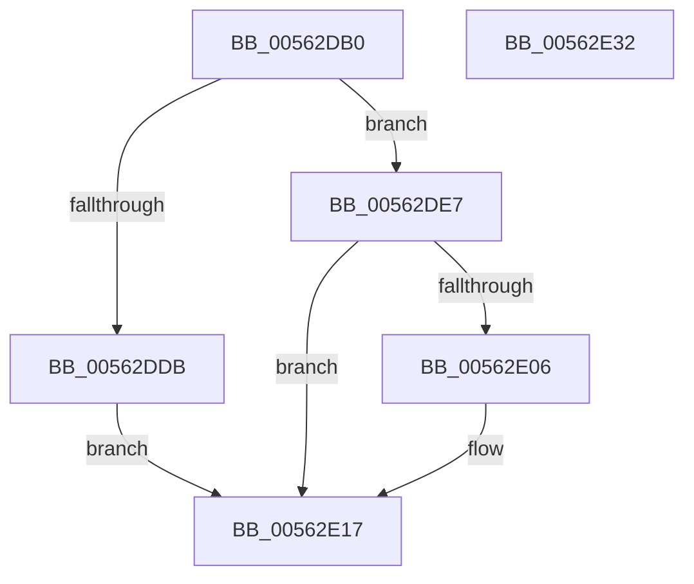

# HalpIumGetTime

- RVA: `0x00562DB0`–`0x00562E33` (길이 `131` bytes)
- VA: `0x0000000140562DB0`
- 실행 섹션: `.text`
- PDB 이름 있음: `예`; PDB Function 태그: `아니요`
- unwind 정보 RVA: `0x000C4B8C`
- 디코드: `34`개 명령, `131/131` bytes 표시
- 미해석 바이트: `0` (있으면 어셈블리에 `.byte`로 보존)

> 이 문서는 커널 이미지의 기계어와 PDB 기호를 분석해 생성했습니다. 4번과 5번은 함수 원형과 자료형을 바이너리 사용 방식에서 추정한 C 해석이며 원본 소스 복구 결과는 아닙니다.

## 1. Dependencies

- 직접 호출 지점: **2**; 고유 호출 대상: **2**
- 직접 호출자로 확인된 함수: **0**
- RIP 상대 이미지 참조: **2**

### Outgoing calls
- `0x00562DF3` → [guard_dispatch_icall](../6B/guard_dispatch_icall_function_006BAAD0.md) (function, `0x006BAAD0`)
- `0x00562E1F` → [_security_check_cookie](../6A/_security_check_cookie_function_006AC640.md) (function, `0x006AC640`)

### Direct callers
- 이 함수 시작 RVA로 연결되는 직접 call은 확인되지 않았습니다. 간접 호출은 완전히 역산할 수 없습니다.

### Static image references
- `0x00562DBA` → RVA `0x00E0A740` (`.data`; read)
- `0x00562DC9` → RVA `0x00FC1D50` (`.data`; read)

## 2. Other-region calls and transfers

- 다른 실행 섹션으로 향하는 call: **0**
- 별도 외부 분기/꼬리 이동을 확인하지 못했습니다.

## 3. Assembly (complete function range)

```asm
00562DB0  48 89 5C 24 18                  mov qword ptr [rsp + 0x18], rbx
00562DB5  57                              push rdi
00562DB6  48 83 EC 60                     sub rsp, 0x60
00562DBA  48 8B 05 7F 79 8A 00            mov rax, qword ptr [rip + 0x8a797f]
00562DC1  48 33 C4                        xor rax, rsp
00562DC4  48 89 44 24 50                  mov qword ptr [rsp + 0x50], rax
00562DC9  48 8B 05 80 EF A5 00            mov rax, qword ptr [rip + 0xa5ef80]
00562DD0  48 8B DA                        mov rbx, rdx
00562DD3  48 8B F9                        mov rdi, rcx
00562DD6  48 85 C0                        test rax, rax
00562DD9  75 0C                           jne 0x140562de7
00562DDB  48 B8 03 00 00 00 00 00 00 80   movabs rax, 0x8000000000000003
00562DE5  EB 30                           jmp 0x140562e17
00562DE7  4C 8D 4C 24 30                  lea r9, [rsp + 0x30]
00562DEC  45 33 C0                        xor r8d, r8d
00562DEF  33 D2                           xor edx, edx
00562DF1  33 C9                           xor ecx, ecx
00562DF3  E8 D8 7C 15 00                  call 0x1406baad0
00562DF8  0F 10 44 24 30                  movups xmm0, xmmword ptr [rsp + 0x30]
00562DFD  F3 0F 7F 07                     movdqu xmmword ptr [rdi], xmm0
00562E01  48 85 DB                        test rbx, rbx
00562E04  74 11                           je 0x140562e17
00562E06  F2 0F 10 44 24 40               movsd xmm0, qword ptr [rsp + 0x40]
00562E0C  8B 4C 24 48                     mov ecx, dword ptr [rsp + 0x48]
00562E10  F2 0F 11 03                     movsd qword ptr [rbx], xmm0
00562E14  89 4B 08                        mov dword ptr [rbx + 8], ecx
00562E17  48 8B 4C 24 50                  mov rcx, qword ptr [rsp + 0x50]
00562E1C  48 33 CC                        xor rcx, rsp
00562E1F  E8 1C 98 14 00                  call 0x1406ac640
00562E24  48 8B 9C 24 80 00 00 00         mov rbx, qword ptr [rsp + 0x80]
00562E2C  48 83 C4 60                     add rsp, 0x60
00562E30  5F                              pop rdi
00562E31  C3                              ret
00562E32  CC                              int3
```

## 4. C-style interpretation (structured pseudocode)

```c
__int64 __fastcall HalpIumGetTime(__int64 a1, __int64 a2, int a3)
{
    __int64 result;
    __int64 v_rsp;
    unsigned __int64 v_stack_m18;
    unsigned int v_stack_m20;
    unsigned __int64 v_stack_m28;
    unsigned __int64 v_stack_m38;
    unsigned __int64 v_stack_p18;

    v_stack_p18 = v_rbx;
    v_rsp = (v_rsp) - (96);
    result = (*(unsigned __int64 *)(v_rip + 9075071)) ^ (v_rsp);
    v_stack_m18 = result;
    if (*(unsigned __int64 *)(v_rip + 10874752) != 0) goto loc_00562DE7;
    goto loc_00562E17;
loc_00562DE7:
    a3 = 0;
    a2 = 0;
    a1 = 0;
    result = guard_dispatch_icall(a1, a2, a3, v_stack_m38);
    *(unsigned __int64 *)(a1) = v_xmm0;
    if (0 != 0) {
        a1 = v_stack_m20;
        *(unsigned __int64 *)(a2) = v_xmm0;
        *(unsigned int *)(a2 + 8) = (unsigned int)(a1);
    }
    a1 = (v_stack_m18) ^ (v_rsp);
    result = _security_check_cookie(a1, a2, a3, v_stack_m38);
    v_rsp = (v_rsp) + (96);
    return result;
}
```

## 5. (Beta) C Style

```c
int64_t HalpIumGetTime(void *Arg1, int64_t Arg2, int32_t Arg3)
{
    uint8_t *arg1 = (uint8_t *)Arg1;

    int64_t result;
    int64_t local_rsp;
    uint64_t v_stack_m18;
    uint32_t v_stack_m20;
    uint64_t v_stack_m28;
    uint64_t v_stack_m38;
    uint64_t v_stack_p18;

    v_stack_p18 = local_rbx;
    local_rsp = (local_rsp) - (96);
    result = (*(uint64_t *)(v_rip + 0x8A797F)) ^ (local_rsp);
    v_stack_m18 = result;
    if (*(uint64_t *)(v_rip + 0xA5EF80) != 0) goto loc_00562DE7;
    goto loc_00562E17;
loc_00562DE7:
    Arg3 = 0;
    Arg2 = 0;
    Arg1 = 0;
    result = guard_dispatch_icall(Arg1, Arg2, Arg3, v_stack_m38);
    *(uint64_t *)(arg1) = v_xmm0;
    if (0 != 0) {
        Arg1 = v_stack_m20;
        *(uint64_t *)(Arg2) = v_xmm0;
        *(uint32_t *)(Arg2 + 0x8) = (uint32_t)(Arg1);
    }
    Arg1 = (v_stack_m18) ^ (local_rsp);
    result = _security_check_cookie(Arg1, Arg2, Arg3, v_stack_m38);
    local_rsp = (local_rsp) + (96);
    return result;
}
```

### 관측된 메모리 오프셋

구조체 형식이 확인되지 않은 접근은 인자 기준의 오프셋으로만 기록했습니다.

| 기준 인자 | 오프셋 표현 | 폭 (bit) | 접근 |
|---|---:|---:|---|
| `Arg1` | `+ 0x0` | `128` | `W` |

## 6. Execution-region graph

[열기: 2D/3D 그래프와 함수 탐색 컨트롤 패널](../../../control-panel.html?section=text&rva=0x00562DB0&view=graph)

- 2D 그래프는 위에서 아래로 흐르고, 3D 그래프는 빈 공간을 드래그해 회전합니다. Shift+드래그는 이동, 휠은 확대·축소, 함수 노드 선택은 대상 보고서 이동입니다.

### Static fallback


