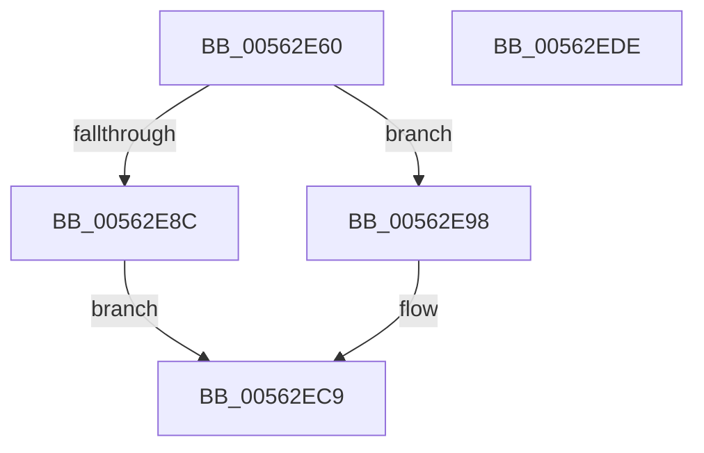

# HalpIumQueryVariableInfo

- RVA: `0x00562E60`–`0x00562EDF` (길이 `127` bytes)
- VA: `0x0000000140562E60`
- 실행 섹션: `.text`
- PDB 이름 있음: `예`; PDB Function 태그: `아니요`
- unwind 정보 RVA: `0x000C4B74`
- 디코드: `37`개 명령, `127/127` bytes 표시
- 미해석 바이트: `0` (있으면 어셈블리에 `.byte`로 보존)

> 이 문서는 커널 이미지의 기계어와 PDB 기호를 분석해 생성했습니다. 4번과 5번은 함수 원형과 자료형을 바이너리 사용 방식에서 추정한 C 해석이며 원본 소스 복구 결과는 아닙니다.

## 1. Dependencies

- 직접 호출 지점: **2**; 고유 호출 대상: **2**
- 직접 호출자로 확인된 함수: **0**
- RIP 상대 이미지 참조: **2**

### Outgoing calls
- `0x00562EAC` → [guard_dispatch_icall](../6B/guard_dispatch_icall_function_006BAAD0.md) (function, `0x006BAAD0`)
- `0x00562ED1` → [_security_check_cookie](../6A/_security_check_cookie_function_006AC640.md) (function, `0x006AC640`)

### Direct callers
- 이 함수 시작 RVA로 연결되는 직접 call은 확인되지 않았습니다. 간접 호출은 완전히 역산할 수 없습니다.

### Static image references
- `0x00562E68` → RVA `0x00E0A740` (`.data`; read)
- `0x00562E77` → RVA `0x00FC1D50` (`.data`; read)

## 2. Other-region calls and transfers

- 다른 실행 섹션으로 향하는 call: **0**
- 별도 외부 분기/꼬리 이동을 확인하지 못했습니다.

## 3. Assembly (complete function range)

```asm
00562E60  40 53                           push rbx
00562E62  56                              push rsi
00562E63  57                              push rdi
00562E64  48 83 EC 60                     sub rsp, 0x60
00562E68  48 8B 05 D1 78 8A 00            mov rax, qword ptr [rip + 0x8a78d1]
00562E6F  48 33 C4                        xor rax, rsp
00562E72  48 89 44 24 50                  mov qword ptr [rsp + 0x50], rax
00562E77  48 8B 05 D2 EE A5 00            mov rax, qword ptr [rip + 0xa5eed2]
00562E7E  49 8B F1                        mov rsi, r9
00562E81  49 8B F8                        mov rdi, r8
00562E84  48 8B DA                        mov rbx, rdx
00562E87  48 85 C0                        test rax, rax
00562E8A  75 0C                           jne 0x140562e98
00562E8C  48 B8 03 00 00 00 00 00 00 80   movabs rax, 0x8000000000000003
00562E96  EB 31                           jmp 0x140562ec9
00562E98  8B C9                           mov ecx, ecx
00562E9A  4C 8D 4C 24 30                  lea r9, [rsp + 0x30]
00562E9F  33 D2                           xor edx, edx
00562EA1  48 89 4C 24 30                  mov qword ptr [rsp + 0x30], rcx
00562EA6  45 33 C0                        xor r8d, r8d
00562EA9  8D 4A 08                        lea ecx, [rdx + 8]
00562EAC  E8 1F 7C 15 00                  call 0x1406baad0
00562EB1  48 8B 4C 24 38                  mov rcx, qword ptr [rsp + 0x38]
00562EB6  48 89 0B                        mov qword ptr [rbx], rcx
00562EB9  48 8B 4C 24 40                  mov rcx, qword ptr [rsp + 0x40]
00562EBE  48 89 0F                        mov qword ptr [rdi], rcx
00562EC1  48 8B 4C 24 48                  mov rcx, qword ptr [rsp + 0x48]
00562EC6  48 89 0E                        mov qword ptr [rsi], rcx
00562EC9  48 8B 4C 24 50                  mov rcx, qword ptr [rsp + 0x50]
00562ECE  48 33 CC                        xor rcx, rsp
00562ED1  E8 6A 97 14 00                  call 0x1406ac640
00562ED6  48 83 C4 60                     add rsp, 0x60
00562EDA  5F                              pop rdi
00562EDB  5E                              pop rsi
00562EDC  5B                              pop rbx
00562EDD  C3                              ret
00562EDE  CC                              int3
```

## 4. C-style interpretation (structured pseudocode)

```c
__int64 __fastcall HalpIumQueryVariableInfo(int a1, __int64 a2, __int64 a3, __int64 a4)
{
    __int64 result;
    __int64 v_rsp;
    unsigned __int64 v_stack_m28;
    unsigned __int64 v_stack_m30;
    unsigned __int64 v_stack_m38;
    unsigned __int64 v_stack_m40;
    unsigned __int64 v_stack_m48;

    v_rsp = (v_rsp) - (96);
    result = (*(unsigned __int64 *)(v_rip + 9074897)) ^ (v_rsp);
    v_stack_m28 = result;
    if (*(unsigned __int64 *)(v_rip + 10874578) != 0) goto loc_00562E98;
    goto loc_00562EC9;
loc_00562E98:
    a2 = 0;
    v_stack_m48 = (unsigned int)(a1);
    a3 = 0;
    result = guard_dispatch_icall(a2 + 8, a2, a3, v_stack_m48);
    *(unsigned __int64 *)(a2) = v_stack_m40;
    *(unsigned __int64 *)(a3) = v_stack_m38;
    *(unsigned __int64 *)(a4) = v_stack_m30;
loc_00562EC9:
    a1 = (v_stack_m28) ^ (v_rsp);
    result = _security_check_cookie(a1, a2, a3, v_stack_m48);
    v_rsp = (v_rsp) + (96);
    return result;
}
```

## 5. (Beta) C Style

```c
int64_t HalpIumQueryVariableInfo(int32_t Arg1, void *Arg2, void *Arg3, void *Arg4)
{
    uint8_t *arg2 = (uint8_t *)Arg2;
    uint8_t *arg3 = (uint8_t *)Arg3;
    uint8_t *arg4 = (uint8_t *)Arg4;

    int64_t result;
    int64_t local_rsp;
    uint64_t v_stack_m28;
    uint64_t v_stack_m30;
    uint64_t v_stack_m38;
    uint64_t v_stack_m40;
    uint64_t v_stack_m48;

    local_rsp = (local_rsp) - (96);
    result = (*(uint64_t *)(v_rip + 0x8A78D1)) ^ (local_rsp);
    v_stack_m28 = result;
    if (*(uint64_t *)(v_rip + 0xA5EED2) != 0) goto loc_00562E98;
    goto loc_00562EC9;
loc_00562E98:
    Arg2 = 0;
    v_stack_m48 = (uint32_t)(Arg1);
    Arg3 = 0;
    result = guard_dispatch_icall(Arg2 + 8, Arg2, Arg3, v_stack_m48);
    *(uint64_t *)(arg2) = v_stack_m40;
    *(uint64_t *)(arg3) = v_stack_m38;
    *(uint64_t *)(arg4) = v_stack_m30;
loc_00562EC9:
    Arg1 = (v_stack_m28) ^ (local_rsp);
    result = _security_check_cookie(Arg1, Arg2, Arg3, v_stack_m48);
    local_rsp = (local_rsp) + (96);
    return result;
}
```

### 관측된 메모리 오프셋

구조체 형식이 확인되지 않은 접근은 인자 기준의 오프셋으로만 기록했습니다.

| 기준 인자 | 오프셋 표현 | 폭 (bit) | 접근 |
|---|---:|---:|---|
| `Arg2` | `+ 0x0` | `64` | `W` |
| `Arg3` | `+ 0x0` | `64` | `W` |
| `Arg4` | `+ 0x0` | `64` | `W` |

## 6. Execution-region graph

[열기: 2D/3D 그래프와 함수 탐색 컨트롤 패널](../../../control-panel.html?section=text&rva=0x00562E60&view=graph)

- 2D 그래프는 위에서 아래로 흐르고, 3D 그래프는 빈 공간을 드래그해 회전합니다. Shift+드래그는 이동, 휠은 확대·축소, 함수 노드 선택은 대상 보고서 이동입니다.

### Static fallback


