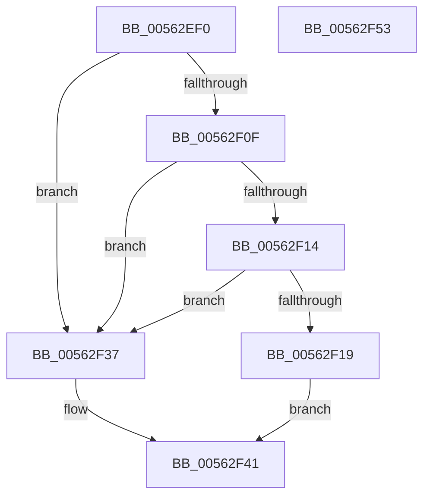

# HalpIumResetSystem

- RVA: `0x00562EF0`–`0x00562F54` (길이 `100` bytes)
- VA: `0x0000000140562EF0`
- 실행 섹션: `.text`
- PDB 이름 있음: `예`; PDB Function 태그: `아니요`
- unwind 정보 RVA: `0x0006F9F8`
- 디코드: `26`개 명령, `100/100` bytes 표시
- 미해석 바이트: `0` (있으면 어셈블리에 `.byte`로 보존)

> 이 문서는 커널 이미지의 기계어와 PDB 기호를 분석해 생성했습니다. 4번과 5번은 함수 원형과 자료형을 바이너리 사용 방식에서 추정한 C 해석이며 원본 소스 복구 결과는 아닙니다.

## 1. Dependencies

- 직접 호출 지점: **2**; 고유 호출 대상: **2**
- 직접 호출자로 확인된 함수: **0**
- RIP 상대 이미지 참조: **2**

### Outgoing calls
- `0x00562F30` → [guard_dispatch_icall](../6B/guard_dispatch_icall_function_006BAAD0.md) (function, `0x006BAAD0`)
- `0x00562F49` → [_security_check_cookie](../6A/_security_check_cookie_function_006AC640.md) (function, `0x006AC640`)

### Direct callers
- 이 함수 시작 RVA로 연결되는 직접 call은 확인되지 않았습니다. 간접 호출은 완전히 역산할 수 없습니다.

### Static image references
- `0x00562EF4` → RVA `0x00E0A740` (`.data`; read)
- `0x00562F03` → RVA `0x00FC1D50` (`.data`; read)

## 2. Other-region calls and transfers

- 다른 실행 섹션으로 향하는 call: **0**
- 별도 외부 분기/꼬리 이동을 확인하지 못했습니다.

## 3. Assembly (complete function range)

```asm
00562EF0  48 83 EC 68                     sub rsp, 0x68
00562EF4  48 8B 05 45 78 8A 00            mov rax, qword ptr [rip + 0x8a7845]
00562EFB  48 33 C4                        xor rax, rsp
00562EFE  48 89 44 24 50                  mov qword ptr [rsp + 0x50], rax
00562F03  48 8B 05 46 EE A5 00            mov rax, qword ptr [rip + 0xa5ee46]
00562F0A  48 85 C0                        test rax, rax
00562F0D  74 28                           je 0x140562f37
00562F0F  4D 85 C0                        test r8, r8
00562F12  75 23                           jne 0x140562f37
00562F14  4D 85 C9                        test r9, r9
00562F17  75 1E                           jne 0x140562f37
00562F19  48 63 C9                        movsxd rcx, ecx
00562F1C  4C 8D 4C 24 30                  lea r9, [rsp + 0x30]
00562F21  48 89 54 24 38                  mov qword ptr [rsp + 0x38], rdx
00562F26  33 D2                           xor edx, edx
00562F28  48 89 4C 24 30                  mov qword ptr [rsp + 0x30], rcx
00562F2D  8D 4A 02                        lea ecx, [rdx + 2]
00562F30  E8 9B 7B 15 00                  call 0x1406baad0
00562F35  EB 0A                           jmp 0x140562f41
00562F37  48 B8 03 00 00 00 00 00 00 80   movabs rax, 0x8000000000000003
00562F41  48 8B 4C 24 50                  mov rcx, qword ptr [rsp + 0x50]
00562F46  48 33 CC                        xor rcx, rsp
00562F49  E8 F2 96 14 00                  call 0x1406ac640
00562F4E  48 83 C4 68                     add rsp, 0x68
00562F52  C3                              ret
00562F53  CC                              int3
```

## 4. C-style interpretation (structured pseudocode)

```c
__int64 __fastcall HalpIumResetSystem(int a1, __int64 a2, __int64 a3, __int64 a4)
{
    __int64 result;
    __int64 v_rsp;
    unsigned __int64 v_stack_m18;
    unsigned __int64 v_stack_m30;
    unsigned __int64 v_stack_m38;

    v_rsp = (v_rsp) - (104);
    result = (*(unsigned __int64 *)(v_rip + 9074757)) ^ (v_rsp);
    v_stack_m18 = result;
    if (*(unsigned __int64 *)(v_rip + 10874438) == 0) goto loc_00562F37;
    if (a3 != 0) goto loc_00562F37;
    if (a4 != 0) goto loc_00562F37;
    v_stack_m30 = a2;
    a2 = 0;
    v_stack_m38 = (int)(a1);
    result = guard_dispatch_icall(a2 + 2, a2, a3, v_stack_m38);
    goto loc_00562F41;
loc_00562F37:
loc_00562F41:
    a1 = (v_stack_m18) ^ (v_rsp);
    result = _security_check_cookie(a1, a2, a3, v_stack_m38);
    v_rsp = (v_rsp) + (104);
    return result;
}
```

## 5. (Beta) C Style

```c
int64_t HalpIumResetSystem(int32_t Arg1, int64_t Arg2, int64_t Arg3, int64_t Arg4)
{
    int64_t result;
    int64_t local_rsp;
    uint64_t v_stack_m18;
    uint64_t v_stack_m30;
    uint64_t v_stack_m38;

    local_rsp = (local_rsp) - (104);
    result = (*(uint64_t *)(v_rip + 0x8A7845)) ^ (local_rsp);
    v_stack_m18 = result;
    if (*(uint64_t *)(v_rip + 0xA5EE46) == 0) goto loc_00562F37;
    if (Arg3 != 0) goto loc_00562F37;
    if (Arg4 != 0) goto loc_00562F37;
    v_stack_m30 = Arg2;
    Arg2 = 0;
    v_stack_m38 = (int32_t)(Arg1);
    result = guard_dispatch_icall(Arg2 + 2, Arg2, Arg3, v_stack_m38);
    goto loc_00562F41;
loc_00562F37:
loc_00562F41:
    Arg1 = (v_stack_m18) ^ (local_rsp);
    result = _security_check_cookie(Arg1, Arg2, Arg3, v_stack_m38);
    local_rsp = (local_rsp) + (104);
    return result;
}
```

## 6. Execution-region graph

[열기: 2D/3D 그래프와 함수 탐색 컨트롤 패널](../../../control-panel.html?section=text&rva=0x00562EF0&view=graph)

- 2D 그래프는 위에서 아래로 흐르고, 3D 그래프는 빈 공간을 드래그해 회전합니다. Shift+드래그는 이동, 휠은 확대·축소, 함수 노드 선택은 대상 보고서 이동입니다.

### Static fallback


