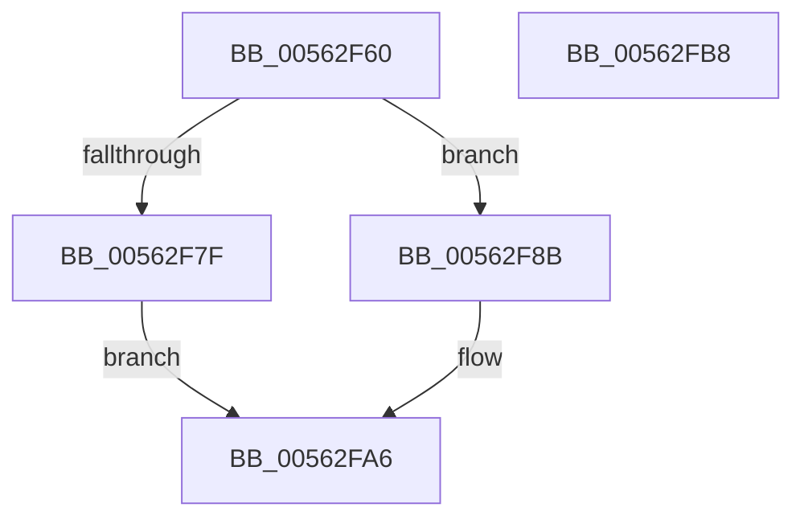

# HalpIumSetTime

- RVA: `0x00562F60`–`0x00562FB9` (길이 `89` bytes)
- VA: `0x0000000140562F60`
- 실행 섹션: `.text`
- PDB 이름 있음: `예`; PDB Function 태그: `아니요`
- unwind 정보 RVA: `0x0006F9F8`
- 디코드: `22`개 명령, `89/89` bytes 표시
- 미해석 바이트: `0` (있으면 어셈블리에 `.byte`로 보존)

> 이 문서는 커널 이미지의 기계어와 PDB 기호를 분석해 생성했습니다. 4번과 5번은 함수 원형과 자료형을 바이너리 사용 방식에서 추정한 C 해석이며 원본 소스 복구 결과는 아닙니다.

## 1. Dependencies

- 직접 호출 지점: **2**; 고유 호출 대상: **2**
- 직접 호출자로 확인된 함수: **0**
- RIP 상대 이미지 참조: **2**

### Outgoing calls
- `0x00562FA1` → [guard_dispatch_icall](../6B/guard_dispatch_icall_function_006BAAD0.md) (function, `0x006BAAD0`)
- `0x00562FAE` → [_security_check_cookie](../6A/_security_check_cookie_function_006AC640.md) (function, `0x006AC640`)

### Direct callers
- 이 함수 시작 RVA로 연결되는 직접 call은 확인되지 않았습니다. 간접 호출은 완전히 역산할 수 없습니다.

### Static image references
- `0x00562F64` → RVA `0x00E0A740` (`.data`; read)
- `0x00562F73` → RVA `0x00FC1D50` (`.data`; read)

## 2. Other-region calls and transfers

- 다른 실행 섹션으로 향하는 call: **0**
- 별도 외부 분기/꼬리 이동을 확인하지 못했습니다.

## 3. Assembly (complete function range)

```asm
00562F60  48 83 EC 68                     sub rsp, 0x68
00562F64  48 8B 05 D5 77 8A 00            mov rax, qword ptr [rip + 0x8a77d5]
00562F6B  48 33 C4                        xor rax, rsp
00562F6E  48 89 44 24 50                  mov qword ptr [rsp + 0x50], rax
00562F73  48 8B 05 D6 ED A5 00            mov rax, qword ptr [rip + 0xa5edd6]
00562F7A  48 85 C0                        test rax, rax
00562F7D  75 0C                           jne 0x140562f8b
00562F7F  48 B8 03 00 00 00 00 00 00 80   movabs rax, 0x8000000000000003
00562F89  EB 1B                           jmp 0x140562fa6
00562F8B  0F 10 01                        movups xmm0, xmmword ptr [rcx]
00562F8E  33 D2                           xor edx, edx
00562F90  4C 8D 4C 24 30                  lea r9, [rsp + 0x30]
00562F95  45 33 C0                        xor r8d, r8d
00562F98  F3 0F 7F 44 24 30               movdqu xmmword ptr [rsp + 0x30], xmm0
00562F9E  8D 4A 01                        lea ecx, [rdx + 1]
00562FA1  E8 2A 7B 15 00                  call 0x1406baad0
00562FA6  48 8B 4C 24 50                  mov rcx, qword ptr [rsp + 0x50]
00562FAB  48 33 CC                        xor rcx, rsp
00562FAE  E8 8D 96 14 00                  call 0x1406ac640
00562FB3  48 83 C4 68                     add rsp, 0x68
00562FB7  C3                              ret
00562FB8  CC                              int3
```

## 4. C-style interpretation (structured pseudocode)

```c
__int64 __fastcall HalpIumSetTime(__int64 a1, int a2, int a3)
{
    __int64 result;
    __int64 v_rsp;
    unsigned __int64 v_stack_m18;
    unsigned __int64 v_stack_m38;

    v_rsp = (v_rsp) - (104);
    result = (*(unsigned __int64 *)(v_rip + 9074645)) ^ (v_rsp);
    v_stack_m18 = result;
    if (*(unsigned __int64 *)(v_rip + 10874326) != 0) goto loc_00562F8B;
    goto loc_00562FA6;
loc_00562F8B:
    a2 = 0;
    a3 = 0;
    v_stack_m38 = v_xmm0;
    result = guard_dispatch_icall(a2 + 1, a2, a3, v_stack_m38);
loc_00562FA6:
    a1 = (v_stack_m18) ^ (v_rsp);
    result = _security_check_cookie(a1, a2, a3, v_stack_m38);
    v_rsp = (v_rsp) + (104);
    return result;
}
```

## 5. (Beta) C Style

```c
int64_t HalpIumSetTime(void *Arg1, int32_t Arg2, int32_t Arg3)
{
    uint8_t *arg1 = (uint8_t *)Arg1;

    int64_t result;
    int64_t local_rsp;
    uint64_t v_stack_m18;
    uint64_t v_stack_m38;

    local_rsp = (local_rsp) - (104);
    result = (*(uint64_t *)(v_rip + 0x8A77D5)) ^ (local_rsp);
    v_stack_m18 = result;
    if (*(uint64_t *)(v_rip + 0xA5EDD6) != 0) goto loc_00562F8B;
    goto loc_00562FA6;
loc_00562F8B:
    Arg2 = 0;
    Arg3 = 0;
    v_stack_m38 = v_xmm0;
    result = guard_dispatch_icall(Arg2 + 1, Arg2, Arg3, v_stack_m38);
loc_00562FA6:
    Arg1 = (v_stack_m18) ^ (local_rsp);
    result = _security_check_cookie(Arg1, Arg2, Arg3, v_stack_m38);
    local_rsp = (local_rsp) + (104);
    return result;
}
```

### 관측된 메모리 오프셋

구조체 형식이 확인되지 않은 접근은 인자 기준의 오프셋으로만 기록했습니다.

| 기준 인자 | 오프셋 표현 | 폭 (bit) | 접근 |
|---|---:|---:|---|
| `Arg1` | `+ 0x0` | `128` | `R` |

## 6. Execution-region graph

[열기: 2D/3D 그래프와 함수 탐색 컨트롤 패널](../../../control-panel.html?section=text&rva=0x00562F60&view=graph)

- 2D 그래프는 위에서 아래로 흐르고, 3D 그래프는 빈 공간을 드래그해 회전합니다. Shift+드래그는 이동, 휠은 확대·축소, 함수 노드 선택은 대상 보고서 이동입니다.

### Static fallback


