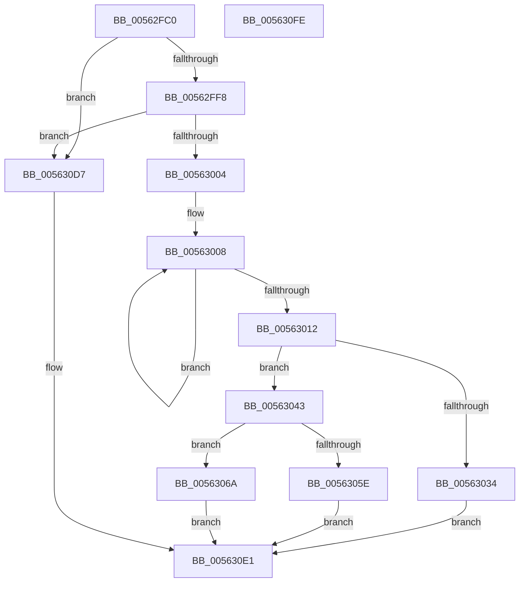

# HalpIumSetVariable

- RVA: `0x00562FC0`–`0x005630FF` (길이 `319` bytes)
- VA: `0x0000000140562FC0`
- 실행 섹션: `.text`
- PDB 이름 있음: `예`; PDB Function 태그: `아니요`
- unwind 정보 RVA: `0x0008C20C`
- 디코드: `80`개 명령, `319/319` bytes 표시
- 미해석 바이트: `0` (있으면 어셈블리에 `.byte`로 보존)

> 이 문서는 커널 이미지의 기계어와 PDB 기호를 분석해 생성했습니다. 4번과 5번은 함수 원형과 자료형을 바이너리 사용 방식에서 추정한 C 해석이며 원본 소스 복구 결과는 아닙니다.

## 1. Dependencies

- 직접 호출 지점: **5**; 고유 호출 대상: **4**
- 직접 호출자로 확인된 함수: **0**
- RIP 상대 이미지 참조: **1**

### Outgoing calls
- `0x00563051` → [ExAllocatePool2](../../poolcode/B8/ExAllocatePool2_function_00B820F0.md) (function, `0x00B820F0`)
- `0x0056307B` → [memcpy](../6C/memcpy_function_006C6840.md) (function, `0x006C6840`)
- `0x005630A3` → [memcpy](../6C/memcpy_function_006C6840.md) (function, `0x006C6840`)
- `0x005630C0` → [guard_dispatch_icall](../6B/guard_dispatch_icall_function_006BAAD0.md) (function, `0x006BAAD0`)
- `0x005630CD` → [ExFreePoolWithTag](../../poolcode/B8/ExFreePoolWithTag_function_00B82870.md) (function, `0x00B82870`)

### Direct callers
- 이 함수 시작 RVA로 연결되는 직접 call은 확인되지 않았습니다. 간접 호출은 완전히 역산할 수 없습니다.

### Static image references
- `0x00562FE2` → RVA `0x00FC1D50` (`.data`; read)

## 2. Other-region calls and transfers

- 다른 실행 섹션으로 향하는 call: **2**
  - `0x00563051` → [ExAllocatePool2](../../poolcode/B8/ExAllocatePool2_function_00B820F0.md) (`.text` → `POOLCODE`)
  - `0x005630CD` → [ExFreePoolWithTag](../../poolcode/B8/ExFreePoolWithTag_function_00B82870.md) (`.text` → `POOLCODE`)
- 별도 외부 분기/꼬리 이동을 확인하지 못했습니다.

## 3. Assembly (complete function range)

```asm
00562FC0  48 89 5C 24 08                  mov qword ptr [rsp + 8], rbx
00562FC5  48 89 6C 24 10                  mov qword ptr [rsp + 0x10], rbp
00562FCA  48 89 74 24 18                  mov qword ptr [rsp + 0x18], rsi
00562FCF  57                              push rdi
00562FD0  41 54                           push r12
00562FD2  41 55                           push r13
00562FD4  41 56                           push r14
00562FD6  41 57                           push r15
00562FD8  48 83 EC 30                     sub rsp, 0x30
00562FDC  45 33 ED                        xor r13d, r13d
00562FDF  49 8B E9                        mov rbp, r9
00562FE2  4C 39 2D 67 ED A5 00            cmp qword ptr [rip + 0xa5ed67], r13
00562FE9  45 8B F8                        mov r15d, r8d
00562FEC  4C 8B E2                        mov r12, rdx
00562FEF  4C 8B F1                        mov r14, rcx
00562FF2  0F 84 DF 00 00 00               je 0x1405630d7
00562FF8  44 0F 20 C0                     mov rax, cr8
00562FFC  3C 02                           cmp al, 2
00562FFE  0F 87 D3 00 00 00               ja 0x1405630d7
00563004  48 83 C8 FF                     or rax, 0xffffffffffffffff
00563008  48 FF C0                        inc rax
0056300B  66 44 39 2C 41                  cmp word ptr [rcx + rax*2], r13w
00563010  75 F6                           jne 0x140563008
00563012  48 8D 34 45 02 00 00 00         lea rsi, [rax*2 + 2]
0056301A  49 8D 99 37 10 00 00            lea rbx, [r9 + 0x1037]
00563021  48 03 DE                        add rbx, rsi
00563024  48 81 E3 00 F0 FF FF            and rbx, 0xfffffffffffff000
0056302B  48 81 FB 00 A0 1F 00            cmp rbx, 0x1fa000
00563032  76 0F                           jbe 0x140563043
00563034  48 B8 04 00 00 00 00 00 00 80   movabs rax, 0x8000000000000004
0056303E  E9 9E 00 00 00                  jmp 0x1405630e1
00563043  41 B8 53 6B 46 77               mov r8d, 0x77466b53
00563049  48 8B D3                        mov rdx, rbx
0056304C  B9 40 00 00 00                  mov ecx, 0x40
00563051  E8 9A F0 61 00                  call 0x140b820f0
00563056  48 8B F8                        mov rdi, rax
00563059  48 85 C0                        test rax, rax
0056305C  75 0C                           jne 0x14056306a
0056305E  48 B8 09 00 00 00 00 00 00 80   movabs rax, 0x8000000000000009
00563068  EB 77                           jmp 0x1405630e1
0056306A  48 8D 48 38                     lea rcx, [rax + 0x38]
0056306E  44 89 78 20                     mov dword ptr [rax + 0x20], r15d
00563072  4C 8B C6                        mov r8, rsi
00563075  48 89 08                        mov qword ptr [rax], rcx
00563078  49 8B D6                        mov rdx, r14
0056307B  E8 C0 37 16 00                  call 0x1406c6840
00563080  48 8B 0F                        mov rcx, qword ptr [rdi]
00563083  4C 8B C5                        mov r8, rbp
00563086  48 8B 94 24 80 00 00 00         mov rdx, qword ptr [rsp + 0x80]
0056308E  48 03 CE                        add rcx, rsi
00563091  48 89 77 08                     mov qword ptr [rdi + 8], rsi
00563095  41 0F 10 04 24                  movups xmm0, xmmword ptr [r12]
0056309A  48 89 4F 30                     mov qword ptr [rdi + 0x30], rcx
0056309E  F3 0F 7F 47 10                  movdqu xmmword ptr [rdi + 0x10], xmm0
005630A3  E8 98 37 16 00                  call 0x1406c6840
005630A8  45 33 C9                        xor r9d, r9d
005630AB  48 89 6F 28                     mov qword ptr [rdi + 0x28], rbp
005630AF  48 8B 05 9A EC A5 00            mov rax, qword ptr [rip + 0xa5ec9a]
005630B6  4C 8B C3                        mov r8, rbx
005630B9  48 8B D7                        mov rdx, rdi
005630BC  41 8D 49 05                     lea ecx, [r9 + 5]
005630C0  E8 0B 7A 15 00                  call 0x1406baad0
005630C5  33 D2                           xor edx, edx
005630C7  48 8B CF                        mov rcx, rdi
005630CA  48 8B D8                        mov rbx, rax
005630CD  E8 9E F7 61 00                  call 0x140b82870
005630D2  48 8B C3                        mov rax, rbx
005630D5  EB 0A                           jmp 0x1405630e1
005630D7  48 B8 03 00 00 00 00 00 00 80   movabs rax, 0x8000000000000003
005630E1  48 8B 5C 24 60                  mov rbx, qword ptr [rsp + 0x60]
005630E6  48 8B 6C 24 68                  mov rbp, qword ptr [rsp + 0x68]
005630EB  48 8B 74 24 70                  mov rsi, qword ptr [rsp + 0x70]
005630F0  48 83 C4 30                     add rsp, 0x30
005630F4  41 5F                           pop r15
005630F6  41 5E                           pop r14
005630F8  41 5D                           pop r13
005630FA  41 5C                           pop r12
005630FC  5F                              pop rdi
005630FD  C3                              ret
005630FE  CC                              int3
```

## 4. C-style interpretation (structured pseudocode)

```c
__int64 __fastcall HalpIumSetVariable(__int64 a1, __int64 a2, int a3, __int64 a4, __int64 a5)
{
    __int64 result;
    __int64 v_r13;
    __int64 v_rbx;
    __int64 v_rsp;
    unsigned __int64 v_stack_p10;
    unsigned __int64 v_stack_p18;
    unsigned __int64 v_stack_p8;

    v_stack_p8 = v_rbx;
    v_stack_p10 = v_rbp;
    v_stack_p18 = v_rsi;
    v_rsp = (v_rsp) - (48);
    v_r13 = 0;
    if ((*(unsigned __int64 *)(v_rip + 10874215)) == 0) goto loc_005630D7;
    if (((unsigned __int8)(v_cr8)) > 2) goto loc_005630D7;
    result = (v_cr8) | (-1);
loc_00563008:
    result = (result) + 1;
    if ((*(unsigned __int16 *)(a1 + result * 2)) != 0) goto loc_00563008;
    v_rbx = (a4 + 4151) + (result * 2 + 2);
    v_rbx = (v_rbx) & (0xFFFFFFFFFFFFF000ULL);
    if (v_rbx <= 0x1FA000ULL) goto loc_00563043;
    goto loc_005630E1;
loc_00563043:
    result = ExAllocatePool2(64, v_rbx, (unsigned int)(0x77466B53ULL), a4);
    if (result != 0) goto loc_0056306A;
    goto loc_005630E1;
loc_0056306A:
    *(unsigned int *)(result + 32) = (unsigned int)((unsigned int)(a3));
    *(unsigned __int64 *)(result) = result + 56;
    result = memcpy(result + 56, a1, result * 2 + 2, a4);
    a1 = (*(unsigned __int64 *)(result)) + (result * 2 + 2);
    *(unsigned __int64 *)(result + 8) = result * 2 + 2;
    *(unsigned __int64 *)(result + 48) = a1;
    *(unsigned __int64 *)(result + 16) = v_xmm0;
    result = memcpy(a1, a5, a4, a4);
    a4 = 0;
    *(unsigned __int64 *)(result + 40) = 0;
    result = guard_dispatch_icall(a4 + 5, result, v_rbx, a4);
    a2 = 0;
    result = ExFreePoolWithTag(result, a2, v_rbx, a4);
    goto loc_005630E1;
loc_005630D7:
loc_005630E1:
    v_rsp = (v_rsp) + (48);
    return result;
}
```

## 5. (Beta) C Style

```c
int64_t HalpIumSetVariable(void *Arg1, void *Arg2, int32_t Arg3, void *Arg4, int64_t Arg5)
{
    uint8_t *arg1 = (uint8_t *)Arg1;
    uint8_t *arg2 = (uint8_t *)Arg2;
    uint8_t *arg4 = (uint8_t *)Arg4;

    int64_t result;
    int64_t local_r13;
    int64_t local_rbx;
    int64_t local_rsp;
    uint64_t v_stack_p10;
    uint64_t v_stack_p18;
    uint64_t v_stack_p8;

    v_stack_p8 = local_rbx;
    v_stack_p10 = local_rbp;
    v_stack_p18 = local_rsi;
    local_rsp = (local_rsp) - (48);
    local_r13 = 0;
    if ((*(uint64_t *)(v_rip + 0xA5ED67)) == 0) goto loc_005630D7;
    if (((uint8_t)(v_cr8)) > 2) goto loc_005630D7;
    result = (v_cr8) | (-1);
loc_00563008:
    result = (result) + 1;
    if ((*(uint16_t *)(arg1 + result * 2)) != 0) goto loc_00563008;
    local_rbx = (Arg4 + 4151) + (result * 2 + 2);
    local_rbx = (local_rbx) & (0xFFFFFFFFFFFFF000ULL);
    if (local_rbx <= 0x1FA000ULL) goto loc_00563043;
    goto loc_005630E1;
loc_00563043:
    result = ExAllocatePool2(64, local_rbx, (uint32_t)(0x77466B53ULL), Arg4);
    if (result != 0) goto loc_0056306A;
    goto loc_005630E1;
loc_0056306A:
    *(uint32_t *)(result + 0x20) = (uint32_t)((uint32_t)(Arg3));
    *(uint64_t *)(result) = result + 56;
    result = memcpy(result + 56, Arg1, result * 2 + 2, Arg4);
    Arg1 = (*(uint64_t *)(result)) + (result * 2 + 2);
    *(uint64_t *)(result + 0x8) = result * 2 + 2;
    *(void **)(result + 0x30) = Arg1;
    *(uint64_t *)(result + 0x10) = v_xmm0;
    result = memcpy(Arg1, Arg5, Arg4, Arg4);
    Arg4 = 0;
    *(uint64_t *)(result + 0x28) = 0;
    result = guard_dispatch_icall(Arg4 + 5, result, local_rbx, Arg4);
    Arg2 = 0;
    result = ExFreePoolWithTag(result, Arg2, local_rbx, Arg4);
    goto loc_005630E1;
loc_005630D7:
loc_005630E1:
    local_rsp = (local_rsp) + (48);
    return result;
}
```

### 관측된 메모리 오프셋

구조체 형식이 확인되지 않은 접근은 인자 기준의 오프셋으로만 기록했습니다.

| 기준 인자 | 오프셋 표현 | 폭 (bit) | 접근 |
|---|---:|---:|---|
| `Arg1` | `+ 0x0 + rax*2` | `16` | `R` |
| `Arg2` | `+ 0x0` | `128` | `R` |
| `Arg4` | `+ 0x1037` | `64` | `R` |

## 6. Execution-region graph

[열기: 2D/3D 그래프와 함수 탐색 컨트롤 패널](../../../control-panel.html?section=text&rva=0x00562FC0&view=graph)

- 2D 그래프는 위에서 아래로 흐르고, 3D 그래프는 빈 공간을 드래그해 회전합니다. Shift+드래그는 이동, 휠은 확대·축소, 함수 노드 선택은 대상 보고서 이동입니다.

### Static fallback


