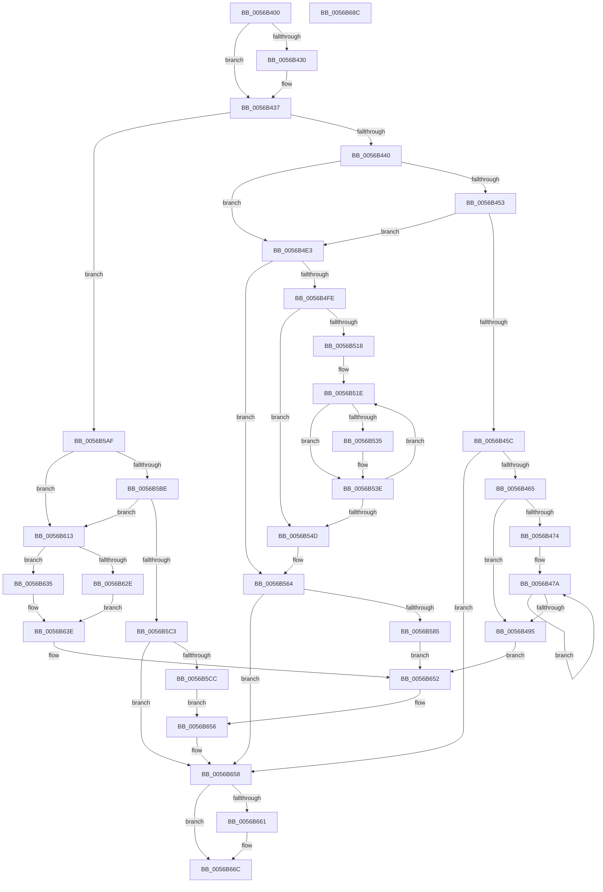

# HalpLbrConfigureProcessor

- RVA: `0x0056B400`–`0x0056B68D` (길이 `653` bytes)
- VA: `0x000000014056B400`
- 실행 섹션: `.text`
- PDB 이름 있음: `예`; PDB Function 태그: `아니요`
- unwind 정보 RVA: `0x00060BC4`
- 디코드: `180`개 명령, `653/653` bytes 표시
- 미해석 바이트: `0` (있으면 어셈블리에 `.byte`로 보존)

> 이 문서는 커널 이미지의 기계어와 PDB 기호를 분석해 생성했습니다. 4번과 5번은 함수 원형과 자료형을 바이너리 사용 방식에서 추정한 C 해석이며 원본 소스 복구 결과는 아닙니다.

## 1. Dependencies

- 직접 호출 지점: **2**; 고유 호출 대상: **2**
- 직접 호출자로 확인된 함수: **0**
- RIP 상대 이미지 참조: **7**

### Outgoing calls
- `0x0056B432` → [KiRaiseIrqlProcessIrqlFlags](../4F/KiRaiseIrqlProcessIrqlFlags_function_004F56FC.md) (function, `0x004F56FC`)
- `0x0056B667` → [KiLowerIrqlProcessIrqlFlags](../4F/KiLowerIrqlProcessIrqlFlags_function_004F5698.md) (function, `0x004F5698`)

### Direct callers
- 이 함수 시작 RVA로 연결되는 직접 call은 확인되지 않았습니다. 간접 호출은 완전히 역산할 수 없습니다.

### Static image references
- `0x0056B40F` → RVA `0x00F8F998` (`.data`; read)
- `0x0056B427` → RVA `0x00FC6D20` (`ALMOSTRO`; read)
- `0x0056B440` → RVA `0x00F8F9A0` (`.data`; read)
- `0x0056B495` → RVA `0x00F8F984` (`.data`; read)
- `0x0056B52D` → RVA `0x00E11810` (`.data`; read)
- `0x0056B598` → RVA `0x00F8F990` (`.data`; read)
- `0x0056B673` → RVA `0x00F8F994` (`.data`; read/write)

## 2. Other-region calls and transfers

- 다른 실행 섹션으로 향하는 call: **0**
- 별도 외부 분기/꼬리 이동을 확인하지 못했습니다.

## 3. Assembly (complete function range)

```asm
0056B400  48 89 5C 24 08                  mov qword ptr [rsp + 8], rbx
0056B405  48 89 74 24 10                  mov qword ptr [rsp + 0x10], rsi
0056B40A  57                              push rdi
0056B40B  48 83 EC 20                     sub rsp, 0x20
0056B40F  8B 35 83 45 A2 00               mov esi, dword ptr [rip + 0xa24583]
0056B415  48 8B F9                        mov rdi, rcx
0056B418  FF CE                           dec esi
0056B41A  44 0F 20 C3                     mov rbx, cr8
0056B41E  BA 0F 00 00 00                  mov edx, 0xf
0056B423  44 0F 22 C2                     mov cr8, rdx
0056B427  83 3D F2 B8 A5 00 00            cmp dword ptr [rip + 0xa5b8f2], 0
0056B42E  74 07                           je 0x14056b437
0056B430  8A CB                           mov cl, bl
0056B432  E8 C5 A2 F8 FF                  call 0x1404f56fc
0056B437  48 85 FF                        test rdi, rdi
0056B43A  0F 84 6F 01 00 00               je 0x14056b5af
0056B440  44 8B 05 59 45 A2 00            mov r8d, dword ptr [rip + 0xa24559]
0056B447  41 8B C8                        mov ecx, r8d
0056B44A  83 E9 01                        sub ecx, 1
0056B44D  0F 84 90 00 00 00               je 0x14056b4e3
0056B453  83 E9 01                        sub ecx, 1
0056B456  0F 84 87 00 00 00               je 0x14056b4e3
0056B45C  83 F9 01                        cmp ecx, 1
0056B45F  0F 85 F3 01 00 00               jne 0x14056b658
0056B465  44 8B 15 2C 45 A2 00            mov r10d, dword ptr [rip + 0xa2452c]
0056B46C  45 33 C9                        xor r9d, r9d
0056B46F  45 85 D2                        test r10d, r10d
0056B472  74 21                           je 0x14056b495
0056B474  41 B8 01 03 01 C0               mov r8d, 0xc0010301
0056B47A  33 C0                           xor eax, eax
0056B47C  41 8D 48 FF                     lea ecx, [r8 - 1]
0056B480  33 D2                           xor edx, edx
0056B482  0F 30                           wrmsr
0056B484  41 8B C8                        mov ecx, r8d
0056B487  0F 30                           wrmsr
0056B489  41 FF C1                        inc r9d
0056B48C  41 83 C0 02                     add r8d, 2
0056B490  45 3B CA                        cmp r9d, r10d
0056B493  72 E5                           jb 0x14056b47a
0056B495  8B 15 E9 44 A2 00               mov edx, dword ptr [rip + 0xa244e9]
0056B49B  B9 0E 01 00 C0                  mov ecx, 0xc000010e
0056B4A0  8B C2                           mov eax, edx
0056B4A2  48 C1 EA 20                     shr rdx, 0x20
0056B4A6  0F 30                           wrmsr
0056B4A8  41 B9 D9 01 00 00               mov r9d, 0x1d9
0056B4AE  41 8B C9                        mov ecx, r9d
0056B4B1  0F 32                           rdmsr
0056B4B3  48 C1 E2 20                     shl rdx, 0x20
0056B4B7  48 0B C2                        or rax, rdx
0056B4BA  48 0D 01 08 00 00               or rax, 0x801
0056B4C0  48 8B D0                        mov rdx, rax
0056B4C3  48 C1 EA 20                     shr rdx, 0x20
0056B4C7  0F 30                           wrmsr
0056B4C9  B9 0F 01 00 C0                  mov ecx, 0xc000010f
0056B4CE  0F 32                           rdmsr
0056B4D0  48 C1 E2 20                     shl rdx, 0x20
0056B4D4  48 0B C2                        or rax, rdx
0056B4D7  48 83 C8 40                     or rax, 0x40
0056B4DB  48 8B D0                        mov rdx, rax
0056B4DE  E9 6F 01 00 00                  jmp 0x14056b652
0056B4E3  41 B9 D9 01 00 00               mov r9d, 0x1d9
0056B4E9  41 8B C9                        mov ecx, r9d
0056B4EC  0F 32                           rdmsr
0056B4EE  48 C1 E2 20                     shl rdx, 0x20
0056B4F2  48 0B C2                        or rax, rdx
0056B4F5  4C 8B D0                        mov r10, rax
0056B4F8  41 83 F8 01                     cmp r8d, 1
0056B4FC  75 66                           jne 0x14056b564
0056B4FE  8B D6                           mov edx, esi
0056B500  41 8D 49 F0                     lea ecx, [r9 - 0x10]
0056B504  48 C1 EA 20                     shr rdx, 0x20
0056B508  8B C6                           mov eax, esi
0056B50A  0F 30                           wrmsr
0056B50C  44 8B 1D 85 44 A2 00            mov r11d, dword ptr [rip + 0xa24485]
0056B513  45 85 DB                        test r11d, r11d
0056B516  74 35                           je 0x14056b54d
0056B518  41 B8 C0 06 00 00               mov r8d, 0x6c0
0056B51E  33 C0                           xor eax, eax
0056B520  41 8D 48 C0                     lea ecx, [r8 - 0x40]
0056B524  33 D2                           xor edx, edx
0056B526  0F 30                           wrmsr
0056B528  41 8B C8                        mov ecx, r8d
0056B52B  0F 30                           wrmsr
0056B52D  38 05 DD 62 8A 00               cmp byte ptr [rip + 0x8a62dd], al
0056B533  74 09                           je 0x14056b53e
0056B535  41 8D 88 00 07 00 00            lea ecx, [r8 + 0x700]
0056B53C  0F 30                           wrmsr
0056B53E  41 FF C0                        inc r8d
0056B541  41 8D 80 40 F9 FF FF            lea eax, [r8 - 0x6c0]
0056B548  41 3B C3                        cmp eax, r11d
0056B54B  72 D1                           jb 0x14056b51e
0056B54D  8B 15 31 44 A2 00               mov edx, dword ptr [rip + 0xa24431]
0056B553  B9 C8 01 00 00                  mov ecx, 0x1c8
0056B558  8B C2                           mov eax, edx
0056B55A  48 C1 EA 20                     shr rdx, 0x20
0056B55E  0F 30                           wrmsr
0056B560  49 83 CA 01                     or r10, 1
0056B564  49 0F BA EA 0B                  bts r10, 0xb
0056B569  41 8B C9                        mov ecx, r9d
0056B56C  49 8B D2                        mov rdx, r10
0056B56F  49 8B C2                        mov rax, r10
0056B572  48 C1 EA 20                     shr rdx, 0x20
0056B576  0F 30                           wrmsr
0056B578  83 3D 21 44 A2 00 02            cmp dword ptr [rip + 0xa24421], 2
0056B57F  0F 85 D3 00 00 00               jne 0x14056b658
0056B585  8B 15 0D 44 A2 00               mov edx, dword ptr [rip + 0xa2440d]
0056B58B  B9 CF 14 00 00                  mov ecx, 0x14cf
0056B590  8B C2                           mov eax, edx
0056B592  48 C1 EA 20                     shr rdx, 0x20
0056B596  0F 30                           wrmsr
0056B598  8B 15 F2 43 A2 00               mov edx, dword ptr [rip + 0xa243f2]
0056B59E  B9 CE 14 00 00                  mov ecx, 0x14ce
0056B5A3  48 83 CA 01                     or rdx, 1
0056B5A7  48 8B C2                        mov rax, rdx
0056B5AA  E9 A3 00 00 00                  jmp 0x14056b652
0056B5AF  44 8B 15 EA 43 A2 00            mov r10d, dword ptr [rip + 0xa243ea]
0056B5B6  41 8B CA                        mov ecx, r10d
0056B5B9  83 E9 01                        sub ecx, 1
0056B5BC  74 55                           je 0x14056b613
0056B5BE  83 E9 01                        sub ecx, 1
0056B5C1  74 50                           je 0x14056b613
0056B5C3  83 F9 01                        cmp ecx, 1
0056B5C6  0F 85 8C 00 00 00               jne 0x14056b658
0056B5CC  B9 0F 01 00 C0                  mov ecx, 0xc000010f
0056B5D1  0F 32                           rdmsr
0056B5D3  48 C1 E2 20                     shl rdx, 0x20
0056B5D7  48 0B C2                        or rax, rdx
0056B5DA  48 83 E0 BF                     and rax, 0xffffffffffffffbf
0056B5DE  48 8B D0                        mov rdx, rax
0056B5E1  48 C1 EA 20                     shr rdx, 0x20
0056B5E5  0F 30                           wrmsr
0056B5E7  41 B9 D9 01 00 00               mov r9d, 0x1d9
0056B5ED  41 8B C9                        mov ecx, r9d
0056B5F0  0F 32                           rdmsr
0056B5F2  48 C1 E2 20                     shl rdx, 0x20
0056B5F6  48 0B C2                        or rax, rdx
0056B5F9  48 25 FE F7 FF FF               and rax, 0xfffffffffffff7fe
0056B5FF  48 8B D0                        mov rdx, rax
0056B602  48 C1 EA 20                     shr rdx, 0x20
0056B606  0F 30                           wrmsr
0056B608  33 C0                           xor eax, eax
0056B60A  B9 0E 01 00 C0                  mov ecx, 0xc000010e
0056B60F  33 D2                           xor edx, edx
0056B611  EB 43                           jmp 0x14056b656
0056B613  41 B9 D9 01 00 00               mov r9d, 0x1d9
0056B619  41 8B C9                        mov ecx, r9d
0056B61C  0F 32                           rdmsr
0056B61E  48 C1 E2 20                     shl rdx, 0x20
0056B622  48 0B C2                        or rax, rdx
0056B625  4C 8B C0                        mov r8, rax
0056B628  41 83 FA 02                     cmp r10d, 2
0056B62C  75 07                           jne 0x14056b635
0056B62E  B9 CE 14 00 00                  mov ecx, 0x14ce
0056B633  EB 09                           jmp 0x14056b63e
0056B635  49 83 E0 FE                     and r8, 0xfffffffffffffffe
0056B639  B9 C8 01 00 00                  mov ecx, 0x1c8
0056B63E  33 C0                           xor eax, eax
0056B640  33 D2                           xor edx, edx
0056B642  0F 30                           wrmsr
0056B644  49 0F BA F0 0B                  btr r8, 0xb
0056B649  41 8B C9                        mov ecx, r9d
0056B64C  49 8B D0                        mov rdx, r8
0056B64F  49 8B C0                        mov rax, r8
0056B652  48 C1 EA 20                     shr rdx, 0x20
0056B656  0F 30                           wrmsr
0056B658  83 3D C1 B6 A5 00 00            cmp dword ptr [rip + 0xa5b6c1], 0
0056B65F  74 0B                           je 0x14056b66c
0056B661  44 0F 20 C1                     mov rcx, cr8
0056B665  8A D3                           mov dl, bl
0056B667  E8 2C A0 F8 FF                  call 0x1404f5698
0056B66C  0F B6 C3                        movzx eax, bl
0056B66F  44 0F 22 C0                     mov cr8, rax
0056B673  F0 FF 0D 1A 43 A2 00            lock dec dword ptr [rip + 0xa2431a]
0056B67A  48 8B 5C 24 30                  mov rbx, qword ptr [rsp + 0x30]
0056B67F  33 C0                           xor eax, eax
0056B681  48 8B 74 24 38                  mov rsi, qword ptr [rsp + 0x38]
0056B686  48 83 C4 20                     add rsp, 0x20
0056B68A  5F                              pop rdi
0056B68B  C3                              ret
0056B68C  CC                              int3
```

## 4. C-style interpretation (structured pseudocode)

```c
__int64 __fastcall HalpLbrConfigureProcessor(__int64 a1, __int64 a2, __int64 a3, int a4)
{
    __int64 result;
    __int64 v_r10;
    __int64 v_rsi;
    __int64 v_rsp;
    unsigned __int64 v_stack_p10;
    unsigned __int64 v_stack_p8;

    v_stack_p8 = v_rbx;
    v_stack_p10 = v_rsi;
    v_rsp = (v_rsp) - (32);
    v_rsi = (unsigned int)(((unsigned int)(*(unsigned int *)(v_rip + 10634627))) - 1);
    if ((*(unsigned int *)(v_rip + 10860786)) != 0) {
        a1 = (unsigned __int8)(v_cr8);
        result = KiRaiseIrqlProcessIrqlFlags(a1, 15, a3, a4);
    }
    if (a1 == 0) goto loc_0056B5AF;
    a1 = (unsigned int)(((unsigned int)((unsigned int)((unsigned int)(*(unsigned int *)(v_rip + 10634585))))) - (1));
    if (condition_is_equal) goto loc_0056B4E3;
    a1 = (unsigned int)((a1) - (1));
    if (condition_is_equal) goto loc_0056B4E3;
    if (((unsigned int)(a1)) != 1) goto loc_0056B658;
    a4 = 0;
    if ((unsigned int)((unsigned int)(*(unsigned int *)(v_rip + 10634540))) == 0) goto loc_0056B495;
loc_0056B47A:
    result = 0;
    a2 = 0;
    a4 = (unsigned int)((a4) + 1);
    a3 = (unsigned int)(((unsigned int)(0xC0010301ULL)) + (2));
    if (a4 < ((unsigned int)((unsigned int)(*(unsigned int *)(v_rip + 10634540))))) goto loc_0056B47A;
loc_0056B495:
    a2 = ((unsigned int)(*(unsigned int *)(v_rip + 10634473))) >> (32);
    a2 = (a2) << (32);
    result = ((unsigned int)((unsigned int)((unsigned int)(*(unsigned int *)(v_rip + 10634473))))) | (a2);
    result = (result) | (0x801ULL);
    a2 = (result) >> (32);
    a2 = (a2) << (32);
    result = (result) | (a2);
    result = (result) | (64);
    goto loc_0056B652;
loc_0056B4E3:
    a2 = (result) << (32);
    result = (result) | (a2);
    if (((unsigned int)(a3)) != 1) goto loc_0056B564;
    a2 = ((unsigned int)((unsigned int)(v_rsi))) >> (32);
    if ((unsigned int)((unsigned int)(*(unsigned int *)(v_rip + 10634373))) == 0) goto loc_0056B54D;
loc_0056B51E:
    result = 0;
    a2 = 0;
    if ((*(unsigned __int8 *)(v_rip + 9069277)) != 0) {
        a1 = (unsigned int)(0x6C0ULL) + 1792;
    }
    a3 = (unsigned int)(((unsigned int)(0x6C0ULL)) + 1);
    if (((unsigned int)(a3 - 1728)) < ((unsigned int)((unsigned int)(*(unsigned int *)(v_rip + 10634373))))) goto loc_0056B51E;
loc_0056B54D:
    a2 = ((unsigned int)(*(unsigned int *)(v_rip + 10634289))) >> (32);
    v_r10 = (result) | (1);
loc_0056B564:
    a2 = (v_r10) >> (32);
    if ((*(unsigned int *)(v_rip + 10634273)) != 2) goto loc_0056B658;
    a2 = ((unsigned int)(*(unsigned int *)(v_rip + 10634253))) >> (32);
    a2 = ((unsigned int)(*(unsigned int *)(v_rip + 10634226))) | (1);
    goto loc_0056B652;
loc_0056B5AF:
    a1 = (unsigned int)(((unsigned int)((unsigned int)((unsigned int)(*(unsigned int *)(v_rip + 10634218))))) - (1));
    if (condition_is_equal) goto loc_0056B613;
    a1 = (unsigned int)((a1) - (1));
    if (condition_is_equal) goto loc_0056B613;
    if (((unsigned int)(a1)) != 1) goto loc_0056B658;
    a2 = (a2) << (32);
    result = (a2) | (a2);
    result = (result) & (-65);
    a2 = (result) >> (32);
    a2 = (a2) << (32);
    result = (result) | (a2);
    result = (result) & (0xFFFFFFFFFFFFF7FEULL);
    a2 = (result) >> (32);
    result = 0;
    a2 = 0;
    goto loc_0056B656;
loc_0056B613:
    a2 = (a2) << (32);
    result = (result) | (a2);
    if (((unsigned int)((unsigned int)(*(unsigned int *)(v_rip + 10634218)))) != 2) goto loc_0056B635;
    goto loc_0056B63E;
loc_0056B635:
    a3 = (result) & (-2);
loc_0056B63E:
    result = 0;
    a2 = 0;
loc_0056B652:
    a2 = (a3) >> (32);
loc_0056B656:
loc_0056B658:
    result = a3;
    if ((*(unsigned int *)(v_rip + 10860225)) != 0) {
        a1 = 15;
        a2 = (unsigned __int8)(v_cr8);
        result = KiLowerIrqlProcessIrqlFlags(a1, a2, a3, 473);
    }
    result = 0;
    v_rsp = (v_rsp) + (32);
    return result;
}
```

## 5. (Beta) C Style

```c
int64_t HalpLbrConfigureProcessor(int64_t Arg1, int64_t Arg2, int64_t Arg3, int32_t Arg4)
{
    int64_t result;
    int64_t local_r10;
    int64_t local_rsi;
    int64_t local_rsp;
    uint64_t v_stack_p10;
    uint64_t v_stack_p8;

    v_stack_p8 = local_rbx;
    v_stack_p10 = local_rsi;
    local_rsp = (local_rsp) - (32);
    local_rsi = (uint32_t)(((uint32_t)(*(uint32_t *)(v_rip + 0xA24583))) - 1);
    if ((*(uint32_t *)(v_rip + 0xA5B8F2)) != 0) {
        Arg1 = (uint8_t)(v_cr8);
        result = KiRaiseIrqlProcessIrqlFlags(Arg1, 15, Arg3, Arg4);
    }
    if (Arg1 == 0) goto loc_0056B5AF;
    Arg1 = (uint32_t)(((uint32_t)((uint32_t)((uint32_t)(*(uint32_t *)(v_rip + 0xA24559))))) - (1));
    if (condition_is_equal) goto loc_0056B4E3;
    Arg1 = (uint32_t)((Arg1) - (1));
    if (condition_is_equal) goto loc_0056B4E3;
    if (((uint32_t)(Arg1)) != 1) goto loc_0056B658;
    Arg4 = 0;
    if ((uint32_t)((uint32_t)(*(uint32_t *)(v_rip + 0xA2452C))) == 0) goto loc_0056B495;
loc_0056B47A:
    result = 0;
    Arg2 = 0;
    Arg4 = (uint32_t)((Arg4) + 1);
    Arg3 = (uint32_t)(((uint32_t)(0xC0010301ULL)) + (2));
    if (Arg4 < ((uint32_t)((uint32_t)(*(uint32_t *)(v_rip + 0xA2452C))))) goto loc_0056B47A;
loc_0056B495:
    Arg2 = ((uint32_t)(*(uint32_t *)(v_rip + 0xA244E9))) >> (32);
    Arg2 = (Arg2) << (32);
    result = ((uint32_t)((uint32_t)((uint32_t)(*(uint32_t *)(v_rip + 0xA244E9))))) | (Arg2);
    result = (result) | (0x801ULL);
    Arg2 = (result) >> (32);
    Arg2 = (Arg2) << (32);
    result = (result) | (Arg2);
    result = (result) | (64);
    goto loc_0056B652;
loc_0056B4E3:
    Arg2 = (result) << (32);
    result = (result) | (Arg2);
    if (((uint32_t)(Arg3)) != 1) goto loc_0056B564;
    Arg2 = ((uint32_t)((uint32_t)(local_rsi))) >> (32);
    if ((uint32_t)((uint32_t)(*(uint32_t *)(v_rip + 0xA24485))) == 0) goto loc_0056B54D;
loc_0056B51E:
    result = 0;
    Arg2 = 0;
    if ((*(uint8_t *)(v_rip + 0x8A62DD)) != 0) {
        Arg1 = (uint32_t)(0x6C0ULL) + 1792;
    }
    Arg3 = (uint32_t)(((uint32_t)(0x6C0ULL)) + 1);
    if (((uint32_t)(Arg3 - 1728)) < ((uint32_t)((uint32_t)(*(uint32_t *)(v_rip + 0xA24485))))) goto loc_0056B51E;
loc_0056B54D:
    Arg2 = ((uint32_t)(*(uint32_t *)(v_rip + 0xA24431))) >> (32);
    local_r10 = (result) | (1);
loc_0056B564:
    Arg2 = (local_r10) >> (32);
    if ((*(uint32_t *)(v_rip + 0xA24421)) != 2) goto loc_0056B658;
    Arg2 = ((uint32_t)(*(uint32_t *)(v_rip + 0xA2440D))) >> (32);
    Arg2 = ((uint32_t)(*(uint32_t *)(v_rip + 0xA243F2))) | (1);
    goto loc_0056B652;
loc_0056B5AF:
    Arg1 = (uint32_t)(((uint32_t)((uint32_t)((uint32_t)(*(uint32_t *)(v_rip + 0xA243EA))))) - (1));
    if (condition_is_equal) goto loc_0056B613;
    Arg1 = (uint32_t)((Arg1) - (1));
    if (condition_is_equal) goto loc_0056B613;
    if (((uint32_t)(Arg1)) != 1) goto loc_0056B658;
    Arg2 = (Arg2) << (32);
    result = (Arg2) | (Arg2);
    result = (result) & (-65);
    Arg2 = (result) >> (32);
    Arg2 = (Arg2) << (32);
    result = (result) | (Arg2);
    result = (result) & (0xFFFFFFFFFFFFF7FEULL);
    Arg2 = (result) >> (32);
    result = 0;
    Arg2 = 0;
    goto loc_0056B656;
loc_0056B613:
    Arg2 = (Arg2) << (32);
    result = (result) | (Arg2);
    if (((uint32_t)((uint32_t)(*(uint32_t *)(v_rip + 0xA243EA)))) != 2) goto loc_0056B635;
    goto loc_0056B63E;
loc_0056B635:
    Arg3 = (result) & (-2);
loc_0056B63E:
    result = 0;
    Arg2 = 0;
loc_0056B652:
    Arg2 = (Arg3) >> (32);
loc_0056B656:
loc_0056B658:
    result = Arg3;
    if ((*(uint32_t *)(v_rip + 0xA5B6C1)) != 0) {
        Arg1 = 15;
        Arg2 = (uint8_t)(v_cr8);
        result = KiLowerIrqlProcessIrqlFlags(Arg1, Arg2, Arg3, 473);
    }
    result = 0;
    local_rsp = (local_rsp) + (32);
    return result;
}
```

## 6. Execution-region graph

[열기: 2D/3D 그래프와 함수 탐색 컨트롤 패널](../../../control-panel.html?section=text&rva=0x0056B400&view=graph)

- 2D 그래프는 위에서 아래로 흐르고, 3D 그래프는 빈 공간을 드래그해 회전합니다. Shift+드래그는 이동, 휠은 확대·축소, 함수 노드 선택은 대상 보고서 이동입니다.

### Static fallback


