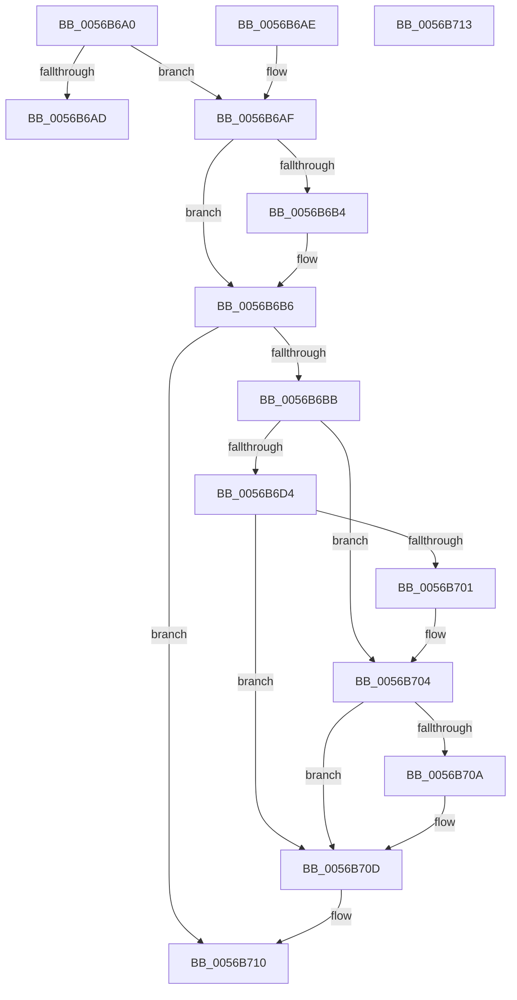

# HalpLbrGetInformation

- RVA: `0x0056B6A0`–`0x0056B714` (길이 `116` bytes)
- VA: `0x000000014056B6A0`
- 실행 섹션: `.text`
- PDB 이름 있음: `예`; PDB Function 태그: `아니요`
- unwind 정보 RVA: `0x000DB714`
- 디코드: `37`개 명령, `116/116` bytes 표시
- 미해석 바이트: `0` (있으면 어셈블리에 `.byte`로 보존)

> 이 문서는 커널 이미지의 기계어와 PDB 기호를 분석해 생성했습니다. 4번과 5번은 함수 원형과 자료형을 바이너리 사용 방식에서 추정한 C 해석이며 원본 소스 복구 결과는 아닙니다.

## 1. Dependencies

- 직접 호출 지점: **0**; 고유 호출 대상: **0**
- 직접 호출자로 확인된 함수: **0**
- RIP 상대 이미지 참조: **3**

### Outgoing calls
- 직접 디코드된 call 명령이 없습니다.

### Direct callers
- 이 함수 시작 RVA로 연결되는 직접 call은 확인되지 않았습니다. 간접 호출은 완전히 역산할 수 없습니다.

### Static image references
- `0x0056B6A0` → RVA `0x00F8F998` (`.data`; read)
- `0x0056B6BB` → RVA `0x00F8F9A0` (`.data`; read)
- `0x0056B6D4` → RVA `0x00F8F9A4` (`.data`; read)

## 2. Other-region calls and transfers

- 다른 실행 섹션으로 향하는 call: **0**
- 별도 외부 분기/꼬리 이동을 확인하지 못했습니다.

## 3. Assembly (complete function range)

```asm
0056B6A0  8B 05 F2 42 A2 00               mov eax, dword ptr [rip + 0xa242f2]
0056B6A6  4C 8B CA                        mov r9, rdx
0056B6A9  85 C0                           test eax, eax
0056B6AB  75 02                           jne 0x14056b6af
0056B6AD  C3                              ret
0056B6AE  CC                              int3
0056B6AF  48 85 C9                        test rcx, rcx
0056B6B2  74 02                           je 0x14056b6b6
0056B6B4  89 01                           mov dword ptr [rcx], eax
0056B6B6  4D 85 C9                        test r9, r9
0056B6B9  74 55                           je 0x14056b710
0056B6BB  44 8B 15 DE 42 A2 00            mov r10d, dword ptr [rip + 0xa242de]
0056B6C2  41 B8 FF 03 00 00               mov r8d, 0x3ff
0056B6C8  41 BB FF FD FF FF               mov r11d, 0xfffffdff
0056B6CE  41 83 FA 02                     cmp r10d, 2
0056B6D2  75 30                           jne 0x14056b704
0056B6D4  8B 15 CA 42 A2 00               mov edx, dword ptr [rip + 0xa242ca]
0056B6DA  8B C2                           mov eax, edx
0056B6DC  24 01                           and al, 1
0056B6DE  F6 D8                           neg al
0056B6E0  1B C9                           sbb ecx, ecx
0056B6E2  83 E1 03                        and ecx, 3
0056B6E5  81 C1 FC 03 00 00               add ecx, 0x3fc
0056B6EB  44 8B C1                        mov r8d, ecx
0056B6EE  41 81 E0 03 FE FF FF            and r8d, 0xfffffe03
0056B6F5  41 84 D2                        test r10b, dl
0056B6F8  44 0F 45 C1                     cmovne r8d, ecx
0056B6FC  F6 C2 04                        test dl, 4
0056B6FF  75 0C                           jne 0x14056b70d
0056B701  45 23 C3                        and r8d, r11d
0056B704  41 83 FA 03                     cmp r10d, 3
0056B708  75 03                           jne 0x14056b70d
0056B70A  45 23 C3                        and r8d, r11d
0056B70D  45 89 01                        mov dword ptr [r9], r8d
0056B710  B0 01                           mov al, 1
0056B712  C3                              ret
0056B713  CC                              int3
```

## 4. C-style interpretation (structured pseudocode)

```c
__int64 __fastcall HalpLbrGetInformation(__int64 a1, __int64 a2)
{
    __int64 result;

    if ((unsigned int)((unsigned int)(*(unsigned int *)(v_rip + 10633970))) != 0) goto loc_0056B6AF;
    return (unsigned int)(*(unsigned int *)(v_rip + 10633970));
loc_0056B6AF:
    if (a1 != 0) {
        *(unsigned int *)(a1) = (unsigned int)((unsigned int)(*(unsigned int *)(v_rip + 10633970)));
    }
    if (a2 == 0) goto loc_0056B710;
    if (((unsigned int)((unsigned int)(*(unsigned int *)(v_rip + 10633950)))) != 2) goto loc_0056B704;
    result = (unsigned __int8)(((unsigned int)((unsigned int)((unsigned int)(*(unsigned int *)(v_rip + 10633930))))) & (1));
    result = (unsigned __int8)(-(result));
    a1 = (unsigned int)((a1) & (3));
    a1 = (unsigned int)((a1) + (0x3FCULL));
    a3 = (unsigned int)(((unsigned int)((unsigned int)(a1))) & (0xFFFFFE03ULL));
    if ((((unsigned __int8)((unsigned int)(*(unsigned int *)(v_rip + 10633950)))) & ((unsigned __int8)((unsigned int)(*(unsigned int *)(v_rip + 10633930))))) != 0) { a3 = (unsigned int)(a1); }
    if ((((unsigned __int8)((unsigned int)(*(unsigned int *)(v_rip + 10633930)))) & (4)) != 0) goto loc_0056B70D;
    a3 = (unsigned int)((a3) & ((unsigned int)((unsigned int)(0xFFFFFDFFULL))));
loc_0056B704:
    if (((unsigned int)((unsigned int)(*(unsigned int *)(v_rip + 10633950)))) == 3) {
        a3 = (unsigned int)((a3) & ((unsigned int)((unsigned int)(0xFFFFFDFFULL))));
    }
    *(unsigned int *)(a2) = (unsigned int)(a3);
loc_0056B710:
    return 1;
}
```

## 5. (Beta) C Style

```c
int64_t HalpLbrGetInformation(int64_t Arg1, int64_t Arg2)
{
    int64_t result;

    if ((uint32_t)((uint32_t)(*(uint32_t *)(v_rip + 0xA242F2))) != 0) goto loc_0056B6AF;
    return (uint32_t)(*(uint32_t *)(v_rip + 0xA242F2));
loc_0056B6AF:
    if (Arg1 != 0) {
        *(uint32_t *)(Arg1) = (uint32_t)((uint32_t)(*(uint32_t *)(v_rip + 0xA242F2)));
    }
    if (Arg2 == 0) goto loc_0056B710;
    if (((uint32_t)((uint32_t)(*(uint32_t *)(v_rip + 0xA242DE)))) != 2) goto loc_0056B704;
    result = (uint8_t)(((uint32_t)((uint32_t)((uint32_t)(*(uint32_t *)(v_rip + 0xA242CA))))) & (1));
    result = (uint8_t)(-(result));
    Arg1 = (uint32_t)((Arg1) & (3));
    Arg1 = (uint32_t)((Arg1) + (0x3FCULL));
    a3 = (uint32_t)(((uint32_t)((uint32_t)(Arg1))) & (0xFFFFFE03ULL));
    if ((((uint8_t)((uint32_t)(*(uint32_t *)(v_rip + 0xA242DE)))) & ((uint8_t)((uint32_t)(*(uint32_t *)(v_rip + 0xA242CA))))) != 0) { a3 = (uint32_t)(Arg1); }
    if ((((uint8_t)((uint32_t)(*(uint32_t *)(v_rip + 0xA242CA)))) & (4)) != 0) goto loc_0056B70D;
    a3 = (uint32_t)((a3) & ((uint32_t)((uint32_t)(0xFFFFFDFFULL))));
loc_0056B704:
    if (((uint32_t)((uint32_t)(*(uint32_t *)(v_rip + 0xA242DE)))) == 3) {
        a3 = (uint32_t)((a3) & ((uint32_t)((uint32_t)(0xFFFFFDFFULL))));
    }
    *(uint32_t *)(Arg2) = (uint32_t)(a3);
loc_0056B710:
    return 1;
}
```

## 6. Execution-region graph

[열기: 2D/3D 그래프와 함수 탐색 컨트롤 패널](../../../control-panel.html?section=text&rva=0x0056B6A0&view=graph)

- 2D 그래프는 위에서 아래로 흐르고, 3D 그래프는 빈 공간을 드래그해 회전합니다. Shift+드래그는 이동, 휠은 확대·축소, 함수 노드 선택은 대상 보고서 이동입니다.

### Static fallback


