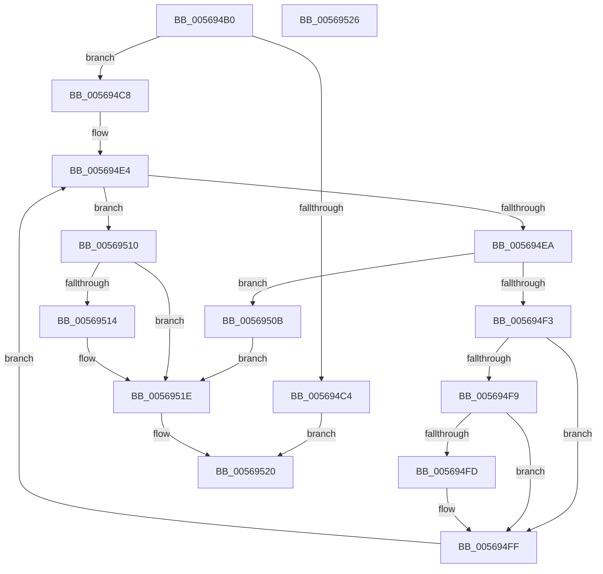

# HalpParseChannelCount

- RVA: `0x005694B0`–`0x00569527` (길이 `119` bytes)
- VA: `0x00000001405694B0`
- 실행 섹션: `.text`
- PDB 이름 있음: `예`; PDB Function 태그: `아니요`
- unwind 정보 RVA: `0x00071750`
- 디코드: `40`개 명령, `119/119` bytes 표시
- 미해석 바이트: `0` (있으면 어셈블리에 `.byte`로 보존)

> 이 문서는 커널 이미지의 기계어와 PDB 기호를 분석해 생성했습니다. 4번과 5번은 함수 원형과 자료형을 바이너리 사용 방식에서 추정한 C 해석이며 원본 소스 복구 결과는 아닙니다.

## 1. Dependencies

- 직접 호출 지점: **0**; 고유 호출 대상: **0**
- 직접 호출자로 확인된 함수: **2**
- RIP 상대 이미지 참조: **1**

### Outgoing calls
- 직접 디코드된 call 명령이 없습니다.

### Direct callers
- [HalpGetNumaProcMemoryCount](../../init/C2/HalpGetNumaProcMemoryCount_function_00C21B40.md) at `0x00C21D18`
- [HalpInitializeConfigurationFromMadt](../../init/C2/HalpInitializeConfigurationFromMadt_function_00C21D54.md) at `0x00C21E27`

### Static image references
- `0x005694B5` → RVA `0x00E117E8` (`.data`; read)

## 2. Other-region calls and transfers

- 다른 실행 섹션으로 향하는 call: **0**
- 별도 외부 분기/꼬리 이동을 확인하지 못했습니다.

## 3. Assembly (complete function range)

```asm
005694B0  48 89 5C 24 08                  mov qword ptr [rsp + 8], rbx
005694B5  48 8B 0D 2C 83 8A 00            mov rcx, qword ptr [rip + 0x8a832c]
005694BC  45 33 DB                        xor r11d, r11d
005694BF  48 85 C9                        test rcx, rcx
005694C2  75 04                           jne 0x1405694c8
005694C4  33 C0                           xor eax, eax
005694C6  EB 58                           jmp 0x140569520
005694C8  44 8B 49 04                     mov r9d, dword ptr [rcx + 4]
005694CC  41 8B D3                        mov edx, r11d
005694CF  44 0F B7 51 28                  movzx r10d, word ptr [rcx + 0x28]
005694D4  4C 03 C9                        add r9, rcx
005694D7  48 83 C1 2C                     add rcx, 0x2c
005694DB  45 0F B7 C3                     movzx r8d, r11w
005694DF  BB 01 00 00 00                  mov ebx, 1
005694E4  66 45 3B C2                     cmp r8w, r10w
005694E8  73 26                           jae 0x140569510
005694EA  48 8D 41 22                     lea rax, [rcx + 0x22]
005694EE  49 3B C1                        cmp rax, r9
005694F1  77 18                           ja 0x14056950b
005694F3  44 39 59 18                     cmp dword ptr [rcx + 0x18], r11d
005694F7  74 06                           je 0x1405694ff
005694F9  84 19                           test byte ptr [rcx], bl
005694FB  74 02                           je 0x1405694ff
005694FD  03 D3                           add edx, ebx
005694FF  8B 41 04                        mov eax, dword ptr [rcx + 4]
00569502  66 44 03 C3                     add r8w, bx
00569506  48 03 C8                        add rcx, rax
00569509  EB D9                           jmp 0x1405694e4
0056950B  41 8B D3                        mov edx, r11d
0056950E  EB 0E                           jmp 0x14056951e
00569510  85 D2                           test edx, edx
00569512  74 0A                           je 0x14056951e
00569514  0F B7 01                        movzx eax, word ptr [rcx]
00569517  66 F7 D8                        neg ax
0056951A  1B C9                           sbb ecx, ecx
0056951C  23 D1                           and edx, ecx
0056951E  8B C2                           mov eax, edx
00569520  48 8B 5C 24 08                  mov rbx, qword ptr [rsp + 8]
00569525  C3                              ret
00569526  CC                              int3
```

## 4. C-style interpretation (structured pseudocode)

```c
__int64 __fastcall HalpParseChannelCount(void)
{
    __int64 result;
    __int64 v_r11;
    unsigned __int64 v_stack_p8;

    v_stack_p8 = v_rbx;
    v_r11 = 0;
    if (*(unsigned __int64 *)(v_rip + 9077548) != 0) goto loc_005694C8;
    result = 0;
    goto loc_00569520;
loc_005694C8:
    a4 = ((unsigned int)(*(unsigned int *)(*(unsigned __int64 *)(v_rip + 9077548) + 4))) + (*(unsigned __int64 *)(v_rip + 9077548));
    a1 = (*(unsigned __int64 *)(v_rip + 9077548)) + (44);
loc_005694E4:
    if (0 >= ((unsigned __int16)(*(unsigned __int16 *)(*(unsigned __int64 *)(v_rip + 9077548) + 40)))) goto loc_00569510;
    if ((a1 + 34) > a4) goto loc_0056950B;
    if ((*(unsigned int *)(a1 + 24)) == 0) goto loc_005694FF;
    if (((*(unsigned __int8 *)(a1)) & (1)) != 0) {
        a2 = (unsigned int)((0) + (1));
    }
    a3 = (unsigned __int16)((0) + (1));
    a1 = (a1) + ((unsigned int)(*(unsigned int *)(a1 + 4)));
    goto loc_005694E4;
loc_0056950B:
    goto loc_0056951E;
loc_00569510:
    result = (unsigned int)(*(unsigned int *)(a1 + 4));
    if (0 != 0) {
        result = *(unsigned __int16 *)(a1);
        result = (unsigned __int16)(-(result));
        a2 = (unsigned int)((0) & ((unsigned int)(a1)));
    }
loc_00569520:
    return (unsigned int)((unsigned int)(a2));
}
```

## 5. (Beta) C Style

```c
void HalpParseChannelCount(void)
{
    int64_t result;
    int64_t local_r11;
    uint64_t v_stack_p8;

    v_stack_p8 = local_rbx;
    local_r11 = 0;
    if (*(uint64_t *)(v_rip + 0x8A832C) != 0) goto loc_005694C8;
    result = 0;
    goto loc_00569520;
loc_005694C8:
    a4 = ((uint32_t)(*(uint32_t *)(*(uint64_t *)(v_rip + 0x8A832C) + 0x4))) + (*(uint64_t *)(v_rip + 0x8A832C));
    a1 = (*(uint64_t *)(v_rip + 0x8A832C)) + (44);
loc_005694E4:
    if (0 >= ((uint16_t)(*(uint16_t *)(*(uint64_t *)(v_rip + 0x8A832C) + 0x28)))) goto loc_00569510;
    if ((a1 + 34) > a4) goto loc_0056950B;
    if ((*(uint32_t *)(a1 + 0x18)) == 0) goto loc_005694FF;
    if (((*(uint8_t *)(a1)) & (1)) != 0) {
        a2 = (uint32_t)((0) + (1));
    }
    a3 = (uint16_t)((0) + (1));
    a1 = (a1) + ((uint32_t)(*(uint32_t *)(a1 + 0x4)));
    goto loc_005694E4;
loc_0056950B:
    goto loc_0056951E;
loc_00569510:
    result = (uint32_t)(*(uint32_t *)(a1 + 0x4));
    if (0 != 0) {
        result = *(uint16_t *)(a1);
        result = (uint16_t)(-(result));
        a2 = (uint32_t)((0) & ((uint32_t)(a1)));
    }
loc_00569520:
    return (uint32_t)((uint32_t)(a2));
}
```

## 6. Execution-region graph

[열기: 2D/3D 그래프와 함수 탐색 컨트롤 패널](../../../control-panel.html?section=text&rva=0x005694B0&view=graph)

- 2D 그래프는 위에서 아래로 흐르고, 3D 그래프는 빈 공간을 드래그해 회전합니다. Shift+드래그는 이동, 휠은 확대·축소, 함수 노드 선택은 대상 보고서 이동입니다.

### Static fallback


