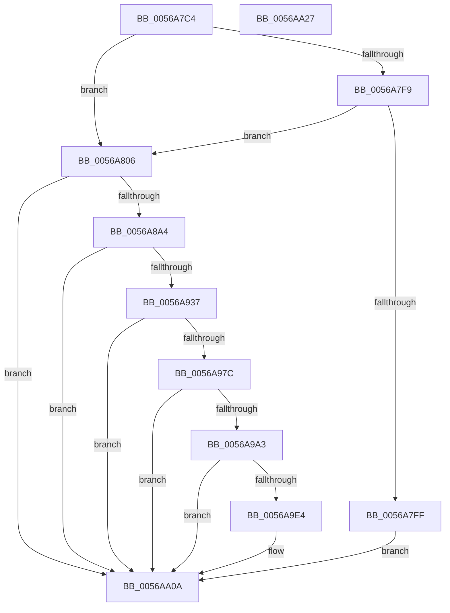

# HalpPicDiscover

- RVA: `0x0056A7C4`–`0x0056AA28` (길이 `612` bytes)
- VA: `0x000000014056A7C4`
- 실행 섹션: `.text`
- PDB 이름 있음: `예`; PDB Function 태그: `아니요`
- unwind 정보 RVA: `0x000C5010`
- 디코드: `138`개 명령, `612/612` bytes 표시
- 미해석 바이트: `0` (있으면 어셈블리에 `.byte`로 보존)

> 이 문서는 커널 이미지의 기계어와 PDB 기호를 분석해 생성했습니다. 4번과 5번은 함수 원형과 자료형을 바이너리 사용 방식에서 추정한 C 해석이며 원본 소스 복구 결과는 아닙니다.

## 1. Dependencies

- 직접 호출 지점: **9**; 고유 호출 대상: **4**
- 직접 호출자로 확인된 함수: **1**
- RIP 상대 이미지 참조: **4**

### Outgoing calls
- `0x0056A7E8` → [HalSocGetAcpiTable](HalSocGetAcpiTable_function_00561580.md) (function, `0x00561580`)
- `0x0056A815` → [memset](../6C/memset_function_006C6C40.md) (function, `0x006C6C40`)
- `0x0056A897` → [HalpInterruptRegisterController](HalpInterruptRegisterController_function_005640F0.md) (function, `0x005640F0`)
- `0x0056A8AE` → [memset](../6C/memset_function_006C6C40.md) (function, `0x006C6C40`)
- `0x0056A92A` → [HalpInterruptRegisterController](HalpInterruptRegisterController_function_005640F0.md) (function, `0x005640F0`)
- `0x0056A96F` → [HalpInterruptRegisterLine](HalpInterruptRegisterLine_function_005645B0.md) (function, `0x005645B0`)
- `0x0056A99A` → [HalpInterruptRegisterLine](HalpInterruptRegisterLine_function_005645B0.md) (function, `0x005645B0`)
- `0x0056A9DB` → [HalpInterruptRegisterLine](HalpInterruptRegisterLine_function_005645B0.md) (function, `0x005645B0`)
- `0x0056AA05` → [HalpInterruptRegisterLine](HalpInterruptRegisterLine_function_005645B0.md) (function, `0x005645B0`)

### Direct callers
- [HalpInitializeInterrupts](../../init/C1/HalpInitializeInterrupts_function_00C1E4F8.md) at `0x00C1E6DB`

### Static image references
- `0x0056A826` → RVA `0x0056AA30` (`HalpPicInitializeIoUnit`; read)
- `0x0056A82D` → RVA `0x0056AB90` (`HalpPicWriteEndOfInterrupt`; read)
- `0x0056A841` → RVA `0x0056AA90` (`HalpPicSetLineState`; read)
- `0x0056A859` → RVA `0x004FC600` (`BvgaSetVirtualFrameBuffer`; read)

## 2. Other-region calls and transfers

- 다른 실행 섹션으로 향하는 call: **0**
- 별도 외부 분기/꼬리 이동을 확인하지 못했습니다.

## 3. Assembly (complete function range)

```asm
0056A7C4  48 8B C4                        mov rax, rsp
0056A7C7  48 89 58 10                     mov qword ptr [rax + 0x10], rbx
0056A7CB  48 89 70 18                     mov qword ptr [rax + 0x18], rsi
0056A7CF  48 89 78 20                     mov qword ptr [rax + 0x20], rdi
0056A7D3  55                              push rbp
0056A7D4  41 55                           push r13
0056A7D6  41 56                           push r14
0056A7D8  48 8D 68 98                     lea rbp, [rax - 0x68]
0056A7DC  48 81 EC 50 01 00 00            sub rsp, 0x150
0056A7E3  B9 41 50 49 43                  mov ecx, 0x43495041
0056A7E8  E8 93 6D FF FF                  call 0x140561580
0056A7ED  33 DB                           xor ebx, ebx
0056A7EF  BF 01 00 00 00                  mov edi, 1
0056A7F4  48 85 C0                        test rax, rax
0056A7F7  74 0D                           je 0x14056a806
0056A7F9  40 84 78 28                     test byte ptr [rax + 0x28], dil
0056A7FD  75 07                           jne 0x14056a806
0056A7FF  8B C3                           mov eax, ebx
0056A801  E9 04 02 00 00                  jmp 0x14056aa0a
0056A806  BE 00 01 00 00                  mov esi, 0x100
0056A80B  48 8D 4C 24 50                  lea rcx, [rsp + 0x50]
0056A810  44 8B C6                        mov r8d, esi
0056A813  33 D2                           xor edx, edx
0056A815  E8 26 C4 15 00                  call 0x1406c6c40
0056A81A  48 8D 45 70                     lea rax, [rbp + 0x70]
0056A81E  89 7C 24 50                     mov dword ptr [rsp + 0x50], edi
0056A822  48 89 45 28                     mov qword ptr [rbp + 0x28], rax
0056A826  4C 8D 2D 03 02 00 00            lea r13, [rip + 0x203]
0056A82D  48 8D 05 5C 03 00 00            lea rax, [rip + 0x35c]
0056A834  89 74 24 54                     mov dword ptr [rsp + 0x54], esi
0056A838  48 89 45 98                     mov qword ptr [rbp - 0x68], rax
0056A83C  48 8D 4C 24 50                  lea rcx, [rsp + 0x50]
0056A841  48 8D 05 48 02 00 00            lea rax, [rip + 0x248]
0056A848  C7 45 30 04 00 00 00            mov dword ptr [rbp + 0x30], 4
0056A84F  48 89 45 A8                     mov qword ptr [rbp - 0x58], rax
0056A853  41 BE 00 B0 00 00               mov r14d, 0xb000
0056A859  48 8D 05 A0 1D F9 FF            lea rax, [rip - 0x6e260]
0056A860  89 7D 34                        mov dword ptr [rbp + 0x34], edi
0056A863  48 89 45 B0                     mov qword ptr [rbp - 0x50], rax
0056A867  4C 89 75 38                     mov qword ptr [rbp + 0x38], r14
0056A86B  48 89 5D 44                     mov qword ptr [rbp + 0x44], rbx
0056A86F  48 89 5C 24 58                  mov qword ptr [rsp + 0x58], rbx
0056A874  4C 89 6C 24 60                  mov qword ptr [rsp + 0x60], r13
0056A879  48 89 5D 88                     mov qword ptr [rbp - 0x78], rbx
0056A87D  48 89 5C 24 68                  mov qword ptr [rsp + 0x68], rbx
0056A882  48 89 5C 24 70                  mov qword ptr [rsp + 0x70], rbx
0056A887  48 89 5C 24 78                  mov qword ptr [rsp + 0x78], rbx
0056A88C  48 89 5D B8                     mov qword ptr [rbp - 0x48], rbx
0056A890  89 5D 40                        mov dword ptr [rbp + 0x40], ebx
0056A893  44 89 75 70                     mov dword ptr [rbp + 0x70], r14d
0056A897  E8 54 98 FF FF                  call 0x1405640f0
0056A89C  85 C0                           test eax, eax
0056A89E  0F 88 66 01 00 00               js 0x14056aa0a
0056A8A4  44 8B C6                        mov r8d, esi
0056A8A7  48 8D 4C 24 50                  lea rcx, [rsp + 0x50]
0056A8AC  33 D2                           xor edx, edx
0056A8AE  E8 8D C3 15 00                  call 0x1406c6c40
0056A8B3  48 8D 45 70                     lea rax, [rbp + 0x70]
0056A8B7  89 7C 24 50                     mov dword ptr [rsp + 0x50], edi
0056A8BB  48 89 45 28                     mov qword ptr [rbp + 0x28], rax
0056A8BF  48 8D 4C 24 50                  lea rcx, [rsp + 0x50]
0056A8C4  48 8D 05 C5 02 00 00            lea rax, [rip + 0x2c5]
0056A8CB  89 74 24 54                     mov dword ptr [rsp + 0x54], esi
0056A8CF  48 89 45 98                     mov qword ptr [rbp - 0x68], rax
0056A8D3  48 8D 05 B6 01 00 00            lea rax, [rip + 0x1b6]
0056A8DA  48 89 45 A8                     mov qword ptr [rbp - 0x58], rax
0056A8DE  48 8D 05 1B 1D F9 FF            lea rax, [rip - 0x6e2e5]
0056A8E5  48 89 45 B0                     mov qword ptr [rbp - 0x50], rax
0056A8E9  C7 45 30 04 00 00 00            mov dword ptr [rbp + 0x30], 4
0056A8F0  89 7D 34                        mov dword ptr [rbp + 0x34], edi
0056A8F3  48 C7 45 38 01 B0 00 00         mov qword ptr [rbp + 0x38], 0xb001
0056A8FB  48 89 5D 44                     mov qword ptr [rbp + 0x44], rbx
0056A8FF  48 89 5C 24 58                  mov qword ptr [rsp + 0x58], rbx
0056A904  4C 89 6C 24 60                  mov qword ptr [rsp + 0x60], r13
0056A909  48 89 5D 88                     mov qword ptr [rbp - 0x78], rbx
0056A90D  48 89 5C 24 68                  mov qword ptr [rsp + 0x68], rbx
0056A912  48 89 5C 24 70                  mov qword ptr [rsp + 0x70], rbx
0056A917  48 89 5C 24 78                  mov qword ptr [rsp + 0x78], rbx
0056A91C  48 89 5D B8                     mov qword ptr [rbp - 0x48], rbx
0056A920  89 5D 40                        mov dword ptr [rbp + 0x40], ebx
0056A923  C7 45 70 01 B0 00 00            mov dword ptr [rbp + 0x70], 0xb001
0056A92A  E8 C1 97 FF FF                  call 0x1405640f0
0056A92F  85 C0                           test eax, eax
0056A931  0F 88 D3 00 00 00               js 0x14056aa0a
0056A937  89 7C 24 24                     mov dword ptr [rsp + 0x24], edi
0056A93B  48 8D 4C 24 20                  lea rcx, [rsp + 0x20]
0056A940  0F 57 C0                        xorps xmm0, xmm0
0056A943  48 C7 44 24 2C 06 00 00 00      mov qword ptr [rsp + 0x2c], 6
0056A94C  83 CE FF                        or esi, 0xffffffff
0056A94F  89 5C 24 4C                     mov dword ptr [rsp + 0x4c], ebx
0056A953  BF 02 00 00 00                  mov edi, 2
0056A958  89 74 24 34                     mov dword ptr [rsp + 0x34], esi
0056A95C  89 7C 24 28                     mov dword ptr [rsp + 0x28], edi
0056A960  F3 0F 7F 44 24 3C               movdqu xmmword ptr [rsp + 0x3c], xmm0
0056A966  89 74 24 38                     mov dword ptr [rsp + 0x38], esi
0056A96A  44 89 74 24 20                  mov dword ptr [rsp + 0x20], r14d
0056A96F  E8 3C 9C FF FF                  call 0x1405645b0
0056A974  85 C0                           test eax, eax
0056A976  0F 88 8E 00 00 00               js 0x14056aa0a
0056A97C  48 8D 4C 24 20                  lea rcx, [rsp + 0x20]
0056A981  89 7C 24 2C                     mov dword ptr [rsp + 0x2c], edi
0056A985  89 5C 24 24                     mov dword ptr [rsp + 0x24], ebx
0056A989  C7 44 24 28 08 00 00 00         mov dword ptr [rsp + 0x28], 8
0056A991  89 74 24 38                     mov dword ptr [rsp + 0x38], esi
0056A995  44 89 74 24 20                  mov dword ptr [rsp + 0x20], r14d
0056A99A  E8 11 9C FF FF                  call 0x1405645b0
0056A99F  85 C0                           test eax, eax
0056A9A1  78 67                           js 0x14056aa0a
0056A9A3  0F 57 C0                        xorps xmm0, xmm0
0056A9A6  48 C7 44 24 2C 06 00 00 00      mov qword ptr [rsp + 0x2c], 6
0056A9AF  48 8D 4C 24 20                  lea rcx, [rsp + 0x20]
0056A9B4  89 5C 24 4C                     mov dword ptr [rsp + 0x4c], ebx
0056A9B8  F3 0F 7F 44 24 3C               movdqu xmmword ptr [rsp + 0x3c], xmm0
0056A9BE  44 89 74 24 34                  mov dword ptr [rsp + 0x34], r14d
0056A9C3  89 7C 24 24                     mov dword ptr [rsp + 0x24], edi
0056A9C7  C7 44 24 28 03 00 00 00         mov dword ptr [rsp + 0x28], 3
0056A9CF  89 74 24 38                     mov dword ptr [rsp + 0x38], esi
0056A9D3  C7 44 24 20 01 B0 00 00         mov dword ptr [rsp + 0x20], 0xb001
0056A9DB  E8 D0 9B FF FF                  call 0x1405645b0
0056A9E0  85 C0                           test eax, eax
0056A9E2  78 26                           js 0x14056aa0a
0056A9E4  48 8D 4C 24 20                  lea rcx, [rsp + 0x20]
0056A9E9  89 7C 24 2C                     mov dword ptr [rsp + 0x2c], edi
0056A9ED  89 5C 24 24                     mov dword ptr [rsp + 0x24], ebx
0056A9F1  C7 44 24 28 08 00 00 00         mov dword ptr [rsp + 0x28], 8
0056A9F9  89 74 24 38                     mov dword ptr [rsp + 0x38], esi
0056A9FD  C7 44 24 20 01 B0 00 00         mov dword ptr [rsp + 0x20], 0xb001
0056AA05  E8 A6 9B FF FF                  call 0x1405645b0
0056AA0A  4C 8D 9C 24 50 01 00 00         lea r11, [rsp + 0x150]
0056AA12  49 8B 5B 28                     mov rbx, qword ptr [r11 + 0x28]
0056AA16  49 8B 73 30                     mov rsi, qword ptr [r11 + 0x30]
0056AA1A  49 8B 7B 38                     mov rdi, qword ptr [r11 + 0x38]
0056AA1E  49 8B E3                        mov rsp, r11
0056AA21  41 5E                           pop r14
0056AA23  41 5D                           pop r13
0056AA25  5D                              pop rbp
0056AA26  C3                              ret
0056AA27  CC                              int3
```

## 4. C-style interpretation (structured pseudocode)

```c
__int64 __fastcall HalpPicDiscover(__int64 a1, int a2)
{
    __int64 result;
    __int64 v_rbx;
    __int64 v_rsi;
    __int64 v_rsp;
    unsigned __int64 v_stack_m100;
    unsigned __int64 v_stack_m108;
    unsigned __int64 v_stack_m110;
    unsigned int v_stack_m114;
    unsigned __int64 v_stack_m118;
    unsigned int v_stack_m11C;
    unsigned __int64 v_stack_m12C;
    unsigned int v_stack_m130;
    unsigned int v_stack_m134;
    unsigned __int64 v_stack_m13C;
    unsigned int v_stack_m140;
    unsigned int v_stack_m144;
    unsigned __int64 v_stack_m148;
    unsigned __int64 v_stack_m18;
    unsigned __int64 v_stack_mF0;
    unsigned __int64 v_stack_mF8;

    *(unsigned __int64 *)(v_rsp + 16) = v_rbx;
    *(unsigned __int64 *)(v_rsp + 24) = v_rsi;
    *(unsigned __int64 *)(v_rsp + 32) = v_rdi;
    v_rsp = (v_rsp) - (336);
    result = HalSocGetAcpiTable((unsigned int)(0x43495041ULL), a2, a3, a4);
    v_rbx = 0;
    if (result == 0) goto loc_0056A806;
    if (((*(unsigned __int8 *)(result + 40)) & (1)) != 0) goto loc_0056A806;
    goto loc_0056AA0A;
loc_0056A806:
    a2 = 0;
    result = memset(v_stack_m118, a2, 256, a4);
    v_stack_m118 = 1;
    *(unsigned __int64 *)(v_rsp - 104 + 40) = v_rsp - 104 + 112;
    v_stack_m114 = 256;
    *(unsigned __int64 *)(v_rsp - 104 - 104) = v_rip + 860;
    *(unsigned int *)(v_rsp - 104 + 48) = 4;
    *(unsigned __int64 *)(v_rsp - 104 - 88) = v_rip + 584;
    *(unsigned int *)(v_rsp - 104 + 52) = 1;
    *(unsigned __int64 *)(v_rsp - 104 - 80) = v_rip - 451168;
    *(unsigned __int64 *)(v_rsp - 104 + 56) = (unsigned int)(0xB000ULL);
    *(unsigned __int64 *)(v_rsp - 104 + 68) = 0;
    v_stack_m110 = 0;
    v_stack_m108 = v_rip + 515;
    *(unsigned __int64 *)(v_rsp - 104 - 120) = 0;
    v_stack_m100 = 0;
    v_stack_mF8 = 0;
    v_stack_mF0 = 0;
    *(unsigned __int64 *)(v_rsp - 104 - 72) = 0;
    *(unsigned int *)(v_rsp - 104 + 64) = 0;
    *(unsigned int *)(v_rsp - 104 + 112) = (unsigned int)((unsigned int)(0xB000ULL));
    result = HalpInterruptRegisterController(v_stack_m118, a2, 256, a4);
    if (sign_flag) goto loc_0056AA0A;
    a2 = 0;
    result = memset(v_stack_m118, a2, 256, a4);
    v_stack_m118 = 1;
    *(unsigned __int64 *)(v_rsp - 104 + 40) = v_rsp - 104 + 112;
    v_stack_m114 = 256;
    *(unsigned __int64 *)(v_rsp - 104 - 104) = v_rip + 709;
    *(unsigned __int64 *)(v_rsp - 104 - 88) = v_rip + 438;
    *(unsigned __int64 *)(v_rsp - 104 - 80) = v_rip - 451301;
    *(unsigned int *)(v_rsp - 104 + 48) = 4;
    *(unsigned int *)(v_rsp - 104 + 52) = 1;
    *(unsigned __int64 *)(v_rsp - 104 + 56) = 0xB001ULL;
    *(unsigned __int64 *)(v_rsp - 104 + 68) = 0;
    v_stack_m110 = 0;
    v_stack_m108 = v_rip + 515;
    *(unsigned __int64 *)(v_rsp - 104 - 120) = 0;
    v_stack_m100 = 0;
    v_stack_mF8 = 0;
    v_stack_mF0 = 0;
    *(unsigned __int64 *)(v_rsp - 104 - 72) = 0;
    *(unsigned int *)(v_rsp - 104 + 64) = 0;
    *(unsigned int *)(v_rsp - 104 + 112) = 0xB001ULL;
    result = HalpInterruptRegisterController(v_stack_m118, a2, 256, a4);
    if (sign_flag) goto loc_0056AA0A;
    v_stack_m144 = 1;
    v_stack_m13C = 6;
    v_rsi = (unsigned int)((256) | (0xFFFFFFFFULL));
    v_stack_m11C = 0;
    v_stack_m134 = (unsigned int)(v_rsi);
    v_stack_m140 = 2;
    v_stack_m12C = v_xmm0;
    v_stack_m130 = (unsigned int)(v_rsi);
    v_stack_m148 = (unsigned int)((unsigned int)(0xB000ULL));
    result = HalpInterruptRegisterLine(v_stack_m148, a2, 256, a4);
    if (sign_flag) goto loc_0056AA0A;
    v_stack_m13C = 2;
    v_stack_m144 = 0;
    v_stack_m140 = 8;
    v_stack_m130 = (unsigned int)(v_rsi);
    v_stack_m148 = (unsigned int)((unsigned int)(0xB000ULL));
    result = HalpInterruptRegisterLine(v_stack_m148, a2, 256, a4);
    if (sign_flag) goto loc_0056AA0A;
    v_stack_m13C = 6;
    v_stack_m11C = 0;
    v_stack_m12C = v_xmm0;
    v_stack_m134 = (unsigned int)((unsigned int)(0xB000ULL));
    v_stack_m144 = 2;
    v_stack_m140 = 3;
    v_stack_m130 = (unsigned int)(v_rsi);
    v_stack_m148 = 0xB001ULL;
    result = HalpInterruptRegisterLine(v_stack_m148, a2, 256, a4);
    if (!(sign_flag)) {
        a1 = v_stack_m148;
        v_stack_m13C = 2;
        v_stack_m144 = 0;
        v_stack_m140 = 8;
        v_stack_m130 = (unsigned int)(v_rsi);
        v_stack_m148 = 0xB001ULL;
        result = HalpInterruptRegisterLine(a1, a2, 256, a4);
    }
    return result;
}
```

## 5. (Beta) C Style

```c
int64_t HalpPicDiscover(int64_t Arg1, int32_t Arg2)
{
    int64_t result;
    int64_t local_rbx;
    int64_t local_rsi;
    int64_t local_rsp;
    uint64_t v_stack_m100;
    uint64_t v_stack_m108;
    uint64_t v_stack_m110;
    uint32_t v_stack_m114;
    uint64_t v_stack_m118;
    uint32_t v_stack_m11C;
    uint64_t v_stack_m12C;
    uint32_t v_stack_m130;
    uint32_t v_stack_m134;
    uint64_t v_stack_m13C;
    uint32_t v_stack_m140;
    uint32_t v_stack_m144;
    uint64_t v_stack_m148;
    uint64_t v_stack_m18;
    uint64_t v_stack_mF0;
    uint64_t v_stack_mF8;

    *(uint64_t *)(local_rsp + 0x10) = local_rbx;
    *(uint64_t *)(local_rsp + 0x18) = local_rsi;
    *(uint64_t *)(local_rsp + 0x20) = local_rdi;
    local_rsp = (local_rsp) - (336);
    result = HalSocGetAcpiTable((uint32_t)(0x43495041ULL), Arg2, a3, a4);
    local_rbx = 0;
    if (result == 0) goto loc_0056A806;
    if (((*(uint8_t *)(result + 0x28)) & (1)) != 0) goto loc_0056A806;
    goto loc_0056AA0A;
loc_0056A806:
    Arg2 = 0;
    result = memset(v_stack_m118, Arg2, 256, a4);
    v_stack_m118 = 1;
    *(uint64_t *)(local_rsp - 0x68 + 0x28) = local_rsp - 104 + 112;
    v_stack_m114 = 256;
    *(uint64_t *)(local_rsp - 0x68 - 0x68) = v_rip + 860;
    *(uint32_t *)(local_rsp - 0x68 + 0x30) = 4;
    *(uint64_t *)(local_rsp - 0x68 - 0x58) = v_rip + 584;
    *(uint32_t *)(local_rsp - 0x68 + 0x34) = 1;
    *(uint64_t *)(local_rsp - 0x68 - 0x50) = v_rip - 451168;
    *(uint64_t *)(local_rsp - 0x68 + 0x38) = (uint32_t)(0xB000ULL);
    *(uint64_t *)(local_rsp - 0x68 + 0x44) = 0;
    v_stack_m110 = 0;
    v_stack_m108 = v_rip + 515;
    *(uint64_t *)(local_rsp - 0x68 - 0x78) = 0;
    v_stack_m100 = 0;
    v_stack_mF8 = 0;
    v_stack_mF0 = 0;
    *(uint64_t *)(local_rsp - 0x68 - 0x48) = 0;
    *(uint32_t *)(local_rsp - 0x68 + 0x40) = 0;
    *(uint32_t *)(local_rsp - 0x68 + 0x70) = (uint32_t)((uint32_t)(0xB000ULL));
    result = HalpInterruptRegisterController(v_stack_m118, Arg2, 256, a4);
    if (sign_flag) goto loc_0056AA0A;
    Arg2 = 0;
    result = memset(v_stack_m118, Arg2, 256, a4);
    v_stack_m118 = 1;
    *(uint64_t *)(local_rsp - 0x68 + 0x28) = local_rsp - 104 + 112;
    v_stack_m114 = 256;
    *(uint64_t *)(local_rsp - 0x68 - 0x68) = v_rip + 709;
    *(uint64_t *)(local_rsp - 0x68 - 0x58) = v_rip + 438;
    *(uint64_t *)(local_rsp - 0x68 - 0x50) = v_rip - 451301;
    *(uint32_t *)(local_rsp - 0x68 + 0x30) = 4;
    *(uint32_t *)(local_rsp - 0x68 + 0x34) = 1;
    *(uint64_t *)(local_rsp - 0x68 + 0x38) = 0xB001ULL;
    *(uint64_t *)(local_rsp - 0x68 + 0x44) = 0;
    v_stack_m110 = 0;
    v_stack_m108 = v_rip + 515;
    *(uint64_t *)(local_rsp - 0x68 - 0x78) = 0;
    v_stack_m100 = 0;
    v_stack_mF8 = 0;
    v_stack_mF0 = 0;
    *(uint64_t *)(local_rsp - 0x68 - 0x48) = 0;
    *(uint32_t *)(local_rsp - 0x68 + 0x40) = 0;
    *(uint32_t *)(local_rsp - 0x68 + 0x70) = 0xB001ULL;
    result = HalpInterruptRegisterController(v_stack_m118, Arg2, 256, a4);
    if (sign_flag) goto loc_0056AA0A;
    v_stack_m144 = 1;
    v_stack_m13C = 6;
    local_rsi = (uint32_t)((256) | (0xFFFFFFFFULL));
    v_stack_m11C = 0;
    v_stack_m134 = (uint32_t)(local_rsi);
    v_stack_m140 = 2;
    v_stack_m12C = v_xmm0;
    v_stack_m130 = (uint32_t)(local_rsi);
    v_stack_m148 = (uint32_t)((uint32_t)(0xB000ULL));
    result = HalpInterruptRegisterLine(v_stack_m148, Arg2, 256, a4);
    if (sign_flag) goto loc_0056AA0A;
    v_stack_m13C = 2;
    v_stack_m144 = 0;
    v_stack_m140 = 8;
    v_stack_m130 = (uint32_t)(local_rsi);
    v_stack_m148 = (uint32_t)((uint32_t)(0xB000ULL));
    result = HalpInterruptRegisterLine(v_stack_m148, Arg2, 256, a4);
    if (sign_flag) goto loc_0056AA0A;
    v_stack_m13C = 6;
    v_stack_m11C = 0;
    v_stack_m12C = v_xmm0;
    v_stack_m134 = (uint32_t)((uint32_t)(0xB000ULL));
    v_stack_m144 = 2;
    v_stack_m140 = 3;
    v_stack_m130 = (uint32_t)(local_rsi);
    v_stack_m148 = 0xB001ULL;
    result = HalpInterruptRegisterLine(v_stack_m148, Arg2, 256, a4);
    if (!(sign_flag)) {
        Arg1 = v_stack_m148;
        v_stack_m13C = 2;
        v_stack_m144 = 0;
        v_stack_m140 = 8;
        v_stack_m130 = (uint32_t)(local_rsi);
        v_stack_m148 = 0xB001ULL;
        result = HalpInterruptRegisterLine(Arg1, Arg2, 256, a4);
    }
    return result;
}
```

## 6. Execution-region graph

[열기: 2D/3D 그래프와 함수 탐색 컨트롤 패널](../../../control-panel.html?section=text&rva=0x0056A7C4&view=graph)

- 2D 그래프는 위에서 아래로 흐르고, 3D 그래프는 빈 공간을 드래그해 회전합니다. Shift+드래그는 이동, 휠은 확대·축소, 함수 노드 선택은 대상 보고서 이동입니다.

### Static fallback


