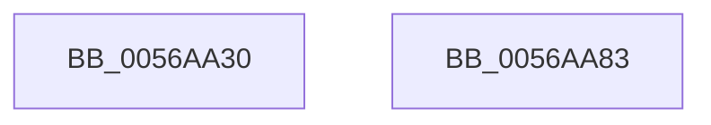

# HalpPicInitializeIoUnit

- RVA: `0x0056AA30`–`0x0056AA84` (길이 `84` bytes)
- VA: `0x000000014056AA30`
- 실행 섹션: `.text`
- PDB 이름 있음: `예`; PDB Function 태그: `아니요`
- unwind 정보 RVA: `0x000DB714`
- 디코드: `36`개 명령, `84/84` bytes 표시
- 미해석 바이트: `0` (있으면 어셈블리에 `.byte`로 보존)

> 이 문서는 커널 이미지의 기계어와 PDB 기호를 분석해 생성했습니다. 4번과 5번은 함수 원형과 자료형을 바이너리 사용 방식에서 추정한 C 해석이며 원본 소스 복구 결과는 아닙니다.

## 1. Dependencies

- 직접 호출 지점: **0**; 고유 호출 대상: **0**
- 직접 호출자로 확인된 함수: **0**
- RIP 상대 이미지 참조: **0**

### Outgoing calls
- 직접 디코드된 call 명령이 없습니다.

### Direct callers
- 이 함수 시작 RVA로 연결되는 직접 call은 확인되지 않았습니다. 간접 호출은 완전히 역산할 수 없습니다.

### Static image references
- 디코드된 RIP-relative 메모리 참조가 없습니다.

## 2. Other-region calls and transfers

- 다른 실행 섹션으로 향하는 call: **0**
- 별도 외부 분기/꼬리 이동을 확인하지 못했습니다.

## 3. Assembly (complete function range)

```asm
0056AA30  44 8B 01                        mov r8d, dword ptr [rcx]
0056AA33  B8 A0 00 00 00                  mov eax, 0xa0
0056AA38  90                              nop
0056AA39  BA 20 00 00 00                  mov edx, 0x20
0056AA3E  41 B9 00 B0 00 00               mov r9d, 0xb000
0056AA44  B9 21 00 00 00                  mov ecx, 0x21
0056AA49  45 3B C1                        cmp r8d, r9d
0056AA4C  66 0F 45 D0                     cmovne dx, ax
0056AA50  B0 11                           mov al, 0x11
0056AA52  EE                              out dx, al
0056AA53  90                              nop
0056AA54  B8 A1 00 00 00                  mov eax, 0xa1
0056AA59  90                              nop
0056AA5A  66 0F 45 C8                     cmovne cx, ax
0056AA5E  B0 D8                           mov al, 0xd8
0056AA60  0F B7 D1                        movzx edx, cx
0056AA63  EE                              out dx, al
0056AA64  90                              nop
0056AA65  B8 04 00 00 00                  mov eax, 4
0056AA6A  90                              nop
0056AA6B  8D 50 FE                        lea edx, [rax - 2]
0056AA6E  0F 45 C2                        cmovne eax, edx
0056AA71  0F B7 D1                        movzx edx, cx
0056AA74  EE                              out dx, al
0056AA75  90                              nop
0056AA76  B0 01                           mov al, 1
0056AA78  90                              nop
0056AA79  EE                              out dx, al
0056AA7A  90                              nop
0056AA7B  B0 FF                           mov al, 0xff
0056AA7D  90                              nop
0056AA7E  EE                              out dx, al
0056AA7F  90                              nop
0056AA80  33 C0                           xor eax, eax
0056AA82  C3                              ret
0056AA83  CC                              int3
```

## 4. C-style interpretation (structured pseudocode)

```c
__int64 __fastcall HalpPicInitializeIoUnit(__int64 a1)
{
    __int64 result;

    a2 = 32;
    if (((unsigned int)((unsigned int)(*(unsigned int *)(a1)))) != ((unsigned int)((unsigned int)(0xB000ULL)))) { a2 = 160; }
    a1 = 33;
    if (((unsigned int)((unsigned int)(*(unsigned int *)(a1)))) != ((unsigned int)((unsigned int)(0xB000ULL)))) { a1 = 161; }
    result = 4;
    if (((unsigned int)((unsigned int)(*(unsigned int *)(a1)))) != ((unsigned int)((unsigned int)(0xB000ULL)))) { result = (unsigned int)(4 - 2); }
    result = 0;
    return result;
}
```

## 5. (Beta) C Style

```c
int64_t HalpPicInitializeIoUnit(void *Arg1)
{
    uint8_t *arg1 = (uint8_t *)Arg1;

    int64_t result;

    a2 = 32;
    if (((uint32_t)((uint32_t)(*(uint32_t *)(arg1)))) != ((uint32_t)((uint32_t)(0xB000ULL)))) { a2 = 160; }
    Arg1 = 33;
    if (((uint32_t)((uint32_t)(*(uint32_t *)(arg1)))) != ((uint32_t)((uint32_t)(0xB000ULL)))) { Arg1 = 161; }
    result = 4;
    if (((uint32_t)((uint32_t)(*(uint32_t *)(arg1)))) != ((uint32_t)((uint32_t)(0xB000ULL)))) { result = (uint32_t)(4 - 2); }
    result = 0;
    return result;
}
```

### 관측된 메모리 오프셋

구조체 형식이 확인되지 않은 접근은 인자 기준의 오프셋으로만 기록했습니다.

| 기준 인자 | 오프셋 표현 | 폭 (bit) | 접근 |
|---|---:|---:|---|
| `Arg1` | `+ 0x0` | `32` | `R` |

## 6. Execution-region graph

[열기: 2D/3D 그래프와 함수 탐색 컨트롤 패널](../../../control-panel.html?section=text&rva=0x0056AA30&view=graph)

- 2D 그래프는 위에서 아래로 흐르고, 3D 그래프는 빈 공간을 드래그해 회전합니다. Shift+드래그는 이동, 휠은 확대·축소, 함수 노드 선택은 대상 보고서 이동입니다.

### Static fallback


