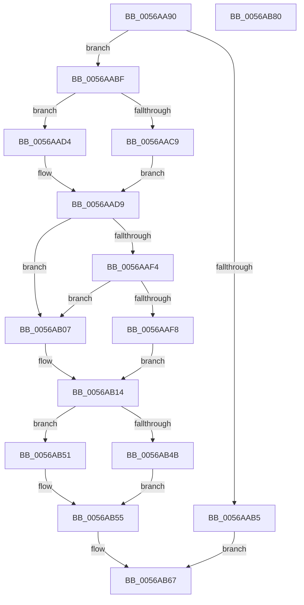

# HalpPicSetLineState

- RVA: `0x0056AA90`–`0x0056AB81` (길이 `241` bytes)
- VA: `0x000000014056AA90`
- 실행 섹션: `.text`
- PDB 이름 있음: `예`; PDB Function 태그: `아니요`
- unwind 정보 RVA: `0x00060300`
- 디코드: `72`개 명령, `241/241` bytes 표시
- 미해석 바이트: `0` (있으면 어셈블리에 `.byte`로 보존)

> 이 문서는 커널 이미지의 기계어와 PDB 기호를 분석해 생성했습니다. 4번과 5번은 함수 원형과 자료형을 바이너리 사용 방식에서 추정한 C 해석이며 원본 소스 복구 결과는 아닙니다.

## 1. Dependencies

- 직접 호출 지점: **6**; 고유 호출 대상: **3**
- 직접 호출자로 확인된 함수: **0**
- RIP 상대 이미지 참조: **0**

### Outgoing calls
- `0x0056AAE9` → [READ_PORT_USHORT_PAIR](READ_PORT_USHORT_PAIR_function_0056ABBC.md) (function, `0x0056ABBC`)
- `0x0056AB1A` → [WRITE_PORT_USHORT_PAIR](../54/WRITE_PORT_USHORT_PAIR_function_00545C48.md) (function, `0x00545C48`)
- `0x0056AB2F` → [READ_PORT_USHORT_PAIR](READ_PORT_USHORT_PAIR_function_0056ABBC.md) (function, `0x0056ABBC`)
- `0x0056AB37` → [HalpIoDelay](../6A/HalpIoDelay_function_006AC7E0.md) (function, `0x006AC7E0`)
- `0x0056AB5B` → [WRITE_PORT_USHORT_PAIR](../54/WRITE_PORT_USHORT_PAIR_function_00545C48.md) (function, `0x00545C48`)
- `0x0056AB60` → [HalpIoDelay](../6A/HalpIoDelay_function_006AC7E0.md) (function, `0x006AC7E0`)

### Direct callers
- 이 함수 시작 RVA로 연결되는 직접 call은 확인되지 않았습니다. 간접 호출은 완전히 역산할 수 없습니다.

### Static image references
- 디코드된 RIP-relative 메모리 참조가 없습니다.

## 2. Other-region calls and transfers

- 다른 실행 섹션으로 향하는 call: **0**
- 별도 외부 분기/꼬리 이동을 확인하지 못했습니다.

## 3. Assembly (complete function range)

```asm
0056AA90  48 89 5C 24 08                  mov qword ptr [rsp + 8], rbx
0056AA95  48 89 6C 24 10                  mov qword ptr [rsp + 0x10], rbp
0056AA9A  48 89 74 24 18                  mov qword ptr [rsp + 0x18], rsi
0056AA9F  57                              push rdi
0056AAA0  41 56                           push r14
0056AAA2  41 57                           push r15
0056AAA4  48 83 EC 20                     sub rsp, 0x20
0056AAA8  41 80 78 04 00                  cmp byte ptr [r8 + 4], 0
0056AAAD  49 8B E8                        mov rbp, r8
0056AAB0  48 8B F2                        mov rsi, rdx
0056AAB3  74 0A                           je 0x14056aabf
0056AAB5  B8 BB 00 00 C0                  mov eax, 0xc00000bb
0056AABA  E9 A8 00 00 00                  jmp 0x14056ab67
0056AABF  32 DB                           xor bl, bl
0056AAC1  81 39 00 B0 00 00               cmp dword ptr [rcx], 0xb000
0056AAC7  75 0B                           jne 0x14056aad4
0056AAC9  83 7A 04 02                     cmp dword ptr [rdx + 4], 2
0056AACD  0F 94 C3                        sete bl
0056AAD0  33 FF                           xor edi, edi
0056AAD2  EB 05                           jmp 0x14056aad9
0056AAD4  BF 08 00 00 00                  mov edi, 8
0056AAD9  41 BE D1 04 00 00               mov r14d, 0x4d1
0056AADF  41 8B D6                        mov edx, r14d
0056AAE2  45 8D 7E FF                     lea r15d, [r14 - 1]
0056AAE6  41 8B CF                        mov ecx, r15d
0056AAE9  E8 CE 00 00 00                  call 0x14056abbc
0056AAEE  83 7D 08 00                     cmp dword ptr [rbp + 8], 0
0056AAF2  75 13                           jne 0x14056ab07
0056AAF4  84 DB                           test bl, bl
0056AAF6  75 0F                           jne 0x14056ab07
0056AAF8  44 0F B7 C0                     movzx r8d, ax
0056AAFC  8B 46 04                        mov eax, dword ptr [rsi + 4]
0056AAFF  03 C7                           add eax, edi
0056AB01  41 0F AB C0                     bts r8d, eax
0056AB05  EB 0D                           jmp 0x14056ab14
0056AB07  44 0F B7 C0                     movzx r8d, ax
0056AB0B  8B 46 04                        mov eax, dword ptr [rsi + 4]
0056AB0E  03 C7                           add eax, edi
0056AB10  41 0F B3 C0                     btr r8d, eax
0056AB14  49 8B D6                        mov rdx, r14
0056AB17  49 8B CF                        mov rcx, r15
0056AB1A  E8 29 B1 FD FF                  call 0x140545c48
0056AB1F  41 BE A1 00 00 00               mov r14d, 0xa1
0056AB25  41 8B D6                        mov edx, r14d
0056AB28  45 8D 7E 80                     lea r15d, [r14 - 0x80]
0056AB2C  41 8B CF                        mov ecx, r15d
0056AB2F  E8 88 00 00 00                  call 0x14056abbc
0056AB34  0F B7 D8                        movzx ebx, ax
0056AB37  E8 A4 1C 14 00                  call 0x1406ac7e0
0056AB3C  8B 4E 04                        mov ecx, dword ptr [rsi + 4]
0056AB3F  44 8B C3                        mov r8d, ebx
0056AB42  8B 45 0C                        mov eax, dword ptr [rbp + 0xc]
0056AB45  03 CF                           add ecx, edi
0056AB47  A8 01                           test al, 1
0056AB49  74 06                           je 0x14056ab51
0056AB4B  41 0F B3 C8                     btr r8d, ecx
0056AB4F  EB 04                           jmp 0x14056ab55
0056AB51  41 0F AB C8                     bts r8d, ecx
0056AB55  49 8B D6                        mov rdx, r14
0056AB58  49 8B CF                        mov rcx, r15
0056AB5B  E8 E8 B0 FD FF                  call 0x140545c48
0056AB60  E8 7B 1C 14 00                  call 0x1406ac7e0
0056AB65  33 C0                           xor eax, eax
0056AB67  48 8B 5C 24 40                  mov rbx, qword ptr [rsp + 0x40]
0056AB6C  48 8B 6C 24 48                  mov rbp, qword ptr [rsp + 0x48]
0056AB71  48 8B 74 24 50                  mov rsi, qword ptr [rsp + 0x50]
0056AB76  48 83 C4 20                     add rsp, 0x20
0056AB7A  41 5F                           pop r15
0056AB7C  41 5E                           pop r14
0056AB7E  5F                              pop rdi
0056AB7F  C3                              ret
0056AB80  CC                              int3
```

## 4. C-style interpretation (structured pseudocode)

```c
__int64 __fastcall HalpPicSetLineState(__int64 a1, __int64 a2, __int64 a3)
{
    __int64 result;
    __int64 v_rbx;
    __int64 v_rdi;
    __int64 v_rsp;
    unsigned __int64 v_stack_p10;
    unsigned __int64 v_stack_p18;
    unsigned __int64 v_stack_p8;

    v_stack_p8 = v_rbx;
    v_stack_p10 = v_rbp;
    v_stack_p18 = v_rsi;
    v_rsp = (v_rsp) - (32);
    if ((*(unsigned __int8 *)(a3 + 4)) == 0) goto loc_0056AABF;
    goto loc_0056AB67;
loc_0056AABF:
    v_rbx = 0;
    if ((*(unsigned int *)(a1)) != 0xB000ULL) goto loc_0056AAD4;
    v_rbx = ((*(unsigned int *)(a2 + 4)) == 2) ? 1 : 0;
    v_rdi = 0;
    goto loc_0056AAD9;
loc_0056AAD4:
loc_0056AAD9:
    result = READ_PORT_USHORT_PAIR((unsigned int)((unsigned int)((unsigned int)(0x4D1ULL) - 1)), (unsigned int)((unsigned int)((unsigned int)(0x4D1ULL))), a3, a4);
    if ((*(unsigned int *)(a3 + 8)) != 0) goto loc_0056AB07;
    if ((unsigned __int8)(v_rbx) != 0) goto loc_0056AB07;
    result = (unsigned int)(((unsigned int)(*(unsigned int *)(a2 + 4))) + (8));
    goto loc_0056AB14;
loc_0056AB07:
    result = (unsigned int)(((unsigned int)(*(unsigned int *)(a2 + 4))) + (8));
loc_0056AB14:
    result = WRITE_PORT_USHORT_PAIR((unsigned int)(0x4D1ULL) - 1, (unsigned int)(0x4D1ULL), (unsigned __int16)(result), a4);
    result = READ_PORT_USHORT_PAIR((unsigned int)((unsigned int)(161 - 128)), 161, (unsigned __int16)(result), a4);
    result = HalpIoDelay((unsigned int)((unsigned int)(161 - 128)), 161, (unsigned __int16)(result), a4);
    a1 = (unsigned int)(((unsigned int)(*(unsigned int *)(a2 + 4))) + (8));
    if ((((unsigned __int8)((unsigned int)(*(unsigned int *)(a3 + 12)))) & (1)) == 0) goto loc_0056AB51;
    goto loc_0056AB55;
loc_0056AB51:
loc_0056AB55:
    result = WRITE_PORT_USHORT_PAIR(161 - 128, 161, (unsigned int)((unsigned int)((unsigned __int16)(result))), a4);
    result = HalpIoDelay(161 - 128, 161, (unsigned int)((unsigned int)((unsigned __int16)(result))), a4);
    result = 0;
loc_0056AB67:
    v_rsp = (v_rsp) + (32);
    return result;
}
```

## 5. (Beta) C Style

```c
int64_t HalpPicSetLineState(void *Arg1, void *Arg2, void *Arg3)
{
    uint8_t *arg1 = (uint8_t *)Arg1;
    uint8_t *arg2 = (uint8_t *)Arg2;
    uint8_t *arg3 = (uint8_t *)Arg3;

    int64_t result;
    int64_t local_rbx;
    int64_t local_rdi;
    int64_t local_rsp;
    uint64_t v_stack_p10;
    uint64_t v_stack_p18;
    uint64_t v_stack_p8;

    v_stack_p8 = local_rbx;
    v_stack_p10 = local_rbp;
    v_stack_p18 = local_rsi;
    local_rsp = (local_rsp) - (32);
    if ((*(uint8_t *)(arg3 + 0x4)) == 0) goto loc_0056AABF;
    goto loc_0056AB67;
loc_0056AABF:
    local_rbx = 0;
    if ((*(uint32_t *)(arg1)) != 0xB000ULL) goto loc_0056AAD4;
    local_rbx = ((*(uint32_t *)(arg2 + 0x4)) == 2) ? 1 : 0;
    local_rdi = 0;
    goto loc_0056AAD9;
loc_0056AAD4:
loc_0056AAD9:
    result = READ_PORT_USHORT_PAIR((uint32_t)((uint32_t)((uint32_t)(0x4D1ULL) - 1)), (uint32_t)((uint32_t)((uint32_t)(0x4D1ULL))), Arg3, a4);
    if ((*(uint32_t *)(arg3 + 0x8)) != 0) goto loc_0056AB07;
    if ((uint8_t)(local_rbx) != 0) goto loc_0056AB07;
    result = (uint32_t)(((uint32_t)(*(uint32_t *)(arg2 + 0x4))) + (8));
    goto loc_0056AB14;
loc_0056AB07:
    result = (uint32_t)(((uint32_t)(*(uint32_t *)(arg2 + 0x4))) + (8));
loc_0056AB14:
    result = WRITE_PORT_USHORT_PAIR((uint32_t)(0x4D1ULL) - 1, (uint32_t)(0x4D1ULL), (uint16_t)(result), a4);
    result = READ_PORT_USHORT_PAIR((uint32_t)((uint32_t)(161 - 128)), 161, (uint16_t)(result), a4);
    result = HalpIoDelay((uint32_t)((uint32_t)(161 - 128)), 161, (uint16_t)(result), a4);
    Arg1 = (uint32_t)(((uint32_t)(*(uint32_t *)(arg2 + 0x4))) + (8));
    if ((((uint8_t)((uint32_t)(*(uint32_t *)(arg3 + 0xC)))) & (1)) == 0) goto loc_0056AB51;
    goto loc_0056AB55;
loc_0056AB51:
loc_0056AB55:
    result = WRITE_PORT_USHORT_PAIR(161 - 128, 161, (uint32_t)((uint32_t)((uint16_t)(result))), a4);
    result = HalpIoDelay(161 - 128, 161, (uint32_t)((uint32_t)((uint16_t)(result))), a4);
    result = 0;
loc_0056AB67:
    local_rsp = (local_rsp) + (32);
    return result;
}
```

### 관측된 메모리 오프셋

구조체 형식이 확인되지 않은 접근은 인자 기준의 오프셋으로만 기록했습니다.

| 기준 인자 | 오프셋 표현 | 폭 (bit) | 접근 |
|---|---:|---:|---|
| `Arg1` | `+ 0x0` | `32` | `R` |
| `Arg2` | `+ 0x4` | `32` | `R` |
| `Arg3` | `+ 0x4` | `8` | `R` |
| `Arg3` | `+ 0x8` | `32` | `R` |
| `Arg3` | `+ 0xC` | `32` | `R` |

## 6. Execution-region graph

[열기: 2D/3D 그래프와 함수 탐색 컨트롤 패널](../../../control-panel.html?section=text&rva=0x0056AA90&view=graph)

- 2D 그래프는 위에서 아래로 흐르고, 3D 그래프는 빈 공간을 드래그해 회전합니다. Shift+드래그는 이동, 휠은 확대·축소, 함수 노드 선택은 대상 보고서 이동입니다.

### Static fallback


