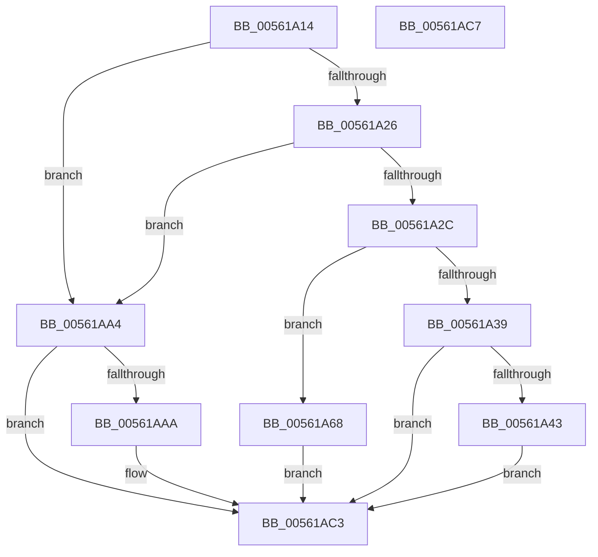

# HalpPmTimerConfigure

- RVA: `0x00561A14`–`0x00561AC8` (길이 `180` bytes)
- VA: `0x0000000140561A14`
- 실행 섹션: `.text`
- PDB 이름 있음: `예`; PDB Function 태그: `아니요`
- unwind 정보 RVA: `0x000DB714`
- 디코드: `48`개 명령, `180/180` bytes 표시
- 미해석 바이트: `0` (있으면 어셈블리에 `.byte`로 보존)

> 이 문서는 커널 이미지의 기계어와 PDB 기호를 분석해 생성했습니다. 4번과 5번은 함수 원형과 자료형을 바이너리 사용 방식에서 추정한 C 해석이며 원본 소스 복구 결과는 아닙니다.

## 1. Dependencies

- 직접 호출 지점: **0**; 고유 호출 대상: **0**
- 직접 호출자로 확인된 함수: **1**
- RIP 상대 이미지 참조: **2**

### Outgoing calls
- 직접 디코드된 call 명령이 없습니다.

### Direct callers
- [HalpPmTimerDiscover](HalpPmTimerDiscover_function_00561AD0.md) at `0x00561B53`

### Static image references
- `0x00561A4D` → RVA `0x00561C30` (`HalpPmTimerQueryCounterIoPort`; read)
- `0x00561A89` → RVA `0x00561C50` (`HalpPmTimerQueryCounterMemory`; read)

## 2. Other-region calls and transfers

- 다른 실행 섹션으로 향하는 call: **0**
- 별도 외부 분기/꼬리 이동을 확인하지 못했습니다.

## 3. Assembly (complete function range)

```asm
00561A14  45 33 DB                        xor r11d, r11d
00561A17  4D 8B D0                        mov r10, r8
00561A1A  80 79 08 05                     cmp byte ptr [rcx + 8], 5
00561A1E  41 B9 BB 00 00 C0               mov r9d, 0xc00000bb
00561A24  72 7E                           jb 0x140561aa4
00561A26  44 38 59 5B                     cmp byte ptr [rcx + 0x5b], r11b
00561A2A  74 78                           je 0x140561aa4
00561A2C  44 0F B6 81 D0 00 00 00         movzx r8d, byte ptr [rcx + 0xd0]
00561A34  45 85 C0                        test r8d, r8d
00561A37  74 2F                           je 0x140561a68
00561A39  41 83 F8 01                     cmp r8d, 1
00561A3D  0F 85 80 00 00 00               jne 0x140561ac3
00561A43  44 88 5A 01                     mov byte ptr [rdx + 1], r11b
00561A47  8B 81 D4 00 00 00               mov eax, dword ptr [rcx + 0xd4]
00561A4D  48 8D 0D DC 01 00 00            lea rcx, [rip + 0x1dc]
00561A54  48 89 42 08                     mov qword ptr [rdx + 8], rax
00561A58  48 F7 D8                        neg rax
00561A5B  49 89 4A 10                     mov qword ptr [r10 + 0x10], rcx
00561A5F  1B C0                           sbb eax, eax
00561A61  F7 D0                           not eax
00561A63  44 23 C8                        and r9d, eax
00561A66  EB 5B                           jmp 0x140561ac3
00561A68  C6 42 01 01                     mov byte ptr [rdx + 1], 1
00561A6C  0F B6 41 5B                     movzx eax, byte ptr [rcx + 0x5b]
00561A70  89 42 1C                        mov dword ptr [rdx + 0x1c], eax
00561A73  F2 0F 10 81 D0 00 00 00         movsd xmm0, qword ptr [rcx + 0xd0]
00561A7B  F2 0F 11 42 10                  movsd qword ptr [rdx + 0x10], xmm0
00561A80  8B 81 D8 00 00 00               mov eax, dword ptr [rcx + 0xd8]
00561A86  89 42 18                        mov dword ptr [rdx + 0x18], eax
00561A89  48 8D 05 C0 01 00 00            lea rax, [rip + 0x1c0]
00561A90  49 89 42 10                     mov qword ptr [r10 + 0x10], rax
00561A94  48 8B 42 14                     mov rax, qword ptr [rdx + 0x14]
00561A98  48 F7 D8                        neg rax
00561A9B  1B C9                           sbb ecx, ecx
00561A9D  F7 D1                           not ecx
00561A9F  44 23 C9                        and r9d, ecx
00561AA2  EB 1F                           jmp 0x140561ac3
00561AA4  44 39 59 4C                     cmp dword ptr [rcx + 0x4c], r11d
00561AA8  74 19                           je 0x140561ac3
00561AAA  44 88 5A 01                     mov byte ptr [rdx + 1], r11b
00561AAE  45 8B CB                        mov r9d, r11d
00561AB1  8B 41 4C                        mov eax, dword ptr [rcx + 0x4c]
00561AB4  48 8D 0D 75 01 00 00            lea rcx, [rip + 0x175]
00561ABB  49 89 48 10                     mov qword ptr [r8 + 0x10], rcx
00561ABF  48 89 42 08                     mov qword ptr [rdx + 8], rax
00561AC3  41 8B C1                        mov eax, r9d
00561AC6  C3                              ret
00561AC7  CC                              int3
```

## 4. C-style interpretation (structured pseudocode)

```c
__int64 __fastcall HalpPmTimerConfigure(__int64 a1, __int64 a2, __int64 a3)
{
    __int64 result;
    __int64 v_r11;

    v_r11 = 0;
    if ((*(unsigned __int8 *)(a1 + 8)) < 5) goto loc_00561AA4;
    if ((*(unsigned __int8 *)(a1 + 91)) == 0) goto loc_00561AA4;
    if ((unsigned int)(*(unsigned __int8 *)(a1 + 208)) == 0) goto loc_00561A68;
    if (((unsigned int)(*(unsigned __int8 *)(a1 + 208))) != 1) goto loc_00561AC3;
    *(unsigned __int8 *)(a2 + 1) = 0;
    *(unsigned __int64 *)(a2 + 8) = (unsigned int)(*(unsigned int *)(a1 + 212));
    result = -((unsigned int)(*(unsigned int *)(a1 + 212)));
    *(unsigned __int64 *)(a3 + 16) = v_rip + 476;
    result = (unsigned int)(~(result));
    a4 = (unsigned int)(((unsigned int)(0xC00000BBULL)) & ((unsigned int)(result)));
    goto loc_00561AC3;
loc_00561A68:
    *(unsigned __int8 *)(a2 + 1) = 1;
    *(unsigned int *)(a2 + 28) = (unsigned int)(*(unsigned __int8 *)(v_rip + 476 + 91));
    *(unsigned __int64 *)(a2 + 16) = v_xmm0;
    *(unsigned int *)(a2 + 24) = (unsigned int)((unsigned int)(*(unsigned int *)(v_rip + 476 + 216)));
    *(unsigned __int64 *)(a3 + 16) = v_rip + 448;
    result = -(*(unsigned __int64 *)(a2 + 20));
    a1 = (unsigned int)(~(v_rip + 476));
    a4 = (unsigned int)((a4) & ((unsigned int)(a1)));
    goto loc_00561AC3;
loc_00561AA4:
    if ((*(unsigned int *)(a1 + 76)) != 0) {
        *(unsigned __int8 *)(a2 + 1) = 0;
        a4 = 0;
        result = *(unsigned int *)(a1 + 76);
        a1 = v_rip + 373;
        *(unsigned __int64 *)(*(unsigned __int8 *)(a1 + 208) + 16) = a1;
        *(unsigned __int64 *)(a2 + 8) = result;
    }
    return (unsigned int)((unsigned int)(a4));
}
```

## 5. (Beta) C Style

```c
int64_t HalpPmTimerConfigure(void *Arg1, void *Arg2, void *Arg3)
{
    uint8_t *arg1 = (uint8_t *)Arg1;
    uint8_t *arg2 = (uint8_t *)Arg2;
    uint8_t *arg3 = (uint8_t *)Arg3;

    int64_t result;
    int64_t local_r11;

    local_r11 = 0;
    if ((*(uint8_t *)(arg1 + 0x8)) < 5) goto loc_00561AA4;
    if ((*(uint8_t *)(arg1 + 0x5B)) == 0) goto loc_00561AA4;
    if ((uint32_t)(*(uint8_t *)(arg1 + 0xD0)) == 0) goto loc_00561A68;
    if (((uint32_t)(*(uint8_t *)(arg1 + 0xD0))) != 1) goto loc_00561AC3;
    *(uint8_t *)(arg2 + 0x1) = 0;
    *(uint64_t *)(arg2 + 0x8) = (uint32_t)(*(uint32_t *)(arg1 + 0xD4));
    result = -((uint32_t)(*(uint32_t *)(arg1 + 0xD4)));
    *(uint64_t *)(arg3 + 0x10) = v_rip + 476;
    result = (uint32_t)(~(result));
    a4 = (uint32_t)(((uint32_t)(0xC00000BBULL)) & ((uint32_t)(result)));
    goto loc_00561AC3;
loc_00561A68:
    *(uint8_t *)(arg2 + 0x1) = 1;
    *(uint32_t *)(arg2 + 0x1C) = (uint32_t)(*(uint8_t *)(v_rip + 0x1DC + 0x5B));
    *(uint64_t *)(arg2 + 0x10) = v_xmm0;
    *(uint32_t *)(arg2 + 0x18) = (uint32_t)((uint32_t)(*(uint32_t *)(v_rip + 0x1DC + 0xD8)));
    *(uint64_t *)(arg3 + 0x10) = v_rip + 448;
    result = -(*(uint64_t *)(arg2 + 0x14));
    Arg1 = (uint32_t)(~(v_rip + 476));
    a4 = (uint32_t)((a4) & ((uint32_t)(Arg1)));
    goto loc_00561AC3;
loc_00561AA4:
    if ((*(uint32_t *)(arg1 + 0x4C)) != 0) {
        *(uint8_t *)(arg2 + 0x1) = 0;
        a4 = 0;
        result = *(uint32_t *)(arg1 + 0x4C);
        Arg1 = v_rip + 373;
        *(void **)(*(uint8_t *)(arg1 + 0xD0) + 0x10) = Arg1;
        *(uint64_t *)(arg2 + 0x8) = result;
    }
    return (uint32_t)((uint32_t)(a4));
}
```

### 관측된 메모리 오프셋

구조체 형식이 확인되지 않은 접근은 인자 기준의 오프셋으로만 기록했습니다.

| 기준 인자 | 오프셋 표현 | 폭 (bit) | 접근 |
|---|---:|---:|---|
| `Arg1` | `+ 0x8` | `8` | `R` |
| `Arg1` | `+ 0x4C` | `32` | `R` |
| `Arg1` | `+ 0x5B` | `8` | `R` |
| `Arg1` | `+ 0xD0` | `8` | `R` |
| `Arg1` | `+ 0xD0` | `64` | `R` |
| `Arg1` | `+ 0xD4` | `32` | `R` |
| `Arg1` | `+ 0xD8` | `32` | `R` |
| `Arg2` | `+ 0x1` | `8` | `W` |
| `Arg2` | `+ 0x8` | `64` | `W` |
| `Arg2` | `+ 0x10` | `64` | `W` |
| `Arg2` | `+ 0x14` | `64` | `R` |
| `Arg2` | `+ 0x18` | `32` | `W` |
| `Arg2` | `+ 0x1C` | `32` | `W` |
| `Arg3` | `+ 0x10` | `64` | `W` |

## 6. Execution-region graph

[열기: 2D/3D 그래프와 함수 탐색 컨트롤 패널](../../../control-panel.html?section=text&rva=0x00561A14&view=graph)

- 2D 그래프는 위에서 아래로 흐르고, 3D 그래프는 빈 공간을 드래그해 회전합니다. Shift+드래그는 이동, 휠은 확대·축소, 함수 노드 선택은 대상 보고서 이동입니다.

### Static fallback


