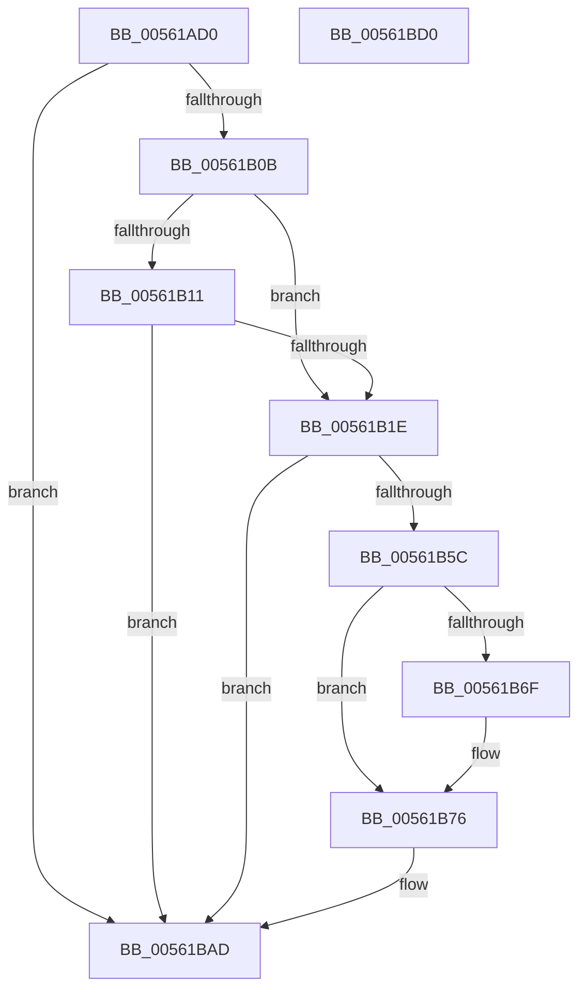

# HalpPmTimerDiscover

- RVA: `0x00561AD0`–`0x00561BD1` (길이 `257` bytes)
- VA: `0x0000000140561AD0`
- 실행 섹션: `.text`
- PDB 이름 있음: `예`; PDB Function 태그: `아니요`
- unwind 정보 RVA: `0x000C4AE8`
- 디코드: `60`개 명령, `257/257` bytes 표시
- 미해석 바이트: `0` (있으면 어셈블리에 `.byte`로 보존)

> 이 문서는 커널 이미지의 기계어와 PDB 기호를 분석해 생성했습니다. 4번과 5번은 함수 원형과 자료형을 바이너리 사용 방식에서 추정한 C 해석이며 원본 소스 복구 결과는 아닙니다.

## 1. Dependencies

- 직접 호출 지점: **5**; 고유 호출 대상: **5**
- 직접 호출자로 확인된 함수: **1**
- RIP 상대 이미지 참조: **2**

### Outgoing calls
- `0x00561AFA` → [HalSocGetAcpiTable](HalSocGetAcpiTable_function_00561580.md) (function, `0x00561580`)
- `0x00561B2A` → [memset](../6C/memset_function_006C6C40.md) (function, `0x006C6C40`)
- `0x00561B53` → [HalpPmTimerConfigure](HalpPmTimerConfigure_function_00561A14.md) (function, `0x00561A14`)
- `0x00561BA8` → [HalpTimerRegister](HalpTimerRegister_function_005616BC.md) (function, `0x005616BC`)
- `0x00561BB6` → [_security_check_cookie](../6A/_security_check_cookie_function_006AC640.md) (function, `0x006AC640`)

### Direct callers
- [HalpTimerRegisterBuiltinPluginsCommon](../54/HalpTimerRegisterBuiltinPluginsCommon_function_0054A014.md) at `0x0054A02C`

### Static image references
- `0x00561AE7` → RVA `0x00E0A740` (`.data`; read)
- `0x00561B85` → RVA `0x00561BE0` (`HalpPmTimerInitialize`; read)

## 2. Other-region calls and transfers

- 다른 실행 섹션으로 향하는 call: **0**
- 별도 외부 분기/꼬리 이동을 확인하지 못했습니다.

## 3. Assembly (complete function range)

```asm
00561AD0  48 89 5C 24 08                  mov qword ptr [rsp + 8], rbx
00561AD5  48 89 7C 24 10                  mov qword ptr [rsp + 0x10], rdi
00561ADA  55                              push rbp
00561ADB  48 8D 6C 24 A9                  lea rbp, [rsp - 0x57]
00561AE0  48 81 EC E0 00 00 00            sub rsp, 0xe0
00561AE7  48 8B 05 52 8C 8A 00            mov rax, qword ptr [rip + 0x8a8c52]
00561AEE  48 33 C4                        xor rax, rsp
00561AF1  48 89 45 47                     mov qword ptr [rbp + 0x47], rax
00561AF5  B9 46 41 43 50                  mov ecx, 0x50434146
00561AFA  E8 81 FA FF FF                  call 0x140561580
00561AFF  48 8B F8                        mov rdi, rax
00561B02  48 85 C0                        test rax, rax
00561B05  0F 84 A2 00 00 00               je 0x140561bad
00561B0B  80 78 08 05                     cmp byte ptr [rax + 8], 5
00561B0F  72 0D                           jb 0x140561b1e
00561B11  F7 40 70 00 00 10 00            test dword ptr [rax + 0x70], 0x100000
00561B18  0F 85 8F 00 00 00               jne 0x140561bad
00561B1E  33 D2                           xor edx, edx
00561B20  48 8D 4D 97                     lea rcx, [rbp - 0x69]
00561B24  41 B8 90 00 00 00               mov r8d, 0x90
00561B2A  E8 11 51 16 00                  call 0x1406c6c40
00561B2F  0F 57 C0                        xorps xmm0, xmm0
00561B32  C7 45 97 01 00 00 00            mov dword ptr [rbp - 0x69], 1
00561B39  4C 8D 45 97                     lea r8, [rbp - 0x69]
00561B3D  C7 45 9B 90 00 00 00            mov dword ptr [rbp - 0x65], 0x90
00561B44  48 8D 55 27                     lea rdx, [rbp + 0x27]
00561B48  48 8B CF                        mov rcx, rdi
00561B4B  0F 11 45 27                     movups xmmword ptr [rbp + 0x27], xmm0
00561B4F  0F 11 45 37                     movups xmmword ptr [rbp + 0x37], xmm0
00561B53  E8 BC FE FF FF                  call 0x140561a14
00561B58  85 C0                           test eax, eax
00561B5A  75 51                           jne 0x140561bad
00561B5C  F7 47 70 00 01 00 00            test dword ptr [rdi + 0x70], 0x100
00561B63  8D 48 20                        lea ecx, [rax + 0x20]
00561B66  C7 45 FB 18 00 00 00            mov dword ptr [rbp - 5], 0x18
00561B6D  74 07                           je 0x140561b76
00561B6F  C6 45 27 01                     mov byte ptr [rbp + 0x27], 1
00561B73  89 4D FB                        mov dword ptr [rbp - 5], ecx
00561B76  48 8D 45 27                     lea rax, [rbp + 0x27]
00561B7A  89 4D F7                        mov dword ptr [rbp - 9], ecx
00561B7D  48 89 45 EF                     mov qword ptr [rbp - 0x11], rax
00561B81  48 8D 4D 97                     lea rcx, [rbp - 0x69]
00561B85  48 8D 05 54 00 00 00            lea rax, [rip + 0x54]
00561B8C  48 C7 45 FF 99 9E 36 00         mov qword ptr [rbp - 1], 0x369e99
00561B94  33 D2                           xor edx, edx
00561B96  48 89 45 9F                     mov qword ptr [rbp - 0x61], rax
00561B9A  C7 45 0B 02 00 00 00            mov dword ptr [rbp + 0xb], 2
00561BA1  C7 45 1F 01 00 00 00            mov dword ptr [rbp + 0x1f], 1
00561BA8  E8 0F FB FF FF                  call 0x1405616bc
00561BAD  33 C0                           xor eax, eax
00561BAF  48 8B 4D 47                     mov rcx, qword ptr [rbp + 0x47]
00561BB3  48 33 CC                        xor rcx, rsp
00561BB6  E8 85 AA 14 00                  call 0x1406ac640
00561BBB  4C 8D 9C 24 E0 00 00 00         lea r11, [rsp + 0xe0]
00561BC3  49 8B 5B 10                     mov rbx, qword ptr [r11 + 0x10]
00561BC7  49 8B 7B 18                     mov rdi, qword ptr [r11 + 0x18]
00561BCB  49 8B E3                        mov rsp, r11
00561BCE  5D                              pop rbp
00561BCF  C3                              ret
00561BD0  CC                              int3
```

## 4. C-style interpretation (structured pseudocode)

```c
__int64 __fastcall HalpPmTimerDiscover(__int64 a1, int a2)
{
    __int64 result;
    __int64 v_rsp;
    unsigned __int64 v_stack_m18;
    unsigned __int64 v_stack_m28;
    unsigned __int64 v_stack_m38;
    unsigned int v_stack_m40;
    unsigned int v_stack_m54;
    unsigned __int64 v_stack_m5F;
    unsigned __int64 v_stack_m60;
    unsigned int v_stack_m64;
    unsigned int v_stack_m68;
    unsigned __int64 v_stack_m70;
    unsigned __int64 v_stack_m8;
    unsigned __int64 v_stack_mC0;
    unsigned int v_stack_mC4;
    unsigned __int64 v_stack_mC8;
    unsigned __int64 v_stack_p10;
    unsigned __int64 v_stack_p8;

    v_stack_p8 = v_rbx;
    v_stack_p10 = v_rdi;
    v_rsp = (v_rsp) - (224);
    result = (*(unsigned __int64 *)(v_rip + 9079890)) ^ (v_rsp);
    v_stack_m18 = result;
    result = HalSocGetAcpiTable((unsigned int)(0x50434146ULL), a2, a3, a4);
    if (result == 0) goto loc_00561BAD;
    if ((*(unsigned __int8 *)(result + 8)) < 5) goto loc_00561B1E;
    if (((*(unsigned int *)(result + 112)) & (0x100000ULL)) != 0) goto loc_00561BAD;
loc_00561B1E:
    a2 = 0;
    result = memset(v_stack_mC8, a2, 144, a4);
    v_stack_mC8 = 1;
    v_stack_mC4 = 144;
    v_stack_m38 = v_xmm0;
    v_stack_m28 = v_xmm0;
    result = HalpPmTimerConfigure(result, v_stack_m38, v_stack_mC8, a4);
    if ((unsigned int)(result) != 0) goto loc_00561BAD;
    v_stack_m64 = 24;
    if (((*(unsigned int *)(result + 112)) & (256)) != 0) {
        v_stack_m38 = 1;
        v_stack_m64 = (unsigned int)(result + 32);
    }
    v_stack_m68 = (unsigned int)(result + 32);
    v_stack_m70 = v_stack_m38;
    v_stack_m60 = 0x369E99ULL;
    a2 = 0;
    v_stack_mC0 = v_rip + 84;
    v_stack_m54 = 2;
    v_stack_m40 = 1;
    result = HalpTimerRegister(v_stack_mC8, a2, v_stack_mC8, a4);
loc_00561BAD:
    result = 0;
    a1 = (v_stack_m18) ^ (v_rsp);
    result = _security_check_cookie(a1, a2, v_stack_mC8, a4);
    return result;
}
```

## 5. (Beta) C Style

```c
int64_t HalpPmTimerDiscover(int64_t Arg1, int32_t Arg2)
{
    int64_t result;
    int64_t local_rsp;
    uint64_t v_stack_m18;
    uint64_t v_stack_m28;
    uint64_t v_stack_m38;
    uint32_t v_stack_m40;
    uint32_t v_stack_m54;
    uint64_t v_stack_m5F;
    uint64_t v_stack_m60;
    uint32_t v_stack_m64;
    uint32_t v_stack_m68;
    uint64_t v_stack_m70;
    uint64_t v_stack_m8;
    uint64_t v_stack_mC0;
    uint32_t v_stack_mC4;
    uint64_t v_stack_mC8;
    uint64_t v_stack_p10;
    uint64_t v_stack_p8;

    v_stack_p8 = local_rbx;
    v_stack_p10 = local_rdi;
    local_rsp = (local_rsp) - (224);
    result = (*(uint64_t *)(v_rip + 0x8A8C52)) ^ (local_rsp);
    v_stack_m18 = result;
    result = HalSocGetAcpiTable((uint32_t)(0x50434146ULL), Arg2, a3, a4);
    if (result == 0) goto loc_00561BAD;
    if ((*(uint8_t *)(result + 0x8)) < 5) goto loc_00561B1E;
    if (((*(uint32_t *)(result + 0x70)) & (0x100000ULL)) != 0) goto loc_00561BAD;
loc_00561B1E:
    Arg2 = 0;
    result = memset(v_stack_mC8, Arg2, 144, a4);
    v_stack_mC8 = 1;
    v_stack_mC4 = 144;
    v_stack_m38 = v_xmm0;
    v_stack_m28 = v_xmm0;
    result = HalpPmTimerConfigure(result, v_stack_m38, v_stack_mC8, a4);
    if ((uint32_t)(result) != 0) goto loc_00561BAD;
    v_stack_m64 = 24;
    if (((*(uint32_t *)(result + 0x70)) & (256)) != 0) {
        v_stack_m38 = 1;
        v_stack_m64 = (uint32_t)(result + 32);
    }
    v_stack_m68 = (uint32_t)(result + 32);
    v_stack_m70 = v_stack_m38;
    v_stack_m60 = 0x369E99ULL;
    Arg2 = 0;
    v_stack_mC0 = v_rip + 84;
    v_stack_m54 = 2;
    v_stack_m40 = 1;
    result = HalpTimerRegister(v_stack_mC8, Arg2, v_stack_mC8, a4);
loc_00561BAD:
    result = 0;
    Arg1 = (v_stack_m18) ^ (local_rsp);
    result = _security_check_cookie(Arg1, Arg2, v_stack_mC8, a4);
    return result;
}
```

## 6. Execution-region graph

[열기: 2D/3D 그래프와 함수 탐색 컨트롤 패널](../../../control-panel.html?section=text&rva=0x00561AD0&view=graph)

- 2D 그래프는 위에서 아래로 흐르고, 3D 그래프는 빈 공간을 드래그해 회전합니다. Shift+드래그는 이동, 휠은 확대·축소, 함수 노드 선택은 대상 보고서 이동입니다.

### Static fallback


