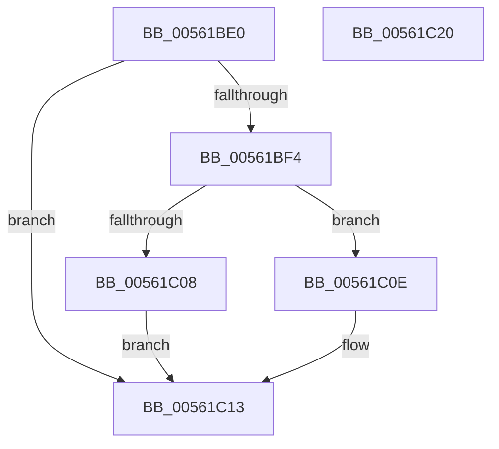

# HalpPmTimerInitialize

- RVA: `0x00561BE0`–`0x00561C21` (길이 `65` bytes)
- VA: `0x0000000140561BE0`
- 실행 섹션: `.text`
- PDB 이름 있음: `예`; PDB Function 태그: `아니요`
- unwind 정보 RVA: `0x0005CAAC`
- 디코드: `22`개 명령, `65/65` bytes 표시
- 미해석 바이트: `0` (있으면 어셈블리에 `.byte`로 보존)

> 이 문서는 커널 이미지의 기계어와 PDB 기호를 분석해 생성했습니다. 4번과 5번은 함수 원형과 자료형을 바이너리 사용 방식에서 추정한 C 해석이며 원본 소스 복구 결과는 아닙니다.

## 1. Dependencies

- 직접 호출 지점: **1**; 고유 호출 대상: **1**
- 직접 호출자로 확인된 함수: **0**
- RIP 상대 이미지 참조: **0**

### Outgoing calls
- `0x00561BFE` → [HalMapIoSpace](../4F/HalMapIoSpace_function_004FCD40.md) (function, `0x004FCD40`)

### Direct callers
- 이 함수 시작 RVA로 연결되는 직접 call은 확인되지 않았습니다. 간접 호출은 완전히 역산할 수 없습니다.

### Static image references
- 디코드된 RIP-relative 메모리 참조가 없습니다.

## 2. Other-region calls and transfers

- 다른 실행 섹션으로 향하는 call: **0**
- 별도 외부 분기/꼬리 이동을 확인하지 못했습니다.

## 3. Assembly (complete function range)

```asm
00561BE0  48 89 5C 24 08                  mov qword ptr [rsp + 8], rbx
00561BE5  57                              push rdi
00561BE6  48 83 EC 20                     sub rsp, 0x20
00561BEA  33 DB                           xor ebx, ebx
00561BEC  48 8B F9                        mov rdi, rcx
00561BEF  38 59 01                        cmp byte ptr [rcx + 1], bl
00561BF2  74 1F                           je 0x140561c13
00561BF4  8B 51 1C                        mov edx, dword ptr [rcx + 0x1c]
00561BF7  45 33 C0                        xor r8d, r8d
00561BFA  48 8B 49 14                     mov rcx, qword ptr [rcx + 0x14]
00561BFE  E8 3D B1 F9 FF                  call 0x1404fcd40
00561C03  48 85 C0                        test rax, rax
00561C06  74 06                           je 0x140561c0e
00561C08  48 89 47 08                     mov qword ptr [rdi + 8], rax
00561C0C  EB 05                           jmp 0x140561c13
00561C0E  BB 9A 00 00 C0                  mov ebx, 0xc000009a
00561C13  8B C3                           mov eax, ebx
00561C15  48 8B 5C 24 30                  mov rbx, qword ptr [rsp + 0x30]
00561C1A  48 83 C4 20                     add rsp, 0x20
00561C1E  5F                              pop rdi
00561C1F  C3                              ret
00561C20  CC                              int3
```

## 4. C-style interpretation (structured pseudocode)

```c
__int64 __fastcall HalpPmTimerInitialize(__int64 a1, __int64 a2, int a3)
{
    __int64 result;
    __int64 v_rbx;
    __int64 v_rsp;
    unsigned __int64 v_stack_p8;

    v_stack_p8 = v_rbx;
    v_rsp = (v_rsp) - (32);
    v_rbx = 0;
    if ((*(unsigned __int8 *)(a1 + 1)) == 0) goto loc_00561C13;
    a3 = 0;
    result = HalMapIoSpace(*(unsigned __int64 *)(a1 + 20), (unsigned int)(*(unsigned int *)(a1 + 28)), a3, a4);
    if (result == 0) goto loc_00561C0E;
    *(unsigned __int64 *)(a1 + 8) = result;
    goto loc_00561C13;
loc_00561C0E:
loc_00561C13:
    v_rsp = (v_rsp) + (32);
    return (unsigned int)((unsigned int)((unsigned int)(0xC000009AULL)));
}
```

## 5. (Beta) C Style

```c
int64_t HalpPmTimerInitialize(void *Arg1, int64_t Arg2, int32_t Arg3)
{
    uint8_t *arg1 = (uint8_t *)Arg1;

    int64_t result;
    int64_t local_rbx;
    int64_t local_rsp;
    uint64_t v_stack_p8;

    v_stack_p8 = local_rbx;
    local_rsp = (local_rsp) - (32);
    local_rbx = 0;
    if ((*(uint8_t *)(arg1 + 0x1)) == 0) goto loc_00561C13;
    Arg3 = 0;
    result = HalMapIoSpace(*(uint64_t *)(arg1 + 0x14), (uint32_t)(*(uint32_t *)(arg1 + 0x1C)), Arg3, a4);
    if (result == 0) goto loc_00561C0E;
    *(uint64_t *)(arg1 + 0x8) = result;
    goto loc_00561C13;
loc_00561C0E:
loc_00561C13:
    local_rsp = (local_rsp) + (32);
    return (uint32_t)((uint32_t)((uint32_t)(0xC000009AULL)));
}
```

### 관측된 메모리 오프셋

구조체 형식이 확인되지 않은 접근은 인자 기준의 오프셋으로만 기록했습니다.

| 기준 인자 | 오프셋 표현 | 폭 (bit) | 접근 |
|---|---:|---:|---|
| `Arg1` | `+ 0x1` | `8` | `R` |
| `Arg1` | `+ 0x8` | `64` | `W` |
| `Arg1` | `+ 0x14` | `64` | `R` |
| `Arg1` | `+ 0x1C` | `32` | `R` |

## 6. Execution-region graph

[열기: 2D/3D 그래프와 함수 탐색 컨트롤 패널](../../../control-panel.html?section=text&rva=0x00561BE0&view=graph)

- 2D 그래프는 위에서 아래로 흐르고, 3D 그래프는 빈 공간을 드래그해 회전합니다. Shift+드래그는 이동, 휠은 확대·축소, 함수 노드 선택은 대상 보고서 이동입니다.

### Static fallback


