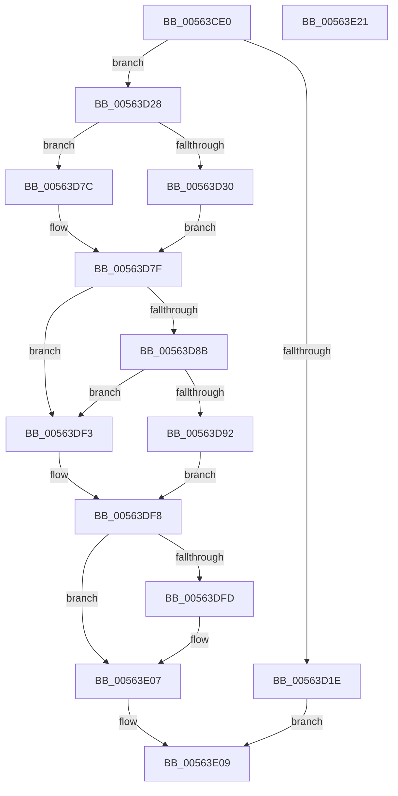

# HalpQueryCapsuleCapabilities

- RVA: `0x00563CE0`–`0x00563E22` (길이 `322` bytes)
- VA: `0x0000000140563CE0`
- 실행 섹션: `.text`
- PDB 이름 있음: `예`; PDB Function 태그: `아니요`
- unwind 정보 RVA: `0x000C4CE4`
- 디코드: `87`개 명령, `322/322` bytes 표시
- 미해석 바이트: `0` (있으면 어셈블리에 `.byte`로 보존)

> 이 문서는 커널 이미지의 기계어와 PDB 기호를 분석해 생성했습니다. 4번과 5번은 함수 원형과 자료형을 바이너리 사용 방식에서 추정한 C 해석이며 원본 소스 복구 결과는 아닙니다.

## 1. Dependencies

- 직접 호출 지점: **8**; 고유 호출 대상: **8**
- 직접 호출자로 확인된 함수: **0**
- RIP 상대 이미지 참조: **5**

### Outgoing calls
- `0x00563D75` → [KeSetSystemGroupAffinityThread](../39/KeSetSystemGroupAffinityThread_function_00399140.md) (function, `0x00399140`)
- `0x00563D99` → [HalpEfiIncrementEfiCall](../46/HalpEfiIncrementEfiCall_function_00467738.md) (function, `0x00467738`)
- `0x00563DA3` → [HalpEfiStartRuntimeCode](../44/HalpEfiStartRuntimeCode_function_00449714.md) (function, `0x00449714`)
- `0x00563DBF` → `indirect target` (indirect, 간접 대상)
- `0x00563DE2` → [HalpEfiDecrementEfiCall](../49/HalpEfiDecrementEfiCall_function_00491DC0.md) (function, `0x00491DC0`)
- `0x00563DEA` → [HalpConvertEfiToNtStatus](../44/HalpConvertEfiToNtStatus_function_0044976C.md) (function, `0x0044976C`)
- `0x00563E02` → [KeRevertToUserGroupAffinityThread](../39/KeRevertToUserGroupAffinityThread_function_00398EC0.md) (function, `0x00398EC0`)
- `0x00563E11` → [_security_check_cookie](../6A/_security_check_cookie_function_006AC640.md) (function, `0x006AC640`)

### Direct callers
- 이 함수 시작 RVA로 연결되는 직접 call은 확인되지 않았습니다. 간접 호출은 완전히 역산할 수 없습니다.

### Static image references
- `0x00563CEB` → RVA `0x00E0A740` (`.data`; read)
- `0x00563CFA` → RVA `0x00FC1A28` (`.data`; read)
- `0x00563D44` → RVA `0x00F231B0` (`.data`; read)
- `0x00563D7F` → RVA `0x01200010` (`CFGRO`; read)
- `0x00563D92` → RVA `0x00FC1C34` (`.data`; read)

## 2. Other-region calls and transfers

- 다른 실행 섹션으로 향하는 call: **0**
- 별도 외부 분기/꼬리 이동을 확인하지 못했습니다.

## 3. Assembly (complete function range)

```asm
00563CE0  40 53                           push rbx
00563CE2  55                              push rbp
00563CE3  56                              push rsi
00563CE4  57                              push rdi
00563CE5  41 56                           push r14
00563CE7  48 83 EC 50                     sub rsp, 0x50
00563CEB  48 8B 05 4E 6A 8A 00            mov rax, qword ptr [rip + 0x8a6a4e]
00563CF2  48 33 C4                        xor rax, rsp
00563CF5  48 89 44 24 40                  mov qword ptr [rsp + 0x40], rax
00563CFA  80 3D 27 DD A5 00 00            cmp byte ptr [rip + 0xa5dd27], 0
00563D01  0F 57 C0                        xorps xmm0, xmm0
00563D04  0F 57 C9                        xorps xmm1, xmm1
00563D07  8B F2                           mov esi, edx
00563D09  0F 11 44 24 20                  movups xmmword ptr [rsp + 0x20], xmm0
00563D0E  4D 8B F1                        mov r14, r9
00563D11  49 8B E8                        mov rbp, r8
00563D14  0F 11 4C 24 30                  movups xmmword ptr [rsp + 0x30], xmm1
00563D19  48 8B D9                        mov rbx, rcx
00563D1C  75 0A                           jne 0x140563d28
00563D1E  B8 02 00 00 C0                  mov eax, 0xc0000002
00563D23  E9 E1 00 00 00                  jmp 0x140563e09
00563D28  44 0F 20 C0                     mov rax, cr8
00563D2C  3C 02                           cmp al, 2
00563D2E  73 4C                           jae 0x140563d7c
00563D30  65 8B 04 25 A4 01 00 00         mov eax, dword ptr gs:[0x1a4]
00563D38  48 8D 54 24 30                  lea rdx, [rsp + 0x30]
00563D3D  8B C8                           mov ecx, eax
00563D3F  BF 01 00 00 00                  mov edi, 1
00563D44  48 8B 05 65 F4 9B 00            mov rax, qword ptr [rip + 0x9bf465]
00563D4B  8B 0C 88                        mov ecx, dword ptr [rax + rcx*4]
00563D4E  33 C0                           xor eax, eax
00563D50  89 44 24 2A                     mov dword ptr [rsp + 0x2a], eax
00563D54  66 89 44 24 2E                  mov word ptr [rsp + 0x2e], ax
00563D59  8B C1                           mov eax, ecx
00563D5B  C1 E8 06                        shr eax, 6
00563D5E  83 E1 3F                        and ecx, 0x3f
00563D61  66 89 44 24 28                  mov word ptr [rsp + 0x28], ax
00563D66  8B C7                           mov eax, edi
00563D68  48 D3 E0                        shl rax, cl
00563D6B  48 8D 4C 24 20                  lea rcx, [rsp + 0x20]
00563D70  48 89 44 24 20                  mov qword ptr [rsp + 0x20], rax
00563D75  E8 C6 53 E3 FF                  call 0x140399140
00563D7A  EB 03                           jmp 0x140563d7f
00563D7C  40 32 FF                        xor dil, dil
00563D7F  48 8B 05 8A C2 C9 00            mov rax, qword ptr [rip + 0xc9c28a]
00563D86  48 85 C0                        test rax, rax
00563D89  74 68                           je 0x140563df3
00563D8B  48 83 78 38 00                  cmp qword ptr [rax + 0x38], 0
00563D90  74 61                           je 0x140563df3
00563D92  48 8D 0D 9B DE A5 00            lea rcx, [rip + 0xa5de9b]
00563D99  E8 9A 39 F0 FF                  call 0x140467738
00563D9E  B9 80 00 00 00                  mov ecx, 0x80
00563DA3  E8 6C 59 EE FF                  call 0x140449714
00563DA8  48 8B 05 61 C2 C9 00            mov rax, qword ptr [rip + 0xc9c261]
00563DAF  48 8B D6                        mov rdx, rsi
00563DB2  4D 8B CE                        mov r9, r14
00563DB5  4C 8B C5                        mov r8, rbp
00563DB8  48 8B CB                        mov rcx, rbx
00563DBB  48 8B 40 38                     mov rax, qword ptr [rax + 0x38]
00563DBF  FF D0                           call rax
00563DC1  0F 1F 00                        nop dword ptr [rax]
00563DC4  65 48 8B 14 25 18 00 00 00      mov rdx, qword ptr gs:[0x18]
00563DCD  4C 8B C0                        mov r8, rax
00563DD0  F0 81 A2 E0 00 00 00 7F FF FF FF  lock and dword ptr [rdx + 0xe0], 0xffffff7f
00563DDB  48 8D 0D 52 DE A5 00            lea rcx, [rip + 0xa5de52]
00563DE2  E8 D9 DF F2 FF                  call 0x140491dc0
00563DE7  49 8B C8                        mov rcx, r8
00563DEA  E8 7D 59 EE FF                  call 0x14044976c
00563DEF  8B D8                           mov ebx, eax
00563DF1  EB 05                           jmp 0x140563df8
00563DF3  BB 02 00 00 C0                  mov ebx, 0xc0000002
00563DF8  40 84 FF                        test dil, dil
00563DFB  74 0A                           je 0x140563e07
00563DFD  48 8D 4C 24 30                  lea rcx, [rsp + 0x30]
00563E02  E8 B9 50 E3 FF                  call 0x140398ec0
00563E07  8B C3                           mov eax, ebx
00563E09  48 8B 4C 24 40                  mov rcx, qword ptr [rsp + 0x40]
00563E0E  48 33 CC                        xor rcx, rsp
00563E11  E8 2A 88 14 00                  call 0x1406ac640
00563E16  48 83 C4 50                     add rsp, 0x50
00563E1A  41 5E                           pop r14
00563E1C  5F                              pop rdi
00563E1D  5E                              pop rsi
00563E1E  5D                              pop rbp
00563E1F  5B                              pop rbx
00563E20  C3                              ret
00563E21  CC                              int3
```

## 4. C-style interpretation (structured pseudocode)

```c
__int64 __fastcall HalpQueryCapsuleCapabilities(__int64 a1, int a2, __int64 a3, __int64 a4)
{
    __int64 result;
    __int64 v_rdi;
    __int64 v_rsp;
    unsigned __int64 v_stack_m38;
    unsigned __int64 v_stack_m48;
    unsigned __int16 v_stack_m4A;
    unsigned int v_stack_m4E;
    unsigned __int16 v_stack_m50;
    unsigned __int64 v_stack_m58;

    v_rsp = (v_rsp) - (80);
    result = (*(unsigned __int64 *)(v_rip + 9071182)) ^ (v_rsp);
    v_stack_m38 = result;
    v_stack_m58 = v_xmm0;
    v_stack_m48 = v_xmm1;
    if ((*(unsigned __int8 *)(v_rip + 10870055)) != 0) goto loc_00563D28;
    goto loc_00563E09;
loc_00563D28:
    if (((unsigned __int8)(v_cr8)) >= 2) goto loc_00563D7C;
    result = 0;
    v_stack_m4E = 0;
    v_stack_m4A = 0;
    result = (unsigned int)(((unsigned int)((unsigned int)((unsigned int)(*(unsigned int *)(*(unsigned __int64 *)(v_rip + 10220645) + (unsigned int)((unsigned int)((unsigned int)(*(unsigned int *)(gs_base + (0 + 420))))) * 4))))) >> (6));
    a1 = (unsigned int)(((unsigned int)(*(unsigned int *)(*(unsigned __int64 *)(v_rip + 10220645) + (unsigned int)((unsigned int)((unsigned int)(*(unsigned int *)(gs_base + (0 + 420))))) * 4))) & (63));
    v_stack_m50 = (unsigned __int16)(result);
    result = (1) << ((unsigned __int8)(a1));
    v_stack_m58 = result;
    result = KeSetSystemGroupAffinityThread(v_stack_m58, v_stack_m48, a3, a4);
    goto loc_00563D7F;
loc_00563D7C:
    v_rdi = 0;
loc_00563D7F:
    if (*(unsigned __int64 *)(v_rip + 13222538) == 0) goto loc_00563DF3;
    if ((*(unsigned __int64 *)(*(unsigned __int64 *)(v_rip + 13222538) + 56)) == 0) goto loc_00563DF3;
    result = HalpEfiIncrementEfiCall(v_rip + 10870427, v_stack_m48, a3, a4);
    result = HalpEfiStartRuntimeCode(128, v_stack_m48, a3, a4);
    result = kernel_indirect_call(a1, (unsigned int)(a2), a3, a4);
    result = HalpEfiDecrementEfiCall(v_rip + 10870354, *(unsigned __int64 *)(gs_base + (0 + 24)), result, a4);
    result = HalpConvertEfiToNtStatus(result, *(unsigned __int64 *)(gs_base + (0 + 24)), result, a4);
    goto loc_00563DF8;
loc_00563DF3:
loc_00563DF8:
    if (0 != 0) {
        a1 = v_stack_m48;
        result = KeRevertToUserGroupAffinityThread(a1, *(unsigned __int64 *)(gs_base + (0 + 24)), result, a4);
    }
loc_00563E09:
    a1 = (v_stack_m38) ^ (v_rsp);
    result = _security_check_cookie(a1, *(unsigned __int64 *)(gs_base + (0 + 24)), result, a4);
    v_rsp = (v_rsp) + (80);
    return result;
}
```

## 5. (Beta) C Style

```c
int64_t HalpQueryCapsuleCapabilities(int64_t Arg1, int32_t Arg2, int64_t Arg3, int64_t Arg4)
{
    int64_t result;
    int64_t local_rdi;
    int64_t local_rsp;
    uint64_t v_stack_m38;
    uint64_t v_stack_m48;
    uint16_t v_stack_m4A;
    uint32_t v_stack_m4E;
    uint16_t v_stack_m50;
    uint64_t v_stack_m58;

    local_rsp = (local_rsp) - (80);
    result = (*(uint64_t *)(v_rip + 0x8A6A4E)) ^ (local_rsp);
    v_stack_m38 = result;
    v_stack_m58 = v_xmm0;
    v_stack_m48 = v_xmm1;
    if ((*(uint8_t *)(v_rip + 0xA5DD27)) != 0) goto loc_00563D28;
    goto loc_00563E09;
loc_00563D28:
    if (((uint8_t)(v_cr8)) >= 2) goto loc_00563D7C;
    result = 0;
    v_stack_m4E = 0;
    v_stack_m4A = 0;
    result = (uint32_t)(((uint32_t)((uint32_t)((uint32_t)(*(uint32_t *)(*(uint64_t *)(v_rip + 0x9BF465) + (uint32_t)((uint32_t)((uint32_t)(*(uint32_t *)(gs_base + (0 + 0x1A4))))) * 4))))) >> (6));
    Arg1 = (uint32_t)(((uint32_t)(*(uint32_t *)(*(uint64_t *)(v_rip + 0x9BF465) + (uint32_t)((uint32_t)((uint32_t)(*(uint32_t *)(gs_base + (0 + 0x1A4))))) * 4))) & (63));
    v_stack_m50 = (uint16_t)(result);
    result = (1) << ((uint8_t)(Arg1));
    v_stack_m58 = result;
    result = KeSetSystemGroupAffinityThread(v_stack_m58, v_stack_m48, Arg3, Arg4);
    goto loc_00563D7F;
loc_00563D7C:
    local_rdi = 0;
loc_00563D7F:
    if (*(uint64_t *)(v_rip + 0xC9C28A) == 0) goto loc_00563DF3;
    if ((*(uint64_t *)(*(uint64_t *)(v_rip + 0xC9C28A) + 0x38)) == 0) goto loc_00563DF3;
    result = HalpEfiIncrementEfiCall(v_rip + 10870427, v_stack_m48, Arg3, Arg4);
    result = HalpEfiStartRuntimeCode(128, v_stack_m48, Arg3, Arg4);
    result = kernel_indirect_call(Arg1, (uint32_t)(Arg2), Arg3, Arg4);
    result = HalpEfiDecrementEfiCall(v_rip + 10870354, *(uint64_t *)(gs_base + (0 + 0x18)), result, Arg4);
    result = HalpConvertEfiToNtStatus(result, *(uint64_t *)(gs_base + (0 + 0x18)), result, Arg4);
    goto loc_00563DF8;
loc_00563DF3:
loc_00563DF8:
    if (0 != 0) {
        Arg1 = v_stack_m48;
        result = KeRevertToUserGroupAffinityThread(Arg1, *(uint64_t *)(gs_base + (0 + 0x18)), result, Arg4);
    }
loc_00563E09:
    Arg1 = (v_stack_m38) ^ (local_rsp);
    result = _security_check_cookie(Arg1, *(uint64_t *)(gs_base + (0 + 0x18)), result, Arg4);
    local_rsp = (local_rsp) + (80);
    return result;
}
```

## 6. Execution-region graph

[열기: 2D/3D 그래프와 함수 탐색 컨트롤 패널](../../../control-panel.html?section=text&rva=0x00563CE0&view=graph)

- 2D 그래프는 위에서 아래로 흐르고, 3D 그래프는 빈 공간을 드래그해 회전합니다. Shift+드래그는 이동, 휠은 확대·축소, 함수 노드 선택은 대상 보고서 이동입니다.

### Static fallback


