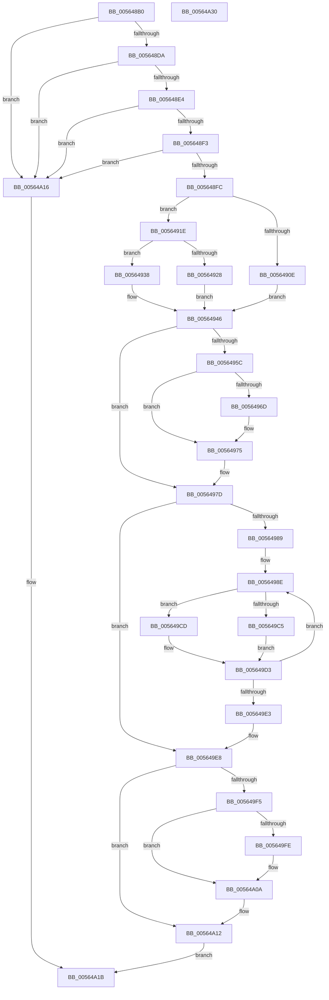

# HalpReadWriteWheaPhysicalMemory

- RVA: `0x005648B0`–`0x00564A31` (길이 `385` bytes)
- VA: `0x00000001405648B0`
- 실행 섹션: `.text`
- PDB 이름 있음: `예`; PDB Function 태그: `아니요`
- unwind 정보 RVA: `0x000B9D04`
- 디코드: `108`개 명령, `385/385` bytes 표시
- 미해석 바이트: `0` (있으면 어셈블리에 `.byte`로 보존)

> 이 문서는 커널 이미지의 기계어와 PDB 기호를 분석해 생성했습니다. 4번과 5번은 함수 원형과 자료형을 바이너리 사용 방식에서 추정한 C 해석이며 원본 소스 복구 결과는 아닙니다.

## 1. Dependencies

- 직접 호출 지점: **6**; 고유 호출 대상: **6**
- 직접 호출자로 확인된 함수: **2**
- RIP 상대 이미지 참조: **9**

### Outgoing calls
- `0x00564970` → [KiRaiseIrqlProcessIrqlFlags](../4F/KiRaiseIrqlProcessIrqlFlags_function_004F56FC.md) (function, `0x004F56FC`)
- `0x00564980` → [KeAcquireSpinLockAtDpcLevel](../20/KeAcquireSpinLockAtDpcLevel_function_00208430.md) (function, `0x00208430`)
- `0x00564997` → [HalpRemapVirtualAddress64](../48/HalpRemapVirtualAddress64_function_0048C644.md) (function, `0x0048C644`)
- `0x005649D3` → [memcpy](../6C/memcpy_function_006C6840.md) (function, `0x006C6840`)
- `0x005649EB` → [KxReleaseSpinLock](../20/KxReleaseSpinLock_function_00206670.md) (function, `0x00206670`)
- `0x00564A05` → [KiLowerIrqlProcessIrqlFlags](../4F/KiLowerIrqlProcessIrqlFlags_function_004F5698.md) (function, `0x004F5698`)

### Direct callers
- [HalpReadWheaPhysicalMemory](HalpReadWheaPhysicalMemory_function_00564890.md) at `0x0056489F`
- [HalpWriteWheaPhysicalMemory](HalpWriteWheaPhysicalMemory_function_00564A40.md) at `0x00564A4F`

### Static image references
- `0x00564904` → RVA `0x00E0A770` (`.data`; read)
- `0x0056490E` → RVA `0x00F8FB38` (`.data`; read)
- `0x00564915` → RVA `0x00F8FB30` (`.data`; read)
- `0x0056491E` → RVA `0x00E0A788` (`.data`; read)
- `0x00564928` → RVA `0x00F8FB28` (`.data`; read)
- `0x0056492F` → RVA `0x00F8FB40` (`.data`; read)
- `0x00564938` → RVA `0x00F8FB48` (`.data`; read)
- `0x0056493F` → RVA `0x00F8FB20` (`.data`; read)
- `0x00564964` → RVA `0x00FC6D20` (`ALMOSTRO`; read)

## 2. Other-region calls and transfers

- 다른 실행 섹션으로 향하는 call: **0**
- 별도 외부 분기/꼬리 이동을 확인하지 못했습니다.

## 3. Assembly (complete function range)

```asm
005648B0  48 89 5C 24 18                  mov qword ptr [rsp + 0x18], rbx
005648B5  88 4C 24 08                     mov byte ptr [rsp + 8], cl
005648B9  55                              push rbp
005648BA  56                              push rsi
005648BB  57                              push rdi
005648BC  41 54                           push r12
005648BE  41 55                           push r13
005648C0  41 56                           push r14
005648C2  41 57                           push r15
005648C4  48 83 EC 20                     sub rsp, 0x20
005648C8  4D 8B F1                        mov r14, r9
005648CB  41 8B F8                        mov edi, r8d
005648CE  48 8B DA                        mov rbx, rdx
005648D1  48 85 D2                        test rdx, rdx
005648D4  0F 84 3C 01 00 00               je 0x140564a16
005648DA  41 83 F8 08                     cmp r8d, 8
005648DE  0F 87 32 01 00 00               ja 0x140564a16
005648E4  B8 16 01 00 00                  mov eax, 0x116
005648E9  44 0F A3 C0                     bt eax, r8d
005648ED  0F 83 23 01 00 00               jae 0x140564a16
005648F3  4D 85 C9                        test r9, r9
005648F6  0F 84 1A 01 00 00               je 0x140564a16
005648FC  65 8B 0C 25 A4 01 00 00         mov ecx, dword ptr gs:[0x1a4]
00564904  8B 05 66 5E 8A 00               mov eax, dword ptr [rip + 0x8a5e66]
0056490A  3B C1                           cmp eax, ecx
0056490C  75 10                           jne 0x14056491e
0056490E  4C 8B 25 23 B2 A2 00            mov r12, qword ptr [rip + 0xa2b223]
00564915  48 8D 2D 14 B2 A2 00            lea rbp, [rip + 0xa2b214]
0056491C  EB 28                           jmp 0x140564946
0056491E  8B 05 64 5E 8A 00               mov eax, dword ptr [rip + 0x8a5e64]
00564924  3B C1                           cmp eax, ecx
00564926  75 10                           jne 0x140564938
00564928  4C 8B 25 F9 B1 A2 00            mov r12, qword ptr [rip + 0xa2b1f9]
0056492F  48 8D 2D 0A B2 A2 00            lea rbp, [rip + 0xa2b20a]
00564936  EB 0E                           jmp 0x140564946
00564938  4C 8B 25 09 B2 A2 00            mov r12, qword ptr [rip + 0xa2b209]
0056493F  48 8D 2D DA B1 A2 00            lea rbp, [rip + 0xa2b1da]
00564946  45 32 ED                        xor r13b, r13b
00564949  44 0F 20 C6                     mov rsi, cr8
0056494D  BA 0F 00 00 00                  mov edx, 0xf
00564952  48 89 74 24 68                  mov qword ptr [rsp + 0x68], rsi
00564957  40 3A F2                        cmp sil, dl
0056495A  73 21                           jae 0x14056497d
0056495C  44 0F 20 C6                     mov rsi, cr8
00564960  44 0F 22 C2                     mov cr8, rdx
00564964  83 3D B5 23 A6 00 00            cmp dword ptr [rip + 0xa623b5], 0
0056496B  74 08                           je 0x140564975
0056496D  40 8A CE                        mov cl, sil
00564970  E8 87 0D F9 FF                  call 0x1404f56fc
00564975  48 89 74 24 68                  mov qword ptr [rsp + 0x68], rsi
0056497A  41 B5 01                        mov r13b, 1
0056497D  48 8B CD                        mov rcx, rbp
00564980  E8 AB 3A CA FF                  call 0x140208430
00564985  85 FF                           test edi, edi
00564987  74 5F                           je 0x1405649e8
00564989  40 8A 74 24 60                  mov sil, byte ptr [rsp + 0x60]
0056498E  41 B0 01                        mov r8b, 1
00564991  48 8B D3                        mov rdx, rbx
00564994  49 8B CC                        mov rcx, r12
00564997  E8 A8 7C F2 FF                  call 0x14048c644
0056499C  44 8B FF                        mov r15d, edi
0056499F  44 8B DB                        mov r11d, ebx
005649A2  41 81 E3 FF 0F 00 00            and r11d, 0xfff
005649A9  B9 00 10 00 00                  mov ecx, 0x1000
005649AE  41 2B CB                        sub ecx, r11d
005649B1  45 8B CB                        mov r9d, r11d
005649B4  4D 03 CC                        add r9, r12
005649B7  3B F9                           cmp edi, ecx
005649B9  44 0F 43 F9                     cmovae r15d, ecx
005649BD  45 8B C7                        mov r8d, r15d
005649C0  40 84 F6                        test sil, sil
005649C3  74 08                           je 0x1405649cd
005649C5  49 8B D1                        mov rdx, r9
005649C8  49 8B CE                        mov rcx, r14
005649CB  EB 06                           jmp 0x1405649d3
005649CD  49 8B D6                        mov rdx, r14
005649D0  49 8B C9                        mov rcx, r9
005649D3  E8 68 1E 16 00                  call 0x1406c6840
005649D8  49 03 DF                        add rbx, r15
005649DB  4D 03 F7                        add r14, r15
005649DE  41 2B FF                        sub edi, r15d
005649E1  75 AB                           jne 0x14056498e
005649E3  48 8B 74 24 68                  mov rsi, qword ptr [rsp + 0x68]
005649E8  48 8B CD                        mov rcx, rbp
005649EB  E8 80 1C CA FF                  call 0x140206670
005649F0  45 84 ED                        test r13b, r13b
005649F3  74 1D                           je 0x140564a12
005649F5  83 3D 24 23 A6 00 00            cmp dword ptr [rip + 0xa62324], 0
005649FC  74 0C                           je 0x140564a0a
005649FE  44 0F 20 C1                     mov rcx, cr8
00564A02  40 8A D6                        mov dl, sil
00564A05  E8 8E 0C F9 FF                  call 0x1404f5698
00564A0A  40 0F B6 C6                     movzx eax, sil
00564A0E  44 0F 22 C0                     mov cr8, rax
00564A12  33 C0                           xor eax, eax
00564A14  EB 05                           jmp 0x140564a1b
00564A16  B8 0D 00 00 C0                  mov eax, 0xc000000d
00564A1B  48 8B 5C 24 70                  mov rbx, qword ptr [rsp + 0x70]
00564A20  48 83 C4 20                     add rsp, 0x20
00564A24  41 5F                           pop r15
00564A26  41 5E                           pop r14
00564A28  41 5D                           pop r13
00564A2A  41 5C                           pop r12
00564A2C  5F                              pop rdi
00564A2D  5E                              pop rsi
00564A2E  5D                              pop rbp
00564A2F  C3                              ret
00564A30  CC                              int3
```

## 4. C-style interpretation (structured pseudocode)

```c
__int64 __fastcall HalpReadWriteWheaPhysicalMemory(unsigned __int8 a1, __int64 a2, int a3, __int64 a4)
{
    __int64 result;
    __int64 v_r11;
    __int64 v_r13;
    __int64 v_r14;
    __int64 v_r15;
    __int64 v_rbx;
    __int64 v_rdi;
    __int64 v_rsp;
    unsigned __int64 v_stack_p10;
    unsigned __int64 v_stack_p18;
    unsigned __int8 v_stack_p8;

    v_stack_p18 = v_rbx;
    v_stack_p8 = a1;
    v_rsp = (v_rsp) - (32);
    if (a2 == 0) goto loc_00564A16;
    if (a3 > 8) goto loc_00564A16;
    if (a3 >= 8) goto loc_00564A16;
    if (a4 == 0) goto loc_00564A16;
    if (((unsigned int)((unsigned int)(*(unsigned int *)(v_rip + 9068134)))) != ((unsigned int)((unsigned int)(*(unsigned int *)(gs_base + (0 + 420)))))) goto loc_0056491E;
    goto loc_00564946;
loc_0056491E:
    if (((unsigned int)((unsigned int)(*(unsigned int *)(v_rip + 9068132)))) != ((unsigned int)((unsigned int)(*(unsigned int *)(gs_base + (0 + 420)))))) goto loc_00564938;
    goto loc_00564946;
loc_00564938:
loc_00564946:
    v_r13 = 0;
    v_stack_p10 = v_cr8;
    if (((unsigned __int8)(v_cr8)) >= 15) goto loc_0056497D;
    result = (unsigned int)(*(unsigned int *)(v_rip + 9068132));
    if ((*(unsigned int *)(v_rip + 10888117)) != 0) {
        a1 = (unsigned __int8)(v_cr8);
        result = KiRaiseIrqlProcessIrqlFlags(a1, 15, a3, a4);
    }
    v_stack_p10 = v_cr8;
loc_0056497D:
    result = KeAcquireSpinLockAtDpcLevel(v_rip + 10662362, 15, a3, a4);
    if ((unsigned int)((unsigned int)(a3)) == 0) goto loc_005649E8;
loc_0056498E:
    result = HalpRemapVirtualAddress64(*(unsigned __int64 *)(v_rip + 10662409), a2, 1, a4);
    v_r11 = (unsigned int)(((unsigned int)((unsigned int)(a2))) & (0xFFFULL));
    a1 = (unsigned int)(((unsigned int)(0x1000ULL)) - ((unsigned int)(v_r11)));
    a4 = ((unsigned int)((unsigned int)(v_r11))) + (*(unsigned __int64 *)(v_rip + 10662409));
    v_r15 = (unsigned int)((unsigned int)((unsigned int)(a3)));
    if (((unsigned int)((unsigned int)(a3))) >= a1) { v_r15 = a1; }
    if ((unsigned __int8)(v_stack_p8) == 0) goto loc_005649CD;
    goto loc_005649D3;
loc_005649CD:
loc_005649D3:
    result = memcpy(a4, a4, (unsigned int)((unsigned int)(v_r15)), a4);
    v_rbx = (a2) + (v_r15);
    v_r14 = (a4) + (v_r15);
    v_rdi = (unsigned int)(((unsigned int)(a3)) - ((unsigned int)(v_r15)));
    if (condition_is_not_equal) goto loc_0056498E;
loc_005649E8:
    result = KxReleaseSpinLock(v_rip + 10662362, a4, (unsigned int)((unsigned int)(v_r15)), a4);
    if (1 == 0) goto loc_00564A12;
    if ((*(unsigned int *)(v_rip + 10887972)) != 0) {
        a1 = 15;
        a2 = (unsigned __int8)(v_stack_p10);
        result = KiLowerIrqlProcessIrqlFlags(a1, a2, (unsigned int)((unsigned int)(v_r15)), a4);
    }
loc_00564A12:
    result = 0;
    goto loc_00564A1B;
loc_00564A16:
loc_00564A1B:
    v_rsp = (v_rsp) + (32);
    return (unsigned int)(0xC000000DULL);
}
```

## 5. (Beta) C Style

```c
int64_t HalpReadWriteWheaPhysicalMemory(uint8_t Arg1, int64_t Arg2, int32_t Arg3, int64_t Arg4)
{
    int64_t result;
    int64_t local_r11;
    int64_t local_r13;
    int64_t local_r14;
    int64_t local_r15;
    int64_t local_rbx;
    int64_t local_rdi;
    int64_t local_rsp;
    uint64_t v_stack_p10;
    uint64_t v_stack_p18;
    uint8_t v_stack_p8;

    v_stack_p18 = local_rbx;
    v_stack_p8 = Arg1;
    local_rsp = (local_rsp) - (32);
    if (Arg2 == 0) goto loc_00564A16;
    if (Arg3 > 8) goto loc_00564A16;
    if (Arg3 >= 8) goto loc_00564A16;
    if (Arg4 == 0) goto loc_00564A16;
    if (((uint32_t)((uint32_t)(*(uint32_t *)(v_rip + 0x8A5E66)))) != ((uint32_t)((uint32_t)(*(uint32_t *)(gs_base + (0 + 0x1A4)))))) goto loc_0056491E;
    goto loc_00564946;
loc_0056491E:
    if (((uint32_t)((uint32_t)(*(uint32_t *)(v_rip + 0x8A5E64)))) != ((uint32_t)((uint32_t)(*(uint32_t *)(gs_base + (0 + 0x1A4)))))) goto loc_00564938;
    goto loc_00564946;
loc_00564938:
loc_00564946:
    local_r13 = 0;
    v_stack_p10 = v_cr8;
    if (((uint8_t)(v_cr8)) >= 15) goto loc_0056497D;
    result = (uint32_t)(*(uint32_t *)(v_rip + 0x8A5E64));
    if ((*(uint32_t *)(v_rip + 0xA623B5)) != 0) {
        Arg1 = (uint8_t)(v_cr8);
        result = KiRaiseIrqlProcessIrqlFlags(Arg1, 15, Arg3, Arg4);
    }
    v_stack_p10 = v_cr8;
loc_0056497D:
    result = KeAcquireSpinLockAtDpcLevel(v_rip + 10662362, 15, Arg3, Arg4);
    if ((uint32_t)((uint32_t)(Arg3)) == 0) goto loc_005649E8;
loc_0056498E:
    result = HalpRemapVirtualAddress64(*(uint64_t *)(v_rip + 0xA2B209), Arg2, 1, Arg4);
    local_r11 = (uint32_t)(((uint32_t)((uint32_t)(Arg2))) & (0xFFFULL));
    Arg1 = (uint32_t)(((uint32_t)(0x1000ULL)) - ((uint32_t)(local_r11)));
    Arg4 = ((uint32_t)((uint32_t)(local_r11))) + (*(uint64_t *)(v_rip + 0xA2B209));
    local_r15 = (uint32_t)((uint32_t)((uint32_t)(Arg3)));
    if (((uint32_t)((uint32_t)(Arg3))) >= Arg1) { local_r15 = Arg1; }
    if ((uint8_t)(v_stack_p8) == 0) goto loc_005649CD;
    goto loc_005649D3;
loc_005649CD:
loc_005649D3:
    result = memcpy(Arg4, Arg4, (uint32_t)((uint32_t)(local_r15)), Arg4);
    local_rbx = (Arg2) + (local_r15);
    local_r14 = (Arg4) + (local_r15);
    local_rdi = (uint32_t)(((uint32_t)(Arg3)) - ((uint32_t)(local_r15)));
    if (condition_is_not_equal) goto loc_0056498E;
loc_005649E8:
    result = KxReleaseSpinLock(v_rip + 10662362, Arg4, (uint32_t)((uint32_t)(local_r15)), Arg4);
    if (1 == 0) goto loc_00564A12;
    if ((*(uint32_t *)(v_rip + 0xA62324)) != 0) {
        Arg1 = 15;
        Arg2 = (uint8_t)(v_stack_p10);
        result = KiLowerIrqlProcessIrqlFlags(Arg1, Arg2, (uint32_t)((uint32_t)(local_r15)), Arg4);
    }
loc_00564A12:
    result = 0;
    goto loc_00564A1B;
loc_00564A16:
loc_00564A1B:
    local_rsp = (local_rsp) + (32);
    return (uint32_t)(0xC000000DULL);
}
```

## 6. Execution-region graph

[열기: 2D/3D 그래프와 함수 탐색 컨트롤 패널](../../../control-panel.html?section=text&rva=0x005648B0&view=graph)

- 2D 그래프는 위에서 아래로 흐르고, 3D 그래프는 빈 공간을 드래그해 회전합니다. Shift+드래그는 이동, 휠은 확대·축소, 함수 노드 선택은 대상 보고서 이동입니다.

### Static fallback


