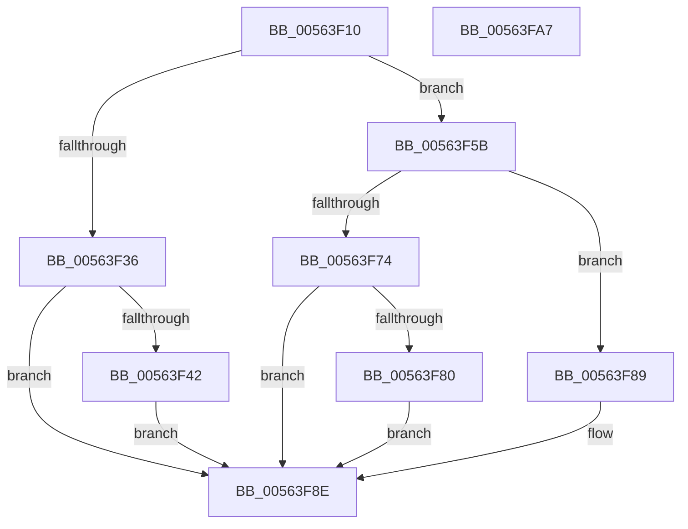

# HalpRegisterProcessorTraceInterruptHandler

- RVA: `0x00563F10`–`0x00563FA8` (길이 `152` bytes)
- VA: `0x0000000140563F10`
- 실행 섹션: `.text`
- PDB 이름 있음: `예`; PDB Function 태그: `아니요`
- unwind 정보 RVA: `0x0005CAAC`
- 디코드: `35`개 명령, `152/152` bytes 표시
- 미해석 바이트: `0` (있으면 어셈블리에 `.byte`로 보존)

> 이 문서는 커널 이미지의 기계어와 PDB 기호를 분석해 생성했습니다. 4번과 5번은 함수 원형과 자료형을 바이너리 사용 방식에서 추정한 C 해석이며 원본 소스 복구 결과는 아닙니다.

## 1. Dependencies

- 직접 호출 지점: **2**; 고유 호출 대상: **2**
- 직접 호출자로 확인된 함수: **1**
- RIP 상대 이미지 참조: **4**

### Outgoing calls
- `0x00563F26` → [KeAcquireSpinLockRaiseToDpc](../20/KeAcquireSpinLockRaiseToDpc_function_00208470.md) (function, `0x00208470`)
- `0x00563F95` → [KeReleaseSpinLock](../39/KeReleaseSpinLock_function_00392BA0.md) (function, `0x00392BA0`)

### Direct callers
- [HalpSetSystemInformation](../../page/AB/HalpSetSystemInformation_function_00AB0850.md) at `0x00AB095B`

### Static image references
- `0x00563F1F` → RVA `0x00FC2C50` (`.data`; read)
- `0x00563F2B` → RVA `0x00E117B0` (`.data`; read)
- `0x00563F36` → RVA `0x00E10308` (`.data`; write)
- `0x00563F52` → RVA `0x00E117B0` (`.data`; write)

## 2. Other-region calls and transfers

- 다른 실행 섹션으로 향하는 call: **0**
- 별도 외부 분기/꼬리 이동을 확인하지 못했습니다.

## 3. Assembly (complete function range)

```asm
00563F10  48 89 5C 24 08                  mov qword ptr [rsp + 8], rbx
00563F15  57                              push rdi
00563F16  48 83 EC 20                     sub rsp, 0x20
00563F1A  48 8B F9                        mov rdi, rcx
00563F1D  33 DB                           xor ebx, ebx
00563F1F  48 8D 0D 2A ED A5 00            lea rcx, [rip + 0xa5ed2a]
00563F26  E8 45 45 CA FF                  call 0x140208470
00563F2B  48 39 1D 7E D8 8A 00            cmp qword ptr [rip + 0x8ad87e], rbx
00563F32  8A D0                           mov dl, al
00563F34  75 25                           jne 0x140563f5b
00563F36  48 89 3D CB C3 8A 00            mov qword ptr [rip + 0x8ac3cb], rdi
00563F3D  48 85 FF                        test rdi, rdi
00563F40  74 4C                           je 0x140563f8e
00563F42  65 48 8B 04 25 88 01 00 00      mov rax, qword ptr gs:[0x188]
00563F4B  48 8B 88 08 05 00 00            mov rcx, qword ptr [rax + 0x508]
00563F52  48 89 0D 57 D8 8A 00            mov qword ptr [rip + 0x8ad857], rcx
00563F59  EB 33                           jmp 0x140563f8e
00563F5B  65 48 8B 04 25 88 01 00 00      mov rax, qword ptr gs:[0x188]
00563F64  48 8B 88 08 05 00 00            mov rcx, qword ptr [rax + 0x508]
00563F6B  48 39 0D 3E D8 8A 00            cmp qword ptr [rip + 0x8ad83e], rcx
00563F72  75 15                           jne 0x140563f89
00563F74  48 89 3D 8D C3 8A 00            mov qword ptr [rip + 0x8ac38d], rdi
00563F7B  48 85 FF                        test rdi, rdi
00563F7E  75 0E                           jne 0x140563f8e
00563F80  48 89 1D 29 D8 8A 00            mov qword ptr [rip + 0x8ad829], rbx
00563F87  EB 05                           jmp 0x140563f8e
00563F89  BB 01 00 00 C0                  mov ebx, 0xc0000001
00563F8E  48 8D 0D BB EC A5 00            lea rcx, [rip + 0xa5ecbb]
00563F95  E8 06 EC E2 FF                  call 0x140392ba0
00563F9A  8B C3                           mov eax, ebx
00563F9C  48 8B 5C 24 30                  mov rbx, qword ptr [rsp + 0x30]
00563FA1  48 83 C4 20                     add rsp, 0x20
00563FA5  5F                              pop rdi
00563FA6  C3                              ret
00563FA7  CC                              int3
```

## 4. C-style interpretation (structured pseudocode)

```c
__int64 __fastcall HalpRegisterProcessorTraceInterruptHandler(__int64 a1)
{
    __int64 result;
    __int64 v_rbx;
    __int64 v_rsp;
    unsigned __int64 v_stack_p8;

    v_stack_p8 = v_rbx;
    v_rsp = (v_rsp) - (32);
    v_rbx = 0;
    result = KeAcquireSpinLockRaiseToDpc(v_rip + 10874154, a2, a3, a4);
    if ((*(unsigned __int64 *)(v_rip + 9099390)) != 0) goto loc_00563F5B;
    *(unsigned __int64 *)(v_rip + 9094091) = a1;
    if (a1 == 0) goto loc_00563F8E;
    *(unsigned __int64 *)(v_rip + 9099351) = *(unsigned __int64 *)(*(unsigned __int64 *)(gs_base + (0 + 392)) + 1288);
    goto loc_00563F8E;
loc_00563F5B:
    if ((*(unsigned __int64 *)(v_rip + 9099326)) != (*(unsigned __int64 *)(*(unsigned __int64 *)(gs_base + (0 + 392)) + 1288))) goto loc_00563F89;
    *(unsigned __int64 *)(v_rip + 9094029) = a1;
    if (a1 != 0) goto loc_00563F8E;
    *(unsigned __int64 *)(v_rip + 9099305) = 0;
    goto loc_00563F8E;
loc_00563F89:
loc_00563F8E:
    result = KeReleaseSpinLock(v_rip + 10874043, (unsigned __int8)(result), a3, a4);
    v_rsp = (v_rsp) + (32);
    return (unsigned int)((unsigned int)((unsigned int)(0xC0000001ULL)));
}
```

## 5. (Beta) C Style

```c
int64_t HalpRegisterProcessorTraceInterruptHandler(int64_t Arg1)
{
    int64_t result;
    int64_t local_rbx;
    int64_t local_rsp;
    uint64_t v_stack_p8;

    v_stack_p8 = local_rbx;
    local_rsp = (local_rsp) - (32);
    local_rbx = 0;
    result = KeAcquireSpinLockRaiseToDpc(v_rip + 10874154, a2, a3, a4);
    if ((*(uint64_t *)(v_rip + 0x8AD87E)) != 0) goto loc_00563F5B;
    *(uint64_t *)(v_rip + 0x8AC3CB) = Arg1;
    if (Arg1 == 0) goto loc_00563F8E;
    *(uint64_t *)(v_rip + 0x8AD857) = *(uint64_t *)(*(uint64_t *)(gs_base + (0 + 0x188)) + 0x508);
    goto loc_00563F8E;
loc_00563F5B:
    if ((*(uint64_t *)(v_rip + 0x8AD83E)) != (*(uint64_t *)(*(uint64_t *)(gs_base + (0 + 0x188)) + 0x508))) goto loc_00563F89;
    *(uint64_t *)(v_rip + 0x8AC38D) = Arg1;
    if (Arg1 != 0) goto loc_00563F8E;
    *(uint64_t *)(v_rip + 0x8AD829) = 0;
    goto loc_00563F8E;
loc_00563F89:
loc_00563F8E:
    result = KeReleaseSpinLock(v_rip + 10874043, (uint8_t)(result), a3, a4);
    local_rsp = (local_rsp) + (32);
    return (uint32_t)((uint32_t)((uint32_t)(0xC0000001ULL)));
}
```

## 6. Execution-region graph

[열기: 2D/3D 그래프와 함수 탐색 컨트롤 패널](../../../control-panel.html?section=text&rva=0x00563F10&view=graph)

- 2D 그래프는 위에서 아래로 흐르고, 3D 그래프는 빈 공간을 드래그해 회전합니다. Shift+드래그는 이동, 휠은 확대·축소, 함수 노드 선택은 대상 보고서 이동입니다.

### Static fallback


