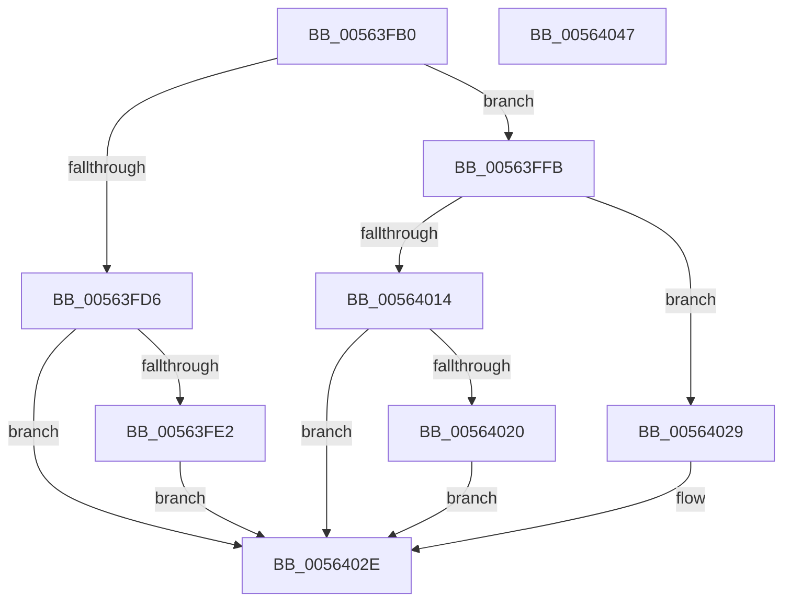

# HalpRegisterProfileSourceInterruptHandler

- RVA: `0x00563FB0`–`0x00564048` (길이 `152` bytes)
- VA: `0x0000000140563FB0`
- 실행 섹션: `.text`
- PDB 이름 있음: `예`; PDB Function 태그: `아니요`
- unwind 정보 RVA: `0x0005CAAC`
- 디코드: `35`개 명령, `152/152` bytes 표시
- 미해석 바이트: `0` (있으면 어셈블리에 `.byte`로 보존)

> 이 문서는 커널 이미지의 기계어와 PDB 기호를 분석해 생성했습니다. 4번과 5번은 함수 원형과 자료형을 바이너리 사용 방식에서 추정한 C 해석이며 원본 소스 복구 결과는 아닙니다.

## 1. Dependencies

- 직접 호출 지점: **2**; 고유 호출 대상: **2**
- 직접 호출자로 확인된 함수: **1**
- RIP 상대 이미지 참조: **4**

### Outgoing calls
- `0x00563FC6` → [KeAcquireSpinLockRaiseToDpc](../20/KeAcquireSpinLockRaiseToDpc_function_00208470.md) (function, `0x00208470`)
- `0x00564035` → [KeReleaseSpinLock](../39/KeReleaseSpinLock_function_00392BA0.md) (function, `0x00392BA0`)

### Direct callers
- [HalpSetSystemInformation](../../page/AB/HalpSetSystemInformation_function_00AB0850.md) at `0x00AB0991`

### Static image references
- `0x00563FBF` → RVA `0x00FC2C50` (`.data`; read)
- `0x00563FCB` → RVA `0x00E117B8` (`.data`; read)
- `0x00563FD6` → RVA `0x00E10310` (`.data`; write)
- `0x00563FF2` → RVA `0x00E117B8` (`.data`; write)

## 2. Other-region calls and transfers

- 다른 실행 섹션으로 향하는 call: **0**
- 별도 외부 분기/꼬리 이동을 확인하지 못했습니다.

## 3. Assembly (complete function range)

```asm
00563FB0  48 89 5C 24 08                  mov qword ptr [rsp + 8], rbx
00563FB5  57                              push rdi
00563FB6  48 83 EC 20                     sub rsp, 0x20
00563FBA  48 8B F9                        mov rdi, rcx
00563FBD  33 DB                           xor ebx, ebx
00563FBF  48 8D 0D 8A EC A5 00            lea rcx, [rip + 0xa5ec8a]
00563FC6  E8 A5 44 CA FF                  call 0x140208470
00563FCB  48 39 1D E6 D7 8A 00            cmp qword ptr [rip + 0x8ad7e6], rbx
00563FD2  8A D0                           mov dl, al
00563FD4  75 25                           jne 0x140563ffb
00563FD6  48 89 3D 33 C3 8A 00            mov qword ptr [rip + 0x8ac333], rdi
00563FDD  48 85 FF                        test rdi, rdi
00563FE0  74 4C                           je 0x14056402e
00563FE2  65 48 8B 04 25 88 01 00 00      mov rax, qword ptr gs:[0x188]
00563FEB  48 8B 88 08 05 00 00            mov rcx, qword ptr [rax + 0x508]
00563FF2  48 89 0D BF D7 8A 00            mov qword ptr [rip + 0x8ad7bf], rcx
00563FF9  EB 33                           jmp 0x14056402e
00563FFB  65 48 8B 04 25 88 01 00 00      mov rax, qword ptr gs:[0x188]
00564004  48 8B 88 08 05 00 00            mov rcx, qword ptr [rax + 0x508]
0056400B  48 39 0D A6 D7 8A 00            cmp qword ptr [rip + 0x8ad7a6], rcx
00564012  75 15                           jne 0x140564029
00564014  48 89 3D F5 C2 8A 00            mov qword ptr [rip + 0x8ac2f5], rdi
0056401B  48 85 FF                        test rdi, rdi
0056401E  75 0E                           jne 0x14056402e
00564020  48 89 1D 91 D7 8A 00            mov qword ptr [rip + 0x8ad791], rbx
00564027  EB 05                           jmp 0x14056402e
00564029  BB 01 00 00 C0                  mov ebx, 0xc0000001
0056402E  48 8D 0D 1B EC A5 00            lea rcx, [rip + 0xa5ec1b]
00564035  E8 66 EB E2 FF                  call 0x140392ba0
0056403A  8B C3                           mov eax, ebx
0056403C  48 8B 5C 24 30                  mov rbx, qword ptr [rsp + 0x30]
00564041  48 83 C4 20                     add rsp, 0x20
00564045  5F                              pop rdi
00564046  C3                              ret
00564047  CC                              int3
```

## 4. C-style interpretation (structured pseudocode)

```c
__int64 __fastcall HalpRegisterProfileSourceInterruptHandler(__int64 a1)
{
    __int64 result;
    __int64 v_rbx;
    __int64 v_rsp;
    unsigned __int64 v_stack_p8;

    v_stack_p8 = v_rbx;
    v_rsp = (v_rsp) - (32);
    v_rbx = 0;
    result = KeAcquireSpinLockRaiseToDpc(v_rip + 10873994, a2, a3, a4);
    if ((*(unsigned __int64 *)(v_rip + 9099238)) != 0) goto loc_00563FFB;
    *(unsigned __int64 *)(v_rip + 9093939) = a1;
    if (a1 == 0) goto loc_0056402E;
    *(unsigned __int64 *)(v_rip + 9099199) = *(unsigned __int64 *)(*(unsigned __int64 *)(gs_base + (0 + 392)) + 1288);
    goto loc_0056402E;
loc_00563FFB:
    if ((*(unsigned __int64 *)(v_rip + 9099174)) != (*(unsigned __int64 *)(*(unsigned __int64 *)(gs_base + (0 + 392)) + 1288))) goto loc_00564029;
    *(unsigned __int64 *)(v_rip + 9093877) = a1;
    if (a1 != 0) goto loc_0056402E;
    *(unsigned __int64 *)(v_rip + 9099153) = 0;
    goto loc_0056402E;
loc_00564029:
loc_0056402E:
    result = KeReleaseSpinLock(v_rip + 10873883, (unsigned __int8)(result), a3, a4);
    v_rsp = (v_rsp) + (32);
    return (unsigned int)((unsigned int)((unsigned int)(0xC0000001ULL)));
}
```

## 5. (Beta) C Style

```c
int64_t HalpRegisterProfileSourceInterruptHandler(int64_t Arg1)
{
    int64_t result;
    int64_t local_rbx;
    int64_t local_rsp;
    uint64_t v_stack_p8;

    v_stack_p8 = local_rbx;
    local_rsp = (local_rsp) - (32);
    local_rbx = 0;
    result = KeAcquireSpinLockRaiseToDpc(v_rip + 10873994, a2, a3, a4);
    if ((*(uint64_t *)(v_rip + 0x8AD7E6)) != 0) goto loc_00563FFB;
    *(uint64_t *)(v_rip + 0x8AC333) = Arg1;
    if (Arg1 == 0) goto loc_0056402E;
    *(uint64_t *)(v_rip + 0x8AD7BF) = *(uint64_t *)(*(uint64_t *)(gs_base + (0 + 0x188)) + 0x508);
    goto loc_0056402E;
loc_00563FFB:
    if ((*(uint64_t *)(v_rip + 0x8AD7A6)) != (*(uint64_t *)(*(uint64_t *)(gs_base + (0 + 0x188)) + 0x508))) goto loc_00564029;
    *(uint64_t *)(v_rip + 0x8AC2F5) = Arg1;
    if (Arg1 != 0) goto loc_0056402E;
    *(uint64_t *)(v_rip + 0x8AD791) = 0;
    goto loc_0056402E;
loc_00564029:
loc_0056402E:
    result = KeReleaseSpinLock(v_rip + 10873883, (uint8_t)(result), a3, a4);
    local_rsp = (local_rsp) + (32);
    return (uint32_t)((uint32_t)((uint32_t)(0xC0000001ULL)));
}
```

## 6. Execution-region graph

[열기: 2D/3D 그래프와 함수 탐색 컨트롤 패널](../../../control-panel.html?section=text&rva=0x00563FB0&view=graph)

- 2D 그래프는 위에서 아래로 흐르고, 3D 그래프는 빈 공간을 드래그해 회전합니다. Shift+드래그는 이동, 휠은 확대·축소, 함수 노드 선택은 대상 보고서 이동입니다.

### Static fallback


