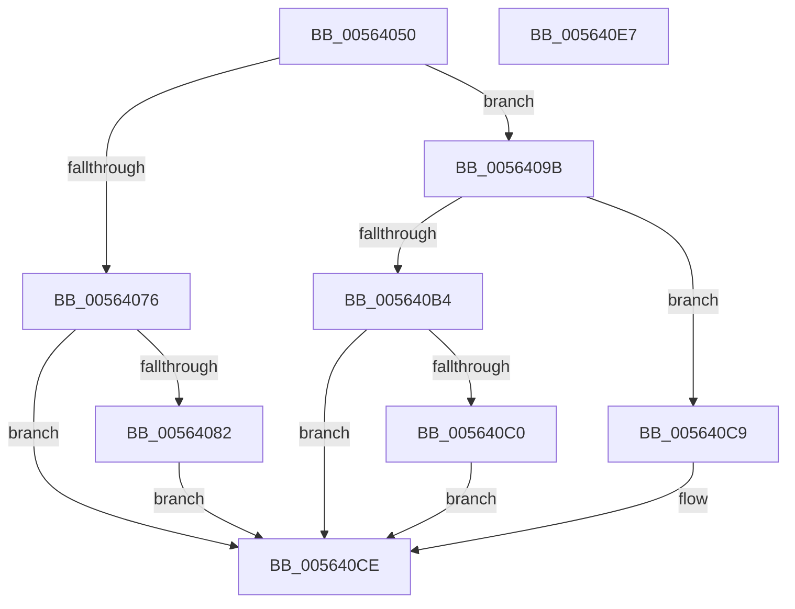

# HalpRegisterTimerInterruptHandler

- RVA: `0x00564050`–`0x005640E8` (길이 `152` bytes)
- VA: `0x0000000140564050`
- 실행 섹션: `.text`
- PDB 이름 있음: `예`; PDB Function 태그: `아니요`
- unwind 정보 RVA: `0x0005CAAC`
- 디코드: `35`개 명령, `152/152` bytes 표시
- 미해석 바이트: `0` (있으면 어셈블리에 `.byte`로 보존)

> 이 문서는 커널 이미지의 기계어와 PDB 기호를 분석해 생성했습니다. 4번과 5번은 함수 원형과 자료형을 바이너리 사용 방식에서 추정한 C 해석이며 원본 소스 복구 결과는 아닙니다.

## 1. Dependencies

- 직접 호출 지점: **2**; 고유 호출 대상: **2**
- 직접 호출자로 확인된 함수: **1**
- RIP 상대 이미지 참조: **4**

### Outgoing calls
- `0x00564066` → [KeAcquireSpinLockRaiseToDpc](../20/KeAcquireSpinLockRaiseToDpc_function_00208470.md) (function, `0x00208470`)
- `0x005640D5` → [KeReleaseSpinLock](../39/KeReleaseSpinLock_function_00392BA0.md) (function, `0x00392BA0`)

### Direct callers
- [HalpSetSystemInformation](../../page/AB/HalpSetSystemInformation_function_00AB0850.md) at `0x00AB0971`

### Static image references
- `0x0056405F` → RVA `0x00FC2C50` (`.data`; read)
- `0x0056406B` → RVA `0x00E117A8` (`.data`; read)
- `0x00564076` → RVA `0x00E10360` (`.data`; write)
- `0x00564092` → RVA `0x00E117A8` (`.data`; write)

## 2. Other-region calls and transfers

- 다른 실행 섹션으로 향하는 call: **0**
- 별도 외부 분기/꼬리 이동을 확인하지 못했습니다.

## 3. Assembly (complete function range)

```asm
00564050  48 89 5C 24 08                  mov qword ptr [rsp + 8], rbx
00564055  57                              push rdi
00564056  48 83 EC 20                     sub rsp, 0x20
0056405A  48 8B F9                        mov rdi, rcx
0056405D  33 DB                           xor ebx, ebx
0056405F  48 8D 0D EA EB A5 00            lea rcx, [rip + 0xa5ebea]
00564066  E8 05 44 CA FF                  call 0x140208470
0056406B  48 39 1D 36 D7 8A 00            cmp qword ptr [rip + 0x8ad736], rbx
00564072  8A D0                           mov dl, al
00564074  75 25                           jne 0x14056409b
00564076  48 89 3D E3 C2 8A 00            mov qword ptr [rip + 0x8ac2e3], rdi
0056407D  48 85 FF                        test rdi, rdi
00564080  74 4C                           je 0x1405640ce
00564082  65 48 8B 04 25 88 01 00 00      mov rax, qword ptr gs:[0x188]
0056408B  48 8B 88 08 05 00 00            mov rcx, qword ptr [rax + 0x508]
00564092  48 89 0D 0F D7 8A 00            mov qword ptr [rip + 0x8ad70f], rcx
00564099  EB 33                           jmp 0x1405640ce
0056409B  65 48 8B 04 25 88 01 00 00      mov rax, qword ptr gs:[0x188]
005640A4  48 8B 88 08 05 00 00            mov rcx, qword ptr [rax + 0x508]
005640AB  48 39 0D F6 D6 8A 00            cmp qword ptr [rip + 0x8ad6f6], rcx
005640B2  75 15                           jne 0x1405640c9
005640B4  48 89 3D A5 C2 8A 00            mov qword ptr [rip + 0x8ac2a5], rdi
005640BB  48 85 FF                        test rdi, rdi
005640BE  75 0E                           jne 0x1405640ce
005640C0  48 89 1D E1 D6 8A 00            mov qword ptr [rip + 0x8ad6e1], rbx
005640C7  EB 05                           jmp 0x1405640ce
005640C9  BB 01 00 00 C0                  mov ebx, 0xc0000001
005640CE  48 8D 0D 7B EB A5 00            lea rcx, [rip + 0xa5eb7b]
005640D5  E8 C6 EA E2 FF                  call 0x140392ba0
005640DA  8B C3                           mov eax, ebx
005640DC  48 8B 5C 24 30                  mov rbx, qword ptr [rsp + 0x30]
005640E1  48 83 C4 20                     add rsp, 0x20
005640E5  5F                              pop rdi
005640E6  C3                              ret
005640E7  CC                              int3
```

## 4. C-style interpretation (structured pseudocode)

```c
__int64 __fastcall HalpRegisterTimerInterruptHandler(__int64 a1)
{
    __int64 result;
    __int64 v_rbx;
    __int64 v_rsp;
    unsigned __int64 v_stack_p8;

    v_stack_p8 = v_rbx;
    v_rsp = (v_rsp) - (32);
    v_rbx = 0;
    result = KeAcquireSpinLockRaiseToDpc(v_rip + 10873834, a2, a3, a4);
    if ((*(unsigned __int64 *)(v_rip + 9099062)) != 0) goto loc_0056409B;
    *(unsigned __int64 *)(v_rip + 9093859) = a1;
    if (a1 == 0) goto loc_005640CE;
    *(unsigned __int64 *)(v_rip + 9099023) = *(unsigned __int64 *)(*(unsigned __int64 *)(gs_base + (0 + 392)) + 1288);
    goto loc_005640CE;
loc_0056409B:
    if ((*(unsigned __int64 *)(v_rip + 9098998)) != (*(unsigned __int64 *)(*(unsigned __int64 *)(gs_base + (0 + 392)) + 1288))) goto loc_005640C9;
    *(unsigned __int64 *)(v_rip + 9093797) = a1;
    if (a1 != 0) goto loc_005640CE;
    *(unsigned __int64 *)(v_rip + 9098977) = 0;
    goto loc_005640CE;
loc_005640C9:
loc_005640CE:
    result = KeReleaseSpinLock(v_rip + 10873723, (unsigned __int8)(result), a3, a4);
    v_rsp = (v_rsp) + (32);
    return (unsigned int)((unsigned int)((unsigned int)(0xC0000001ULL)));
}
```

## 5. (Beta) C Style

```c
int64_t HalpRegisterTimerInterruptHandler(int64_t Arg1)
{
    int64_t result;
    int64_t local_rbx;
    int64_t local_rsp;
    uint64_t v_stack_p8;

    v_stack_p8 = local_rbx;
    local_rsp = (local_rsp) - (32);
    local_rbx = 0;
    result = KeAcquireSpinLockRaiseToDpc(v_rip + 10873834, a2, a3, a4);
    if ((*(uint64_t *)(v_rip + 0x8AD736)) != 0) goto loc_0056409B;
    *(uint64_t *)(v_rip + 0x8AC2E3) = Arg1;
    if (Arg1 == 0) goto loc_005640CE;
    *(uint64_t *)(v_rip + 0x8AD70F) = *(uint64_t *)(*(uint64_t *)(gs_base + (0 + 0x188)) + 0x508);
    goto loc_005640CE;
loc_0056409B:
    if ((*(uint64_t *)(v_rip + 0x8AD6F6)) != (*(uint64_t *)(*(uint64_t *)(gs_base + (0 + 0x188)) + 0x508))) goto loc_005640C9;
    *(uint64_t *)(v_rip + 0x8AC2A5) = Arg1;
    if (Arg1 != 0) goto loc_005640CE;
    *(uint64_t *)(v_rip + 0x8AD6E1) = 0;
    goto loc_005640CE;
loc_005640C9:
loc_005640CE:
    result = KeReleaseSpinLock(v_rip + 10873723, (uint8_t)(result), a3, a4);
    local_rsp = (local_rsp) + (32);
    return (uint32_t)((uint32_t)((uint32_t)(0xC0000001ULL)));
}
```

## 6. Execution-region graph

[열기: 2D/3D 그래프와 함수 탐색 컨트롤 패널](../../../control-panel.html?section=text&rva=0x00564050&view=graph)

- 2D 그래프는 위에서 아래로 흐르고, 3D 그래프는 빈 공간을 드래그해 회전합니다. Shift+드래그는 이동, 휠은 확대·축소, 함수 노드 선택은 대상 보고서 이동입니다.

### Static fallback


