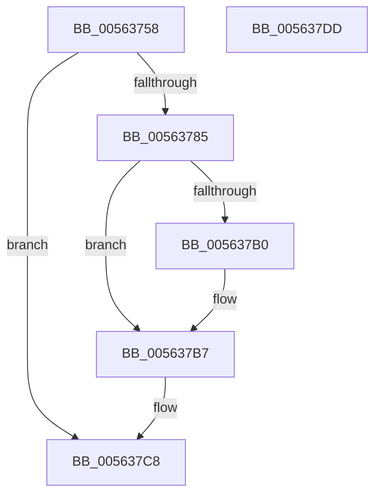

# HalpRegisterUsbController

- RVA: `0x00563758`–`0x005637DE` (길이 `134` bytes)
- VA: `0x0000000140563758`
- 실행 섹션: `.text`
- PDB 이름 있음: `예`; PDB Function 태그: `아니요`
- unwind 정보 RVA: `0x0005C954`
- 디코드: `37`개 명령, `134/134` bytes 표시
- 미해석 바이트: `0` (있으면 어셈블리에 `.byte`로 보존)

> 이 문서는 커널 이미지의 기계어와 PDB 기호를 분석해 생성했습니다. 4번과 5번은 함수 원형과 자료형을 바이너리 사용 방식에서 추정한 C 해석이며 원본 소스 복구 결과는 아닙니다.

## 1. Dependencies

- 직접 호출 지점: **1**; 고유 호출 대상: **1**
- 직접 호출자로 확인된 함수: **1**
- RIP 상대 이미지 참조: **3**

### Outgoing calls
- `0x0056377B` → [HalpMmAllocCtxAlloc](../3E/HalpMmAllocCtxAlloc_function_003E10B8.md) (function, `0x003E10B8`)

### Direct callers
- [HalpUsbLegacyDeviceHandoff](HalpUsbLegacyDeviceHandoff_function_005637E4.md) at `0x00563848`
- [HalpUsbLegacyDeviceHandoff](HalpUsbLegacyDeviceHandoff_function_005637E4.md) at `0x00563869`

### Static image references
- `0x00563788` → RVA `0x00F8FB80` (`.data`; read)
- `0x005637A4` → RVA `0x00F8FB88` (`.data`; read)
- `0x005637C1` → RVA `0x00F8FB88` (`.data`; write)

## 2. Other-region calls and transfers

- 다른 실행 섹션으로 향하는 call: **0**
- 별도 외부 분기/꼬리 이동을 확인하지 못했습니다.

## 3. Assembly (complete function range)

```asm
00563758  48 89 5C 24 08                  mov qword ptr [rsp + 8], rbx
0056375D  48 89 6C 24 10                  mov qword ptr [rsp + 0x10], rbp
00563762  48 89 74 24 18                  mov qword ptr [rsp + 0x18], rsi
00563767  57                              push rdi
00563768  48 83 EC 20                     sub rsp, 0x20
0056376C  8B DA                           mov ebx, edx
0056376E  41 8A F9                        mov dil, r9b
00563771  BA 20 00 00 00                  mov edx, 0x20
00563776  41 8A F0                        mov sil, r8b
00563779  8B E9                           mov ebp, ecx
0056377B  E8 38 D9 E7 FF                  call 0x1403e10b8
00563780  48 85 C0                        test rax, rax
00563783  74 43                           je 0x1405637c8
00563785  0F 57 C0                        xorps xmm0, xmm0
00563788  48 8D 15 F1 C3 A2 00            lea rdx, [rip + 0xa2c3f1]
0056378F  0F 11 00                        movups xmmword ptr [rax], xmm0
00563792  0F 11 40 10                     movups xmmword ptr [rax + 0x10], xmm0
00563796  89 68 10                        mov dword ptr [rax + 0x10], ebp
00563799  89 58 14                        mov dword ptr [rax + 0x14], ebx
0056379C  40 88 70 1A                     mov byte ptr [rax + 0x1a], sil
005637A0  40 88 78 19                     mov byte ptr [rax + 0x19], dil
005637A4  48 8B 0D DD C3 A2 00            mov rcx, qword ptr [rip + 0xa2c3dd]
005637AB  48 39 11                        cmp qword ptr [rcx], rdx
005637AE  74 07                           je 0x1405637b7
005637B0  B9 03 00 00 00                  mov ecx, 3
005637B5  CD 29                           int 0x29
005637B7  48 89 10                        mov qword ptr [rax], rdx
005637BA  48 89 48 08                     mov qword ptr [rax + 8], rcx
005637BE  48 89 01                        mov qword ptr [rcx], rax
005637C1  48 89 05 C0 C3 A2 00            mov qword ptr [rip + 0xa2c3c0], rax
005637C8  48 8B 5C 24 30                  mov rbx, qword ptr [rsp + 0x30]
005637CD  48 8B 6C 24 38                  mov rbp, qword ptr [rsp + 0x38]
005637D2  48 8B 74 24 40                  mov rsi, qword ptr [rsp + 0x40]
005637D7  48 83 C4 20                     add rsp, 0x20
005637DB  5F                              pop rdi
005637DC  C3                              ret
005637DD  CC                              int3
```

## 4. C-style interpretation (structured pseudocode)

```c
__int64 __fastcall HalpRegisterUsbController(int a1, int a2, unsigned __int8 a3, unsigned __int8 a4)
{
    __int64 result;
    __int64 v_rsp;
    unsigned __int64 v_stack_p10;
    unsigned __int64 v_stack_p18;
    unsigned __int64 v_stack_p8;

    v_stack_p8 = v_rbx;
    v_stack_p10 = v_rbp;
    v_stack_p18 = v_rsi;
    v_rsp = (v_rsp) - (32);
    result = HalpMmAllocCtxAlloc(a1, 32, a3, a4);
    if (result == 0) goto loc_005637C8;
    *(unsigned __int64 *)(result) = v_xmm0;
    *(unsigned __int64 *)(result + 16) = v_xmm0;
    *(unsigned int *)(result + 16) = (unsigned int)((unsigned int)(a1));
    *(unsigned int *)(result + 20) = (unsigned int)((unsigned int)(a2));
    *(unsigned __int8 *)(result + 26) = a3;
    *(unsigned __int8 *)(result + 25) = a4;
    if ((*(unsigned __int64 *)(*(unsigned __int64 *)(v_rip + 10666973))) != (v_rip + 10666993)) {
        a1 = 3;
    }
    *(unsigned __int64 *)(result) = v_rip + 10666993;
    *(unsigned __int64 *)(result + 8) = a1;
    *(unsigned __int64 *)(a1) = result;
    *(unsigned __int64 *)(v_rip + 10666944) = result;
loc_005637C8:
    v_rsp = (v_rsp) + (32);
    return result;
}
```

## 5. (Beta) C Style

```c
int64_t HalpRegisterUsbController(int32_t Arg1, int32_t Arg2, uint8_t Arg3, uint8_t Arg4)
{
    int64_t result;
    int64_t local_rsp;
    uint64_t v_stack_p10;
    uint64_t v_stack_p18;
    uint64_t v_stack_p8;

    v_stack_p8 = local_rbx;
    v_stack_p10 = local_rbp;
    v_stack_p18 = local_rsi;
    local_rsp = (local_rsp) - (32);
    result = HalpMmAllocCtxAlloc(Arg1, 32, Arg3, Arg4);
    if (result == 0) goto loc_005637C8;
    *(uint64_t *)(result) = v_xmm0;
    *(uint64_t *)(result + 0x10) = v_xmm0;
    *(uint32_t *)(result + 0x10) = (uint32_t)((uint32_t)(Arg1));
    *(uint32_t *)(result + 0x14) = (uint32_t)((uint32_t)(Arg2));
    *(uint8_t *)(result + 0x1A) = Arg3;
    *(uint8_t *)(result + 0x19) = Arg4;
    if ((*(uint64_t *)(*(uint64_t *)(v_rip + 0xA2C3DD))) != (v_rip + 10666993)) {
        Arg1 = 3;
    }
    *(uint64_t *)(result) = v_rip + 10666993;
    *(uint64_t *)(result + 0x8) = Arg1;
    *(uint64_t *)(Arg1) = result;
    *(uint64_t *)(v_rip + 0xA2C3C0) = result;
loc_005637C8:
    local_rsp = (local_rsp) + (32);
    return result;
}
```

## 6. Execution-region graph

[열기: 2D/3D 그래프와 함수 탐색 컨트롤 패널](../../../control-panel.html?section=text&rva=0x00563758&view=graph)

- 2D 그래프는 위에서 아래로 흐르고, 3D 그래프는 빈 공간을 드래그해 회전합니다. Shift+드래그는 이동, 휠은 확대·축소, 함수 노드 선택은 대상 보고서 이동입니다.

### Static fallback


