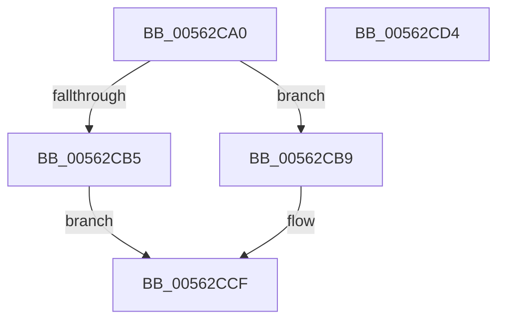

# HalpSocApiAllocatePhysicalMemory

- RVA: `0x00562CA0`–`0x00562CD5` (길이 `53` bytes)
- VA: `0x0000000140562CA0`
- 실행 섹션: `.text`
- PDB 이름 있음: `예`; PDB Function 태그: `아니요`
- unwind 정보 RVA: `0x0006BDBC`
- 디코드: `15`개 명령, `53/53` bytes 표시
- 미해석 바이트: `0` (있으면 어셈블리에 `.byte`로 보존)

> 이 문서는 커널 이미지의 기계어와 PDB 기호를 분석해 생성했습니다. 4번과 5번은 함수 원형과 자료형을 바이너리 사용 방식에서 추정한 C 해석이며 원본 소스 복구 결과는 아닙니다.

## 1. Dependencies

- 직접 호출 지점: **1**; 고유 호출 대상: **1**
- 직접 호출자로 확인된 함수: **0**
- RIP 상대 이미지 참조: **1**

### Outgoing calls
- `0x00562CCA` → [HalpAllocPhysicalMemoryEx](../../init/C7/HalpAllocPhysicalMemoryEx_function_00C771DC.md) (function, `0x00C771DC`)

### Direct callers
- 이 함수 시작 RVA로 연결되는 직접 call은 확인되지 않았습니다. 간접 호출은 완전히 역산할 수 없습니다.

### Static image references
- `0x00562CA9` → RVA `0x00FC4058` (`.data`; read)

## 2. Other-region calls and transfers

- 다른 실행 섹션으로 향하는 call: **1**
  - `0x00562CCA` → [HalpAllocPhysicalMemoryEx](../../init/C7/HalpAllocPhysicalMemoryEx_function_00C771DC.md) (`.text` → `INIT`)
- 별도 외부 분기/꼬리 이동을 확인하지 못했습니다.

## 3. Assembly (complete function range)

```asm
00562CA0  48 89 4C 24 08                  mov qword ptr [rsp + 8], rcx
00562CA5  48 83 EC 38                     sub rsp, 0x38
00562CA9  48 8B 0D A8 13 A6 00            mov rcx, qword ptr [rip + 0xa613a8]
00562CB0  48 85 C9                        test rcx, rcx
00562CB3  75 04                           jne 0x140562cb9
00562CB5  33 C0                           xor eax, eax
00562CB7  EB 16                           jmp 0x140562ccf
00562CB9  48 83 64 24 20 00               and qword ptr [rsp + 0x20], 0
00562CBF  44 8B C2                        mov r8d, edx
00562CC2  48 8D 54 24 40                  lea rdx, [rsp + 0x40]
00562CC7  45 33 C9                        xor r9d, r9d
00562CCA  E8 0D 45 71 00                  call 0x140c771dc
00562CCF  48 83 C4 38                     add rsp, 0x38
00562CD3  C3                              ret
00562CD4  CC                              int3
```

## 4. C-style interpretation (structured pseudocode)

```c
__int64 __fastcall HalpSocApiAllocatePhysicalMemory(__int64 a1, int a2, __int64 a3, int a4)
{
    __int64 result;
    __int64 v_rsp;
    unsigned __int64 v_stack_m18;
    unsigned __int64 v_stack_p8;

    v_stack_p8 = a1;
    v_rsp = (v_rsp) - (56);
    if (*(unsigned __int64 *)(v_rip + 10884008) != 0) goto loc_00562CB9;
    result = 0;
    goto loc_00562CCF;
loc_00562CB9:
    a4 = 0;
    result = HalpAllocPhysicalMemoryEx(*(unsigned __int64 *)(v_rip + 10884008), v_stack_p8, (unsigned int)(a2), a4);
loc_00562CCF:
    v_rsp = (v_rsp) + (56);
    return result;
}
```

## 5. (Beta) C Style

```c
int64_t HalpSocApiAllocatePhysicalMemory(int64_t Arg1, int32_t Arg2, int64_t Arg3, int32_t Arg4)
{
    int64_t result;
    int64_t local_rsp;
    uint64_t v_stack_m18;
    uint64_t v_stack_p8;

    v_stack_p8 = Arg1;
    local_rsp = (local_rsp) - (56);
    if (*(uint64_t *)(v_rip + 0xA613A8) != 0) goto loc_00562CB9;
    result = 0;
    goto loc_00562CCF;
loc_00562CB9:
    Arg4 = 0;
    result = HalpAllocPhysicalMemoryEx(*(uint64_t *)(v_rip + 0xA613A8), v_stack_p8, (uint32_t)(Arg2), Arg4);
loc_00562CCF:
    local_rsp = (local_rsp) + (56);
    return result;
}
```

## 6. Execution-region graph

[열기: 2D/3D 그래프와 함수 탐색 컨트롤 패널](../../../control-panel.html?section=text&rva=0x00562CA0&view=graph)

- 2D 그래프는 위에서 아래로 흐르고, 3D 그래프는 빈 공간을 드래그해 회전합니다. Shift+드래그는 이동, 휠은 확대·축소, 함수 노드 선택은 대상 보고서 이동입니다.

### Static fallback


