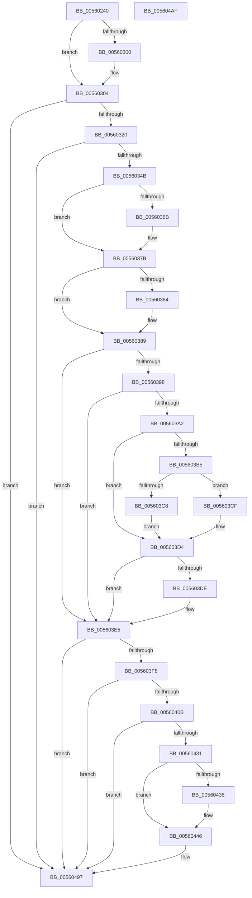

# HalpTimerAlwaysOnClockInterrupt

- RVA: `0x00560240`–`0x005604B0` (길이 `624` bytes)
- VA: `0x0000000140560240`
- 실행 섹션: `.text`
- PDB 이름 있음: `예`; PDB Function 태그: `아니요`
- unwind 정보 RVA: `0x000C4A1C`
- 디코드: `136`개 명령, `624/624` bytes 표시
- 미해석 바이트: `0` (있으면 어셈블리에 `.byte`로 보존)

> 이 문서는 커널 이미지의 기계어와 PDB 기호를 분석해 생성했습니다. 4번과 5번은 함수 원형과 자료형을 바이너리 사용 방식에서 추정한 C 해석이며 원본 소스 복구 결과는 아닙니다.

## 1. Dependencies

- 직접 호출 지점: **15**; 고유 호출 대상: **10**
- 직접 호출자로 확인된 함수: **0**
- RIP 상대 이미지 참조: **14**

### Outgoing calls
- `0x0056026A` → [HalpTimerGetInternalData](../20/HalpTimerGetInternalData_function_00209500.md) (function, `0x00209500`)
- `0x00560276` → [guard_dispatch_icall](../6B/guard_dispatch_icall_function_006BAAD0.md) (function, `0x006BAAD0`)
- `0x0056029D` → [RtlGetInterruptTimePrecise](../20/RtlGetInterruptTimePrecise_function_0020A4C0.md) (function, `0x0020A4C0`)
- `0x00560322` → [HalpTimerSwitchToNormalClock](../54/HalpTimerSwitchToNormalClock_function_00548814.md) (function, `0x00548814`)
- `0x00560333` → [KeClockInterruptNotify](../39/KeClockInterruptNotify_function_0039A970.md) (function, `0x0039A970`)
- `0x00560384` → [HalpTimerClockInterruptWork](../39/HalpTimerClockInterruptWork_function_0039B310.md) (function, `0x0039B310`)
- `0x005603C8` → [HalpTimerWatchdogResetCountdown](../39/HalpTimerWatchdogResetCountdown_function_0039B3B0.md) (function, `0x0039B3B0`)
- `0x005603CF` → [guard_dispatch_icall](../6B/guard_dispatch_icall_function_006BAAD0.md) (function, `0x006BAAD0`)
- `0x005603E0` → [HalpTimerWatchdogTriggerSystemReset](../39/HalpTimerWatchdogTriggerSystemReset_function_0039B410.md) (function, `0x0039B410`)
- `0x00560441` → [guard_dispatch_icall](../6B/guard_dispatch_icall_function_006BAAD0.md) (function, `0x006BAAD0`)
- `0x00560448` → [KeQueryPerformanceCounter](../37/KeQueryPerformanceCounter_function_0037E7E0.md) (function, `0x0037E7E0`)
- `0x00560457` → [HalpScanForProfilingCorruptionInternal](../44/HalpScanForProfilingCorruptionInternal_function_00445A64.md) (function, `0x00445A64`)
- `0x00560466` → [HalpScanForProfilingCorruptionInternal](../44/HalpScanForProfilingCorruptionInternal_function_00445A64.md) (function, `0x00445A64`)
- `0x00560475` → [HalpScanForProfilingCorruptionInternal](../44/HalpScanForProfilingCorruptionInternal_function_00445A64.md) (function, `0x00445A64`)
- `0x00560484` → [HalpScanForProfilingCorruptionInternal](../44/HalpScanForProfilingCorruptionInternal_function_00445A64.md) (function, `0x00445A64`)

### Direct callers
- 이 함수 시작 RVA로 연결되는 직접 call은 확인되지 않았습니다. 간접 호출은 완전히 역산할 수 없습니다.

### Static image references
- `0x0056025C` → RVA `0x00FC4108` (`.data`; read)
- `0x00560280` → RVA `0x00E0A838` (`.data`; read/write)
- `0x00560292` → RVA `0x00F8FC60` (`.data`; read)
- `0x005602B9` → RVA `0x00F21FB0` (`.data`; read)
- `0x0056034B` → RVA `0x00FC40F0` (`.data`; read)
- `0x00560371` → RVA `0x00FC22E1` (`.data`; write)
- `0x0056037B` → RVA `0x00FC22E0` (`.data`; read)
- `0x00560398` → RVA `0x00FC4028` (`.data`; read)
- `0x005603A5` → RVA `0x00FC2188` (`.data`; read)
- `0x005603AC` → RVA `0x00FC2178` (`.data`; read)
- `0x005603B5` → RVA `0x00E00B20` (`.data`; read)
- `0x005603BC` → RVA `0x0039B3B0` (`HalpTimerWatchdogResetCountdown`; read)
- `0x00560413` → RVA `0x00FC2C30` (`.data`; read)
- `0x00560436` → RVA `0x00E00A38` (`.data`; read)

## 2. Other-region calls and transfers

- 다른 실행 섹션으로 향하는 call: **0**
- 별도 외부 분기/꼬리 이동을 확인하지 못했습니다.

## 3. Assembly (complete function range)

```asm
00560240  48 89 5C 24 10                  mov qword ptr [rsp + 0x10], rbx
00560245  48 89 74 24 18                  mov qword ptr [rsp + 0x18], rsi
0056024A  48 89 7C 24 20                  mov qword ptr [rsp + 0x20], rdi
0056024F  41 57                           push r15
00560251  48 83 EC 20                     sub rsp, 0x20
00560255  48 8B B9 88 00 00 00            mov rdi, qword ptr [rcx + 0x88]
0056025C  48 8B 15 A5 3E A6 00            mov rdx, qword ptr [rip + 0xa63ea5]
00560263  48 8B CA                        mov rcx, rdx
00560266  40 8A 77 29                     mov sil, byte ptr [rdi + 0x29]
0056026A  E8 91 92 CA FF                  call 0x140209500
0056026F  48 8B C8                        mov rcx, rax
00560272  48 8B 42 78                     mov rax, qword ptr [rdx + 0x78]
00560276  E8 55 A8 15 00                  call 0x1406baad0
0056027B  B8 01 00 00 00                  mov eax, 1
00560280  F0 0F C1 05 B0 A5 8A 00         lock xadd dword ptr [rip + 0x8aa5b0], eax
00560288  FF C0                           inc eax
0056028A  48 8D 4C 24 30                  lea rcx, [rsp + 0x30]
0056028F  83 E0 0F                        and eax, 0xf
00560292  4C 8D 3D C7 F9 A2 00            lea r15, [rip + 0xa2f9c7]
00560299  48 8D 1C 40                     lea rbx, [rax + rax*2]
0056029D  E8 1E A2 CA FF                  call 0x14020a4c0
005602A2  49 89 04 DF                     mov qword ptr [r15 + rbx*8], rax
005602A6  65 8B 04 25 A4 01 00 00         mov eax, dword ptr gs:[0x1a4]
005602AE  41 C6 44 DF 10 00               mov byte ptr [r15 + rbx*8 + 0x10], 0
005602B4  41 89 44 DF 08                  mov dword ptr [r15 + rbx*8 + 8], eax
005602B9  8B 05 F1 1C 9C 00               mov eax, dword ptr [rip + 0x9c1cf1]
005602BF  41 89 44 DF 0C                  mov dword ptr [r15 + rbx*8 + 0xc], eax
005602C4  65 48 8B 04 25 20 00 00 00      mov rax, qword ptr gs:[0x20]
005602CD  44 8A 40 22                     mov r8b, byte ptr [rax + 0x22]
005602D1  41 80 E0 01                     and r8b, 1
005602D5  45 88 44 DF 10                  mov byte ptr [r15 + rbx*8 + 0x10], r8b
005602DA  65 48 8B 04 25 20 00 00 00      mov rax, qword ptr gs:[0x20]
005602E3  8A 48 22                        mov cl, byte ptr [rax + 0x22]
005602E6  80 E1 02                        and cl, 2
005602E9  44 0A C1                        or r8b, cl
005602EC  45 88 44 DF 10                  mov byte ptr [r15 + rbx*8 + 0x10], r8b
005602F1  65 48 8B 04 25 20 00 00 00      mov rax, qword ptr gs:[0x20]
005602FA  80 78 21 00                     cmp byte ptr [rax + 0x21], 0
005602FE  74 04                           je 0x140560304
00560300  41 80 C8 04                     or r8b, 4
00560304  41 80 C8 08                     or r8b, 8
00560308  45 88 44 DF 10                  mov byte ptr [r15 + rbx*8 + 0x10], r8b
0056030D  65 48 8B 04 25 20 00 00 00      mov rax, qword ptr gs:[0x20]
00560316  F6 40 22 02                     test byte ptr [rax + 0x22], 2
0056031A  0F 84 77 01 00 00               je 0x140560497
00560320  B1 01                           mov cl, 1
00560322  E8 ED 84 FE FF                  call 0x140548814
00560327  41 B8 01 00 00 00               mov r8d, 1
0056032D  40 8A D6                        mov dl, sil
00560330  48 8B CF                        mov rcx, rdi
00560333  E8 38 A6 E3 FF                  call 0x14039a970
00560338  65 48 8B 04 25 20 00 00 00      mov rax, qword ptr gs:[0x20]
00560341  80 78 21 00                     cmp byte ptr [rax + 0x21], 0
00560345  0F 84 4C 01 00 00               je 0x140560497
0056034B  48 8B 0D 9E 3D A6 00            mov rcx, qword ptr [rip + 0xa63d9e]
00560352  48 BB 08 00 00 00 80 F7 FF FF   movabs rbx, 0xfffff78000000008
0056035C  48 8B 13                        mov rdx, qword ptr [rbx]
0056035F  8B 41 3C                        mov eax, dword ptr [rcx + 0x3c]
00560362  2B C2                           sub eax, edx
00560364  3D 00 8C 86 47                  cmp eax, 0x47868c00
00560369  76 10                           jbe 0x14056037b
0056036B  8D 82 00 8C 86 47               lea eax, [rdx + 0x47868c00]
00560371  C6 05 69 1F A6 00 01            mov byte ptr [rip + 0xa61f69], 1
00560378  89 41 3C                        mov dword ptr [rcx + 0x3c], eax
0056037B  83 3D 5E 1F A6 00 00            cmp dword ptr [rip + 0xa61f5e], 0
00560382  74 05                           je 0x140560389
00560384  E8 87 AF E3 FF                  call 0x14039b310
00560389  65 48 8B 04 25 20 00 00 00      mov rax, qword ptr gs:[0x20]
00560392  80 78 21 00                     cmp byte ptr [rax + 0x21], 0
00560396  74 4D                           je 0x1405603e5
00560398  48 83 3D 88 3C A6 00 00         cmp qword ptr [rip + 0xa63c88], 0
005603A0  74 43                           je 0x1405603e5
005603A2  48 8B 03                        mov rax, qword ptr [rbx]
005603A5  48 2B 05 DC 1D A6 00            sub rax, qword ptr [rip + 0xa61ddc]
005603AC  48 3B 05 C5 1D A6 00            cmp rax, qword ptr [rip + 0xa61dc5]
005603B3  76 1F                           jbe 0x1405603d4
005603B5  48 8B 05 64 07 8A 00            mov rax, qword ptr [rip + 0x8a0764]
005603BC  48 8D 0D ED AF E3 FF            lea rcx, [rip - 0x1c5013]
005603C3  48 3B C1                        cmp rax, rcx
005603C6  75 07                           jne 0x1405603cf
005603C8  E8 E3 AF E3 FF                  call 0x14039b3b0
005603CD  EB 05                           jmp 0x1405603d4
005603CF  E8 FC A6 15 00                  call 0x1406baad0
005603D4  48 83 3D 9C 1D A6 00 FF         cmp qword ptr [rip + 0xa61d9c], -1
005603DC  75 07                           jne 0x1405603e5
005603DE  33 C9                           xor ecx, ecx
005603E0  E8 2B B0 E3 FF                  call 0x14039b410
005603E5  65 48 8B 04 25 20 00 00 00      mov rax, qword ptr gs:[0x20]
005603EE  83 78 60 00                     cmp dword ptr [rax + 0x60], 0
005603F2  0F 8E 9F 00 00 00               jle 0x140560497
005603F8  65 48 8B 04 25 20 00 00 00      mov rax, qword ptr gs:[0x20]
00560401  F6 40 60 01                     test byte ptr [rax + 0x60], 1
00560405  0F 85 8C 00 00 00               jne 0x140560497
0056040B  65 8B 34 25 A4 01 00 00         mov esi, dword ptr gs:[0x1a4]
00560413  48 8B 05 16 28 A6 00            mov rax, qword ptr [rip + 0xa62816]
0056041A  48 8D 0C 76                     lea rcx, [rsi + rsi*2]
0056041E  48 8D 3C C8                     lea rdi, [rax + rcx*8]
00560422  48 8B 03                        mov rax, qword ptr [rbx]
00560425  48 2B 47 10                     sub rax, qword ptr [rdi + 0x10]
00560429  48 3D 40 4B 4C 00               cmp rax, 0x4c4b40
0056042F  72 66                           jb 0x140560497
00560431  48 39 3F                        cmp qword ptr [rdi], rdi
00560434  74 10                           je 0x140560446
00560436  48 8B 05 FB 05 8A 00            mov rax, qword ptr [rip + 0x8a05fb]
0056043D  33 D2                           xor edx, edx
0056043F  33 C9                           xor ecx, ecx
00560441  E8 8A A6 15 00                  call 0x1406baad0
00560446  33 C9                           xor ecx, ecx
00560448  E8 93 E3 E1 FF                  call 0x14037e7e0
0056044D  4C 8B C0                        mov r8, rax
00560450  8B D6                           mov edx, esi
00560452  33 C9                           xor ecx, ecx
00560454  48 8B D8                        mov rbx, rax
00560457  E8 08 56 EE FF                  call 0x140445a64
0056045C  4C 8B C3                        mov r8, rbx
0056045F  8B D6                           mov edx, esi
00560461  B9 01 00 00 00                  mov ecx, 1
00560466  E8 F9 55 EE FF                  call 0x140445a64
0056046B  4C 8B C3                        mov r8, rbx
0056046E  8B D6                           mov edx, esi
00560470  B9 64 00 00 00                  mov ecx, 0x64
00560475  E8 EA 55 EE FF                  call 0x140445a64
0056047A  4C 8B C3                        mov r8, rbx
0056047D  8B D6                           mov edx, esi
0056047F  B9 65 00 00 00                  mov ecx, 0x65
00560484  E8 DB 55 EE FF                  call 0x140445a64
00560489  48 A1 08 00 00 00 80 F7 FF FF   movabs rax, qword ptr [0xfffff78000000008]
00560493  48 89 47 10                     mov qword ptr [rdi + 0x10], rax
00560497  48 8B 5C 24 38                  mov rbx, qword ptr [rsp + 0x38]
0056049C  B0 01                           mov al, 1
0056049E  48 8B 74 24 40                  mov rsi, qword ptr [rsp + 0x40]
005604A3  48 8B 7C 24 48                  mov rdi, qword ptr [rsp + 0x48]
005604A8  48 83 C4 20                     add rsp, 0x20
005604AC  41 5F                           pop r15
005604AE  C3                              ret
005604AF  CC                              int3
```

## 4. C-style interpretation (structured pseudocode)

```c
__int64 __fastcall HalpTimerAlwaysOnClockInterrupt(__int64 a1)
{
    __int64 result;
    __int64 v_rsp;
    unsigned __int64 v_stack_p10;
    unsigned __int64 v_stack_p18;
    unsigned __int64 v_stack_p20;
    unsigned __int64 v_stack_p8;

    v_stack_p10 = v_rbx;
    v_stack_p18 = v_rsi;
    v_stack_p20 = v_rdi;
    v_rsp = (v_rsp) - (32);
    result = HalpTimerGetInternalData(*(unsigned __int64 *)(v_rip + 10895013), *(unsigned __int64 *)(v_rip + 10895013), a3, a4);
    result = guard_dispatch_icall(result, *(unsigned __int64 *)(v_rip + 10895013), a3, a4);
    result = (unsigned int)((1) + 1);
    result = (unsigned int)((result) & (15));
    result = RtlGetInterruptTimePrecise(v_stack_p8, *(unsigned __int64 *)(v_rip + 10895013), a3, a4);
    *(unsigned __int64 *)(v_rip + 10680775 + result + result * 2 * 8) = result;
    *(unsigned __int8 *)(v_rip + 10680775 + result + result * 2 * 8 + 16) = 0;
    *(unsigned int *)(v_rip + 10680775 + result + result * 2 * 8 + 8) = (unsigned int)((unsigned int)(*(unsigned int *)(gs_base + (0 + 420))));
    *(unsigned int *)(v_rip + 10680775 + result + result * 2 * 8 + 12) = (unsigned int)((unsigned int)(*(unsigned int *)(v_rip + 10231025)));
    a3 = (unsigned __int8)((*(unsigned __int8 *)(*(unsigned __int64 *)(gs_base + (0 + 32)) + 34)) & (1));
    *(unsigned __int8 *)(v_rip + 10680775 + result + result * 2 * 8 + 16) = (unsigned __int8)(a3);
    a1 = (unsigned __int8)((*(unsigned __int8 *)(*(unsigned __int64 *)(gs_base + (0 + 32)) + 34)) & (2));
    a3 = (unsigned __int8)((a3) | ((unsigned __int8)(a1)));
    *(unsigned __int8 *)(v_rip + 10680775 + result + result * 2 * 8 + 16) = (unsigned __int8)(a3);
    if ((*(unsigned __int8 *)(*(unsigned __int64 *)(gs_base + (0 + 32)) + 33)) != 0) {
        a3 = (unsigned __int8)((a3) | (4));
    }
    a3 = (unsigned __int8)((a3) | (8));
    *(unsigned __int8 *)(v_rip + 10680775 + result + result * 2 * 8 + 16) = (unsigned __int8)(a3);
    if (((*(unsigned __int8 *)(*(unsigned __int64 *)(gs_base + (0 + 32)) + 34)) & (2)) == 0) goto loc_00560497;
    result = HalpTimerSwitchToNormalClock(1, *(unsigned __int64 *)(v_rip + 10895013), a3, a4);
    result = KeClockInterruptNotify(*(unsigned __int64 *)(a1 + 136), (unsigned __int8)(*(unsigned __int8 *)(*(unsigned __int64 *)(a1 + 136) + 41)), 1, a4);
    if ((*(unsigned __int8 *)(*(unsigned __int64 *)(gs_base + (0 + 32)) + 33)) == 0) goto loc_00560497;
    result = (unsigned int)(((unsigned int)(*(unsigned int *)(*(unsigned __int64 *)(v_rip + 10894750) + 60))) - ((unsigned int)(*(unsigned __int64 *)(result + result * 2))));
    if (((unsigned int)(result)) >= = 0x47868C00ULL) {
        result = *(unsigned __int64 *)(result + result * 2) + 1200000000;
        *(unsigned __int8 *)(v_rip + 10887017) = 1;
        *(unsigned int *)(*(unsigned __int64 *)(v_rip + 10894750) + 60) = (unsigned int)(result);
    }
    if ((*(unsigned int *)(v_rip + 10887006)) != 0) {
        result = HalpTimerClockInterruptWork(*(unsigned __int64 *)(v_rip + 10894750), *(unsigned __int64 *)(result + result * 2), 1, a4);
    }
    if ((*(unsigned __int8 *)(*(unsigned __int64 *)(gs_base + (0 + 32)) + 33)) == 0) goto loc_005603E5;
    if ((*(unsigned __int64 *)(v_rip + 10894472)) == 0) goto loc_005603E5;
    result = (*(unsigned __int64 *)(result + result * 2)) - (*(unsigned __int64 *)(v_rip + 10886620));
    if (result <= (*(unsigned __int64 *)(v_rip + 10886597))) goto loc_005603D4;
    if ((*(unsigned __int64 *)(v_rip + 9045860)) != (v_rip - 1855507)) goto loc_005603CF;
    result = HalpTimerWatchdogResetCountdown(v_rip - 1855507, *(unsigned __int64 *)(result + result * 2), 1, a4);
    goto loc_005603D4;
loc_005603CF:
    result = guard_dispatch_icall(v_rip - 1855507, *(unsigned __int64 *)(result + result * 2), 1, a4);
loc_005603D4:
    if ((*(unsigned __int64 *)(v_rip + 10886556)) == -1) {
        a1 = 0;
        result = HalpTimerWatchdogTriggerSystemReset(a1, *(unsigned __int64 *)(result + result * 2), 1, a4);
    }
    if ((*(unsigned int *)(*(unsigned __int64 *)(gs_base + (0 + 32)) + 96)) <= 0) goto loc_00560497;
    if (((*(unsigned __int8 *)(*(unsigned __int64 *)(gs_base + (0 + 32)) + 96)) & (1)) != 0) goto loc_00560497;
    result = (*(unsigned __int64 *)(result + result * 2)) - (*(unsigned __int64 *)(*(unsigned __int64 *)(v_rip + 10889238) + (unsigned int)(*(unsigned int *)(gs_base + (0 + 420))) + (unsigned int)(*(unsigned int *)(gs_base + (0 + 420))) * 2 * 8 + 16));
    if (result < 0x4C4B40ULL) goto loc_00560497;
    if ((*(unsigned __int64 *)(*(unsigned __int64 *)(v_rip + 10889238) + (unsigned int)(*(unsigned int *)(gs_base + (0 + 420))) + (unsigned int)(*(unsigned int *)(gs_base + (0 + 420))) * 2 * 8)) != (*(unsigned __int64 *)(v_rip + 10889238) + (unsigned int)(*(unsigned int *)(gs_base + (0 + 420))) + (unsigned int)(*(unsigned int *)(gs_base + (0 + 420))) * 2 * 8)) {
        result = *(unsigned __int64 *)(v_rip + 9045499);
        a2 = 0;
        a1 = 0;
        result = guard_dispatch_icall(a1, a2, 1, a4);
    }
    a1 = 0;
    result = KeQueryPerformanceCounter(a1, a2, 1, a4);
    a1 = 0;
    result = HalpScanForProfilingCorruptionInternal(a1, (unsigned int)((unsigned int)((unsigned int)(*(unsigned int *)(gs_base + (0 + 420))))), result, a4);
    result = HalpScanForProfilingCorruptionInternal(1, (unsigned int)((unsigned int)((unsigned int)(*(unsigned int *)(gs_base + (0 + 420))))), result, a4);
    result = HalpScanForProfilingCorruptionInternal(100, (unsigned int)((unsigned int)((unsigned int)(*(unsigned int *)(gs_base + (0 + 420))))), result, a4);
    result = HalpScanForProfilingCorruptionInternal(101, (unsigned int)((unsigned int)((unsigned int)(*(unsigned int *)(gs_base + (0 + 420))))), result, a4);
    *(unsigned __int64 *)(*(unsigned __int64 *)(v_rip + 10889238) + (unsigned int)(*(unsigned int *)(gs_base + (0 + 420))) + (unsigned int)(*(unsigned int *)(gs_base + (0 + 420))) * 2 * 8 + 16) = result;
loc_00560497:
    v_rsp = (v_rsp) + (32);
    return 1;
}
```

## 5. (Beta) C Style

```c
int64_t HalpTimerAlwaysOnClockInterrupt(void *Arg1)
{
    uint8_t *arg1 = (uint8_t *)Arg1;

    int64_t result;
    int64_t local_rsp;
    uint64_t v_stack_p10;
    uint64_t v_stack_p18;
    uint64_t v_stack_p20;
    uint64_t v_stack_p8;

    v_stack_p10 = local_rbx;
    v_stack_p18 = local_rsi;
    v_stack_p20 = local_rdi;
    local_rsp = (local_rsp) - (32);
    result = HalpTimerGetInternalData(*(uint64_t *)(v_rip + 0xA63EA5), *(uint64_t *)(v_rip + 0xA63EA5), a3, a4);
    result = guard_dispatch_icall(result, *(uint64_t *)(v_rip + 0xA63EA5), a3, a4);
    result = (uint32_t)((1) + 1);
    result = (uint32_t)((result) & (15));
    result = RtlGetInterruptTimePrecise(v_stack_p8, *(uint64_t *)(v_rip + 0xA63EA5), a3, a4);
    *(uint64_t *)(v_rip + 0xA2F9C7 + result + result * 2 * 8) = result;
    *(uint8_t *)(v_rip + 0xA2F9C7 + result + result * 2 * 8 + 0x10) = 0;
    *(uint32_t *)(v_rip + 0xA2F9C7 + result + result * 2 * 8 + 0x8) = (uint32_t)((uint32_t)(*(uint32_t *)(gs_base + (0 + 0x1A4))));
    *(uint32_t *)(v_rip + 0xA2F9C7 + result + result * 2 * 8 + 0xC) = (uint32_t)((uint32_t)(*(uint32_t *)(v_rip + 0x9C1CF1)));
    a3 = (uint8_t)((*(uint8_t *)(*(uint64_t *)(gs_base + (0 + 0x20)) + 0x22)) & (1));
    *(uint8_t *)(v_rip + 0xA2F9C7 + result + result * 2 * 8 + 0x10) = (uint8_t)(a3);
    Arg1 = (uint8_t)((*(uint8_t *)(*(uint64_t *)(gs_base + (0 + 0x20)) + 0x22)) & (2));
    a3 = (uint8_t)((a3) | ((uint8_t)(Arg1)));
    *(uint8_t *)(v_rip + 0xA2F9C7 + result + result * 2 * 8 + 0x10) = (uint8_t)(a3);
    if ((*(uint8_t *)(*(uint64_t *)(gs_base + (0 + 0x20)) + 0x21)) != 0) {
        a3 = (uint8_t)((a3) | (4));
    }
    a3 = (uint8_t)((a3) | (8));
    *(uint8_t *)(v_rip + 0xA2F9C7 + result + result * 2 * 8 + 0x10) = (uint8_t)(a3);
    if (((*(uint8_t *)(*(uint64_t *)(gs_base + (0 + 0x20)) + 0x22)) & (2)) == 0) goto loc_00560497;
    result = HalpTimerSwitchToNormalClock(1, *(uint64_t *)(v_rip + 0xA63EA5), a3, a4);
    result = KeClockInterruptNotify(*(uint64_t *)(arg1 + 0x88), (uint8_t)(*(uint8_t *)(*(uint64_t *)(arg1 + 0x88) + 0x29)), 1, a4);
    if ((*(uint8_t *)(*(uint64_t *)(gs_base + (0 + 0x20)) + 0x21)) == 0) goto loc_00560497;
    result = (uint32_t)(((uint32_t)(*(uint32_t *)(*(uint64_t *)(v_rip + 0xA63D9E) + 0x3C))) - ((uint32_t)(*(uint64_t *)(result + result * 2))));
    if (((uint32_t)(result)) >= = 0x47868C00ULL) {
        result = *(uint64_t *)(result + result * 2) + 1200000000;
        *(uint8_t *)(v_rip + 0xA61F69) = 1;
        *(uint32_t *)(*(uint64_t *)(v_rip + 0xA63D9E) + 0x3C) = (uint32_t)(result);
    }
    if ((*(uint32_t *)(v_rip + 0xA61F5E)) != 0) {
        result = HalpTimerClockInterruptWork(*(uint64_t *)(v_rip + 0xA63D9E), *(uint64_t *)(result + result * 2), 1, a4);
    }
    if ((*(uint8_t *)(*(uint64_t *)(gs_base + (0 + 0x20)) + 0x21)) == 0) goto loc_005603E5;
    if ((*(uint64_t *)(v_rip + 0xA63C88)) == 0) goto loc_005603E5;
    result = (*(uint64_t *)(result + result * 2)) - (*(uint64_t *)(v_rip + 0xA61DDC));
    if (result <= (*(uint64_t *)(v_rip + 0xA61DC5))) goto loc_005603D4;
    if ((*(uint64_t *)(v_rip + 0x8A0764)) != (v_rip - 1855507)) goto loc_005603CF;
    result = HalpTimerWatchdogResetCountdown(v_rip - 1855507, *(uint64_t *)(result + result * 2), 1, a4);
    goto loc_005603D4;
loc_005603CF:
    result = guard_dispatch_icall(v_rip - 1855507, *(uint64_t *)(result + result * 2), 1, a4);
loc_005603D4:
    if ((*(uint64_t *)(v_rip + 0xA61D9C)) == -1) {
        Arg1 = 0;
        result = HalpTimerWatchdogTriggerSystemReset(Arg1, *(uint64_t *)(result + result * 2), 1, a4);
    }
    if ((*(uint32_t *)(*(uint64_t *)(gs_base + (0 + 0x20)) + 0x60)) <= 0) goto loc_00560497;
    if (((*(uint8_t *)(*(uint64_t *)(gs_base + (0 + 0x20)) + 0x60)) & (1)) != 0) goto loc_00560497;
    result = (*(uint64_t *)(result + result * 2)) - (*(uint64_t *)(*(uint64_t *)(v_rip + 0xA62816) + (uint32_t)(*(uint32_t *)(gs_base + (0 + 0x1A4))) + (uint32_t)(*(uint32_t *)(gs_base + (0 + 0x1A4))) * 2 * 8 + 0x10));
    if (result < 0x4C4B40ULL) goto loc_00560497;
    if ((*(uint64_t *)(*(uint64_t *)(v_rip + 0xA62816) + (uint32_t)(*(uint32_t *)(gs_base + (0 + 0x1A4))) + (uint32_t)(*(uint32_t *)(gs_base + (0 + 0x1A4))) * 2 * 8)) != (*(uint64_t *)(v_rip + 0xA62816) + (uint32_t)(*(uint32_t *)(gs_base + (0 + 0x1A4))) + (uint32_t)(*(uint32_t *)(gs_base + (0 + 0x1A4))) * 2 * 8)) {
        result = *(uint64_t *)(v_rip + 0x8A05FB);
        a2 = 0;
        Arg1 = 0;
        result = guard_dispatch_icall(Arg1, a2, 1, a4);
    }
    Arg1 = 0;
    result = KeQueryPerformanceCounter(Arg1, a2, 1, a4);
    Arg1 = 0;
    result = HalpScanForProfilingCorruptionInternal(Arg1, (uint32_t)((uint32_t)((uint32_t)(*(uint32_t *)(gs_base + (0 + 0x1A4))))), result, a4);
    result = HalpScanForProfilingCorruptionInternal(1, (uint32_t)((uint32_t)((uint32_t)(*(uint32_t *)(gs_base + (0 + 0x1A4))))), result, a4);
    result = HalpScanForProfilingCorruptionInternal(100, (uint32_t)((uint32_t)((uint32_t)(*(uint32_t *)(gs_base + (0 + 0x1A4))))), result, a4);
    result = HalpScanForProfilingCorruptionInternal(101, (uint32_t)((uint32_t)((uint32_t)(*(uint32_t *)(gs_base + (0 + 0x1A4))))), result, a4);
    *(uint64_t *)(*(uint64_t *)(v_rip + 0xA62816) + (uint32_t)(*(uint32_t *)(gs_base + (0 + 0x1A4))) + (uint32_t)(*(uint32_t *)(gs_base + (0 + 0x1A4))) * 2 * 8 + 0x10) = result;
loc_00560497:
    local_rsp = (local_rsp) + (32);
    return 1;
}
```

### 관측된 메모리 오프셋

구조체 형식이 확인되지 않은 접근은 인자 기준의 오프셋으로만 기록했습니다.

| 기준 인자 | 오프셋 표현 | 폭 (bit) | 접근 |
|---|---:|---:|---|
| `Arg1` | `+ 0x88` | `64` | `R` |

## 6. Execution-region graph

[열기: 2D/3D 그래프와 함수 탐색 컨트롤 패널](../../../control-panel.html?section=text&rva=0x00560240&view=graph)

- 2D 그래프는 위에서 아래로 흐르고, 3D 그래프는 빈 공간을 드래그해 회전합니다. Shift+드래그는 이동, 휠은 확대·축소, 함수 노드 선택은 대상 보고서 이동입니다.

### Static fallback


