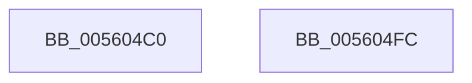

# HalpTimerClockInterruptStub

- RVA: `0x005604C0`–`0x005604FD` (길이 `61` bytes)
- VA: `0x00000001405604C0`
- 실행 섹션: `.text`
- PDB 이름 있음: `예`; PDB Function 태그: `아니요`
- unwind 정보 RVA: `0x0005C788`
- 디코드: `16`개 명령, `61/61` bytes 표시
- 미해석 바이트: `0` (있으면 어셈블리에 `.byte`로 보존)

> 이 문서는 커널 이미지의 기계어와 PDB 기호를 분석해 생성했습니다. 4번과 5번은 함수 원형과 자료형을 바이너리 사용 방식에서 추정한 C 해석이며 원본 소스 복구 결과는 아닙니다.

## 1. Dependencies

- 직접 호출 지점: **2**; 고유 호출 대상: **2**
- 직접 호출자로 확인된 함수: **0**
- RIP 상대 이미지 참조: **1**

### Outgoing calls
- `0x005604CE` → [HalpTimerGetInternalData](../20/HalpTimerGetInternalData_function_00209500.md) (function, `0x00209500`)
- `0x005604DA` → [guard_dispatch_icall](../6B/guard_dispatch_icall_function_006BAAD0.md) (function, `0x006BAAD0`)

### Direct callers
- 이 함수 시작 RVA로 연결되는 직접 call은 확인되지 않았습니다. 간접 호출은 완전히 역산할 수 없습니다.

### Static image references
- `0x005604C4` → RVA `0x00FC40F0` (`.data`; read)

## 2. Other-region calls and transfers

- 다른 실행 섹션으로 향하는 call: **0**
- 별도 외부 분기/꼬리 이동을 확인하지 못했습니다.

## 3. Assembly (complete function range)

```asm
005604C0  48 83 EC 28                     sub rsp, 0x28
005604C4  48 8B 15 25 3C A6 00            mov rdx, qword ptr [rip + 0xa63c25]
005604CB  48 8B CA                        mov rcx, rdx
005604CE  E8 2D 90 CA FF                  call 0x140209500
005604D3  48 8B C8                        mov rcx, rax
005604D6  48 8B 42 78                     mov rax, qword ptr [rdx + 0x78]
005604DA  E8 F1 A5 15 00                  call 0x1406baad0
005604DF  48 8B 05 0A 3C A6 00            mov rax, qword ptr [rip + 0xa63c0a]
005604E6  8B 50 40                        mov edx, dword ptr [rax + 0x40]
005604E9  B0 01                           mov al, 1
005604EB  48 8B 0D FE 3B A6 00            mov rcx, qword ptr [rip + 0xa63bfe]
005604F2  FF C2                           inc edx
005604F4  89 51 40                        mov dword ptr [rcx + 0x40], edx
005604F7  48 83 C4 28                     add rsp, 0x28
005604FB  C3                              ret
005604FC  CC                              int3
```

## 4. C-style interpretation (structured pseudocode)

```c
__int64 __fastcall HalpTimerClockInterruptStub(void)
{
    __int64 result;
    __int64 v_rsp;

    v_rsp = (v_rsp) - (40);
    result = HalpTimerGetInternalData(*(unsigned __int64 *)(v_rip + 10894373), *(unsigned __int64 *)(v_rip + 10894373), a3, a4);
    result = guard_dispatch_icall(result, *(unsigned __int64 *)(v_rip + 10894373), a3, a4);
    a2 = (unsigned int)(((unsigned int)(*(unsigned int *)(*(unsigned __int64 *)(v_rip + 10894346) + 64))) + 1);
    *(unsigned int *)(*(unsigned __int64 *)(v_rip + 10894334) + 64) = (unsigned int)(a2);
    v_rsp = (v_rsp) + (40);
    return 1;
}
```

## 5. (Beta) C Style

```c
void HalpTimerClockInterruptStub(void)
{
    int64_t result;
    int64_t local_rsp;

    local_rsp = (local_rsp) - (40);
    result = HalpTimerGetInternalData(*(uint64_t *)(v_rip + 0xA63C25), *(uint64_t *)(v_rip + 0xA63C25), a3, a4);
    result = guard_dispatch_icall(result, *(uint64_t *)(v_rip + 0xA63C25), a3, a4);
    a2 = (uint32_t)(((uint32_t)(*(uint32_t *)(*(uint64_t *)(v_rip + 0xA63C0A) + 0x40))) + 1);
    *(uint32_t *)(*(uint64_t *)(v_rip + 0xA63BFE) + 0x40) = (uint32_t)(a2);
    local_rsp = (local_rsp) + (40);
    return 1;
}
```

## 6. Execution-region graph

[열기: 2D/3D 그래프와 함수 탐색 컨트롤 패널](../../../control-panel.html?section=text&rva=0x005604C0&view=graph)

- 2D 그래프는 위에서 아래로 흐르고, 3D 그래프는 빈 공간을 드래그해 회전합니다. Shift+드래그는 이동, 휠은 확대·축소, 함수 노드 선택은 대상 보고서 이동입니다.

### Static fallback


