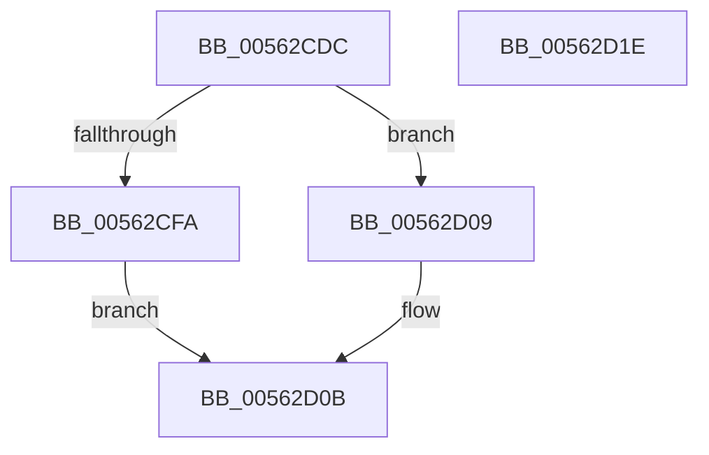

# HalpTimerIsHypervisorReferenceAvailable

- RVA: `0x00562CDC`–`0x00562D1F` (길이 `67` bytes)
- VA: `0x0000000140562CDC`
- 실행 섹션: `.text`
- PDB 이름 있음: `예`; PDB Function 태그: `아니요`
- unwind 정보 RVA: `0x000AB2E4`
- 디코드: `22`개 명령, `67/67` bytes 표시
- 미해석 바이트: `0` (있으면 어셈블리에 `.byte`로 보존)

> 이 문서는 커널 이미지의 기계어와 PDB 기호를 분석해 생성했습니다. 4번과 5번은 함수 원형과 자료형을 바이너리 사용 방식에서 추정한 C 해석이며 원본 소스 복구 결과는 아닙니다.

## 1. Dependencies

- 직접 호출 지점: **2**; 고유 호출 대상: **2**
- 직접 호출자로 확인된 함수: **1**
- RIP 상대 이미지 참조: **1**

### Outgoing calls
- `0x00562CF1` → [HalpIsMicrosoftCompatibleHvLoaded](../4A/HalpIsMicrosoftCompatibleHvLoaded_function_004AFAAC.md) (function, `0x004AFAAC`)
- `0x00562D13` → [_security_check_cookie](../6A/_security_check_cookie_function_006AC640.md) (function, `0x006AC640`)

### Direct callers
- [sub_006FC0AA](../6F/Unknown_function_006FC0AA.md) at `0x006FC120`

### Static image references
- `0x00562CE2` → RVA `0x00E0A740` (`.data`; read)

## 2. Other-region calls and transfers

- 다른 실행 섹션으로 향하는 call: **0**
- 별도 외부 분기/꼬리 이동을 확인하지 못했습니다.

## 3. Assembly (complete function range)

```asm
00562CDC  40 53                           push rbx
00562CDE  48 83 EC 40                     sub rsp, 0x40
00562CE2  48 8B 05 57 7A 8A 00            mov rax, qword ptr [rip + 0x8a7a57]
00562CE9  48 33 C4                        xor rax, rsp
00562CEC  48 89 44 24 30                  mov qword ptr [rsp + 0x30], rax
00562CF1  E8 B6 CD F4 FF                  call 0x1404afaac
00562CF6  84 C0                           test al, al
00562CF8  74 0F                           je 0x140562d09
00562CFA  33 C9                           xor ecx, ecx
00562CFC  B8 03 00 00 40                  mov eax, 0x40000003
00562D01  0F A2                           cpuid
00562D03  D0 E8                           shr al, 1
00562D05  24 01                           and al, 1
00562D07  EB 02                           jmp 0x140562d0b
00562D09  32 C0                           xor al, al
00562D0B  48 8B 4C 24 30                  mov rcx, qword ptr [rsp + 0x30]
00562D10  48 33 CC                        xor rcx, rsp
00562D13  E8 28 99 14 00                  call 0x1406ac640
00562D18  48 83 C4 40                     add rsp, 0x40
00562D1C  5B                              pop rbx
00562D1D  C3                              ret
00562D1E  CC                              int3
```

## 4. C-style interpretation (structured pseudocode)

```c
__int64 __fastcall HalpTimerIsHypervisorReferenceAvailable(int a1)
{
    __int64 result;
    __int64 v_rsp;
    unsigned __int64 v_stack_m18;

    v_rsp = (v_rsp) - (64);
    result = (*(unsigned __int64 *)(v_rip + 9075287)) ^ (v_rsp);
    v_stack_m18 = result;
    result = HalpIsMicrosoftCompatibleHvLoaded(a1, a2, a3, a4);
    if ((unsigned __int8)(result) == 0) goto loc_00562D09;
    a1 = 0;
    result = (unsigned __int8)(((unsigned int)(0x40000003ULL)) >> (1));
    result = (unsigned __int8)((result) & (1));
    goto loc_00562D0B;
loc_00562D09:
    result = 0;
loc_00562D0B:
    a1 = (v_stack_m18) ^ (v_rsp);
    result = _security_check_cookie(a1, a2, a3, a4);
    v_rsp = (v_rsp) + (64);
    return result;
}
```

## 5. (Beta) C Style

```c
int64_t HalpTimerIsHypervisorReferenceAvailable(int32_t Arg1)
{
    int64_t result;
    int64_t local_rsp;
    uint64_t v_stack_m18;

    local_rsp = (local_rsp) - (64);
    result = (*(uint64_t *)(v_rip + 0x8A7A57)) ^ (local_rsp);
    v_stack_m18 = result;
    result = HalpIsMicrosoftCompatibleHvLoaded(Arg1, a2, a3, a4);
    if ((uint8_t)(result) == 0) goto loc_00562D09;
    Arg1 = 0;
    result = (uint8_t)(((uint32_t)(0x40000003ULL)) >> (1));
    result = (uint8_t)((result) & (1));
    goto loc_00562D0B;
loc_00562D09:
    result = 0;
loc_00562D0B:
    Arg1 = (v_stack_m18) ^ (local_rsp);
    result = _security_check_cookie(Arg1, a2, a3, a4);
    local_rsp = (local_rsp) + (64);
    return result;
}
```

## 6. Execution-region graph

[열기: 2D/3D 그래프와 함수 탐색 컨트롤 패널](../../../control-panel.html?section=text&rva=0x00562CDC&view=graph)

- 2D 그래프는 위에서 아래로 흐르고, 3D 그래프는 빈 공간을 드래그해 회전합니다. Shift+드래그는 이동, 휠은 확대·축소, 함수 노드 선택은 대상 보고서 이동입니다.

### Static fallback


