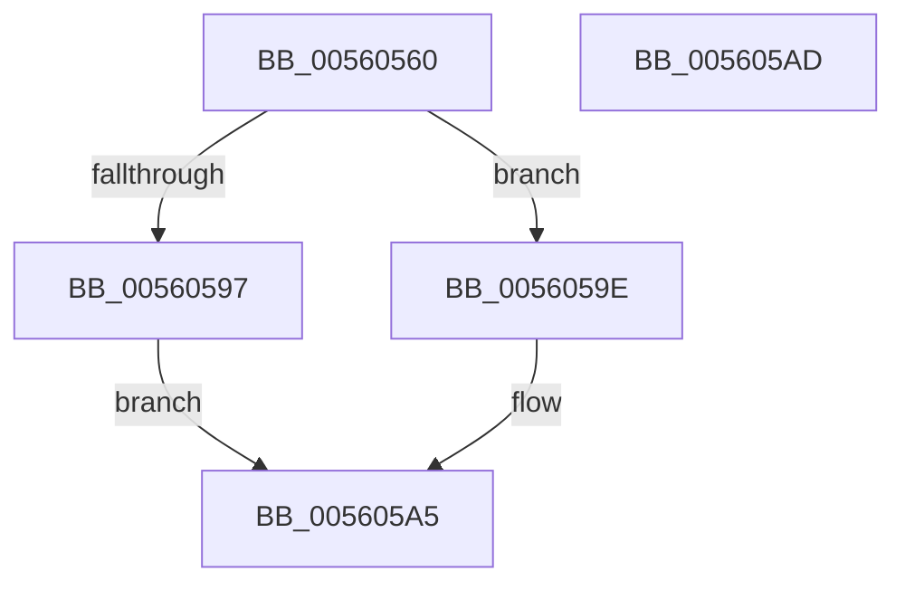

# HalpTimerProfileInterrupt

- RVA: `0x00560560`–`0x005605AE` (길이 `78` bytes)
- VA: `0x0000000140560560`
- 실행 섹션: `.text`
- PDB 이름 있음: `예`; PDB Function 태그: `아니요`
- unwind 정보 RVA: `0x0005CF00`
- 디코드: `22`개 명령, `78/78` bytes 표시
- 미해석 바이트: `0` (있으면 어셈블리에 `.byte`로 보존)

> 이 문서는 커널 이미지의 기계어와 PDB 기호를 분석해 생성했습니다. 4번과 5번은 함수 원형과 자료형을 바이너리 사용 방식에서 추정한 C 해석이며 원본 소스 복구 결과는 아닙니다.

## 1. Dependencies

- 직접 호출 지점: **4**; 고유 호출 대상: **3**
- 직접 호출자로 확인된 함수: **0**
- RIP 상대 이미지 참조: **2**

### Outgoing calls
- `0x00560577` → [HalpTimerGetInternalData](../20/HalpTimerGetInternalData_function_00209500.md) (function, `0x00209500`)
- `0x00560583` → [guard_dispatch_icall](../6B/guard_dispatch_icall_function_006BAAD0.md) (function, `0x006BAAD0`)
- `0x00560597` → [guard_dispatch_icall](../6B/guard_dispatch_icall_function_006BAAD0.md) (function, `0x006BAAD0`)
- `0x005605A0` → [KeProfileInterruptWithSource](../4A/KeProfileInterruptWithSource_function_004A34D0.md) (function, `0x004A34D0`)

### Direct callers
- 이 함수 시작 RVA로 연결되는 직접 call은 확인되지 않았습니다. 간접 호출은 완전히 역산할 수 없습니다.

### Static image references
- `0x00560566` → RVA `0x00FC3FC0` (`.data`; read)
- `0x00560588` → RVA `0x00E10360` (`.data`; read)

## 2. Other-region calls and transfers

- 다른 실행 섹션으로 향하는 call: **0**
- 별도 외부 분기/꼬리 이동을 확인하지 못했습니다.

## 3. Assembly (complete function range)

```asm
00560560  40 53                           push rbx
00560562  48 83 EC 20                     sub rsp, 0x20
00560566  48 8B 15 53 3A A6 00            mov rdx, qword ptr [rip + 0xa63a53]
0056056D  48 8B 99 88 00 00 00            mov rbx, qword ptr [rcx + 0x88]
00560574  48 8B CA                        mov rcx, rdx
00560577  E8 84 8F CA FF                  call 0x140209500
0056057C  48 8B C8                        mov rcx, rax
0056057F  48 8B 42 78                     mov rax, qword ptr [rdx + 0x78]
00560583  E8 48 A5 15 00                  call 0x1406baad0
00560588  48 8B 05 D1 FD 8A 00            mov rax, qword ptr [rip + 0x8afdd1]
0056058F  48 8B CB                        mov rcx, rbx
00560592  48 85 C0                        test rax, rax
00560595  74 07                           je 0x14056059e
00560597  E8 34 A5 15 00                  call 0x1406baad0
0056059C  EB 07                           jmp 0x1405605a5
0056059E  33 D2                           xor edx, edx
005605A0  E8 2B 2F F4 FF                  call 0x1404a34d0
005605A5  B0 01                           mov al, 1
005605A7  48 83 C4 20                     add rsp, 0x20
005605AB  5B                              pop rbx
005605AC  C3                              ret
005605AD  CC                              int3
```

## 4. C-style interpretation (structured pseudocode)

```c
__int64 __fastcall HalpTimerProfileInterrupt(__int64 a1)
{
    __int64 result;
    __int64 v_rsp;

    v_rsp = (v_rsp) - (32);
    result = HalpTimerGetInternalData(*(unsigned __int64 *)(v_rip + 10893907), *(unsigned __int64 *)(v_rip + 10893907), a3, a4);
    result = guard_dispatch_icall(result, *(unsigned __int64 *)(v_rip + 10893907), a3, a4);
    if (*(unsigned __int64 *)(v_rip + 9108945) == 0) goto loc_0056059E;
    result = guard_dispatch_icall(*(unsigned __int64 *)(a1 + 136), *(unsigned __int64 *)(v_rip + 10893907), a3, a4);
    goto loc_005605A5;
loc_0056059E:
    a2 = 0;
    result = KeProfileInterruptWithSource(*(unsigned __int64 *)(a1 + 136), a2, a3, a4);
loc_005605A5:
    v_rsp = (v_rsp) + (32);
    return 1;
}
```

## 5. (Beta) C Style

```c
int64_t HalpTimerProfileInterrupt(void *Arg1)
{
    uint8_t *arg1 = (uint8_t *)Arg1;

    int64_t result;
    int64_t local_rsp;

    local_rsp = (local_rsp) - (32);
    result = HalpTimerGetInternalData(*(uint64_t *)(v_rip + 0xA63A53), *(uint64_t *)(v_rip + 0xA63A53), a3, a4);
    result = guard_dispatch_icall(result, *(uint64_t *)(v_rip + 0xA63A53), a3, a4);
    if (*(uint64_t *)(v_rip + 0x8AFDD1) == 0) goto loc_0056059E;
    result = guard_dispatch_icall(*(uint64_t *)(arg1 + 0x88), *(uint64_t *)(v_rip + 0xA63A53), a3, a4);
    goto loc_005605A5;
loc_0056059E:
    a2 = 0;
    result = KeProfileInterruptWithSource(*(uint64_t *)(arg1 + 0x88), a2, a3, a4);
loc_005605A5:
    local_rsp = (local_rsp) + (32);
    return 1;
}
```

### 관측된 메모리 오프셋

구조체 형식이 확인되지 않은 접근은 인자 기준의 오프셋으로만 기록했습니다.

| 기준 인자 | 오프셋 표현 | 폭 (bit) | 접근 |
|---|---:|---:|---|
| `Arg1` | `+ 0x88` | `64` | `R` |

## 6. Execution-region graph

[열기: 2D/3D 그래프와 함수 탐색 컨트롤 패널](../../../control-panel.html?section=text&rva=0x00560560&view=graph)

- 2D 그래프는 위에서 아래로 흐르고, 3D 그래프는 빈 공간을 드래그해 회전합니다. Shift+드래그는 이동, 휠은 확대·축소, 함수 노드 선택은 대상 보고서 이동입니다.

### Static fallback


