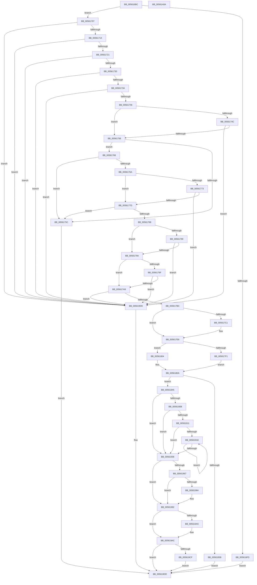

# HalpTimerRegister

- RVA: `0x005616BC`–`0x00561A0B` (길이 `847` bytes)
- VA: `0x00000001405616BC`
- 실행 섹션: `.text`
- PDB 이름 있음: `예`; PDB Function 태그: `아니요`
- unwind 정보 RVA: `0x000C4AC0`
- 디코드: `214`개 명령, `847/847` bytes 표시
- 미해석 바이트: `0` (있으면 어셈블리에 `.byte`로 보존)

> 이 문서는 커널 이미지의 기계어와 PDB 기호를 분석해 생성했습니다. 4번과 5번은 함수 원형과 자료형을 바이너리 사용 방식에서 추정한 C 해석이며 원본 소스 복구 결과는 아닙니다.

## 1. Dependencies

- 직접 호출 지점: **9**; 고유 호출 대상: **9**
- 직접 호출자로 확인된 함수: **9**
- RIP 상대 이미지 참조: **7**

### Outgoing calls
- `0x005617CD` → [HalpTimerBuildKnownResourceIdString](../54/HalpTimerBuildKnownResourceIdString_function_00548A10.md) (function, `0x00548A10`)
- `0x005617E1` → [RtlInitUnicodeString](../42/RtlInitUnicodeString_function_0042A780.md) (function, `0x0042A780`)
- `0x005617F1` → [HalQueryMaximumProcessorCount](../4A/HalQueryMaximumProcessorCount_function_004AC9A0.md) (function, `0x004AC9A0`)
- `0x0056182E` → [HalpMmAllocateMemoryInternal](../54/HalpMmAllocateMemoryInternal_function_00544990.md) (function, `0x00544990`)
- `0x0056184D` → [memset](../6C/memset_function_006C6C40.md) (function, `0x006C6C40`)
- `0x0056192A` → [memcpy](../6C/memcpy_function_006C6840.md) (function, `0x006C6840`)
- `0x00561959` → [RtlCopyUnicodeString](../3F/RtlCopyUnicodeString_function_003FEF30.md) (function, `0x003FEF30`)
- `0x0056198D` → [HalpPciGetHpetInterruptSource](../../init/C2/HalpPciGetHpetInterruptSource_function_00C25940.md) (function, `0x00C25940`)
- `0x005619EA` → [_security_check_cookie](../6A/_security_check_cookie_function_006AC640.md) (function, `0x006AC640`)

### Direct callers
- [HalpVpptTimerRegister](../54/HalpVpptTimerRegister_function_0054A42C.md) at `0x0054A587`
- [HalpHvDiscover](HalpHvDiscover_function_005606A0.md) at `0x00560732`
- [HalpHvDiscover](HalpHvDiscover_function_005606A0.md) at `0x005607E7`
- [HalpWdatDiscover](HalpWdatDiscover_function_005609A8.md) at `0x00560BF6`
- [HalpPmTimerDiscover](HalpPmTimerDiscover_function_00561AD0.md) at `0x00561BA8`
- [HalpHvWatchdogDiscover](HalpHvWatchdogDiscover_function_00561C60.md) at `0x00561D48`
- [HalpArtDiscover](HalpArtDiscover_function_00561DB4.md) at `0x00561E6B`
- [HalpHpetDiscover](HalpHpetDiscover_function_00561E98.md) at `0x005621EE`
- [HalpHpetDiscover](HalpHpetDiscover_function_00561E98.md) at `0x005622BA`
- [HalpApicTimerDiscover](HalpApicTimerDiscover_function_005623D0.md) at `0x0056254F`
- [HalpTscDiscover](HalpTscDiscover_function_00562728.md) at `0x0056284E`

### Static image references
- `0x005616D3` → RVA `0x00E0A740` (`.data`; read)
- `0x005616EA` → RVA `0x00E0A758` (`.data`; read)
- `0x00561992` → RVA `0x00FC4128` (`.data`; read)
- `0x00561999` → RVA `0x00FC4120` (`.data`; read)
- `0x005619AC` → RVA `0x00FC413C` (`.data`; read/write)
- `0x005619BC` → RVA `0x00FC4128` (`.data`; write)
- `0x005619CF` → RVA `0x00FC40E8` (`.data`; write)

## 2. Other-region calls and transfers

- 다른 실행 섹션으로 향하는 call: **1**
  - `0x0056198D` → [HalpPciGetHpetInterruptSource](../../init/C2/HalpPciGetHpetInterruptSource_function_00C25940.md) (`.text` → `INIT`)
- 별도 외부 분기/꼬리 이동을 확인하지 못했습니다.

## 3. Assembly (complete function range)

```asm
005616BC  48 89 5C 24 18                  mov qword ptr [rsp + 0x18], rbx
005616C1  55                              push rbp
005616C2  56                              push rsi
005616C3  57                              push rdi
005616C4  41 54                           push r12
005616C6  41 55                           push r13
005616C8  41 56                           push r14
005616CA  41 57                           push r15
005616CC  48 81 EC E0 00 00 00            sub rsp, 0xe0
005616D3  48 8B 05 66 90 8A 00            mov rax, qword ptr [rip + 0x8a9066]
005616DA  48 33 C4                        xor rax, rsp
005616DD  48 89 84 24 D0 00 00 00         mov qword ptr [rsp + 0xd0], rax
005616E5  33 DB                           xor ebx, ebx
005616E7  0F 57 C0                        xorps xmm0, xmm0
005616EA  38 1D 68 90 8A 00               cmp byte ptr [rip + 0x8a9068], bl
005616F0  4C 8B FA                        mov r15, rdx
005616F3  48 8B F9                        mov rdi, rcx
005616F6  0F 11 44 24 20                  movups xmmword ptr [rsp + 0x20], xmm0
005616FB  75 0A                           jne 0x140561707
005616FD  BB 89 01 00 C0                  mov ebx, 0xc0000189
00561702  E9 D6 02 00 00                  jmp 0x1405619dd
00561707  BE 01 00 00 00                  mov esi, 1
0056170C  39 31                           cmp dword ptr [rcx], esi
0056170E  0F 85 C4 02 00 00               jne 0x1405619d8
00561714  81 79 04 90 00 00 00            cmp dword ptr [rcx + 4], 0x90
0056171B  0F 85 B7 02 00 00               jne 0x1405619d8
00561721  8B 49 74                        mov ecx, dword ptr [rcx + 0x74]
00561724  F7 C1 00 00 00 FE               test ecx, 0xfe000000
0056172A  0F 85 A8 02 00 00               jne 0x1405619d8
00561730  0F BA E1 16                     bt ecx, 0x16
00561734  0F 82 9E 02 00 00               jb 0x1405619d8
0056173A  39 9F 88 00 00 00               cmp dword ptr [rdi + 0x88], ebx
00561740  0F 84 92 02 00 00               je 0x1405619d8
00561746  0F BA E1 0A                     bt ecx, 0xa
0056174A  73 0A                           jae 0x140561756
0056174C  48 39 5F 38                     cmp qword ptr [rdi + 0x38], rbx
00561750  0F 84 82 02 00 00               je 0x1405619d8
00561756  0F BA E1 0C                     bt ecx, 0xc
0056175A  73 0A                           jae 0x140561766
0056175C  BB BB 00 00 C0                  mov ebx, 0xc00000bb
00561761  E9 77 02 00 00                  jmp 0x1405619dd
00561766  84 C9                           test cl, cl
00561768  78 F2                           js 0x14056175c
0056176A  BA 00 08 00 00                  mov edx, 0x800
0056176F  85 CA                           test edx, ecx
00561771  74 0A                           je 0x14056177d
00561773  48 39 5F 48                     cmp qword ptr [rdi + 0x48], rbx
00561777  0F 84 5B 02 00 00               je 0x1405619d8
0056177D  8B C1                           mov eax, ecx
0056177F  25 01 08 00 00                  and eax, 0x801
00561784  3B C2                           cmp eax, edx
00561786  74 D4                           je 0x14056175c
00561788  F7 C1 00 0F 00 00               test ecx, 0xf00
0056178E  74 0A                           je 0x14056179a
00561790  48 39 5F 28                     cmp qword ptr [rdi + 0x28], rbx
00561794  0F 84 3E 02 00 00               je 0x1405619d8
0056179A  F6 C1 02                        test cl, 2
0056179D  74 0A                           je 0x1405617a9
0056179F  48 39 5F 10                     cmp qword ptr [rdi + 0x10], rbx
005617A3  0F 84 2F 02 00 00               je 0x1405619d8
005617A9  81 E1 01 00 01 00               and ecx, 0x10001
005617AF  BD 00 00 01 00                  mov ebp, 0x10000
005617B4  3B CD                           cmp ecx, ebp
005617B6  0F 84 1C 02 00 00               je 0x1405619d8
005617BC  4D 85 FF                        test r15, r15
005617BF  75 25                           jne 0x1405617e6
005617C1  4C 8D 44 24 30                  lea r8, [rsp + 0x30]
005617C6  48 8B CF                        mov rcx, rdi
005617C9  41 8D 57 4B                     lea edx, [r15 + 0x4b]
005617CD  E8 3E 72 FE FF                  call 0x140548a10
005617D2  48 8D 54 24 30                  lea rdx, [rsp + 0x30]
005617D7  48 8D 4C 24 20                  lea rcx, [rsp + 0x20]
005617DC  4C 8D 7C 24 20                  lea r15, [rsp + 0x20]
005617E1  E8 9A 8F EC FF                  call 0x14042a780
005617E6  41 BE F8 FF FF FF               mov r14d, 0xfffffff8
005617EC  85 6F 74                        test dword ptr [rdi + 0x74], ebp
005617EF  74 13                           je 0x140561804
005617F1  E8 AA B1 F4 FF                  call 0x1404ac9a0
005617F6  8B 6F 60                        mov ebp, dword ptr [rdi + 0x60]
005617F9  44 8B E0                        mov r12d, eax
005617FC  83 C5 07                        add ebp, 7
005617FF  41 23 EE                        and ebp, r14d
00561802  EB 06                           jmp 0x14056180a
00561804  8B 6F 60                        mov ebp, dword ptr [rdi + 0x60]
00561807  44 8B E6                        mov r12d, esi
0056180A  44 8B ED                        mov r13d, ebp
0056180D  8B D6                           mov edx, esi
0056180F  45 0F AF EC                     imul r13d, r12d
00561813  41 8D 8D 5F 01 00 00            lea ecx, [r13 + 0x15f]
0056181A  41 23 CE                        and ecx, r14d
0056181D  45 0F B7 37                     movzx r14d, word ptr [r15]
00561821  83 C1 09                        add ecx, 9
00561824  44 03 F1                        add r14d, ecx
00561827  41 83 E6 F8                     and r14d, 0xfffffff8
0056182B  41 8B CE                        mov ecx, r14d
0056182E  E8 5D 31 FE FF                  call 0x140544990
00561833  48 8B F0                        mov rsi, rax
00561836  48 85 C0                        test rax, rax
00561839  75 0A                           jne 0x140561845
0056183B  BB 9A 00 00 C0                  mov ebx, 0xc000009a
00561840  E9 98 01 00 00                  jmp 0x1405619dd
00561845  45 8B C6                        mov r8d, r14d
00561848  33 D2                           xor edx, edx
0056184A  48 8B CE                        mov rcx, rsi
0056184D  E8 EE 53 16 00                  call 0x1406c6c40
00561852  41 8B C5                        mov eax, r13d
00561855  4C 8D B6 2F 01 00 00            lea r14, [rsi + 0x12f]
0056185C  49 83 E6 F8                     and r14, 0xfffffffffffffff8
00561860  4C 89 B6 20 01 00 00            mov qword ptr [rsi + 0x120], r14
00561867  49 8D 4E 37                     lea rcx, [r14 + 0x37]
0056186B  48 83 E1 F8                     and rcx, 0xfffffffffffffff8
0056186F  48 89 4E 48                     mov qword ptr [rsi + 0x48], rcx
00561873  48 83 C1 07                     add rcx, 7
00561877  48 03 C8                        add rcx, rax
0056187A  48 83 E1 F8                     and rcx, 0xfffffffffffffff8
0056187E  49 89 4E 20                     mov qword ptr [r14 + 0x20], rcx
00561882  48 8B 47 68                     mov rax, qword ptr [rdi + 0x68]
00561886  48 89 86 C0 00 00 00            mov qword ptr [rsi + 0xc0], rax
0056188D  0F 10 47 08                     movups xmm0, xmmword ptr [rdi + 8]
00561891  0F 11 46 68                     movups xmmword ptr [rsi + 0x68], xmm0
00561895  0F 10 4F 18                     movups xmm1, xmmword ptr [rdi + 0x18]
00561899  0F 11 4E 78                     movups xmmword ptr [rsi + 0x78], xmm1
0056189D  0F 10 47 28                     movups xmm0, xmmword ptr [rdi + 0x28]
005618A1  0F 11 86 88 00 00 00            movups xmmword ptr [rsi + 0x88], xmm0
005618A8  0F 10 4F 38                     movups xmm1, xmmword ptr [rdi + 0x38]
005618AC  0F 11 8E 98 00 00 00            movups xmmword ptr [rsi + 0x98], xmm1
005618B3  0F 10 47 48                     movups xmm0, xmmword ptr [rdi + 0x48]
005618B7  89 6E 50                        mov dword ptr [rsi + 0x50], ebp
005618BA  0F 11 86 A8 00 00 00            movups xmmword ptr [rsi + 0xa8], xmm0
005618C1  8B 47 64                        mov eax, dword ptr [rdi + 0x64]
005618C4  89 86 DC 00 00 00               mov dword ptr [rsi + 0xdc], eax
005618CA  8B 47 74                        mov eax, dword ptr [rdi + 0x74]
005618CD  89 86 E0 00 00 00               mov dword ptr [rsi + 0xe0], eax
005618D3  8B 47 78                        mov eax, dword ptr [rdi + 0x78]
005618D6  89 46 54                        mov dword ptr [rsi + 0x54], eax
005618D9  8B 47 7C                        mov eax, dword ptr [rdi + 0x7c]
005618DC  89 46 58                        mov dword ptr [rsi + 0x58], eax
005618DF  8B 87 84 00 00 00               mov eax, dword ptr [rdi + 0x84]
005618E5  89 46 60                        mov dword ptr [rsi + 0x60], eax
005618E8  8B 87 80 00 00 00               mov eax, dword ptr [rdi + 0x80]
005618EE  89 46 5C                        mov dword ptr [rsi + 0x5c], eax
005618F1  8B 87 88 00 00 00               mov eax, dword ptr [rdi + 0x88]
005618F7  89 86 E4 00 00 00               mov dword ptr [rsi + 0xe4], eax
005618FD  8B 47 70                        mov eax, dword ptr [rdi + 0x70]
00561900  89 86 D8 00 00 00               mov dword ptr [rsi + 0xd8], eax
00561906  39 5F 60                        cmp dword ptr [rdi + 0x60], ebx
00561909  74 2B                           je 0x140561936
0056190B  48 39 5F 58                     cmp qword ptr [rdi + 0x58], rbx
0056190F  74 25                           je 0x140561936
00561911  8B EB                           mov ebp, ebx
00561913  45 85 E4                        test r12d, r12d
00561916  74 1E                           je 0x140561936
00561918  44 8B 47 60                     mov r8d, dword ptr [rdi + 0x60]
0056191C  8B CD                           mov ecx, ebp
0056191E  0F AF 4E 50                     imul ecx, dword ptr [rsi + 0x50]
00561922  48 8B 57 58                     mov rdx, qword ptr [rdi + 0x58]
00561926  48 03 4E 48                     add rcx, qword ptr [rsi + 0x48]
0056192A  E8 11 4F 16 00                  call 0x1406c6840
0056192F  FF C5                           inc ebp
00561931  41 3B EC                        cmp ebp, r12d
00561934  72 E2                           jb 0x140561918
00561936  8B 87 8C 00 00 00               mov eax, dword ptr [rdi + 0x8c]
0056193C  49 8D 4E 18                     lea rcx, [r14 + 0x18]
00561940  89 86 1C 01 00 00               mov dword ptr [rsi + 0x11c], eax
00561946  49 8B D7                        mov rdx, r15
00561949  66 89 19                        mov word ptr [rcx], bx
0056194C  41 0F B7 07                     movzx eax, word ptr [r15]
00561950  66 83 C0 02                     add ax, 2
00561954  66 41 89 46 1A                  mov word ptr [r14 + 0x1a], ax
00561959  E8 D2 D5 E9 FF                  call 0x1403fef30
0056195E  F7 47 74 00 04 00 00            test dword ptr [rdi + 0x74], 0x400
00561965  74 2B                           je 0x140561992
00561967  49 89 5E 0C                     mov qword ptr [r14 + 0xc], rbx
0056196B  49 8D 56 08                     lea rdx, [r14 + 8]
0056196F  89 1A                           mov dword ptr [rdx], ebx
00561971  4D 8D 4E 04                     lea r9, [r14 + 4]
00561975  41 89 1E                        mov dword ptr [r14], ebx
00561978  41 89 19                        mov dword ptr [r9], ebx
0056197B  83 BF 88 00 00 00 03            cmp dword ptr [rdi + 0x88], 3
00561982  75 0E                           jne 0x140561992
00561984  8A 8F 8E 00 00 00               mov cl, byte ptr [rdi + 0x8e]
0056198A  4D 8B C6                        mov r8, r14
0056198D  E8 AE 3F 6C 00                  call 0x140c25940
00561992  48 8B 05 8F 27 A6 00            mov rax, qword ptr [rip + 0xa6278f]
00561999  48 8D 15 80 27 A6 00            lea rdx, [rip + 0xa62780]
005619A0  48 39 10                        cmp qword ptr [rax], rdx
005619A3  74 07                           je 0x1405619ac
005619A5  B9 03 00 00 00                  mov ecx, 3
005619AA  CD 29                           int 0x29
005619AC  FF 05 8A 27 A6 00               inc dword ptr [rip + 0xa6278a]
005619B2  48 89 16                        mov qword ptr [rsi], rdx
005619B5  48 89 46 08                     mov qword ptr [rsi + 8], rax
005619B9  48 89 30                        mov qword ptr [rax], rsi
005619BC  48 89 35 65 27 A6 00            mov qword ptr [rip + 0xa62765], rsi
005619C3  F7 86 E0 00 00 00 00 00 10 00   test dword ptr [rsi + 0xe0], 0x100000
005619CD  74 0E                           je 0x1405619dd
005619CF  C6 05 12 27 A6 00 01            mov byte ptr [rip + 0xa62712], 1
005619D6  EB 05                           jmp 0x1405619dd
005619D8  BB 0D 00 00 C0                  mov ebx, 0xc000000d
005619DD  8B C3                           mov eax, ebx
005619DF  48 8B 8C 24 D0 00 00 00         mov rcx, qword ptr [rsp + 0xd0]
005619E7  48 33 CC                        xor rcx, rsp
005619EA  E8 51 AC 14 00                  call 0x1406ac640
005619EF  48 8B 9C 24 30 01 00 00         mov rbx, qword ptr [rsp + 0x130]
005619F7  48 81 C4 E0 00 00 00            add rsp, 0xe0
005619FE  41 5F                           pop r15
00561A00  41 5E                           pop r14
00561A02  41 5D                           pop r13
00561A04  41 5C                           pop r12
00561A06  5F                              pop rdi
00561A07  5E                              pop rsi
00561A08  5D                              pop rbp
00561A09  C3                              ret
00561A0A  CC                              int3
```

## 4. C-style interpretation (structured pseudocode)

```c
__int64 __fastcall HalpTimerRegister(__int64 a1, __int64 a2)
{
    __int64 result;
    __int64 v_r13;
    __int64 v_r14;
    __int64 v_r15;
    __int64 v_rbp;
    __int64 v_rbx;
    __int64 v_rsp;
    unsigned __int64 v_stack_m48;
    unsigned __int64 v_stack_mE8;
    unsigned __int64 v_stack_mF8;
    unsigned __int64 v_stack_p18;

    v_stack_p18 = v_rbx;
    v_rsp = (v_rsp) - (224);
    result = (*(unsigned __int64 *)(v_rip + 9080934)) ^ (v_rsp);
    v_stack_m48 = result;
    v_rbx = 0;
    v_stack_mF8 = v_xmm0;
    if ((*(unsigned __int8 *)(v_rip + 9080936)) != 0) goto loc_00561707;
    goto loc_005619DD;
loc_00561707:
    if ((*(unsigned int *)(a1)) != 1) goto loc_005619D8;
    if ((*(unsigned int *)(a1 + 4)) != 144) goto loc_005619D8;
    if ((((unsigned int)((unsigned int)(*(unsigned int *)(a1 + 116)))) & (0xFE000000ULL)) != 0) goto loc_005619D8;
    if (condition_is_below) goto loc_005619D8;
    if ((*(unsigned int *)(a1 + 136)) == ((unsigned int)((unsigned int)(0xC0000189ULL)))) goto loc_005619D8;
    if ((*(unsigned int *)(a1 + 136)) >= ((unsigned int)((unsigned int)(0xC0000189ULL)))) goto loc_00561756;
    if ((*(unsigned __int64 *)(a1 + 56)) == ((unsigned int)(0xC0000189ULL))) goto loc_005619D8;
loc_00561756:
    if ((*(unsigned __int64 *)(a1 + 56)) >= ((unsigned int)(0xC0000189ULL))) goto loc_00561766;
loc_0056175C:
    goto loc_005619DD;
loc_00561766:
    if (sign_flag) goto loc_0056175C;
    if ((((unsigned int)((unsigned int)(0x800ULL))) & ((unsigned int)((unsigned int)(*(unsigned int *)(a1 + 116))))) == 0) goto loc_0056177D;
    if ((*(unsigned __int64 *)(a1 + 72)) == ((unsigned int)(0xC00000BBULL))) goto loc_005619D8;
loc_0056177D:
    result = (unsigned int)(((unsigned int)((unsigned int)((unsigned int)(*(unsigned int *)(a1 + 116))))) & (0x801ULL));
    if (((unsigned int)(result)) == ((unsigned int)((unsigned int)(0x800ULL)))) goto loc_0056175C;
    if ((((unsigned int)((unsigned int)(*(unsigned int *)(a1 + 116)))) & (0xF00ULL)) == 0) goto loc_0056179A;
    if ((*(unsigned __int64 *)(a1 + 40)) == ((unsigned int)(0xC00000BBULL))) goto loc_005619D8;
loc_0056179A:
    if ((((unsigned __int8)((unsigned int)(*(unsigned int *)(a1 + 116)))) & (2)) == 0) goto loc_005617A9;
    if ((*(unsigned __int64 *)(a1 + 16)) == ((unsigned int)(0xC00000BBULL))) goto loc_005619D8;
loc_005617A9:
    a1 = (unsigned int)(((unsigned int)(*(unsigned int *)(a1 + 116))) & (0x10001ULL));
    if (((unsigned int)(a1)) == ((unsigned int)((unsigned int)(0x10000ULL)))) goto loc_005619D8;
    v_r15 = a2;
    if (a2 == 0) {
        a3 = v_stack_mE8;
        a1 = a1;
        a2 = a2 + 75;
        result = HalpTimerBuildKnownResourceIdString(a1, a2, a3, a4);
        a2 = v_stack_mE8;
        a1 = v_stack_mF8;
        v_r15 = v_stack_mF8;
        result = RtlInitUnicodeString(a1, a2, a3, a4);
    }
    if (((*(unsigned int *)(a1 + 116)) & ((unsigned int)((unsigned int)(0x10000ULL)))) == 0) goto loc_00561804;
    result = HalQueryMaximumProcessorCount(a1, a2, a3, a4);
    v_rbp = (unsigned int)(((unsigned int)(*(unsigned int *)(a1 + 96))) + (7));
    v_rbp = (unsigned int)((v_rbp) & ((unsigned int)((unsigned int)(0xFFFFFFF8ULL))));
    goto loc_0056180A;
loc_00561804:
loc_0056180A:
    v_r13 = (unsigned int)(((unsigned int)((unsigned int)((unsigned int)(*(unsigned int *)(a1 + 96))))) * (1));
    a1 = (unsigned int)((v_r13 + 351) & ((unsigned int)((unsigned int)(0xFFFFFFF8ULL))));
    a1 = (unsigned int)((a1) + (9));
    v_r14 = (unsigned int)((*(unsigned __int16 *)(v_r15)) + ((unsigned int)(a1)));
    v_r14 = (unsigned int)((v_r14) & (0xFFFFFFF8ULL));
    result = HalpMmAllocateMemoryInternal((unsigned int)((unsigned int)(v_r14)), 1, a3, a4);
    if (result != 0) goto loc_00561845;
    goto loc_005619DD;
loc_00561845:
    a2 = 0;
    result = memset(result, a2, (unsigned int)((unsigned int)(v_r14)), a4);
    v_r14 = (result + 303) & (-8);
    *(unsigned __int64 *)(result + 288) = v_r14;
    a1 = (v_r14 + 55) & (-8);
    *(unsigned __int64 *)(result + 72) = a1;
    a1 = (a1) + (7);
    a1 = (a1) + ((unsigned int)((unsigned int)(v_r13)));
    a1 = (a1) & (-8);
    *(unsigned __int64 *)(v_r14 + 32) = a1;
    *(unsigned __int64 *)(result + 192) = *(unsigned __int64 *)(a1 + 104);
    *(unsigned __int64 *)(result + 104) = v_xmm0;
    *(unsigned __int64 *)(result + 120) = v_xmm1;
    *(unsigned __int64 *)(result + 136) = v_xmm0;
    *(unsigned __int64 *)(result + 152) = v_xmm1;
    *(unsigned int *)(result + 80) = (unsigned int)((unsigned int)(*(unsigned int *)(a1 + 96)));
    *(unsigned __int64 *)(result + 168) = v_xmm0;
    *(unsigned int *)(result + 220) = (unsigned int)((unsigned int)(*(unsigned int *)(a1 + 100)));
    *(unsigned int *)(result + 224) = (unsigned int)((unsigned int)(*(unsigned int *)(a1 + 116)));
    *(unsigned int *)(result + 84) = (unsigned int)((unsigned int)(*(unsigned int *)(a1 + 120)));
    *(unsigned int *)(result + 88) = (unsigned int)((unsigned int)(*(unsigned int *)(a1 + 124)));
    *(unsigned int *)(result + 96) = (unsigned int)((unsigned int)(*(unsigned int *)(a1 + 132)));
    *(unsigned int *)(result + 92) = (unsigned int)((unsigned int)(*(unsigned int *)(a1 + 128)));
    *(unsigned int *)(result + 228) = (unsigned int)((unsigned int)(*(unsigned int *)(a1 + 136)));
    *(unsigned int *)(result + 216) = (unsigned int)((unsigned int)(*(unsigned int *)(a1 + 112)));
    if ((*(unsigned int *)(a1 + 96)) == ((unsigned int)((unsigned int)(0xC000009AULL)))) goto loc_00561936;
    if ((*(unsigned __int64 *)(a1 + 88)) == ((unsigned int)(0xC000009AULL))) goto loc_00561936;
    if (1 == 0) goto loc_00561936;
loc_00561918:
    a1 = (unsigned int)(((unsigned int)((unsigned int)((unsigned int)((unsigned int)((unsigned int)(0xC000009AULL)))))) * (*(unsigned int *)(result + 80)));
    a1 = (a1) + (*(unsigned __int64 *)(result + 72));
    result = memcpy(a1, *(unsigned __int64 *)(a1 + 88), (unsigned int)(*(unsigned int *)(a1 + 96)), a4);
    v_rbp = (unsigned int)(((unsigned int)((unsigned int)((unsigned int)(0xC000009AULL)))) + 1);
    if (((unsigned int)(v_rbp)) < 1) goto loc_00561918;
loc_00561936:
    *(unsigned int *)(result + 284) = (unsigned int)((unsigned int)(*(unsigned int *)(a1 + 140)));
    *(unsigned __int16 *)(v_r14 + 24) = (unsigned __int16)((unsigned int)(0xC000009AULL));
    result = (unsigned __int16)((*(unsigned __int16 *)(v_r15)) + (2));
    *(unsigned __int16 *)(v_r14 + 26) = (unsigned __int16)(result);
    result = RtlCopyUnicodeString(v_r14 + 24, v_r15, (unsigned int)(*(unsigned int *)(a1 + 96)), a4);
    if (((*(unsigned int *)(a1 + 116)) & (0x400ULL)) == 0) goto loc_00561992;
    *(unsigned __int64 *)(v_r14 + 12) = (unsigned int)(0xC000009AULL);
    *(unsigned int *)(v_r14 + 8) = (unsigned int)((unsigned int)(0xC000009AULL));
    *(unsigned int *)(v_r14) = (unsigned int)((unsigned int)(0xC000009AULL));
    *(unsigned int *)(v_r14 + 4) = (unsigned int)((unsigned int)(0xC000009AULL));
    if ((*(unsigned int *)(a1 + 136)) == 3) {
        a1 = *(unsigned __int8 *)(a1 + 142);
        a3 = v_r14;
        result = HalpPciGetHpetInterruptSource(a1, v_r14 + 8, a3, v_r14 + 4);
    }
    if ((*(unsigned __int64 *)(*(unsigned __int64 *)(v_rip + 10889103))) != (v_rip + 10889088)) {
        a1 = 3;
    }
    *(unsigned __int64 *)(result) = v_rip + 10889088;
    *(unsigned __int64 *)(result + 8) = *(unsigned __int64 *)(v_rip + 10889103);
    *(unsigned __int64 *)(*(unsigned __int64 *)(v_rip + 10889103)) = result;
    *(unsigned __int64 *)(v_rip + 10889061) = result;
    if (((*(unsigned int *)(result + 224)) & (0x100000ULL)) == 0) goto loc_005619DD;
    *(unsigned __int8 *)(v_rip + 10888978) = 1;
    goto loc_005619DD;
loc_005619D8:
loc_005619DD:
    a1 = (v_stack_m48) ^ (v_rsp);
    result = _security_check_cookie(a1, v_rip + 10889088, a3, v_r14 + 4);
    v_rsp = (v_rsp) + (224);
    return result;
}
```

## 5. (Beta) C Style

```c
int64_t HalpTimerRegister(void *Arg1, int64_t Arg2)
{
    uint8_t *arg1 = (uint8_t *)Arg1;

    int64_t result;
    int64_t local_r13;
    int64_t local_r14;
    int64_t local_r15;
    int64_t local_rbp;
    int64_t local_rbx;
    int64_t local_rsp;
    uint64_t v_stack_m48;
    uint64_t v_stack_mE8;
    uint64_t v_stack_mF8;
    uint64_t v_stack_p18;

    v_stack_p18 = local_rbx;
    local_rsp = (local_rsp) - (224);
    result = (*(uint64_t *)(v_rip + 0x8A9066)) ^ (local_rsp);
    v_stack_m48 = result;
    local_rbx = 0;
    v_stack_mF8 = v_xmm0;
    if ((*(uint8_t *)(v_rip + 0x8A9068)) != 0) goto loc_00561707;
    goto loc_005619DD;
loc_00561707:
    if ((*(uint32_t *)(arg1)) != 1) goto loc_005619D8;
    if ((*(uint32_t *)(arg1 + 0x4)) != 144) goto loc_005619D8;
    if ((((uint32_t)((uint32_t)(*(uint32_t *)(arg1 + 0x74)))) & (0xFE000000ULL)) != 0) goto loc_005619D8;
    if (condition_is_below) goto loc_005619D8;
    if ((*(uint32_t *)(arg1 + 0x88)) == ((uint32_t)((uint32_t)(0xC0000189ULL)))) goto loc_005619D8;
    if ((*(uint32_t *)(arg1 + 0x88)) >= ((uint32_t)((uint32_t)(0xC0000189ULL)))) goto loc_00561756;
    if ((*(uint64_t *)(arg1 + 0x38)) == ((uint32_t)(0xC0000189ULL))) goto loc_005619D8;
loc_00561756:
    if ((*(uint64_t *)(arg1 + 0x38)) >= ((uint32_t)(0xC0000189ULL))) goto loc_00561766;
loc_0056175C:
    goto loc_005619DD;
loc_00561766:
    if (sign_flag) goto loc_0056175C;
    if ((((uint32_t)((uint32_t)(0x800ULL))) & ((uint32_t)((uint32_t)(*(uint32_t *)(arg1 + 0x74))))) == 0) goto loc_0056177D;
    if ((*(uint64_t *)(arg1 + 0x48)) == ((uint32_t)(0xC00000BBULL))) goto loc_005619D8;
loc_0056177D:
    result = (uint32_t)(((uint32_t)((uint32_t)((uint32_t)(*(uint32_t *)(arg1 + 0x74))))) & (0x801ULL));
    if (((uint32_t)(result)) == ((uint32_t)((uint32_t)(0x800ULL)))) goto loc_0056175C;
    if ((((uint32_t)((uint32_t)(*(uint32_t *)(arg1 + 0x74)))) & (0xF00ULL)) == 0) goto loc_0056179A;
    if ((*(uint64_t *)(arg1 + 0x28)) == ((uint32_t)(0xC00000BBULL))) goto loc_005619D8;
loc_0056179A:
    if ((((uint8_t)((uint32_t)(*(uint32_t *)(arg1 + 0x74)))) & (2)) == 0) goto loc_005617A9;
    if ((*(uint64_t *)(arg1 + 0x10)) == ((uint32_t)(0xC00000BBULL))) goto loc_005619D8;
loc_005617A9:
    Arg1 = (uint32_t)(((uint32_t)(*(uint32_t *)(arg1 + 0x74))) & (0x10001ULL));
    if (((uint32_t)(Arg1)) == ((uint32_t)((uint32_t)(0x10000ULL)))) goto loc_005619D8;
    local_r15 = Arg2;
    if (Arg2 == 0) {
        a3 = v_stack_mE8;
        Arg1 = Arg1;
        Arg2 = Arg2 + 75;
        result = HalpTimerBuildKnownResourceIdString(Arg1, Arg2, a3, a4);
        Arg2 = v_stack_mE8;
        Arg1 = v_stack_mF8;
        local_r15 = v_stack_mF8;
        result = RtlInitUnicodeString(Arg1, Arg2, a3, a4);
    }
    if (((*(uint32_t *)(arg1 + 0x74)) & ((uint32_t)((uint32_t)(0x10000ULL)))) == 0) goto loc_00561804;
    result = HalQueryMaximumProcessorCount(Arg1, Arg2, a3, a4);
    local_rbp = (uint32_t)(((uint32_t)(*(uint32_t *)(arg1 + 0x60))) + (7));
    local_rbp = (uint32_t)((local_rbp) & ((uint32_t)((uint32_t)(0xFFFFFFF8ULL))));
    goto loc_0056180A;
loc_00561804:
loc_0056180A:
    local_r13 = (uint32_t)(((uint32_t)((uint32_t)((uint32_t)(*(uint32_t *)(arg1 + 0x60))))) * (1));
    Arg1 = (uint32_t)((local_r13 + 351) & ((uint32_t)((uint32_t)(0xFFFFFFF8ULL))));
    Arg1 = (uint32_t)((Arg1) + (9));
    local_r14 = (uint32_t)((*(uint16_t *)(local_r15)) + ((uint32_t)(Arg1)));
    local_r14 = (uint32_t)((local_r14) & (0xFFFFFFF8ULL));
    result = HalpMmAllocateMemoryInternal((uint32_t)((uint32_t)(local_r14)), 1, a3, a4);
    if (result != 0) goto loc_00561845;
    goto loc_005619DD;
loc_00561845:
    Arg2 = 0;
    result = memset(result, Arg2, (uint32_t)((uint32_t)(local_r14)), a4);
    local_r14 = (result + 303) & (-8);
    *(uint64_t *)(result + 0x120) = local_r14;
    Arg1 = (local_r14 + 55) & (-8);
    *(void **)(result + 0x48) = Arg1;
    Arg1 = (Arg1) + (7);
    Arg1 = (Arg1) + ((uint32_t)((uint32_t)(local_r13)));
    Arg1 = (Arg1) & (-8);
    *(void **)(local_r14 + 0x20) = Arg1;
    *(uint64_t *)(result + 0xC0) = *(uint64_t *)(arg1 + 0x68);
    *(uint64_t *)(result + 0x68) = v_xmm0;
    *(uint64_t *)(result + 0x78) = v_xmm1;
    *(uint64_t *)(result + 0x88) = v_xmm0;
    *(uint64_t *)(result + 0x98) = v_xmm1;
    *(uint32_t *)(result + 0x50) = (uint32_t)((uint32_t)(*(uint32_t *)(arg1 + 0x60)));
    *(uint64_t *)(result + 0xA8) = v_xmm0;
    *(uint32_t *)(result + 0xDC) = (uint32_t)((uint32_t)(*(uint32_t *)(arg1 + 0x64)));
    *(uint32_t *)(result + 0xE0) = (uint32_t)((uint32_t)(*(uint32_t *)(arg1 + 0x74)));
    *(uint32_t *)(result + 0x54) = (uint32_t)((uint32_t)(*(uint32_t *)(arg1 + 0x78)));
    *(uint32_t *)(result + 0x58) = (uint32_t)((uint32_t)(*(uint32_t *)(arg1 + 0x7C)));
    *(uint32_t *)(result + 0x60) = (uint32_t)((uint32_t)(*(uint32_t *)(arg1 + 0x84)));
    *(uint32_t *)(result + 0x5C) = (uint32_t)((uint32_t)(*(uint32_t *)(arg1 + 0x80)));
    *(uint32_t *)(result + 0xE4) = (uint32_t)((uint32_t)(*(uint32_t *)(arg1 + 0x88)));
    *(uint32_t *)(result + 0xD8) = (uint32_t)((uint32_t)(*(uint32_t *)(arg1 + 0x70)));
    if ((*(uint32_t *)(arg1 + 0x60)) == ((uint32_t)((uint32_t)(0xC000009AULL)))) goto loc_00561936;
    if ((*(uint64_t *)(arg1 + 0x58)) == ((uint32_t)(0xC000009AULL))) goto loc_00561936;
    if (1 == 0) goto loc_00561936;
loc_00561918:
    Arg1 = (uint32_t)(((uint32_t)((uint32_t)((uint32_t)((uint32_t)((uint32_t)(0xC000009AULL)))))) * (*(uint32_t *)(result + 0x50)));
    Arg1 = (Arg1) + (*(uint64_t *)(result + 0x48));
    result = memcpy(Arg1, *(uint64_t *)(arg1 + 0x58), (uint32_t)(*(uint32_t *)(arg1 + 0x60)), a4);
    local_rbp = (uint32_t)(((uint32_t)((uint32_t)((uint32_t)(0xC000009AULL)))) + 1);
    if (((uint32_t)(local_rbp)) < 1) goto loc_00561918;
loc_00561936:
    *(uint32_t *)(result + 0x11C) = (uint32_t)((uint32_t)(*(uint32_t *)(arg1 + 0x8C)));
    *(uint16_t *)(local_r14 + 0x18) = (uint16_t)((uint32_t)(0xC000009AULL));
    result = (uint16_t)((*(uint16_t *)(local_r15)) + (2));
    *(uint16_t *)(local_r14 + 0x1A) = (uint16_t)(result);
    result = RtlCopyUnicodeString(local_r14 + 24, local_r15, (uint32_t)(*(uint32_t *)(arg1 + 0x60)), a4);
    if (((*(uint32_t *)(arg1 + 0x74)) & (0x400ULL)) == 0) goto loc_00561992;
    *(uint64_t *)(local_r14 + 0xC) = (uint32_t)(0xC000009AULL);
    *(uint32_t *)(local_r14 + 0x8) = (uint32_t)((uint32_t)(0xC000009AULL));
    *(uint32_t *)(local_r14) = (uint32_t)((uint32_t)(0xC000009AULL));
    *(uint32_t *)(local_r14 + 0x4) = (uint32_t)((uint32_t)(0xC000009AULL));
    if ((*(uint32_t *)(arg1 + 0x88)) == 3) {
        Arg1 = *(uint8_t *)(arg1 + 0x8E);
        a3 = local_r14;
        result = HalpPciGetHpetInterruptSource(Arg1, local_r14 + 8, a3, local_r14 + 4);
    }
    if ((*(uint64_t *)(*(uint64_t *)(v_rip + 0xA6278F))) != (v_rip + 10889088)) {
        Arg1 = 3;
    }
    *(uint64_t *)(result) = v_rip + 10889088;
    *(uint64_t *)(result + 0x8) = *(uint64_t *)(v_rip + 0xA6278F);
    *(uint64_t *)(*(uint64_t *)(v_rip + 0xA6278F)) = result;
    *(uint64_t *)(v_rip + 0xA62765) = result;
    if (((*(uint32_t *)(result + 0xE0)) & (0x100000ULL)) == 0) goto loc_005619DD;
    *(uint8_t *)(v_rip + 0xA62712) = 1;
    goto loc_005619DD;
loc_005619D8:
loc_005619DD:
    Arg1 = (v_stack_m48) ^ (local_rsp);
    result = _security_check_cookie(Arg1, v_rip + 10889088, a3, local_r14 + 4);
    local_rsp = (local_rsp) + (224);
    return result;
}
```

### 관측된 메모리 오프셋

구조체 형식이 확인되지 않은 접근은 인자 기준의 오프셋으로만 기록했습니다.

| 기준 인자 | 오프셋 표현 | 폭 (bit) | 접근 |
|---|---:|---:|---|
| `Arg1` | `+ 0x0` | `32` | `R` |
| `Arg1` | `+ 0x4` | `32` | `R` |
| `Arg1` | `+ 0x8` | `128` | `R` |
| `Arg1` | `+ 0x10` | `64` | `R` |
| `Arg1` | `+ 0x18` | `128` | `R` |
| `Arg1` | `+ 0x28` | `64` | `R` |
| `Arg1` | `+ 0x28` | `128` | `R` |
| `Arg1` | `+ 0x38` | `64` | `R` |
| `Arg1` | `+ 0x38` | `128` | `R` |
| `Arg1` | `+ 0x48` | `64` | `R` |
| `Arg1` | `+ 0x48` | `128` | `R` |
| `Arg1` | `+ 0x58` | `64` | `R` |
| `Arg1` | `+ 0x60` | `32` | `R` |
| `Arg1` | `+ 0x64` | `32` | `R` |
| `Arg1` | `+ 0x68` | `64` | `R` |
| `Arg1` | `+ 0x70` | `32` | `R` |
| `Arg1` | `+ 0x74` | `32` | `R` |
| `Arg1` | `+ 0x78` | `32` | `R` |
| `Arg1` | `+ 0x7C` | `32` | `R` |
| `Arg1` | `+ 0x80` | `32` | `R` |
| `Arg1` | `+ 0x84` | `32` | `R` |
| `Arg1` | `+ 0x88` | `32` | `R` |
| `Arg1` | `+ 0x8C` | `32` | `R` |
| `Arg1` | `+ 0x8E` | `8` | `R` |

## 6. Execution-region graph

[열기: 2D/3D 그래프와 함수 탐색 컨트롤 패널](../../../control-panel.html?section=text&rva=0x005616BC&view=graph)

- 2D 그래프는 위에서 아래로 흐르고, 3D 그래프는 빈 공간을 드래그해 회전합니다. Shift+드래그는 이동, 휠은 확대·축소, 함수 노드 선택은 대상 보고서 이동입니다.

### Static fallback


