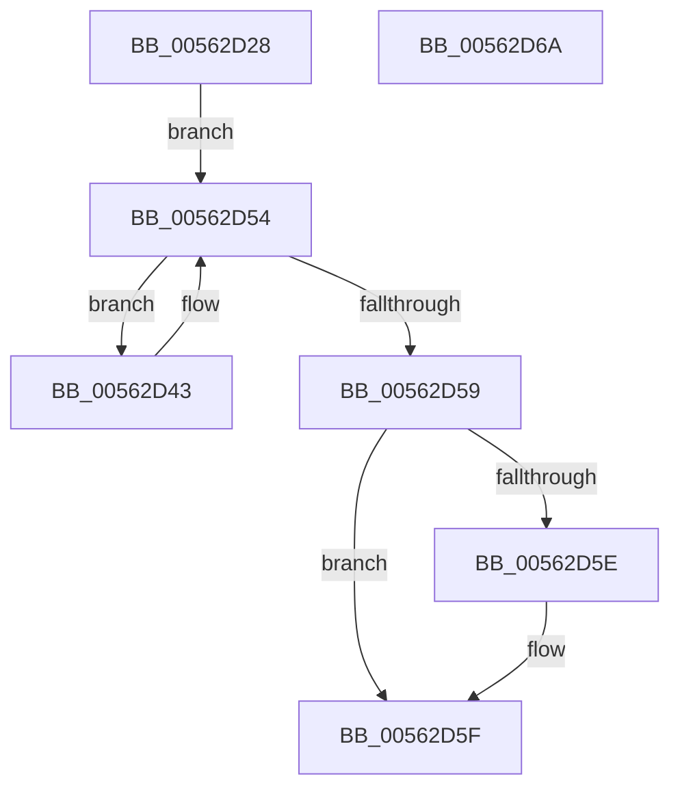

# HalpTimerUpdateApiConsumers

- RVA: `0x00562D28`–`0x00562D6B` (길이 `67` bytes)
- VA: `0x0000000140562D28`
- 실행 섹션: `.text`
- PDB 이름 있음: `예`; PDB Function 태그: `아니요`
- unwind 정보 RVA: `0x0005CAAC`
- 디코드: `21`개 명령, `67/67` bytes 표시
- 미해석 바이트: `0` (있으면 어셈블리에 `.byte`로 보존)

> 이 문서는 커널 이미지의 기계어와 PDB 기호를 분석해 생성했습니다. 4번과 5번은 함수 원형과 자료형을 바이너리 사용 방식에서 추정한 C 해석이며 원본 소스 복구 결과는 아닙니다.

## 1. Dependencies

- 직접 호출 지점: **2**; 고유 호출 대상: **2**
- 직접 호출자로 확인된 함수: **3**
- RIP 상대 이미지 참조: **1**

### Outgoing calls
- `0x00562D32` → [HalpDisableInterrupts](../25/HalpDisableInterrupts_function_002521A0.md) (function, `0x002521A0`)
- `0x00562D4C` → [guard_dispatch_icall](../6B/guard_dispatch_icall_function_006BAAD0.md) (function, `0x006BAAD0`)

### Direct callers
- [HalpPrepareForBugcheck](../54/HalpPrepareForBugcheck_function_0054C460.md) at `0x0054C4A6`
- [HalpRestoreHvEnlightenment](../54/HalpRestoreHvEnlightenment_function_0054D130.md) at `0x0054D4BF`
- [HalpSaveAndDisableEnlightenment](../54/HalpSaveAndDisableEnlightenment_function_0054D4D0.md) at `0x0054D8F8`

### Static image references
- `0x00562D37` → RVA `0x00E11780` (`.data`; read)

## 2. Other-region calls and transfers

- 다른 실행 섹션으로 향하는 call: **0**
- 별도 외부 분기/꼬리 이동을 확인하지 못했습니다.

## 3. Assembly (complete function range)

```asm
00562D28  48 89 5C 24 08                  mov qword ptr [rsp + 8], rbx
00562D2D  57                              push rdi
00562D2E  48 83 EC 20                     sub rsp, 0x20
00562D32  E8 69 F4 CE FF                  call 0x1402521a0
00562D37  48 8B 1D 42 EA 8A 00            mov rbx, qword ptr [rip + 0x8aea42]
00562D3E  40 8A F8                        mov dil, al
00562D41  EB 11                           jmp 0x140562d54
00562D43  48 8B 43 08                     mov rax, qword ptr [rbx + 8]
00562D47  B9 05 00 00 00                  mov ecx, 5
00562D4C  E8 7F 7D 15 00                  call 0x1406baad0
00562D51  48 8B 1B                        mov rbx, qword ptr [rbx]
00562D54  48 85 DB                        test rbx, rbx
00562D57  75 EA                           jne 0x140562d43
00562D59  40 84 FF                        test dil, dil
00562D5C  74 01                           je 0x140562d5f
00562D5E  FB                              sti
00562D5F  48 8B 5C 24 30                  mov rbx, qword ptr [rsp + 0x30]
00562D64  48 83 C4 20                     add rsp, 0x20
00562D68  5F                              pop rdi
00562D69  C3                              ret
00562D6A  CC                              int3
```

## 4. C-style interpretation (structured pseudocode)

```c
__int64 __fastcall HalpTimerUpdateApiConsumers(void)
{
    __int64 result;
    __int64 v_rsp;
    unsigned __int64 v_stack_p8;

    v_stack_p8 = v_rbx;
    v_rsp = (v_rsp) - (32);
    result = HalpDisableInterrupts(a1, a2, a3, a4);
    goto loc_00562D54;
loc_00562D43:
    result = guard_dispatch_icall(5, a2, a3, a4);
loc_00562D54:
    if (*(unsigned __int64 *)(*(unsigned __int64 *)(v_rip + 9103938)) != 0) goto loc_00562D43;
    if ((unsigned __int8)((unsigned __int8)(result)) != 0) {
    }
    v_rsp = (v_rsp) + (32);
    return result;
}
```

## 5. (Beta) C Style

```c
void HalpTimerUpdateApiConsumers(void)
{
    int64_t result;
    int64_t local_rsp;
    uint64_t v_stack_p8;

    v_stack_p8 = local_rbx;
    local_rsp = (local_rsp) - (32);
    result = HalpDisableInterrupts(a1, a2, a3, a4);
    goto loc_00562D54;
loc_00562D43:
    result = guard_dispatch_icall(5, a2, a3, a4);
loc_00562D54:
    if (*(uint64_t *)(*(uint64_t *)(v_rip + 0x8AEA42)) != 0) goto loc_00562D43;
    if ((uint8_t)((uint8_t)(result)) != 0) {
    }
    local_rsp = (local_rsp) + (32);
    return result;
}
```

## 6. Execution-region graph

[열기: 2D/3D 그래프와 함수 탐색 컨트롤 패널](../../../control-panel.html?section=text&rva=0x00562D28&view=graph)

- 2D 그래프는 위에서 아래로 흐르고, 3D 그래프는 빈 공간을 드래그해 회전합니다. Shift+드래그는 이동, 휠은 확대·축소, 함수 노드 선택은 대상 보고서 이동입니다.

### Static fallback


