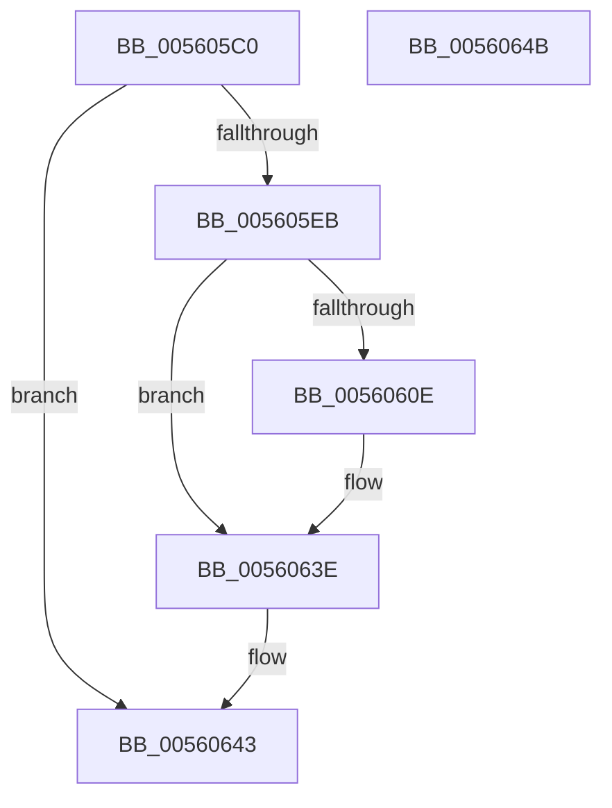

# HalpTimerWatchdogPreResetInterrupt

- RVA: `0x005605C0`–`0x0056064C` (길이 `140` bytes)
- VA: `0x00000001405605C0`
- 실행 섹션: `.text`
- PDB 이름 있음: `예`; PDB Function 태그: `아니요`
- unwind 정보 RVA: `0x00064C80`
- 디코드: `34`개 명령, `140/140` bytes 표시
- 미해석 바이트: `0` (있으면 어셈블리에 `.byte`로 보존)

> 이 문서는 커널 이미지의 기계어와 PDB 기호를 분석해 생성했습니다. 4번과 5번은 함수 원형과 자료형을 바이너리 사용 방식에서 추정한 C 해석이며 원본 소스 복구 결과는 아닙니다.

## 1. Dependencies

- 직접 호출 지점: **5**; 고유 호출 대상: **5**
- 직접 호출자로 확인된 함수: **0**
- RIP 상대 이미지 참조: **4**

### Outgoing calls
- `0x005605D0` → [HalpTimerGetInternalData](../20/HalpTimerGetInternalData_function_00209500.md) (function, `0x00209500`)
- `0x005605DC` → [guard_dispatch_icall](../6B/guard_dispatch_icall_function_006BAAD0.md) (function, `0x006BAAD0`)
- `0x00560613` → [RtlGetInterruptTimePrecise](../20/RtlGetInterruptTimePrecise_function_0020A4C0.md) (function, `0x0020A4C0`)
- `0x00560638` → [KeBugCheckEx](../4F/KeBugCheckEx_function_004FD660.md) (function, `0x004FD660`)
- `0x0056063E` → [HalpTimerWatchdogResetCountdown](../39/HalpTimerWatchdogResetCountdown_function_0039B3B0.md) (function, `0x0039B3B0`)

### Direct callers
- 이 함수 시작 RVA로 연결되는 직접 call은 확인되지 않았습니다. 간접 호출은 완전히 역산할 수 없습니다.

### Static image references
- `0x005605C6` → RVA `0x00FC4028` (`.data`; read)
- `0x005605E1` → RVA `0x00FC2178` (`.data`; read)
- `0x005605FF` → RVA `0x00FC2188` (`.data`; read)
- `0x00560618` → RVA `0x00F21FB0` (`.data`; read)

## 2. Other-region calls and transfers

- 다른 실행 섹션으로 향하는 call: **0**
- 별도 외부 분기/꼬리 이동을 확인하지 못했습니다.

## 3. Assembly (complete function range)

```asm
005605C0  40 53                           push rbx
005605C2  48 83 EC 30                     sub rsp, 0x30
005605C6  48 8B 15 5B 3A A6 00            mov rdx, qword ptr [rip + 0xa63a5b]
005605CD  48 8B CA                        mov rcx, rdx
005605D0  E8 2B 8F CA FF                  call 0x140209500
005605D5  48 8B C8                        mov rcx, rax
005605D8  48 8B 42 78                     mov rax, qword ptr [rdx + 0x78]
005605DC  E8 EF A4 15 00                  call 0x1406baad0
005605E1  48 83 3D 8F 1B A6 00 FD         cmp qword ptr [rip + 0xa61b8f], -3
005605E9  77 58                           ja 0x140560643
005605EB  48 BB 08 00 00 00 80 F7 FF FF   movabs rbx, 0xfffff78000000008
005605F5  48 8B 1B                        mov rbx, qword ptr [rbx]
005605F8  48 8B 05 79 1B A6 00            mov rax, qword ptr [rip + 0xa61b79]
005605FF  48 2B 1D 82 1B A6 00            sub rbx, qword ptr [rip + 0xa61b82]
00560606  48 D1 E8                        shr rax, 1
00560609  48 3B D8                        cmp rbx, rax
0056060C  73 30                           jae 0x14056063e
0056060E  48 8D 4C 24 50                  lea rcx, [rsp + 0x50]
00560613  E8 A8 9E CA FF                  call 0x14020a4c0
00560618  8B 0D 92 19 9C 00               mov ecx, dword ptr [rip + 0x9c1992]
0056061E  4C 8B C8                        mov r9, rax
00560621  4C 8B 05 50 1B A6 00            mov r8, qword ptr [rip + 0xa61b50]
00560628  48 8B D3                        mov rdx, rbx
0056062B  48 89 4C 24 20                  mov qword ptr [rsp + 0x20], rcx
00560630  B9 01 01 00 00                  mov ecx, 0x101
00560635  49 D1 E8                        shr r8, 1
00560638  E8 23 D0 F9 FF                  call 0x1404fd660
0056063D  CC                              int3
0056063E  E8 6D AD E3 FF                  call 0x14039b3b0
00560643  B0 01                           mov al, 1
00560645  48 83 C4 30                     add rsp, 0x30
00560649  5B                              pop rbx
0056064A  C3                              ret
0056064B  CC                              int3
```

## 4. C-style interpretation (structured pseudocode)

```c
__int64 __fastcall HalpTimerWatchdogPreResetInterrupt(void)
{
    __int64 result;
    __int64 v_rbx;
    __int64 v_rsp;
    unsigned __int64 v_stack_m18;
    unsigned __int64 v_stack_p18;

    v_rsp = (v_rsp) - (48);
    result = HalpTimerGetInternalData(*(unsigned __int64 *)(v_rip + 10893915), *(unsigned __int64 *)(v_rip + 10893915), a3, a4);
    result = guard_dispatch_icall(result, *(unsigned __int64 *)(v_rip + 10893915), a3, a4);
    if ((*(unsigned __int64 *)(v_rip + 10886031)) > -3) goto loc_00560643;
    v_rbx = (*(unsigned __int64 *)(v_rbx)) - (*(unsigned __int64 *)(v_rip + 10886018));
    result = (*(unsigned __int64 *)(v_rip + 10886009)) >> (1);
    if (v_rbx < result) {
        a1 = v_stack_p18;
        result = RtlGetInterruptTimePrecise(a1, *(unsigned __int64 *)(v_rip + 10893915), a3, a4);
        a1 = *(unsigned int *)(v_rip + 10230162);
        a4 = result;
        a3 = *(unsigned __int64 *)(v_rip + 10885968);
        a2 = v_rbx;
        v_stack_m18 = a1;
        a1 = 257;
        a3 = (a3) >> (1);
        result = KeBugCheckEx(a1, a2, a3, a4);
    }
    result = HalpTimerWatchdogResetCountdown(a1, a2, a3, a4);
loc_00560643:
    v_rsp = (v_rsp) + (48);
    return 1;
}
```

## 5. (Beta) C Style

```c
void HalpTimerWatchdogPreResetInterrupt(void)
{
    int64_t result;
    int64_t local_rbx;
    int64_t local_rsp;
    uint64_t v_stack_m18;
    uint64_t v_stack_p18;

    local_rsp = (local_rsp) - (48);
    result = HalpTimerGetInternalData(*(uint64_t *)(v_rip + 0xA63A5B), *(uint64_t *)(v_rip + 0xA63A5B), a3, a4);
    result = guard_dispatch_icall(result, *(uint64_t *)(v_rip + 0xA63A5B), a3, a4);
    if ((*(uint64_t *)(v_rip + 0xA61B8F)) > -3) goto loc_00560643;
    local_rbx = (*(uint64_t *)(local_rbx)) - (*(uint64_t *)(v_rip + 0xA61B82));
    result = (*(uint64_t *)(v_rip + 0xA61B79)) >> (1);
    if (local_rbx < result) {
        a1 = v_stack_p18;
        result = RtlGetInterruptTimePrecise(a1, *(uint64_t *)(v_rip + 0xA63A5B), a3, a4);
        a1 = *(uint32_t *)(v_rip + 0x9C1992);
        a4 = result;
        a3 = *(uint64_t *)(v_rip + 0xA61B50);
        a2 = local_rbx;
        v_stack_m18 = a1;
        a1 = 257;
        a3 = (a3) >> (1);
        result = KeBugCheckEx(a1, a2, a3, a4);
    }
    result = HalpTimerWatchdogResetCountdown(a1, a2, a3, a4);
loc_00560643:
    local_rsp = (local_rsp) + (48);
    return 1;
}
```

## 6. Execution-region graph

[열기: 2D/3D 그래프와 함수 탐색 컨트롤 패널](../../../control-panel.html?section=text&rva=0x005605C0&view=graph)

- 2D 그래프는 위에서 아래로 흐르고, 3D 그래프는 빈 공간을 드래그해 회전합니다. Shift+드래그는 이동, 휠은 확대·축소, 함수 노드 선택은 대상 보고서 이동입니다.

### Static fallback


