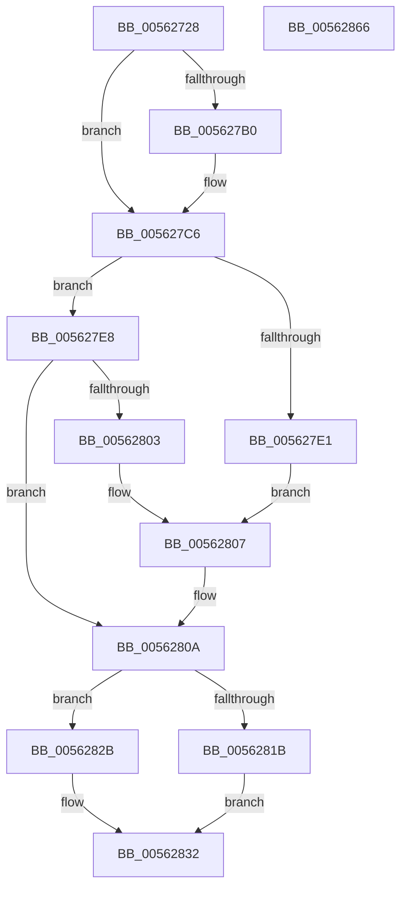

# HalpTscDiscover

- RVA: `0x00562728`–`0x00562867` (길이 `319` bytes)
- VA: `0x0000000140562728`
- 실행 섹션: `.text`
- PDB 이름 있음: `예`; PDB Function 태그: `아니요`
- unwind 정보 RVA: `0x000C4B40`
- 디코드: `76`개 명령, `319/319` bytes 표시
- 미해석 바이트: `0` (있으면 어셈블리에 `.byte`로 보존)

> 이 문서는 커널 이미지의 기계어와 PDB 기호를 분석해 생성했습니다. 4번과 5번은 함수 원형과 자료형을 바이너리 사용 방식에서 추정한 C 해석이며 원본 소스 복구 결과는 아닙니다.

## 1. Dependencies

- 직접 호출 지점: **6**; 고유 호출 대상: **6**
- 직접 호출자로 확인된 함수: **1**
- RIP 상대 이미지 참조: **6**

### Outgoing calls
- `0x0056275E` → [memset](../6C/memset_function_006C6C40.md) (function, `0x006C6C40`)
- `0x005627A7` → [HalSocRequestApi](../4B/HalSocRequestApi_function_004B848C.md) (function, `0x004B848C`)
- `0x005627B4` → [guard_dispatch_icall](../6B/guard_dispatch_icall_function_006BAAD0.md) (function, `0x006BAAD0`)
- `0x005627D8` → [HalpTscGetAttributes](HalpTscGetAttributes_function_00562870.md) (function, `0x00562870`)
- `0x00562841` → [RtlInitUnicodeString](../42/RtlInitUnicodeString_function_0042A780.md) (function, `0x0042A780`)
- `0x0056284E` → [HalpTimerRegister](HalpTimerRegister_function_005616BC.md) (function, `0x005616BC`)

### Direct callers
- [HalpTimerRegisterBuiltinPluginsCommon](../54/HalpTimerRegisterBuiltinPluginsCommon_function_0054A014.md) at `0x0054A020`

### Static image references
- `0x005627CA` → RVA `0x00F8FB98` (`.data`; read)
- `0x005627D1` → RVA `0x00F8FB99` (`.data`; read)
- `0x0056280E` → RVA `0x00562A20` (`HalpTscInitialize`; read)
- `0x0056281F` → RVA `0x0041FD10` (`HalpTscQueryCounterOrdered`; read)
- `0x0056282B` → RVA `0x00562AB0` (`HalpTscQueryCounter`; read)
- `0x00562832` → RVA `0x00025E80` (`.rdata`; read)

## 2. Other-region calls and transfers

- 다른 실행 섹션으로 향하는 call: **0**
- 별도 외부 분기/꼬리 이동을 확인하지 못했습니다.

## 3. Assembly (complete function range)

```asm
00562728  48 89 5C 24 18                  mov qword ptr [rsp + 0x18], rbx
0056272D  55                              push rbp
0056272E  48 8D 6C 24 A9                  lea rbp, [rsp - 0x57]
00562733  48 81 EC E0 00 00 00            sub rsp, 0xe0
0056273A  83 65 6F 00                     and dword ptr [rbp + 0x6f], 0
0056273E  48 8D 4D C7                     lea rcx, [rbp - 0x39]
00562742  0F 57 C0                        xorps xmm0, xmm0
00562745  C6 45 67 00                     mov byte ptr [rbp + 0x67], 0
00562749  0F 57 C9                        xorps xmm1, xmm1
0056274C  BB 90 00 00 00                  mov ebx, 0x90
00562751  44 8B C3                        mov r8d, ebx
00562754  33 D2                           xor edx, edx
00562756  0F 11 45 A7                     movups xmmword ptr [rbp - 0x59], xmm0
0056275A  0F 11 4D B7                     movups xmmword ptr [rbp - 0x49], xmm1
0056275E  E8 DD 44 16 00                  call 0x1406c6c40
00562763  48 83 65 2F 00                  and qword ptr [rbp + 0x2f], 0
00562768  48 8D 45 6F                     lea rax, [rbp + 0x6f]
0056276C  48 89 45 1F                     mov qword ptr [rbp + 0x1f], rax
00562770  33 D2                           xor edx, edx
00562772  48 8D 45 A7                     lea rax, [rbp - 0x59]
00562776  89 5D CB                        mov dword ptr [rbp - 0x35], ebx
00562779  BB 07 00 00 00                  mov ebx, 7
0056277E  C7 45 C7 01 00 00 00            mov dword ptr [rbp - 0x39], 1
00562785  C7 45 2B 40 00 00 00            mov dword ptr [rbp + 0x2b], 0x40
0056278C  C7 45 4F 05 00 00 00            mov dword ptr [rbp + 0x4f], 5
00562793  C7 45 27 04 00 00 00            mov dword ptr [rbp + 0x27], 4
0056279A  44 8D 4B 09                     lea r9d, [rbx + 9]
0056279E  48 89 44 24 20                  mov qword ptr [rsp + 0x20], rax
005627A3  44 8D 43 FF                     lea r8d, [rbx - 1]
005627A7  E8 E0 5C F5 FF                  call 0x1404b848c
005627AC  85 C0                           test eax, eax
005627AE  78 16                           js 0x1405627c6
005627B0  48 8B 45 A7                     mov rax, qword ptr [rbp - 0x59]
005627B4  E8 17 83 15 00                  call 0x1406baad0
005627B9  33 C9                           xor ecx, ecx
005627BB  48 85 C0                        test rax, rax
005627BE  48 0F 45 C8                     cmovne rcx, rax
005627C2  48 89 4D 2F                     mov qword ptr [rbp + 0x2f], rcx
005627C6  4C 8D 45 67                     lea r8, [rbp + 0x67]
005627CA  48 8D 15 C7 D3 A2 00            lea rdx, [rip + 0xa2d3c7]
005627D1  48 8D 0D C1 D3 A2 00            lea rcx, [rip + 0xa2d3c1]
005627D8  E8 93 00 00 00                  call 0x140562870
005627DD  85 C0                           test eax, eax
005627DF  79 07                           jns 0x1405627e8
005627E1  BB 07 60 00 00                  mov ebx, 0x6007
005627E6  EB 1F                           jmp 0x140562807
005627E8  80 3D AA D3 A2 00 00            cmp byte ptr [rip + 0xa2d3aa], 0
005627EF  B8 07 20 00 00                  mov eax, 0x2007
005627F4  0F 44 D8                        cmove ebx, eax
005627F7  80 3D 9A D3 A2 00 00            cmp byte ptr [rip + 0xa2d39a], 0
005627FE  89 5D 3B                        mov dword ptr [rbp + 0x3b], ebx
00562801  75 07                           jne 0x14056280a
00562803  0F BA EB 0E                     bts ebx, 0xe
00562807  89 5D 3B                        mov dword ptr [rbp + 0x3b], ebx
0056280A  80 7D 67 00                     cmp byte ptr [rbp + 0x67], 0
0056280E  48 8D 05 0B 02 00 00            lea rax, [rip + 0x20b]
00562815  48 89 45 CF                     mov qword ptr [rbp - 0x31], rax
00562819  74 10                           je 0x14056282b
0056281B  0F BA EB 18                     bts ebx, 0x18
0056281F  48 8D 05 EA D4 EB FF            lea rax, [rip - 0x142b16]
00562826  89 5D 3B                        mov dword ptr [rbp + 0x3b], ebx
00562829  EB 07                           jmp 0x140562832
0056282B  48 8D 05 7E 02 00 00            lea rax, [rip + 0x27e]
00562832  48 8D 15 47 36 AC FF            lea rdx, [rip - 0x53c9b9]
00562839  48 89 45 D7                     mov qword ptr [rbp - 0x29], rax
0056283D  48 8D 4D B7                     lea rcx, [rbp - 0x49]
00562841  E8 3A 7F EC FF                  call 0x14042a780
00562846  48 8D 55 B7                     lea rdx, [rbp - 0x49]
0056284A  48 8D 4D C7                     lea rcx, [rbp - 0x39]
0056284E  E8 69 EE FF FF                  call 0x1405616bc
00562853  48 8B 9C 24 00 01 00 00         mov rbx, qword ptr [rsp + 0x100]
0056285B  33 C0                           xor eax, eax
0056285D  48 81 C4 E0 00 00 00            add rsp, 0xe0
00562864  5D                              pop rbp
00562865  C3                              ret
00562866  CC                              int3
```

## 4. C-style interpretation (structured pseudocode)

```c
__int64 __fastcall HalpTscDiscover(__int64 a1, int a2)
{
    __int64 result;
    __int64 v_rbx;
    __int64 v_rsp;
    unsigned int v_stack_m10;
    unsigned int v_stack_m24;
    unsigned __int64 v_stack_m30;
    unsigned int v_stack_m34;
    unsigned int v_stack_m38;
    unsigned __int64 v_stack_m40;
    unsigned __int64 v_stack_m5F;
    unsigned __int64 v_stack_m88;
    unsigned __int64 v_stack_m90;
    unsigned int v_stack_m94;
    unsigned __int64 v_stack_m98;
    unsigned __int64 v_stack_mA8;
    unsigned __int64 v_stack_mB8;
    unsigned __int64 v_stack_mC8;
    unsigned int v_stack_p10;
    unsigned __int64 v_stack_p18;
    unsigned __int8 v_stack_p8;

    v_stack_p18 = v_rbx;
    v_rsp = (v_rsp) - (224);
    v_stack_p8 = 0;
    a2 = 0;
    v_stack_mB8 = v_xmm0;
    v_stack_mA8 = v_xmm1;
    result = memset(v_stack_m98, a2, 144, a4);
    v_stack_m40 = v_stack_p10;
    a2 = 0;
    v_stack_m94 = 144;
    v_stack_m98 = 1;
    v_stack_m34 = 64;
    v_stack_m10 = 5;
    v_stack_m38 = 4;
    v_stack_mC8 = v_stack_mB8;
    result = HalSocRequestApi(v_stack_m98, a2, 7 - 1, 7 + 9);
    if (!(sign_flag)) {
        result = v_stack_mB8;
        result = guard_dispatch_icall(v_stack_m98, a2, 7 - 1, 7 + 9);
        a1 = 0;
        if (result != 0) { a1 = result; }
        v_stack_m30 = a1;
    }
    result = HalpTscGetAttributes(v_rip + 10671041, v_rip + 10671047, v_stack_p8, 7 + 9);
    if (!sign_flag) goto loc_005627E8;
    goto loc_00562807;
loc_005627E8:
    v_rbx = (unsigned int)(0x6007ULL);
    if ((*(unsigned __int8 *)(v_rip + 10671018)) == 0) { v_rbx = (unsigned int)((unsigned int)(0x2007ULL)); }
    v_stack_m24 = (unsigned int)(v_rbx);
    if ((*(unsigned __int8 *)(v_rip + 10671002)) != 0) goto loc_0056280A;
loc_00562807:
    v_stack_m24 = (unsigned int)(v_rbx);
loc_0056280A:
    v_stack_m90 = v_rip + 523;
    if (v_stack_p8 == 0) goto loc_0056282B;
    v_stack_m24 = (unsigned int)(v_rbx);
    goto loc_00562832;
loc_0056282B:
loc_00562832:
    v_stack_m88 = v_rip + 638;
    result = RtlInitUnicodeString(v_stack_mA8, v_rip - 5491129, v_stack_p8, 7 + 9);
    result = HalpTimerRegister(v_stack_m98, v_stack_mA8, v_stack_p8, 7 + 9);
    result = 0;
    v_rsp = (v_rsp) + (224);
    return result;
}
```

## 5. (Beta) C Style

```c
int64_t HalpTscDiscover(int64_t Arg1, int32_t Arg2)
{
    int64_t result;
    int64_t local_rbx;
    int64_t local_rsp;
    uint32_t v_stack_m10;
    uint32_t v_stack_m24;
    uint64_t v_stack_m30;
    uint32_t v_stack_m34;
    uint32_t v_stack_m38;
    uint64_t v_stack_m40;
    uint64_t v_stack_m5F;
    uint64_t v_stack_m88;
    uint64_t v_stack_m90;
    uint32_t v_stack_m94;
    uint64_t v_stack_m98;
    uint64_t v_stack_mA8;
    uint64_t v_stack_mB8;
    uint64_t v_stack_mC8;
    uint32_t v_stack_p10;
    uint64_t v_stack_p18;
    uint8_t v_stack_p8;

    v_stack_p18 = local_rbx;
    local_rsp = (local_rsp) - (224);
    v_stack_p8 = 0;
    Arg2 = 0;
    v_stack_mB8 = v_xmm0;
    v_stack_mA8 = v_xmm1;
    result = memset(v_stack_m98, Arg2, 144, a4);
    v_stack_m40 = v_stack_p10;
    Arg2 = 0;
    v_stack_m94 = 144;
    v_stack_m98 = 1;
    v_stack_m34 = 64;
    v_stack_m10 = 5;
    v_stack_m38 = 4;
    v_stack_mC8 = v_stack_mB8;
    result = HalSocRequestApi(v_stack_m98, Arg2, 7 - 1, 7 + 9);
    if (!(sign_flag)) {
        result = v_stack_mB8;
        result = guard_dispatch_icall(v_stack_m98, Arg2, 7 - 1, 7 + 9);
        Arg1 = 0;
        if (result != 0) { Arg1 = result; }
        v_stack_m30 = Arg1;
    }
    result = HalpTscGetAttributes(v_rip + 10671041, v_rip + 10671047, v_stack_p8, 7 + 9);
    if (!sign_flag) goto loc_005627E8;
    goto loc_00562807;
loc_005627E8:
    local_rbx = (uint32_t)(0x6007ULL);
    if ((*(uint8_t *)(v_rip + 0xA2D3AA)) == 0) { local_rbx = (uint32_t)((uint32_t)(0x2007ULL)); }
    v_stack_m24 = (uint32_t)(local_rbx);
    if ((*(uint8_t *)(v_rip + 0xA2D39A)) != 0) goto loc_0056280A;
loc_00562807:
    v_stack_m24 = (uint32_t)(local_rbx);
loc_0056280A:
    v_stack_m90 = v_rip + 523;
    if (v_stack_p8 == 0) goto loc_0056282B;
    v_stack_m24 = (uint32_t)(local_rbx);
    goto loc_00562832;
loc_0056282B:
loc_00562832:
    v_stack_m88 = v_rip + 638;
    result = RtlInitUnicodeString(v_stack_mA8, v_rip - 5491129, v_stack_p8, 7 + 9);
    result = HalpTimerRegister(v_stack_m98, v_stack_mA8, v_stack_p8, 7 + 9);
    result = 0;
    local_rsp = (local_rsp) + (224);
    return result;
}
```

## 6. Execution-region graph

[열기: 2D/3D 그래프와 함수 탐색 컨트롤 패널](../../../control-panel.html?section=text&rva=0x00562728&view=graph)

- 2D 그래프는 위에서 아래로 흐르고, 3D 그래프는 빈 공간을 드래그해 회전합니다. Shift+드래그는 이동, 휠은 확대·축소, 함수 노드 선택은 대상 보고서 이동입니다.

### Static fallback


