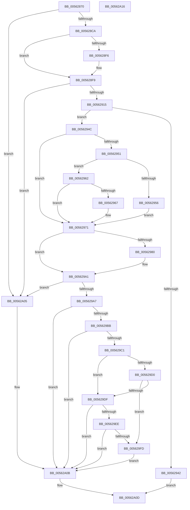

# HalpTscGetAttributes

- RVA: `0x00562870`–`0x00562A17` (길이 `423` bytes)
- VA: `0x0000000140562870`
- 실행 섹션: `.text`
- PDB 이름 있음: `예`; PDB Function 태그: `아니요`
- unwind 정보 RVA: `0x000C4B2C`
- 디코드: `116`개 명령, `423/423` bytes 표시
- 미해석 바이트: `0` (있으면 어셈블리에 `.byte`로 보존)

> 이 문서는 커널 이미지의 기계어와 PDB 기호를 분석해 생성했습니다. 4번과 5번은 함수 원형과 자료형을 바이너리 사용 방식에서 추정한 C 해석이며 원본 소스 복구 결과는 아닙니다.

## 1. Dependencies

- 직접 호출 지점: **6**; 고유 호출 대상: **3**
- 직접 호출자로 확인된 함수: **2**
- RIP 상대 이미지 참조: **1**

### Outgoing calls
- `0x005628BD` → [HalSocRequestApi](../4B/HalSocRequestApi_function_004B848C.md) (function, `0x004B848C`)
- `0x005628E8` → [guard_dispatch_icall](../6B/guard_dispatch_icall_function_006BAAD0.md) (function, `0x006BAAD0`)
- `0x00562908` → [guard_dispatch_icall](../6B/guard_dispatch_icall_function_006BAAD0.md) (function, `0x006BAAD0`)
- `0x00562933` → [guard_dispatch_icall](../6B/guard_dispatch_icall_function_006BAAD0.md) (function, `0x006BAAD0`)
- `0x00562999` → [guard_dispatch_icall](../6B/guard_dispatch_icall_function_006BAAD0.md) (function, `0x006BAAD0`)
- `0x005629B0` → [HalSocRequestConfigurationData](HalSocRequestConfigurationData_function_00562ADC.md) (function, `0x00562ADC`)

### Direct callers
- [HalpTscDiscover](HalpTscDiscover_function_00562728.md) at `0x005627D8`
- [HalpTscInitialize](HalpTscInitialize_function_00562A20.md) at `0x00562A49`

### Static image references
- `0x00562956` → RVA `0x00F8FB94` (`.data`; write)

## 2. Other-region calls and transfers

- 다른 실행 섹션으로 향하는 call: **0**
- 별도 외부 분기/꼬리 이동을 확인하지 못했습니다.

## 3. Assembly (complete function range)

```asm
00562870  40 55                           push rbp
00562872  53                              push rbx
00562873  56                              push rsi
00562874  57                              push rdi
00562875  48 8B EC                        mov rbp, rsp
00562878  48 83 EC 58                     sub rsp, 0x58
0056287C  83 65 40 00                     and dword ptr [rbp + 0x40], 0
00562880  48 8D 45 E0                     lea rax, [rbp - 0x20]
00562884  83 65 38 00                     and dword ptr [rbp + 0x38], 0
00562888  48 8B FA                        mov rdi, rdx
0056288B  83 65 D8 00                     and dword ptr [rbp - 0x28], 0
0056288F  49 8B D8                        mov rbx, r8
00562892  C6 01 00                        mov byte ptr [rcx], 0
00562895  0F 57 C0                        xorps xmm0, xmm0
00562898  C6 02 00                        mov byte ptr [rdx], 0
0056289B  48 8B F1                        mov rsi, rcx
0056289E  33 D2                           xor edx, edx
005628A0  41 C6 00 00                     mov byte ptr [r8], 0
005628A4  0F 11 45 E0                     movups xmmword ptr [rbp - 0x20], xmm0
005628A8  C6 45 28 00                     mov byte ptr [rbp + 0x28], 0
005628AC  C6 45 30 00                     mov byte ptr [rbp + 0x30], 0
005628B0  44 8D 4A 10                     lea r9d, [rdx + 0x10]
005628B4  48 89 44 24 20                  mov qword ptr [rsp + 0x20], rax
005628B9  44 8D 42 02                     lea r8d, [rdx + 2]
005628BD  E8 CA 5B F5 FF                  call 0x1404b848c
005628C2  85 C0                           test eax, eax
005628C4  0F 88 3B 01 00 00               js 0x140562a05
005628CA  48 8D 45 40                     lea rax, [rbp + 0x40]
005628CE  B9 01 00 00 80                  mov ecx, 0x80000001
005628D3  48 89 44 24 20                  mov qword ptr [rsp + 0x20], rax
005628D8  4C 8D 4D 38                     lea r9, [rbp + 0x38]
005628DC  48 8B 45 E8                     mov rax, qword ptr [rbp - 0x18]
005628E0  4C 8D 45 38                     lea r8, [rbp + 0x38]
005628E4  48 8D 55 38                     lea rdx, [rbp + 0x38]
005628E8  E8 E3 81 15 00                  call 0x1406baad0
005628ED  F7 45 40 00 00 00 08            test dword ptr [rbp + 0x40], 0x8000000
005628F4  74 03                           je 0x1405628f9
005628F6  C6 03 01                        mov byte ptr [rbx], 1
005628F9  48 8B 45 E0                     mov rax, qword ptr [rbp - 0x20]
005628FD  4C 8D 4D 28                     lea r9, [rbp + 0x28]
00562901  45 33 C0                        xor r8d, r8d
00562904  33 D2                           xor edx, edx
00562906  33 C9                           xor ecx, ecx
00562908  E8 C3 81 15 00                  call 0x1406baad0
0056290D  84 C0                           test al, al
0056290F  0F 84 F0 00 00 00               je 0x140562a05
00562915  48 8D 45 38                     lea rax, [rbp + 0x38]
00562919  B9 00 00 00 80                  mov ecx, 0x80000000
0056291E  48 89 44 24 20                  mov qword ptr [rsp + 0x20], rax
00562923  4C 8D 4D 38                     lea r9, [rbp + 0x38]
00562927  48 8B 45 E8                     mov rax, qword ptr [rbp - 0x18]
0056292B  4C 8D 45 38                     lea r8, [rbp + 0x38]
0056292F  48 8D 55 D8                     lea rdx, [rbp - 0x28]
00562933  E8 98 81 15 00                  call 0x1406baad0
00562938  8A 4D 28                        mov cl, byte ptr [rbp + 0x28]
0056293B  8D 41 FF                        lea eax, [rcx - 1]
0056293E  3C 01                           cmp al, 1
00562940  76 0A                           jbe 0x14056294c
00562942  B8 BB 00 00 C0                  mov eax, 0xc00000bb
00562947  E9 C1 00 00 00                  jmp 0x140562a0d
0056294C  80 3B 00                        cmp byte ptr [rbx], 0
0056294F  75 20                           jne 0x140562971
00562951  80 F9 02                        cmp cl, 2
00562954  75 0C                           jne 0x140562962
00562956  C7 05 34 D2 A2 00 01 00 00 00   mov dword ptr [rip + 0xa2d234], 1
00562960  EB 0F                           jmp 0x140562971
00562962  80 F9 01                        cmp cl, 1
00562965  75 0A                           jne 0x140562971
00562967  C7 05 23 D2 A2 00 02 00 00 00   mov dword ptr [rip + 0xa2d223], 2
00562971  33 C0                           xor eax, eax
00562973  B9 07 00 00 80                  mov ecx, 0x80000007
00562978  89 45 DC                        mov dword ptr [rbp - 0x24], eax
0056297B  39 4D D8                        cmp dword ptr [rbp - 0x28], ecx
0056297E  72 21                           jb 0x1405629a1
00562980  48 8D 45 DC                     lea rax, [rbp - 0x24]
00562984  48 89 44 24 20                  mov qword ptr [rsp + 0x20], rax
00562989  4C 8D 4D 38                     lea r9, [rbp + 0x38]
0056298D  48 8B 45 E8                     mov rax, qword ptr [rbp - 0x18]
00562991  4C 8D 45 38                     lea r8, [rbp + 0x38]
00562995  48 8D 55 38                     lea rdx, [rbp + 0x38]
00562999  E8 32 81 15 00                  call 0x1406baad0
0056299E  8B 45 DC                        mov eax, dword ptr [rbp - 0x24]
005629A1  0F BA E0 08                     bt eax, 8
005629A5  72 5E                           jb 0x140562a05
005629A7  4C 8D 45 30                     lea r8, [rbp + 0x30]
005629AB  B9 08 00 00 00                  mov ecx, 8
005629B0  E8 27 01 00 00                  call 0x140562adc
005629B5  80 7D 30 00                     cmp byte ptr [rbp + 0x30], 0
005629B9  75 50                           jne 0x140562a0b
005629BB  80 7D 28 02                     cmp byte ptr [rbp + 0x28], 2
005629BF  75 4A                           jne 0x140562a0b
005629C1  65 48 8B 04 25 20 00 00 00      mov rax, qword ptr gs:[0x20]
005629CA  80 78 40 0F                     cmp byte ptr [rax + 0x40], 0xf
005629CE  75 0F                           jne 0x1405629df
005629D0  65 48 8B 04 25 20 00 00 00      mov rax, qword ptr gs:[0x20]
005629D9  80 78 43 03                     cmp byte ptr [rax + 0x43], 3
005629DD  73 1E                           jae 0x1405629fd
005629DF  65 48 8B 04 25 20 00 00 00      mov rax, qword ptr gs:[0x20]
005629E8  80 78 40 06                     cmp byte ptr [rax + 0x40], 6
005629EC  75 1D                           jne 0x140562a0b
005629EE  65 48 8B 04 25 20 00 00 00      mov rax, qword ptr gs:[0x20]
005629F7  80 78 43 0E                     cmp byte ptr [rax + 0x43], 0xe
005629FB  72 0E                           jb 0x140562a0b
005629FD  C6 06 01                        mov byte ptr [rsi], 1
00562A00  C6 07 00                        mov byte ptr [rdi], 0
00562A03  EB 06                           jmp 0x140562a0b
00562A05  C6 06 01                        mov byte ptr [rsi], 1
00562A08  C6 07 01                        mov byte ptr [rdi], 1
00562A0B  33 C0                           xor eax, eax
00562A0D  48 83 C4 58                     add rsp, 0x58
00562A11  5F                              pop rdi
00562A12  5E                              pop rsi
00562A13  5B                              pop rbx
00562A14  5D                              pop rbp
00562A15  C3                              ret
00562A16  CC                              int3
```

## 4. C-style interpretation (structured pseudocode)

```c
__int64 __fastcall HalpTscGetAttributes(__int64 a1, __int64 a2, __int64 a3)
{
    __int64 result;
    __int64 v_rsp;
    unsigned __int64 v_stack_m38;
    unsigned __int64 v_stack_m40;
    unsigned int v_stack_m44;
    unsigned int v_stack_m48;
    unsigned __int64 v_stack_m58;
    unsigned __int8 v_stack_p10;
    unsigned int v_stack_p18;
    unsigned int v_stack_p20;
    unsigned __int8 v_stack_p8;

    v_rsp = (v_rsp) - (88);
    *(unsigned __int8 *)(a1) = 0;
    *(unsigned __int8 *)(a2) = 0;
    a2 = 0;
    *(unsigned __int8 *)(a3) = 0;
    v_stack_m40 = v_xmm0;
    v_stack_p8 = 0;
    v_stack_p10 = 0;
    v_stack_m58 = v_stack_m40;
    result = HalSocRequestApi(a1, a2, a2 + 2, a2 + 16);
    if (sign_flag) goto loc_00562A05;
    v_stack_m58 = v_stack_p20;
    result = guard_dispatch_icall((unsigned int)(0x80000001ULL), v_stack_p18, v_stack_p18, v_stack_p18);
    if (((v_stack_p20) & (0x8000000ULL)) != 0) {
        *(unsigned __int8 *)(a3) = 1;
    }
    a3 = 0;
    a2 = 0;
    a1 = 0;
    result = guard_dispatch_icall(a1, a2, a3, v_stack_p8);
    if ((unsigned __int8)(result) == 0) goto loc_00562A05;
    v_stack_m58 = v_stack_p18;
    result = guard_dispatch_icall((unsigned int)(0x80000000ULL), v_stack_m48, v_stack_p18, v_stack_p18);
    if (((unsigned __int8)(v_stack_p8 - 1)) <= 1) goto loc_0056294C;
    goto loc_00562A0D;
loc_0056294C:
    if ((*(unsigned __int8 *)(a3)) != 0) goto loc_00562971;
    if (((unsigned __int8)(v_stack_p8)) != 2) goto loc_00562962;
    *(unsigned int *)(v_rip + 10670644) = 1;
    goto loc_00562971;
loc_00562962:
    if (((unsigned __int8)(v_stack_p8)) == 1) {
        *(unsigned int *)(v_rip + 10670627) = 2;
    }
    result = 0;
    v_stack_m44 = 0;
    if (v_stack_m48 >= ((unsigned int)((unsigned int)(0x80000007ULL)))) {
        result = v_stack_m44;
        v_stack_m58 = result;
        a4 = v_stack_p18;
        result = v_stack_m38;
        a3 = v_stack_p18;
        a2 = v_stack_p18;
        result = guard_dispatch_icall((unsigned int)(0x80000007ULL), a2, a3, a4);
        result = v_stack_m44;
    }
    if (v_stack_m48 < ((unsigned int)((unsigned int)(0x80000007ULL)))) goto loc_00562A05;
    result = HalSocRequestConfigurationData(8, a2, v_stack_p10, a4);
    if (v_stack_p10 != 0) goto loc_00562A0B;
    if (v_stack_p8 != 2) goto loc_00562A0B;
    if ((*(unsigned __int8 *)(*(unsigned __int64 *)(gs_base + (0 + 32)) + 64)) != 15) goto loc_005629DF;
    if ((*(unsigned __int8 *)(*(unsigned __int64 *)(gs_base + (0 + 32)) + 67)) >= 3) goto loc_005629FD;
loc_005629DF:
    if ((*(unsigned __int8 *)(*(unsigned __int64 *)(gs_base + (0 + 32)) + 64)) != 6) goto loc_00562A0B;
    if ((*(unsigned __int8 *)(*(unsigned __int64 *)(gs_base + (0 + 32)) + 67)) < 14) goto loc_00562A0B;
loc_005629FD:
    *(unsigned __int8 *)(a1) = 1;
    *(unsigned __int8 *)(a2) = 0;
    goto loc_00562A0B;
loc_00562A05:
    *(unsigned __int8 *)(a1) = 1;
    *(unsigned __int8 *)(a2) = 1;
loc_00562A0B:
    result = 0;
loc_00562A0D:
    v_rsp = (v_rsp) + (88);
    return result;
}
```

## 5. (Beta) C Style

```c
int64_t HalpTscGetAttributes(void *Arg1, void *Arg2, void *Arg3)
{
    uint8_t *arg1 = (uint8_t *)Arg1;
    uint8_t *arg2 = (uint8_t *)Arg2;
    uint8_t *arg3 = (uint8_t *)Arg3;

    int64_t result;
    int64_t local_rsp;
    uint64_t v_stack_m38;
    uint64_t v_stack_m40;
    uint32_t v_stack_m44;
    uint32_t v_stack_m48;
    uint64_t v_stack_m58;
    uint8_t v_stack_p10;
    uint32_t v_stack_p18;
    uint32_t v_stack_p20;
    uint8_t v_stack_p8;

    local_rsp = (local_rsp) - (88);
    *(uint8_t *)(arg1) = 0;
    *(uint8_t *)(arg2) = 0;
    Arg2 = 0;
    *(uint8_t *)(arg3) = 0;
    v_stack_m40 = v_xmm0;
    v_stack_p8 = 0;
    v_stack_p10 = 0;
    v_stack_m58 = v_stack_m40;
    result = HalSocRequestApi(Arg1, Arg2, Arg2 + 2, Arg2 + 16);
    if (sign_flag) goto loc_00562A05;
    v_stack_m58 = v_stack_p20;
    result = guard_dispatch_icall((uint32_t)(0x80000001ULL), v_stack_p18, v_stack_p18, v_stack_p18);
    if (((v_stack_p20) & (0x8000000ULL)) != 0) {
        *(uint8_t *)(arg3) = 1;
    }
    Arg3 = 0;
    Arg2 = 0;
    Arg1 = 0;
    result = guard_dispatch_icall(Arg1, Arg2, Arg3, v_stack_p8);
    if ((uint8_t)(result) == 0) goto loc_00562A05;
    v_stack_m58 = v_stack_p18;
    result = guard_dispatch_icall((uint32_t)(0x80000000ULL), v_stack_m48, v_stack_p18, v_stack_p18);
    if (((uint8_t)(v_stack_p8 - 1)) <= 1) goto loc_0056294C;
    goto loc_00562A0D;
loc_0056294C:
    if ((*(uint8_t *)(arg3)) != 0) goto loc_00562971;
    if (((uint8_t)(v_stack_p8)) != 2) goto loc_00562962;
    *(uint32_t *)(v_rip + 0xA2D234) = 1;
    goto loc_00562971;
loc_00562962:
    if (((uint8_t)(v_stack_p8)) == 1) {
        *(uint32_t *)(v_rip + 0xA2D223) = 2;
    }
    result = 0;
    v_stack_m44 = 0;
    if (v_stack_m48 >= ((uint32_t)((uint32_t)(0x80000007ULL)))) {
        result = v_stack_m44;
        v_stack_m58 = result;
        a4 = v_stack_p18;
        result = v_stack_m38;
        Arg3 = v_stack_p18;
        Arg2 = v_stack_p18;
        result = guard_dispatch_icall((uint32_t)(0x80000007ULL), Arg2, Arg3, a4);
        result = v_stack_m44;
    }
    if (v_stack_m48 < ((uint32_t)((uint32_t)(0x80000007ULL)))) goto loc_00562A05;
    result = HalSocRequestConfigurationData(8, Arg2, v_stack_p10, a4);
    if (v_stack_p10 != 0) goto loc_00562A0B;
    if (v_stack_p8 != 2) goto loc_00562A0B;
    if ((*(uint8_t *)(*(uint64_t *)(gs_base + (0 + 0x20)) + 0x40)) != 15) goto loc_005629DF;
    if ((*(uint8_t *)(*(uint64_t *)(gs_base + (0 + 0x20)) + 0x43)) >= 3) goto loc_005629FD;
loc_005629DF:
    if ((*(uint8_t *)(*(uint64_t *)(gs_base + (0 + 0x20)) + 0x40)) != 6) goto loc_00562A0B;
    if ((*(uint8_t *)(*(uint64_t *)(gs_base + (0 + 0x20)) + 0x43)) < 14) goto loc_00562A0B;
loc_005629FD:
    *(uint8_t *)(arg1) = 1;
    *(uint8_t *)(arg2) = 0;
    goto loc_00562A0B;
loc_00562A05:
    *(uint8_t *)(arg1) = 1;
    *(uint8_t *)(arg2) = 1;
loc_00562A0B:
    result = 0;
loc_00562A0D:
    local_rsp = (local_rsp) + (88);
    return result;
}
```

### 관측된 메모리 오프셋

구조체 형식이 확인되지 않은 접근은 인자 기준의 오프셋으로만 기록했습니다.

| 기준 인자 | 오프셋 표현 | 폭 (bit) | 접근 |
|---|---:|---:|---|
| `Arg1` | `+ 0x0` | `8` | `W` |
| `Arg2` | `+ 0x0` | `8` | `W` |
| `Arg3` | `+ 0x0` | `8` | `R` |
| `Arg3` | `+ 0x0` | `8` | `W` |

## 6. Execution-region graph

[열기: 2D/3D 그래프와 함수 탐색 컨트롤 패널](../../../control-panel.html?section=text&rva=0x00562870&view=graph)

- 2D 그래프는 위에서 아래로 흐르고, 3D 그래프는 빈 공간을 드래그해 회전합니다. Shift+드래그는 이동, 휠은 확대·축소, 함수 노드 선택은 대상 보고서 이동입니다.

### Static fallback


