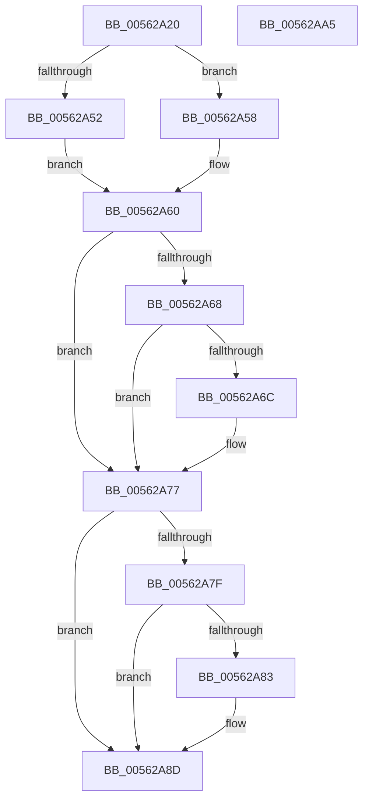

# HalpTscInitialize

- RVA: `0x00562A20`–`0x00562AA6` (길이 `134` bytes)
- VA: `0x0000000140562A20`
- 실행 섹션: `.text`
- PDB 이름 있음: `예`; PDB Function 태그: `아니요`
- unwind 정보 RVA: `0x000A5538`
- 디코드: `41`개 명령, `134/134` bytes 표시
- 미해석 바이트: `0` (있으면 어셈블리에 `.byte`로 보존)

> 이 문서는 커널 이미지의 기계어와 PDB 기호를 분석해 생성했습니다. 4번과 5번은 함수 원형과 자료형을 바이너리 사용 방식에서 추정한 C 해석이며 원본 소스 복구 결과는 아닙니다.

## 1. Dependencies

- 직접 호출 지점: **2**; 고유 호출 대상: **2**
- 직접 호출자로 확인된 함수: **0**
- RIP 상대 이미지 참조: **4**

### Outgoing calls
- `0x00562A49` → [HalpTscGetAttributes](HalpTscGetAttributes_function_00562870.md) (function, `0x00562870`)
- `0x00562A95` → [HalUpdateTimerCapabilities](HalUpdateTimerCapabilities_function_005615E0.md) (function, `0x005615E0`)

### Direct callers
- 이 함수 시작 RVA로 연결되는 직접 call은 확인되지 않았습니다. 간접 호출은 완전히 역산할 수 없습니다.

### Static image references
- `0x00562A60` → RVA `0x00F8FB99` (`.data`; read)
- `0x00562A71` → RVA `0x00F8FB99` (`.data`; write)
- `0x00562A77` → RVA `0x00F8FB98` (`.data`; read)
- `0x00562A87` → RVA `0x00F8FB98` (`.data`; write)

## 2. Other-region calls and transfers

- 다른 실행 섹션으로 향하는 call: **0**
- 별도 외부 분기/꼬리 이동을 확인하지 못했습니다.

## 3. Assembly (complete function range)

```asm
00562A20  48 8B C4                        mov rax, rsp
00562A23  48 89 58 08                     mov qword ptr [rax + 8], rbx
00562A27  57                              push rdi
00562A28  48 83 EC 20                     sub rsp, 0x20
00562A2C  48 8B F9                        mov rdi, rcx
00562A2F  C6 40 10 00                     mov byte ptr [rax + 0x10], 0
00562A33  48 8D 48 18                     lea rcx, [rax + 0x18]
00562A37  C6 40 18 00                     mov byte ptr [rax + 0x18], 0
00562A3B  4C 8D 40 20                     lea r8, [rax + 0x20]
00562A3F  C6 40 20 00                     mov byte ptr [rax + 0x20], 0
00562A43  48 8D 50 10                     lea rdx, [rax + 0x10]
00562A47  33 DB                           xor ebx, ebx
00562A49  E8 22 FE FF FF                  call 0x140562870
00562A4E  85 C0                           test eax, eax
00562A50  79 06                           jns 0x140562a58
00562A52  32 C9                           xor cl, cl
00562A54  32 C0                           xor al, al
00562A56  EB 08                           jmp 0x140562a60
00562A58  8A 44 24 38                     mov al, byte ptr [rsp + 0x38]
00562A5C  8A 4C 24 40                     mov cl, byte ptr [rsp + 0x40]
00562A60  3A 0D 33 D1 A2 00               cmp cl, byte ptr [rip + 0xa2d133]
00562A66  74 0F                           je 0x140562a77
00562A68  84 C9                           test cl, cl
00562A6A  75 0B                           jne 0x140562a77
00562A6C  BB 00 20 00 00                  mov ebx, 0x2000
00562A71  88 0D 22 D1 A2 00               mov byte ptr [rip + 0xa2d122], cl
00562A77  3A 05 1B D1 A2 00               cmp al, byte ptr [rip + 0xa2d11b]
00562A7D  74 0E                           je 0x140562a8d
00562A7F  84 C0                           test al, al
00562A81  75 0A                           jne 0x140562a8d
00562A83  0F BA EB 0E                     bts ebx, 0xe
00562A87  88 05 0B D1 A2 00               mov byte ptr [rip + 0xa2d10b], al
00562A8D  45 33 C0                        xor r8d, r8d
00562A90  8B D3                           mov edx, ebx
00562A92  48 8B CF                        mov rcx, rdi
00562A95  E8 46 EB FF FF                  call 0x1405615e0
00562A9A  48 8B 5C 24 30                  mov rbx, qword ptr [rsp + 0x30]
00562A9F  48 83 C4 20                     add rsp, 0x20
00562AA3  5F                              pop rdi
00562AA4  C3                              ret
00562AA5  CC                              int3
```

## 4. C-style interpretation (structured pseudocode)

```c
__int64 __fastcall HalpTscInitialize(__int64 a1)
{
    __int64 result;
    __int64 v_rbx;
    __int64 v_rsp;
    unsigned __int8 v_stack_p10;
    unsigned __int8 v_stack_p18;
    unsigned __int64 v_stack_p8;

    *(unsigned __int64 *)(v_rsp + 8) = v_rbx;
    v_rsp = (v_rsp) - (32);
    *(unsigned __int8 *)(v_rsp + 16) = 0;
    *(unsigned __int8 *)(v_rsp + 24) = 0;
    *(unsigned __int8 *)(v_rsp + 32) = 0;
    v_rbx = 0;
    result = HalpTscGetAttributes(v_rsp + 24, v_rsp + 16, v_rsp + 32, a4);
    if (!sign_flag) goto loc_00562A58;
    a1 = 0;
    result = 0;
    goto loc_00562A60;
loc_00562A58:
loc_00562A60:
    if (((unsigned __int8)(v_stack_p18)) == (*(unsigned __int8 *)(v_rip + 10670387))) goto loc_00562A77;
    if ((unsigned __int8)(v_stack_p18) == 0) {
        v_rbx = 0x2000ULL;
        *(unsigned __int8 *)(v_rip + 10670370) = (unsigned __int8)(v_stack_p18);
    }
    if (((unsigned __int8)(v_stack_p10)) == (*(unsigned __int8 *)(v_rip + 10670363))) goto loc_00562A8D;
    if ((unsigned __int8)(v_stack_p10) == 0) {
        *(unsigned __int8 *)(v_rip + 10670347) = (unsigned __int8)(v_stack_p10);
    }
    a3 = 0;
    result = HalUpdateTimerCapabilities(0, (unsigned int)((unsigned int)(v_rbx)), a3, a4);
    v_rsp = (v_rsp) + (32);
    return result;
}
```

## 5. (Beta) C Style

```c
int64_t HalpTscInitialize(int64_t Arg1)
{
    int64_t result;
    int64_t local_rbx;
    int64_t local_rsp;
    uint8_t v_stack_p10;
    uint8_t v_stack_p18;
    uint64_t v_stack_p8;

    *(uint64_t *)(local_rsp + 0x8) = local_rbx;
    local_rsp = (local_rsp) - (32);
    *(uint8_t *)(local_rsp + 0x10) = 0;
    *(uint8_t *)(local_rsp + 0x18) = 0;
    *(uint8_t *)(local_rsp + 0x20) = 0;
    local_rbx = 0;
    result = HalpTscGetAttributes(local_rsp + 24, local_rsp + 16, local_rsp + 32, a4);
    if (!sign_flag) goto loc_00562A58;
    Arg1 = 0;
    result = 0;
    goto loc_00562A60;
loc_00562A58:
loc_00562A60:
    if (((uint8_t)(v_stack_p18)) == (*(uint8_t *)(v_rip + 0xA2D133))) goto loc_00562A77;
    if ((uint8_t)(v_stack_p18) == 0) {
        local_rbx = 0x2000ULL;
        *(uint8_t *)(v_rip + 0xA2D122) = (uint8_t)(v_stack_p18);
    }
    if (((uint8_t)(v_stack_p10)) == (*(uint8_t *)(v_rip + 0xA2D11B))) goto loc_00562A8D;
    if ((uint8_t)(v_stack_p10) == 0) {
        *(uint8_t *)(v_rip + 0xA2D10B) = (uint8_t)(v_stack_p10);
    }
    a3 = 0;
    result = HalUpdateTimerCapabilities(0, (uint32_t)((uint32_t)(local_rbx)), a3, a4);
    local_rsp = (local_rsp) + (32);
    return result;
}
```

## 6. Execution-region graph

[열기: 2D/3D 그래프와 함수 탐색 컨트롤 패널](../../../control-panel.html?section=text&rva=0x00562A20&view=graph)

- 2D 그래프는 위에서 아래로 흐르고, 3D 그래프는 빈 공간을 드래그해 회전합니다. Shift+드래그는 이동, 휠은 확대·축소, 함수 노드 선택은 대상 보고서 이동입니다.

### Static fallback


